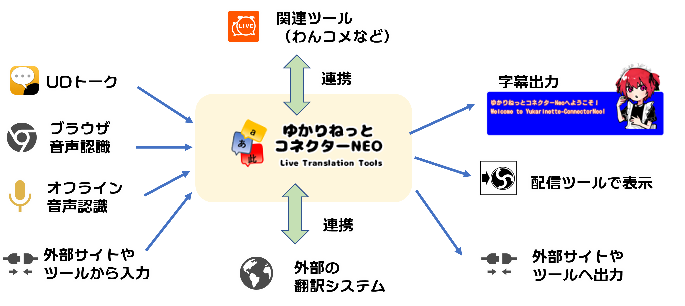
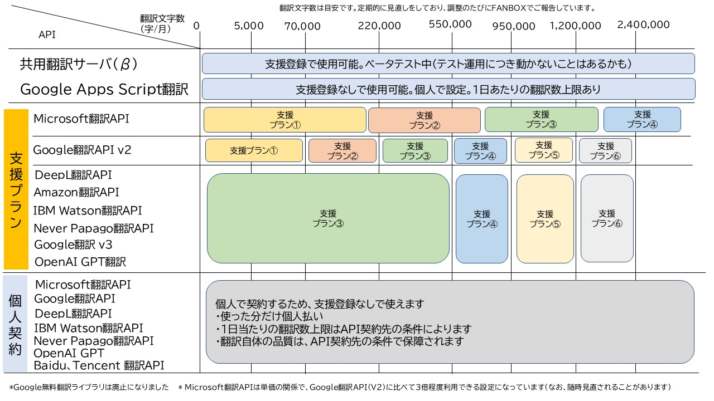

# 何ができるか？

ゆかコネNEOは、話した声を字幕にして、配信や VRChat に出すツールです。翻訳はしてもしなくてもかまいません。
やりたいことから探してください。

## やりたいことから探す

|やりたいこと|できること|ページ|
|:--|:--|:--|
|日本語の字幕だけ出す|翻訳せずに、話した言葉をそのまま配信の字幕にします。はじめての設定で「自分の言葉の字幕だけ出したい（翻訳しない）」を選ぶだけです|[はじめての設定](v3.0/cs/cs_startup.md)|
|聞き間違いを直す（単語登録）|ゲーム名や名前の聞き間違いを、正しい言葉に直します。認識したあとの文を置き換える仕組みです|[辞書](v3.0/plugin/plugin_dictionary.md)|
|歌枠で歌詞を出す|リリックモーションで、歌詞を文字PVのように見せます。歌詞表示支援の再生にも合わせられます|[リリックモーション](v3.0/startup/startup_layout.md#lyric-motion)|
|コラボ配信で相手の字幕も出す|Discord で相手の字幕を受け取る・通話の相手の声を話した人ごとに字幕にする（試験実装）・同じ場所なら UDトークのサーバモードで受け取る|[Discord経由でコラボ](v3.0/cs/cs_colab_discord.md)・[UDトーク経由でコラボ](v3.0/cs/cs_colab_udtalk.md)|
|翻訳字幕を出す|話した言葉と、最大 4 か国語の訳を並べて出します。翻訳エンジンは目的に合わせて選べます|[無料で英語翻訳を出す](v3.0/cs/cs_en.md)|
|VRChat で会話をサポートする|VRChat のチャットボックスに字幕を出し、OSC でアバターやカメラも動かせます|[VRChatのチャットとつなぐ](v3.0/cs/cs_vrchat.md)|
|このパソコンの中だけで動かす|声も文字もネットに出さずに、認識と翻訳をこのパソコンの中で行います。選んだところとだけ通信します|[外部と通信をしたくない場合](v3.0/qa/network.md)|
|読み上げる|字幕を VOICEVOX・A.I.VOICE などの声で読み上げます|[読み上げ](v3.0/plugin/plugin_playvoice.md)|
|配信の見た目を変える|字幕テンプレートを選び、配信画面に合わせて大きさや位置を合わせます|[レイアウト](v3.0/startup/startup_layout.md)|

* 配信・収益化した配信・動画・切り抜きにご自由にお使いください。連絡は要りません。クレジットの表記は任意です（[利用規約](system_info.md)）。
* 上の「設定をさがす」に「単語登録」「歌枠」のような作業の言葉を入れると、合うプラグインやテンプレートを探して開きます（v3.2.3～）。

## 全体の流れ

ゆかコネNEOは、音声認識・翻訳・字幕表示・周辺ツールへの出力をつなぎます。

## 具体的仕様

|項目|可否|補足|
|:--|:---|:---|
|多言語翻訳|〇|母国語＋４か国語まで|
|翻訳エンジン|状況による|●Microsoft翻訳エンジン ●Google翻訳エンジン ●DeepL Free/Pro翻訳エンジン ●Amazon翻訳エンジン ●NAVER Papago翻訳エンジン ●共用翻訳サーバ(m2m100/Algos） ●[Google Apps Script翻訳](v3.0/startup/startup_gas.md) ●Google 翻訳v3 ●Tencentクラウド翻訳 ●Baidu翻訳 ●Alibaba翻訳 ●OpenAI翻訳 ●Gemini翻訳 ●Claude翻訳 ●Grok翻訳 ●PLaMo翻訳 ●みらい翻訳 ●みんなの自動翻訳＠TexTra ●Open Router(LM Studio)翻訳 ●オフラインブラウザ翻訳 ●オフライン翻訳（無料） ●PLaMo 3 翻訳（オフライン）|
|音声認識|〇| ●[UDトーク](https://udtalk.jp/)（Shamrock Records,Inc製） ●ブラウザ音声認識 ●ブラウザ音声認識(ガムベックさん開発) ●オフライン音声認識(Whisper,Kotoba-v2,VOSK) ●[Whisper音声認識](https://github.com/tyapa0/YukariWhisper)（tyapa0さん開発） ●[ゆーかねすぴれこ](https://harukei66494739.github.io/recognize/) (Haru_Keiさん開発)） ●[Parapper](https://github.com/Parakeet-Inc/Parapper-ASR/) (Parakeet株式会社製)|
|ゆかりねっと連携|〇|●ゆかりねっとプラグイン併用モード ●ブラウザエミュレート|
|OBS連携|〇| OBS Studio用 WebSocket v4/v5対応|
|読み上げ|〇|プラグインを使えば可能 ●[A.I.Voice](https://aivoice.jp/) ●[CeVIO](https://cevio.jp/)/[CeVIO AI](https://cevio.jp/products_cevio_ai/) ●[AITalk3](https://www.ai-j.jp/consumer/kantan3/) ●[VOICEVOX](https://voicevox.hiroshiba.jp/) ●[COEIROINK on VOICEVOX](https://coeiroink.com/) ●[LMROID](https://lmroidsoftware.wixsite.com/nhoshio) ●[SHAREVOIX](https://www.sharevox.app/) ●SAPI5 ●[VOICEROID2](https://www.ah-soft.net/shopbrand/ct92/)   ●[VOICEPEAK](https://www.ah-soft.com/voice/6nare/)(v1.1b2～) ●[ITVOICE](https://booth.pm/ja/items/4374126) ●[AivisSpeech](https://aivis-project.com/)(v2.2.0～) ●[Voisona Talk](https://voisona.com/talk/)(v2.3.0～) ●ブラウザで発話可能なWeb読み上げ音声|
|表示形式|〇|●多言語 ●VRオーバーレイ ●リスト ●ゲーム風 ●コラボレイアウト ●わんコメテンプレ|
|辞書・ルビ|〇|プラグインで実現|
|FANBOX支援|〇|支援しなくても利用はできます。 支援するとみんなで支える企業版翻訳サーバがつかえるようになります|
|ツール連携|〇|●[わんコメ](https://onecomme.com/)(アスティさん) ●[ゆかりねっと](http://www.okayulu.moe/)(おかゆぅさん) ●[OBS Studio](https://obsproject.com/ja/download) ●[HTML5コメントジェネレータ](https://seesaawiki.jp/fcg/)(kilinさん) ●[HTML5コメントジェネレータ改](http://twinstraycat.kagome-kagome.com/commegene/commentgenerator_kai)(彼岸扇花さん) ●[MTGA自動解説ツール](https://github.com/poslogithub/binary-dist/tree/main/mtga-commentary-automation)(ぽsさん) ●[バーチャルモーションキャプチャー](https://vmc.info/)(あきらさん) ●[棒読みちゃん](https://chi.usamimi.info/Program/Application/BouyomiChan/)(みちあきさん) ●[AssistantSeika](https://hgotoh.jp/wiki/doku.php/documents/voiceroid/assistantseika/assistantseika-001a)(ゆかコネNEOv2.0.112より対応) ●[Softalk](https://www.vector.co.jp/soft/winnt/art/se412443.html)(CNCCさん) ●[VaNiiシリーズ](https://sabowl.sakura.ne.jp/gpsnmeajp/)(gpsnmeajpさん) ●[VTube Studio](https://denchisoft.com/)(DenchiSoftさん) ●[VRChat](https://hello.vrchat.com/) ●[VirtualCast](https://virtualcast.jp/) ●[cluster](https://cluster.mu/) ●[Twitch](https://www.twitch.tv/) ※上記は一例。他にもプラグイン等で実現例あり|

## 翻訳の種類について

* 支援については、 [こちら](v3.0/support/support_summary.md)をご覧ください。
