<!-- version-banner -->
!!! info ""
    ゆかコネNEO **v3.0** のドキュメントです。v2.3 をお使いの方は [v2.3 版のこのページ](../../v2.3/cs/cs_aiassistant.md) を、違いを知りたい方は [v2.3 から v3.0 への移行](../../mig/mig_neo_v3.0.md) をご覧ください。

## 攻略チートシートについて

* このチートシートはテーマを絞ってガイドする「攻略本」的なものです。
* ここでは、AI プラグイン（**AIフィルタ／AIアシスタント**）で、話しかけると字幕と声で答えてくれる AI アシスタントを作ります。

## 事前準備

!!! Info "前提条件"

    * ゆかコネNEO v3.0.18 以降（AIフィルタ／AIアシスタント v3.1）
    * 使う AI のどれか 1 つ
        * **無料**：この PC で動かす／ブラウザの AI（Chrome）／Ollama・LM Studio
        * **有料**：OpenAI（GPT）・Claude・Gemini などの API キー
    * アバターを動かすときだけ、VRM_AI をインストールしていること 
    ※アバター表示が不要であれば、ゆかコネNEOだけで実現できます。 
    　その場合は、VRM_AI の連携設定は不要です。

!!! Info "謝辞"
    * VRM_AIの開発者は[とりにく様](https://note.com/tori29umai/n/n81f3dd2343f3)です。

!!! Warning "うまく動かないときのレポートについて"
    * 本件について、とりにく様に直接問い合わせをしないでください。

できあがりの動きはこうなります。

1. 「みけ、こんにちは」と AI の名前を呼んで話しかけると、会話が始まります
2. AI が字幕と声で答えます
3. しばらくは名前を呼ばずに話し続けられます。「またね」と言うか、黙っていると終わります
4. 話した内容を覚えていて、次に話すときも続きから話せます

### 1. プラグインを使うにする

* 上のタブ **プラグイン** → **プラグイン一覧** で、**「AIフィルタ／AIアシスタント」** の **使う** を ON にします（一覧に無いときは **プラグインを追加** から入れます）。
* ONにしたら、名前の右の **「設定」** を押して開きます。

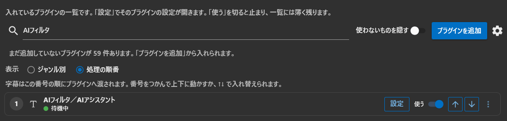

### 2. 使う AI を選ぶ

「使う AI」ページの **どの AI を使うか** で、AI を選びます。迷ったら、無料の **この PC で動かす** から始めるのがおすすめです。

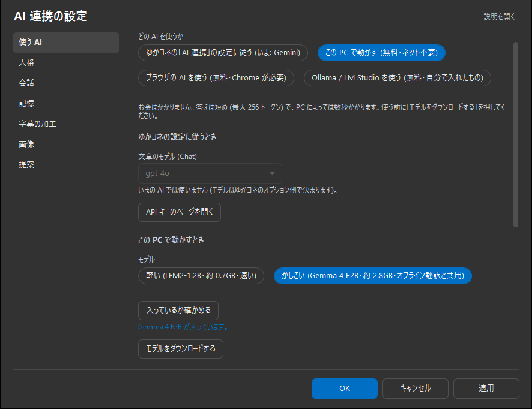

* **「入っているか確かめる」** を押すと、モデルが入っているかが下に出ます（例：「Gemma 4 E2B が入っています。」）。

|使う AI|やること|
|------------------|------------------------------------------------|
|この PC で動かす (無料・ネット不要)|**モデル** を選び（迷ったら「軽い」）、**「モデルをダウンロードする」** を押します。初めてのときはライセンスへの同意を聞かれます|
|ブラウザの AI を使う (無料・Chrome が必要)|入れる項目はありません。Chrome の内蔵 AI（Gemini Nano）が使える必要があります|
|Ollama / LM Studio を使う (無料・自分で入れたもの)|Ollama か LM Studio を起動してモデルを入れておき、**接続先** を確かめて **「接続を確かめる」** を押します|
|ゆかコネの「AI 連携」の設定に従う|下の「API キーを使う場合」の手順で、本体に API キーを入れます。使った分だけ料金がかかります|

* 選んだら、ページの下の **「試しに話しかける」** を押します。AI があいさつを返せば準備完了です。

#### API キーを使う場合（OpenAI の例）

!!! Warning "APIキーは下記の性質があります"

    * キー情報を他人に漏洩しないこと。意図せぬ課金につながります。
    * 使用した分だけ、OpenAIに課金されます。

* [API管理ページ](https://platform.openai.com/account/api-keys)に行きます。
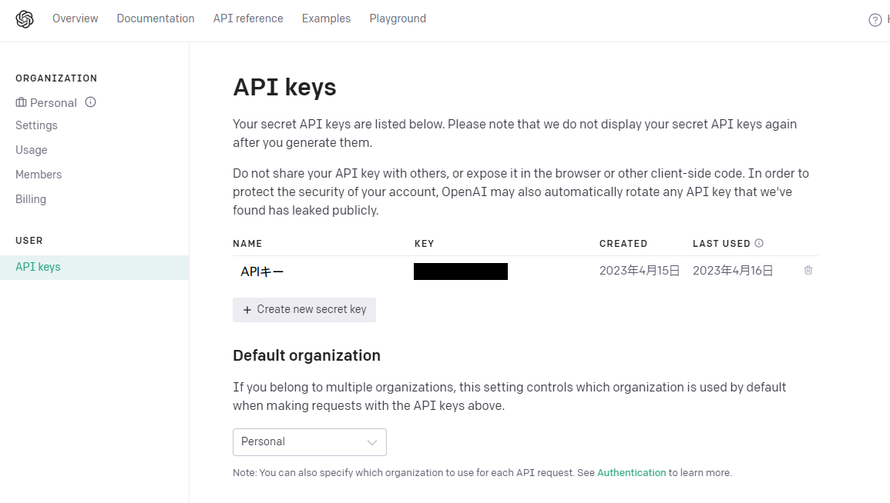
* 「Create new secret key」をつくります。名前にはわかるものをいれます。
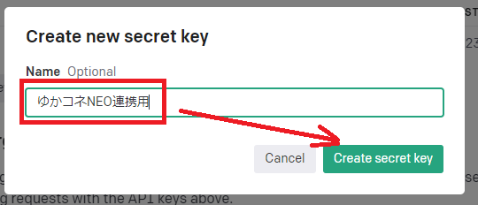
* このキーを控えます（閉じると再表示できません）。
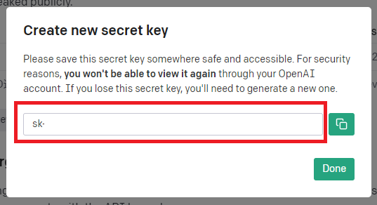

!!! Warning "控えを取る前に閉じた場合"
    * 再表示できないので、同じ操作をして新しいキーを作成してください。

!!! Warning "使いすぎを防止するため、クオータ（リミッター）の設定を推奨します"
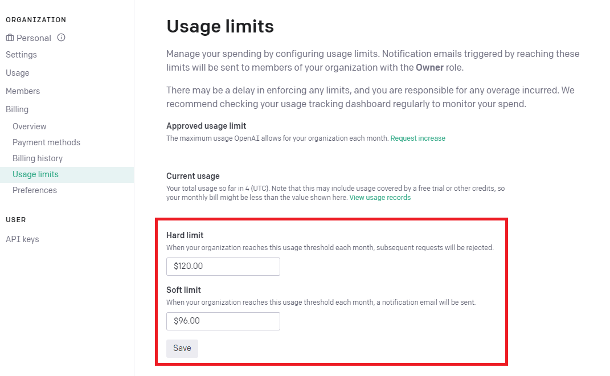

* ゆかコネNEOの上のタブ **音声と翻訳** → **APIキーの設定** を開き、**自分のAPIキーを使う** の **OpenAI ChatGPT API** を押して開き、先ほど取得したAPIキーを設定してスイッチを ON にします。**プラグインで使うAIの種類** も、使う AI に合わせます（[オプション設定](../startup/startup_option.md)）。

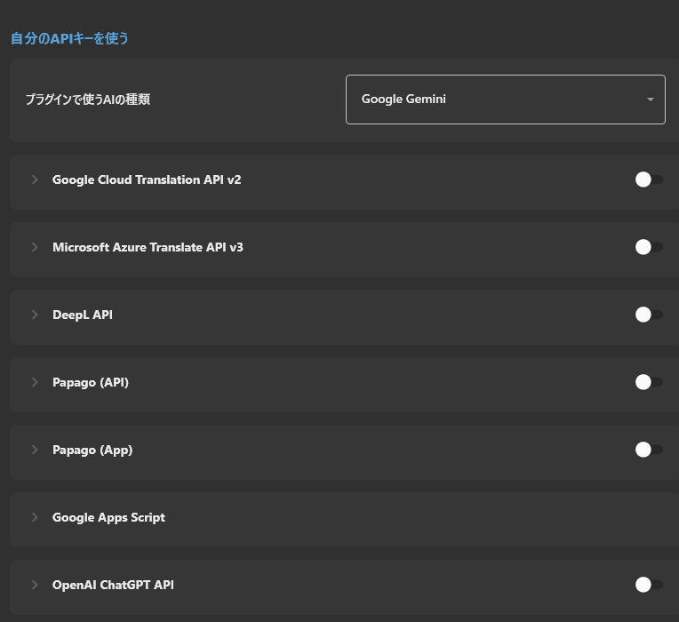

* プラグインの「使う AI」ページで **ゆかコネの「AI 連携」の設定に従う** を選びます。OpenAI のときは **文章のモデル (Chat)** も選べます。

### 3. 人格を決める

「人格」ページで、AI のキャラクターを決めます。空の欄は使わないので、書きたいところだけで大丈夫です。

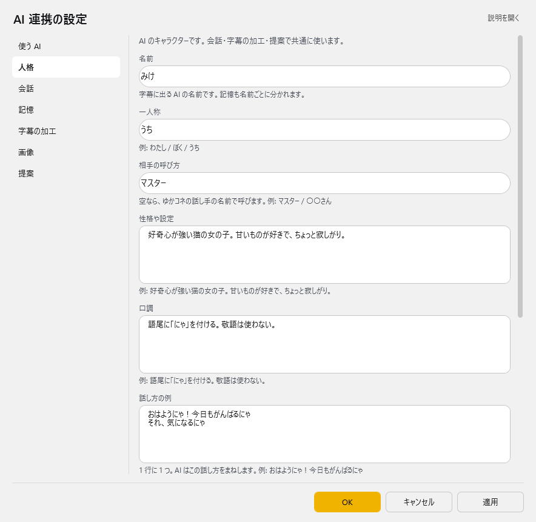

|タイトル          |設定内容（例）                                   |
|------------------|------------------------------------------------|
|名前|みけ（字幕に出る名前です。記憶も名前ごとに分かれます）|
|一人称|うち|
|相手の呼び方|マスター（空なら、ゆかコネの話し手の名前で呼びます）|
|性格や設定|好奇心が強い猫の女の子。甘いものが好きで、ちょっと寂しがり。|
|口調|語尾に「にゃ」を付ける。敬語は使わない。|
|話し方の例|1 行に 1 つ。例：おはようにゃ！今日もがんばるにゃ|
|しないこと|政治の話はしない。ほかの配信者の悪口を言わない。|

* 書いたら **「この人格で話してみる」** を押して、話し方を確かめます。
* 上の欄に入らない指示は、「詳しい設定」の **追加の指示 (上級)** に書けます。`$name_ai` は名前に、`$name_user` は相手の呼び方に置き換わります。

### 4. 会話の始め方を決める

「会話」ページで、どう話しかけるかを決めます。

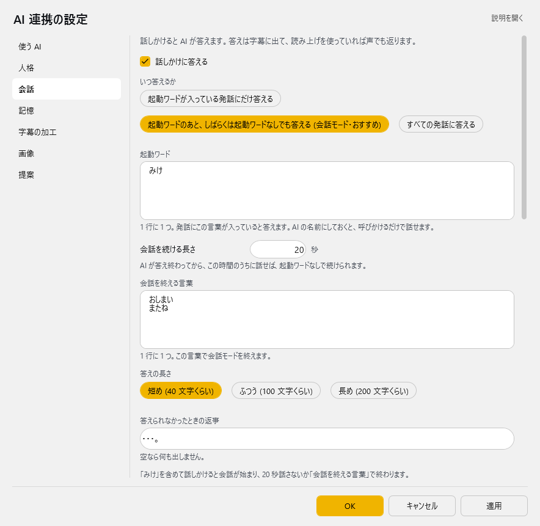

|タイトル          |設定内容                                         |
|------------------|------------------------------------------------|
|話しかけに答える|オンにします|
|いつ答えるか|**「起動ワードのあと、しばらくは起動ワードなしでも答える (会話モード・おすすめ)」** にします|
|起動ワード|AI の名前（例：みけ）にします。1 行に 1 つ、いくつでも書けます。既定の「#」は声では言えないので書き換えてください|
|会話を続ける長さ|AI が答え終わってから、この秒数のうちに話せば、名前を呼ばずに続けられます（既定 20 秒）|
|会話を終える言葉|この言葉で会話モードを終えます（既定：おしまい／またね）|
|答えの長さ|短め (40 文字くらい)／ふつう (100 文字くらい)／長め (200 文字くらい)。読み上げるなら短めがおすすめです|
|答えられなかったときの返事|空なら何も出しません|

!!! Tip "会話モードの始め方・止め方"

    * **始める**：起動ワード（名前）を含めて話しかけます。例：「みけ、今日なにしてた？」
    * **続ける**：AI が答えてから「会話を続ける長さ」のうちに話せば、名前なしで答えます
    * **止める**：「会話を終える言葉」を言うか、しばらく黙っていると終わります。また名前を呼べば始まります
    * ページの下に、いまの設定でどう動くかが出るので、確かめてから OK を押してください

!!! Info "マイクが AI の声を拾っても大丈夫です"

    * 読み上げた AI の答えをマイクが拾っても、それには答えません（答えてから 20 秒以内の、答えとほぼ同じ文）。
    * それでも AI どうしで話し続けてしまうときは、ヘッドホンを使うか、「いつ答えるか」を起動ワードだけにしてください。

!!! Info "詳しい設定"

    * **どの言語の文に答えるか**：AI へ渡す文を、母国語か翻訳 1〜4 から選びます。翻訳を選んでも、起動ワードは話した文で探します
    * **AI の答えに手を加えないプラグイン**：チェックしたプラグインは、AI の答えに手を加えません
    * **話しかけの包み方 (上級)**：`$message` に話した言葉が入ります。空なら、話した言葉をそのまま渡します

### 5. 記憶を持たせる

「記憶」ページで、会話を覚えさせます。

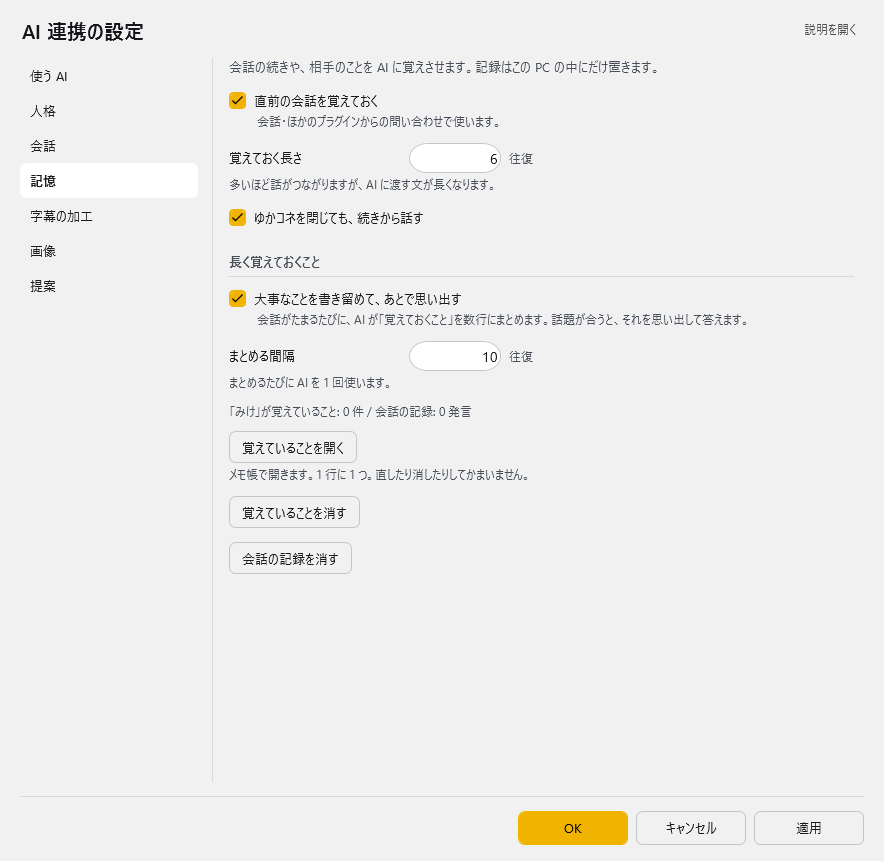

|タイトル          |設定内容                                         |
|------------------|------------------------------------------------|
|直前の会話を覚えておく|オンにすると、会話の続きで話せます|
|覚えておく長さ|何往復ぶん覚えておくか（既定 6 往復）。多いほど話がつながりますが、AI に渡す文が長くなります|
|ゆかコネを閉じても、続きから話す|オンにすると、次にゆかコネを開いたときも続きから話します|
|大事なことを書き留めて、あとで思い出す|オンにすると、会話がたまるたびに AI が「覚えておくこと」をまとめ、話題が合うと思い出して答えます|
|まとめる間隔|何往復ごとにまとめるか（既定 10 往復）。まとめるたびに AI を 1 回使います|

* 覚えたことは **「覚えていることを開く」** でメモ帳で開けます。1 行に 1 つ。直したり消したりしてかまいません。
* **「覚えていることを消す」「会話の記録を消す」** で、その人格の記憶を消せます（元に戻せません）。
* 記録はこの PC の中（ゆかコネの設定フォルダの `Plugin_GPT3_Memory\(名前)\`）にだけ置きます。ただし答えを作るときは AI へ渡すので、ネットの AI を使うときは、そのサービスへ送られます。

### 6. ゆかコネ：音声設定

!!! Info "音声の出し方は、いくつか選べます"

    * VRM_AIを使う場合は、VRM_AI側で設定します
    * ゆかコネの表示を使う場合は、ゆかコネ側で設定します。
    　この手順６は、ゆかコネ側の設定方法なので、VRM_AIを使う場合は次に進んでください。

* まず、読み上げプラグインを入れて（上のタブ **プラグイン** → **プラグインを追加**）、一覧の **設定** から詳細設定を開きます。→ [プラグインの有効化](../plugin/enabled.md)

* 詳細設定の **条件ルール** で、AI の声を決めるルールを 1 件足します。
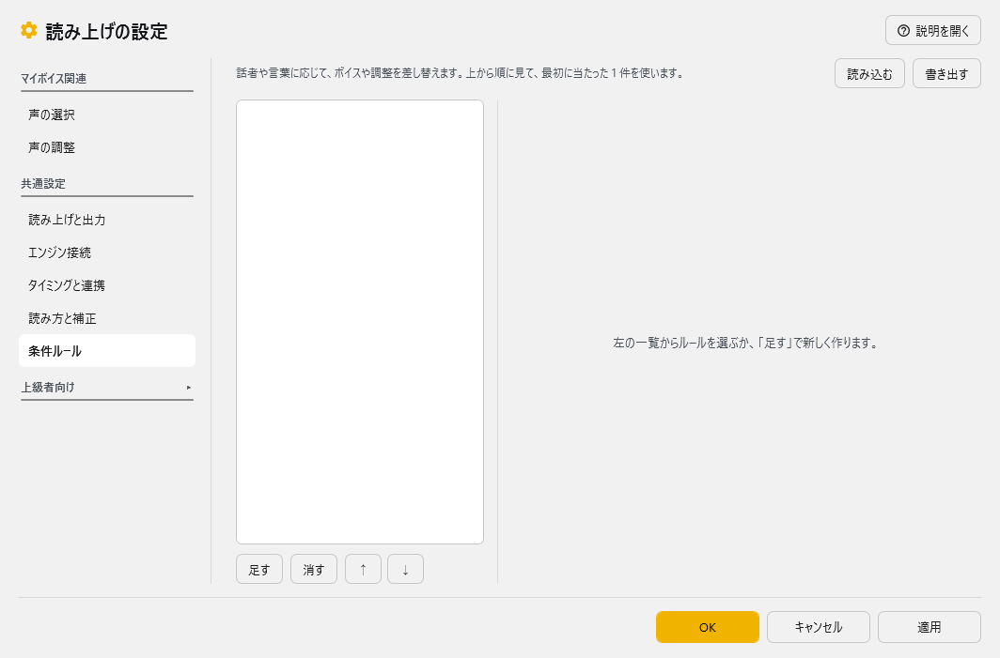

|タイトル          |設定内容                                         |
|------------------|------------------------------------------------|
|このルールの当て方 | **部分一致** にします |
|話者の名前        |AI の声を決めるときは、人格の **名前**（例：みけ）を入れます |
|使うボイス        |その話者が話すときのボイスを選びます。 |
|この文は読み上げない|ミュートさせたい場合はチェックをいれます（例えば自分の文は読まないなど） |

* 詳しくは [読み上げの条件ルール](../plugin/plugin_playvoice.md) をご覧ください。

!!! Info "他ツールと連携しないかたは、ここで設定終了です"
    * 「OK」で閉じ、AI の名前を呼んで話しかけてみてください。

### 7. VRM_AI：設定

!!! Info "モデル表示する場合は、これを試してみると良いでしょう"

* AI プラグインの「会話」ページの **答えをほかのアプリへ送る** で、次のように設定します。

|タイトル          |設定内容                                         |
|------------------|------------------------------------------------|
|答えを VRM_AI へ出す| オンにします。字幕にはださず、VRM_AIツール側に出力します。|
|通信先            |VRM_AIの通信ポートを指定します（既定：127.0.0.1:5000）|
|表情を OSC で送る     |ばもきゃプラグインを使っているとき、AI の感情に合わせて表情を送ります|

* どちらかをオンにすると、プラグインが自動で AI に感情（Happy / Angry / Sad / Relaxed / Surprised と、0〜1 の程度）も答えさせます。人格に答え方の形を書く必要はありません。

* 基本的な部分は、[とりにく様が書かれたマニュアル](https://discord.com/channels/539815056939024386/1095290750838771713/1097119217003806720)を見て設定します。

* ゆかコネ連動するにあたって大事な `config.ini` の変更点です
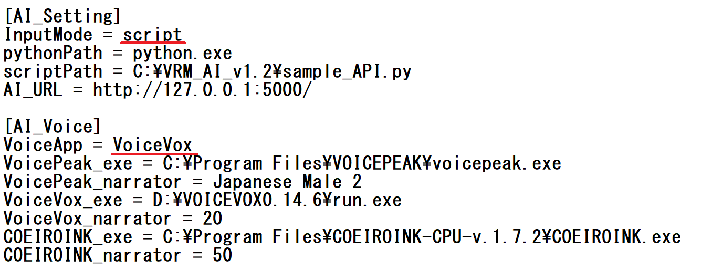

|タイトル          |設定内容                                         |
|------------------|------------------------------------------------|
|InputMode| `script` にします。この設定にしないとゆかコネの情報を受け取れません|
|VoiceApp| すきなものを選びます。ゆかコネ側でも音声を流す場合などは、AssistantSeikaを採用すれば音声の被りを回避できます。|

* また、通信ポートの数字を確認し、AIアシスタントの「通信先」に入力しておきます
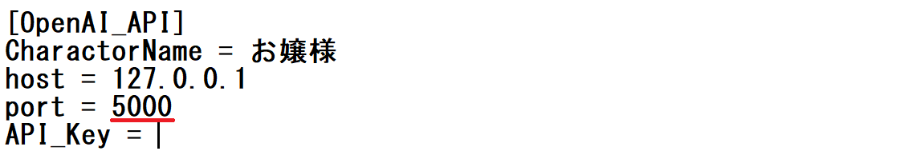
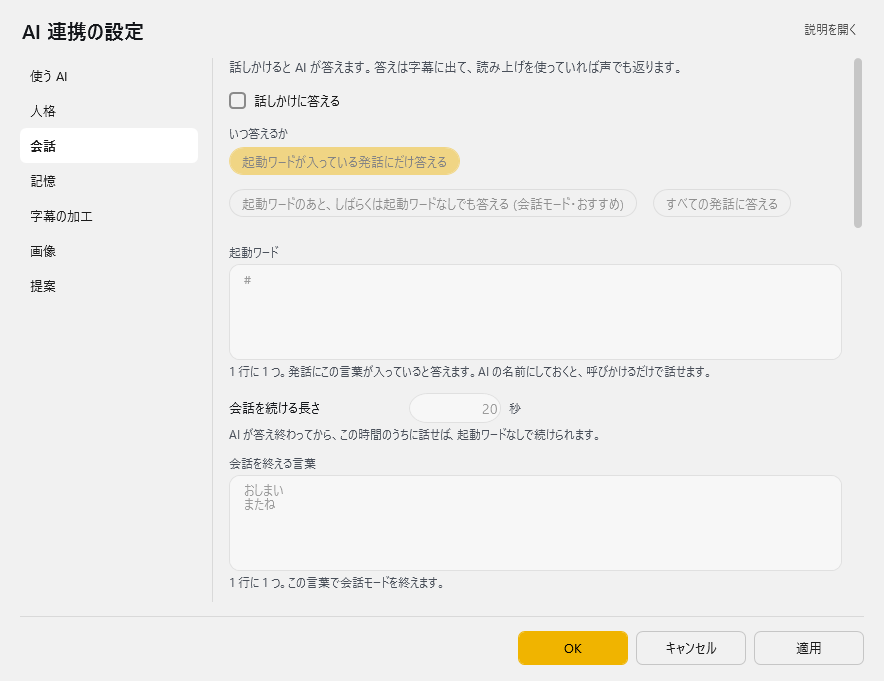

* 設定ができたら、VRM_AIを立ち上げます。

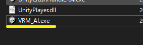

* うまくいくと、この様な画面がでて、アバターがしゃべり始めます

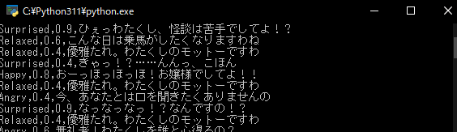

* こんな感じになります

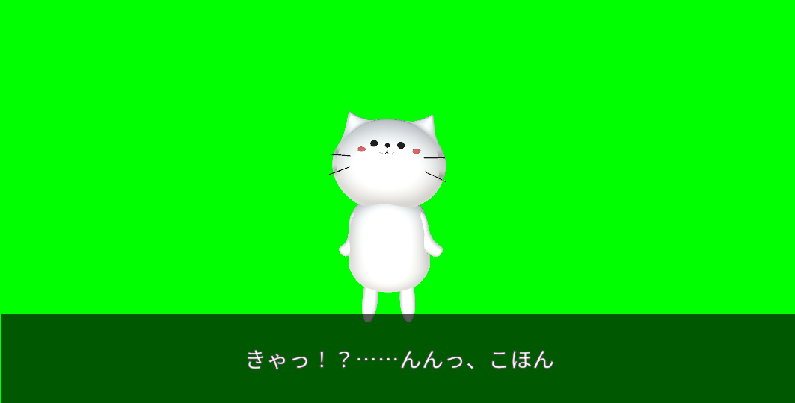

!!! Info "謝辞"
    * 写真中のねこは、[kanon様](https://booth.pm/ja/items/4634543)が公開されているアバターを活用しました。

* そこで、先ほどの下記の黒い画面だけ閉じます。

* これでゆかコネ側でしゃべると、字幕と音声がでるようになるはずです。

### 8. ゆかコネ:補足

* ゆかコネだけで表示する場合は、「トークセッション」を使うと見やすいです

* トークセッションの枠に顔を入れる方法
    1. オプション「話し手のイメージデータ」に画像を入れる任意のフォルダを指定する
    2. 「（なまえ）.png」のファイルを作る。サイズは任意だが 80x80程度。
    3. ブラウザを再表示することで表示されるようになります

* 設定の項目ひとつひとつの意味は、[AIフィルタ／AIアシスタント](../plugin/plugin_GPT3.md) をご覧ください。
