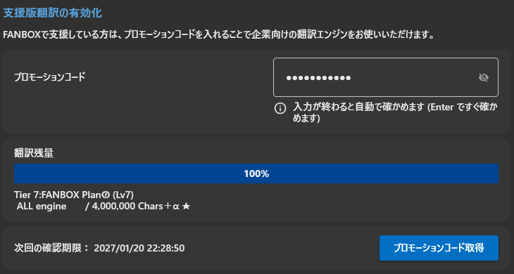
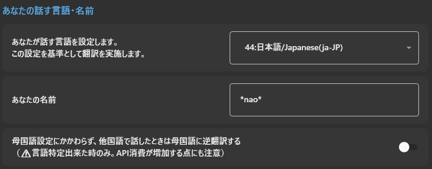
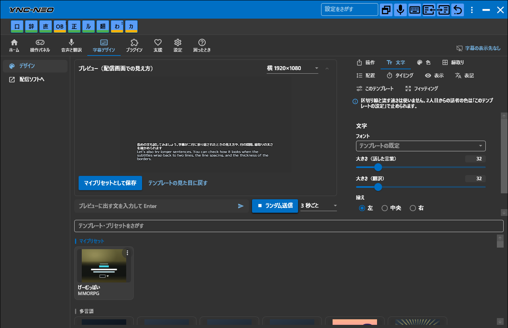
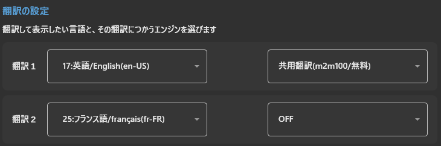
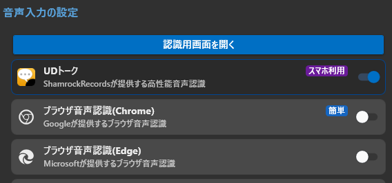
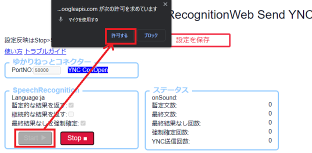

<!-- version-banner -->
!!! info ""
    ゆかコネNEO **v3.0** のドキュメントです。v2.3 をお使いの方は [v2.3 版のこのページ](../../v2.3/cs/cs_en_sp.md) を、違いを知りたい方は [v2.3 から v3.0 への移行](../../mig/mig_neo_v3.0.md) をご覧ください。

## 攻略チートシートについて

* このチートシートはテーマを絞ってガイドする「攻略本」的なものです。

## 最速で英語翻訳をする(支援あり)

!!! Info "前提条件"
    *話者は日本語
    *英語に翻訳して表示
    *FANBOXで支援をしている

## 1.支援状態の確認

* [支援手続き](../support/support_howto.md)に従い、支援の登録と有効かをしてください。
* 設定が正しく終わると、翻訳残数が表示されます。

## 2.母国語の設定

* 上のタブ **音声と翻訳** → **話す言語と名前** で、あなたが話す言語を設定します。写真の例では 日本語 になっています。

## 3.字幕を出すデザインを決めます

* 上のタブ **字幕デザイン** → **デザイン** の下の一覧から、テンプレートのタイルを押して選びます。どれを選んでも字幕は出せます。一般的によく使われるのは「多言語」の分類です。
* ブラウザで確かめたいときや配信ソフトに取り込みたいときは、左の **配信ソフトへ** を開き、**ブラウザで開く** を押すか、**OBSへ** をOBSの配信画面にドラッグ＆ドロップします。一覧のタイルをそのままOBSへドラッグしてもかまいません。

## 4.言語を決める

上のタブ **音声と翻訳** → **翻訳する言語** で、下記のように設定します。

|設定項目    |設定値                 |
|:----------|:----------------------|
|翻訳 1（言語）|17:英語/English(en-US) |
|翻訳 1（エンジン）|Microsoft翻訳エンジンなど、支援版で使えるエンジン |

!!! Tips "エンジンの種類について"
    *支援①、支援②ではGoogle翻訳エンジン、Microsoft翻訳エンジンが使えます。
    *支援③以上では、DeepL Pro翻訳エンジンや、Papago翻訳などが使えます。
    *一部、個人向けのものは支援では提供していません（GASなど）

## 5.音声認識を設定する

今回は簡単設定なので、上のタブ **音声と翻訳** → **音声の入れ方** で **ブラウザ音声認識(Chrome)** を ON にします。

## 6.音声認識を起動する

同じ画面のいちばん上の **認識用画面を開く** を押して音声認識を起動します。

音声認識画面がでたら、スタートボタンをおします。マイクの許可を求める画面がでたら「許可する」をおして、音声認識できるようにします。

!!! Info "音声認識がうまくいかない場合"
    話したときに、onSoundという行に「＠」が表示されない場合は、音声がうまく入っていないので、マイクの設定を見直してください。

これで字幕が表示されました。お疲れさまでした。
