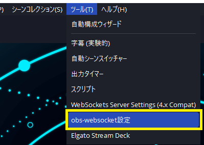
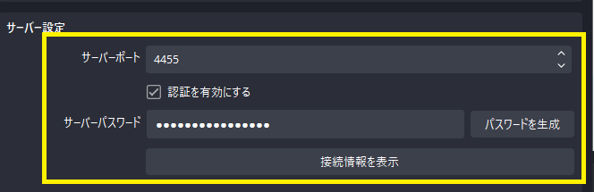
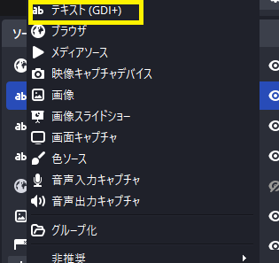
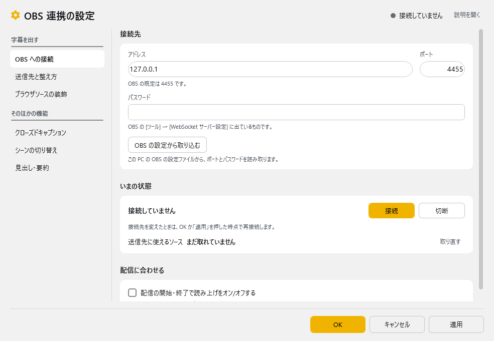
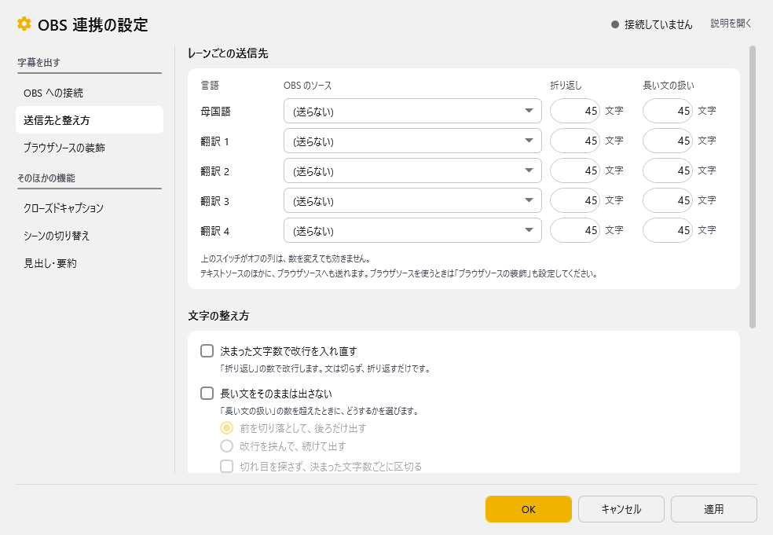
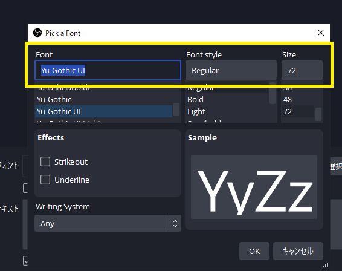

<!-- version-banner -->
!!! info ""
    ゆかコネNEO **v3.0** のドキュメントです。v2.3 をお使いの方は [v2.3 版のこのページ](../../v2.3/cs/cs_obs.md) を、違いを知りたい方は [v2.3 から v3.0 への移行](../../mig/mig_neo_v3.0.md) をご覧ください。

## 攻略チートシートについて

* このチートシートはテーマを絞ってガイドする「攻略本」的なものです。

## OBS Studioで字幕をきれいに出す
!!! Info "前提条件"
    * 配信にOBS Studioを使用している
    * OBS Studio のバージョンは v28以上
    * OBS WebSocket プラグインは Version 5
    * 音声認識で字幕が出るところまではセットアップ完了済

## 1.OBS StudioのWebSocket設定を有効にする

!!! Info "OBS Websocket5はOBS標準装備になりました"
    * 個別にインストールする必要はありません。

* OBSのツールメニューから、WebSocketのメニューを開きます。

* OBS WebSocketを有効にしてください。
* パスワードも必要に応じて設定します。（設定値は後ほど必要なので覚えておいて下さい）

## 2.字幕を出すためのテキストソースを作る

* OBS Studioのソース画面で字幕を表示させるためのテキストソースを作ります。
* 言語ごとに作る必要があるので、２言語出したい場合は、２つ作ります。
* ここで作ったソース名は後で必要になるので覚えておきましょう。

!!! Tip "落とし穴に注意"
    * ソースをグループ化するとうまく転送できないことがあるので、グループ化しないようにしましょう。

## 3.ゆかコネNEOのプラグインを有効にする

* 上のタブ **プラグイン** → **プラグインを追加** で下の表のプラグインを選んで **追加する** を押します（一覧の **使う** が ON になります）。→ [プラグインの有効化](../plugin/enabled.md)
* 有効にすべきプラグインは、OBSのバージョンによって異なります。

|OBS Studioのバージョン|有効にすべきプラグイン|
|:--------------------|:-------------------|
|v28 ～               | OBS連携 WSv5         |

## 4.接続の設定をする

プラグイン一覧の **OBS連携 WSv5** の **設定** を押し、**OBS への接続** のページを開きます。

|設定|意味|
|:--|:---|
|アドレス / ポート|字幕を送付したいOBSを指定します。 ※ポート番号はOBSの「ツール」→「WebSocket サーバー設定」で確認してください（既定は ``4455``）|
|パスワード|OBS 側でパスワードを設定していれば入れます|
|OBS の設定から取り込む|この PC の OBS の設定ファイルから、ポートとパスワードを読み取ります|
|いまの状態|**接続** / **切断** で OBS とつなぎます|

!!! Top "OBS側の設定"
    

    * ポート番号やパスワードなどはOBS側の設定とNEOの設定を一致させてください。
    * 設定値は自分で決めて一致させる形で構いません。

* 通信先は、通常 ``127.0.0.1`` もしくは ``localhost``でOKです。
* 通信ポートは 通常は ``4455`` です。
* パスワードを設定した場合はここに入力します。(パスワードはOBS Websocket側に入力したものと合わせます)

設定が終わったら、**いまの状態** の **接続** を押して、状態が「接続しました」に変わることを確認します。

!!! Warning "接続されましたにならない場合"
    *通信ポートの番号が正しいかOBS側の設定を見て確認しましょう。
    *パスワードの設定が正しいか見直しましょう。

## 5.転送先の設定をする

* **送信先と整え方** のページの **レーンごとの送信先** で、母国語・翻訳 1〜4 ごとに転送先の OBS のソースを選択します。うまく通信できていれば、プルダウンメニューの中にソース名があるので、選択するだけでOKです。

## 6.OBS側の見え方の設定

* フォントの設定をします。縁取りなども、OBS側の設定で実施可能です。

!!! Tips "OBS側の設定について"
    OBS側は設定のやり方がたくさんあるので、ここでは「よりきれいな見せ方」については割愛しています。他のサイトで紹介しているところが多数ありますので、そちらを参考にしてください。
