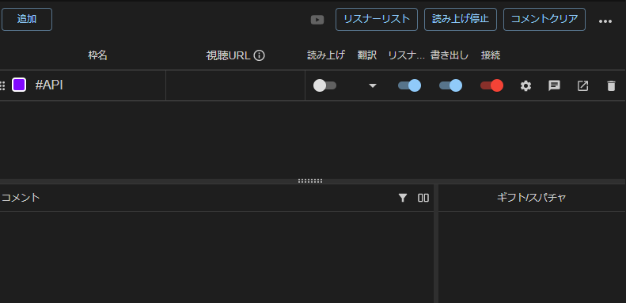
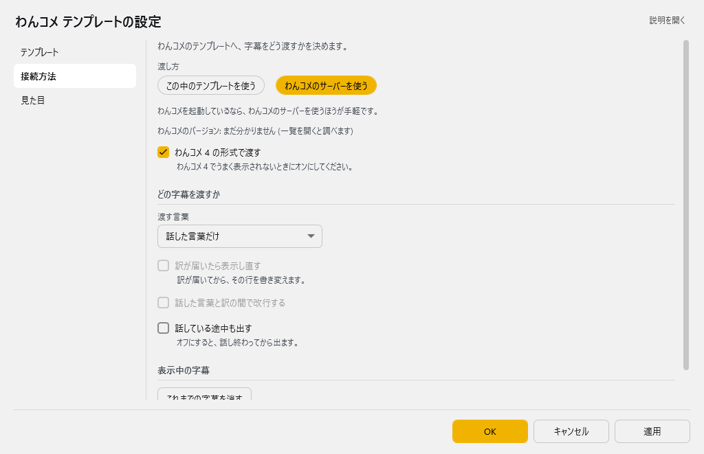
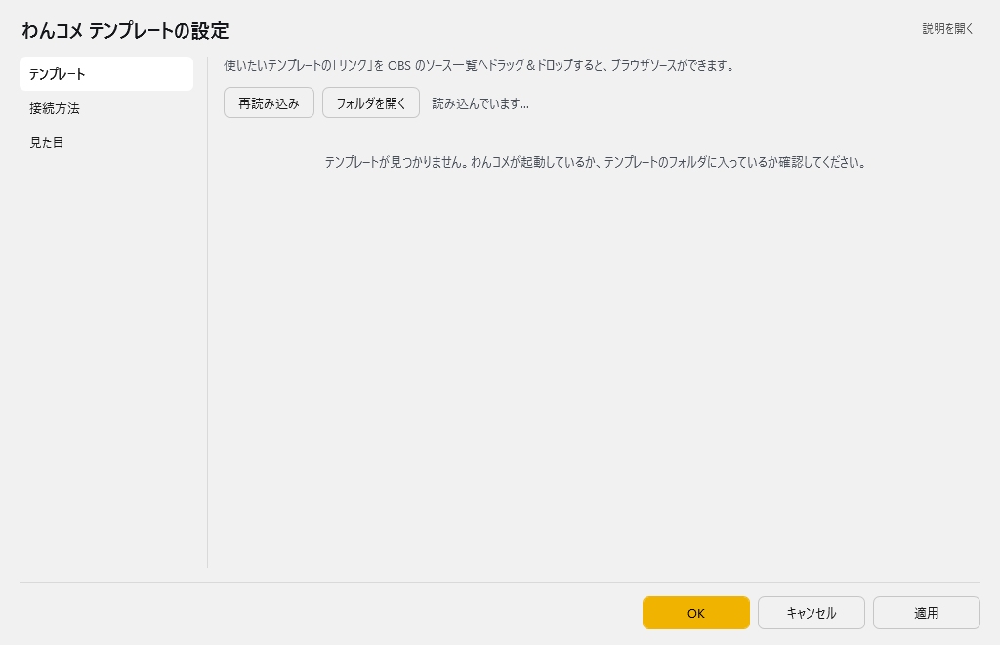
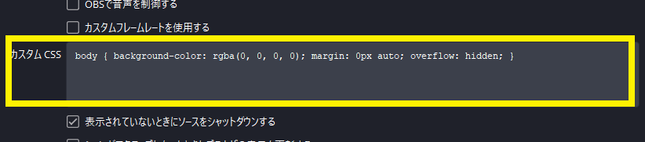

<!-- version-banner -->
!!! info ""
    ゆかコネNEO **v3.0** のドキュメントです。v2.3 をお使いの方は [v2.3 版のこのページ](../../v2.3/cs/cs_onetemplate.md) を、違いを知りたい方は [v2.3 から v3.0 への移行](../../mig/mig_neo_v3.0.md) をご覧ください。

## 攻略チートシートについて

* このチートシートはテーマを絞ってガイドする「攻略本」的なものです。

!!! Info "前提条件"
    * [わんコメ](https://onecomme.com/) v3.2以上を使用していること

!!! Info "謝辞"
    * わんコメ作者[アスティさん](https://twitter.com/AstieDog)に様々なご協力をいただいております

## わんコメのテンプレートを使って字幕をだす

### 1.プラグインの有効化

* 上のタブ **プラグイン** → **プラグインを追加** で **わんコメテンプレ連携** を選んで **追加する** を押します（一覧の **使う** が ON になります）。→ [プラグインの有効化](../plugin/enabled.md)

### 2.わんコメを起動する

### 3.プラグイン設定画面で設定をします

* プラグイン一覧の **設定** を押し、**接続方法** のページで、字幕の渡し方と渡す言葉を決めます。

### 4.テンプレートを読みこみます

* **テンプレート** のページで **再読み込み** を押します。
* わんコメに登録されているテンプレート一覧がでます。

### 5.CSSを定義します

* **見た目** のページの **足す CSS** で、デザインを設定します。

!!! Tip "画面のカスタムができます"
    * 翻訳に改行をいれたり、表示のスタイルを変えたりする場合は、このCSS欄を加工してください

### 6.レイアウトを選びます

* **テンプレート** のページで、使いたいテンプレートのボタンを使います。ブラウザで表示する場合は **↗** を、OBSに取り込む場合は **リンク** と **CSS** をつかいます。

* OBSに取り込む場合は、**リンク** をOBS上にドロップした後、**CSS** を押してコピーし、ブラウザソースの設定画面のカスタムCSS枠に貼ります。
（それにより設定が反映されます）　→ 詳しくは [わんコメテンプレ連携](../plugin/plugin_OCTemplateGen.md)

* これで設定は完了です。