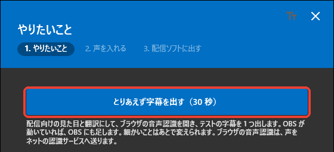
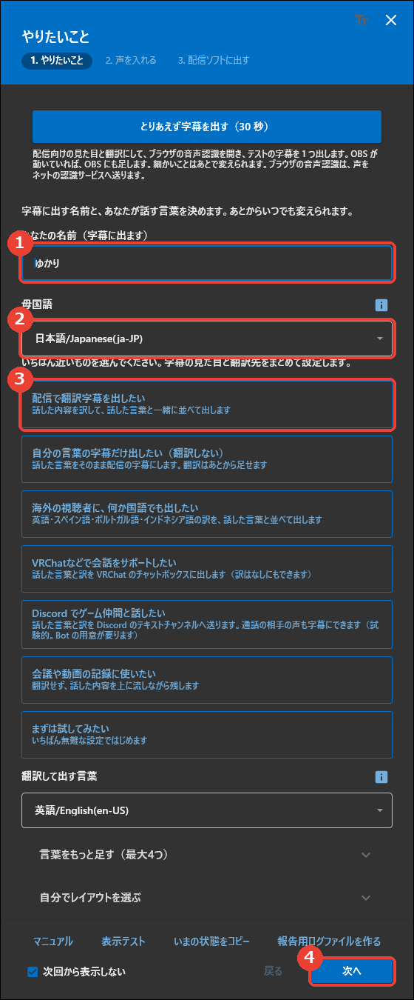
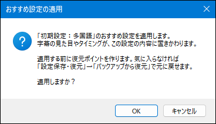
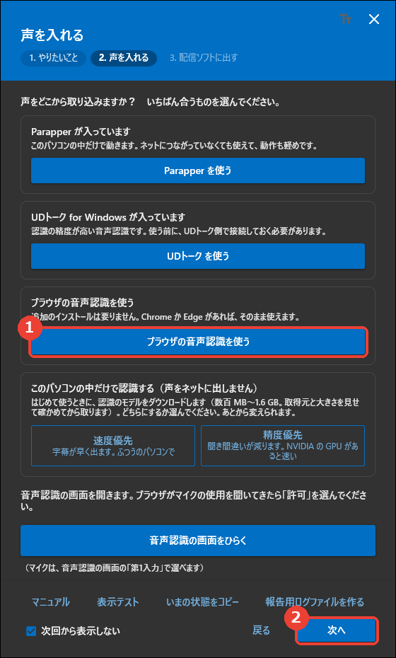
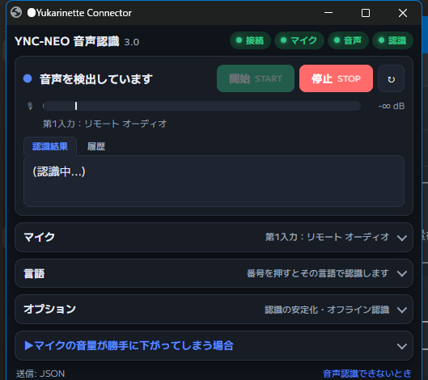
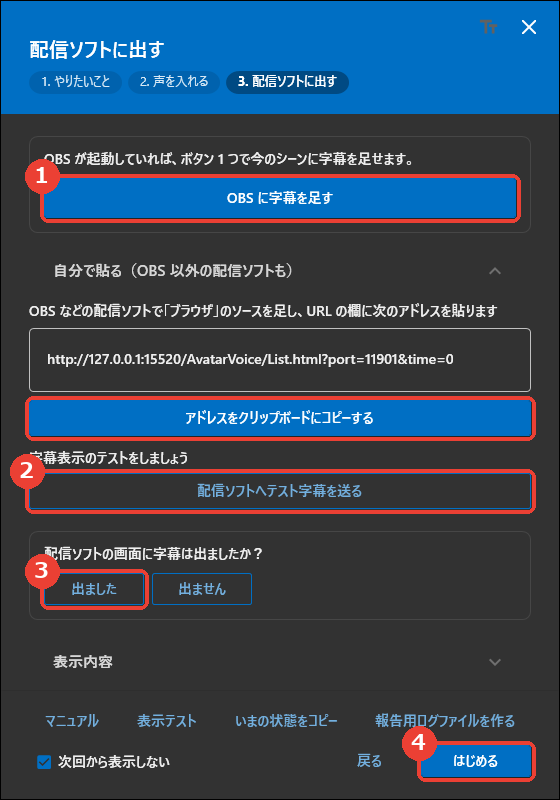
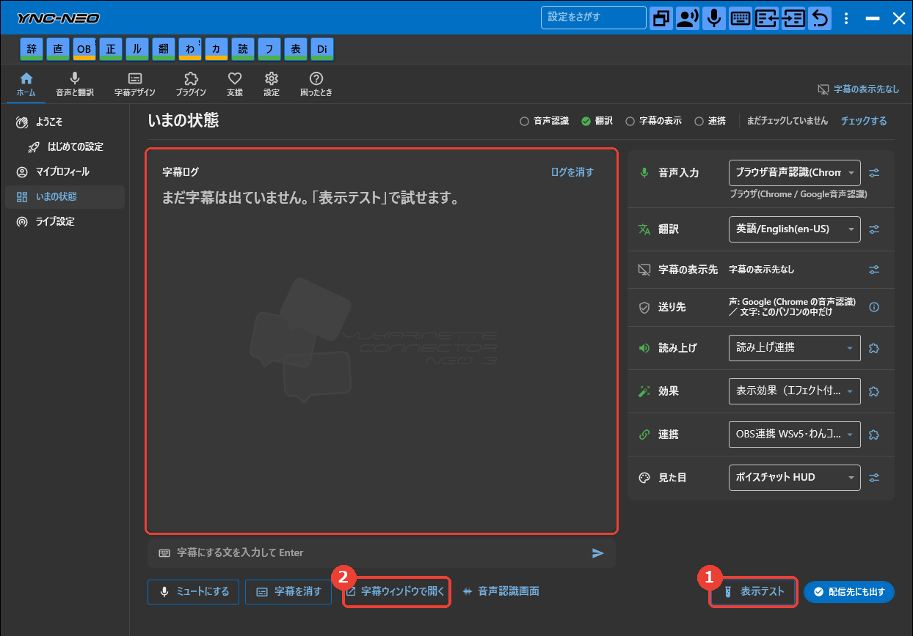

# 5分クイックスタート

<!-- version-banner -->
!!! info ""
    ゆかコネNEO **v3.0** のドキュメントです（画面は v3.2.3 のものです）。v2.3 をお使いの方は [v2.3 版のこのページ](../../v2.3/guide/quickstart.md) を、違いを知りたい方は [v2.3 から v3.0 への移行](../../mig/mig_neo_v3.0.md) をご覧ください。

はじめて使う方が、**話した言葉を字幕に出すところまで**進むためのページです。
画面に出てくるボタンを、上から順に押していけば終わります。細かい設定はあとまわしでかまいません。

## 用意するもの

| | |
|:--|:--|
| パソコン | Windows 10 / 11（グラフィックボードは要りません） |
| マイク | パソコンに付いているものでも大丈夫です |
| ブラウザ | Chrome か Edge（どちらか入っていれば OK） |
| 空き容量 | 1GB くらい |

<!-- TODO(開発者に確認): メモリの目安の実測値。PLaMo 3 翻訳はモデルの大きさの表示で 0.8B=約0.9GB／2B=約3GB。載せるなら「PC の中だけで翻訳するときは、メモリに 1〜3GB の余裕が要ります」のように、使い方の言葉で書く -->

まだ入れていない方は[ダウンロード](../../download.md)からどうぞ。

---

## インストールする

1. ダウンロードした **`YNCNEO_v<版>.zip`** を右クリックして、**すべて展開** を押します。
2. 出てきた **`YNCNEO_v<版>.exe`**（インストーラ）をダブルクリックします。
    * 「Windows によって PC が保護されました」と出たら、**詳細情報** → **実行** を押します（[くわしく](../qa/faq.md)）。
3. 出てくる画面に、次のように答えて進みます。

| 出てくる画面 | すること |
|:--|:--|
| インストールモードの選択 | ふつうは **すべてのユーザー用にインストール** を押します。管理者権限が無いときは **現在のユーザー用にインストール** を押します |
| セットアップに使用する言語の選択 | **日本語** を選んで **OK** |
| 使用許諾契約書の同意 | 読んで **同意する** を選び、**次へ** |
| インストール先の指定 | そのまま **次へ**（既定は `C:\Program Files\YNC_Neo`） |
| コンポーネントの選択 | そのまま **次へ** |
| 追加タスクの選択 | デスクトップにアイコンがほしいときだけチェックを入れて **次へ** |
| セットアップウィザードの完了 | **ゆかりねっとコネクターNEO を実行する** にチェックが入ったまま **完了** |

* 動かすのに要る部品（.NET 10 デスクトップ ランタイム・Visual C++ 再頒布可能パッケージ・WebView2 ランタイム）が PC に無いときは、インストーラが自動で入れます。.NET 10 を入れられなかったときは、インストールが止まります。
* 新しい版への更新も、同じインストーラで行います（更新のときにも使用許諾の画面が出ます）。

---

## 起動する

インストールの最後に、そのまま起動します。
次からは、スタート メニューの **ゆかりねっとコネクターNEO** から起動します。

* 初めて起動すると、**「やりたいこと」** と書かれた青い窓（はじめての設定）が開きます。このページでは、この窓を使って進めます。

!!! tip "窓を閉じてしまったら"
    ゆかコネNEO の上のタブ **ホーム** → 左の **はじめての設定** を押すと、もう一度開きます。

---

## いちばん早い方法：「とりあえず字幕を出す」

とにかく字幕が出るところを見たいときは、窓のいちばん上の **とりあえず字幕を出す（30 秒）** を押してください。

押したあとは、出てきたものに答えるだけです。

1. 「おすすめ設定の適用」と聞かれたら **OK**
2. ブラウザの音声認識の画面が開きます。マイクの使用を聞かれたら **許可**
3. 字幕の窓（OBS が起動していれば OBS）に、テストの字幕が出ます
4. 窓の「配信ソフトの画面に字幕は出ましたか？」で **出ました** → **はじめる**

これで、配信向けの見た目・英語への翻訳・ブラウザの音声認識で動いています。
マイクに向かって話すと、字幕になります。

自分で選びながら進めたいときは、下の 3 つの手順をどうぞ。

---

## 手順 1：やりたいこと

窓の上に **1. やりたいこと／2. 声を入れる／3. 配信ソフトに出す** と並んでいて、いまの手順が濃く出ます。

1. **あなたの名前（字幕に出ます）** に名前を入れます。字幕に話した人の名前として出ます。
2. **母国語** で、あなたが話す言葉を選びます（ふつうは「日本語」のままで OK）。
3. 下に並んでいるカードから、**いちばん近いもの**を 1 つ押します。
    * 「おすすめ設定の適用」と聞かれるので **OK** を押します。
    * 字幕の見た目と、何語に訳すかが、まとめて決まります。
4. 右下の **次へ** を押します。

!!! info "OK を押しても大丈夫です"
    押す前の状態を自動で残しています。気に入らなければ、あとで元に戻せます。

### どのカードを押せばいいか

| こうしたい | 押すカード |
|:--|:--|
| 配信で、話した言葉と訳を並べて出したい | 配信で翻訳字幕を出したい |
| 訳さずに、話した言葉だけ字幕にしたい | 自分の言葉の字幕だけ出したい（翻訳しない） |
| 英語・スペイン語など何か国語でも出したい | 海外の視聴者に、何か国語でも出したい |
| VRChat のチャットボックスに出したい | VRChatなどで会話をサポートしたい |
| Discord のゲーム仲間に送りたい | Discord でゲーム仲間と話したい |
| 会議や動画の内容を記録したい | 会議や動画の記録に使いたい |
| よく分からない | まずは試してみたい |

* 訳す言葉を変えたいときは、カードの下の **翻訳して出す言葉** で選び直します。
* VRChat・Discord のカードを押すと、「ほかのソフトやサービスとつなぎます」と聞かれます。使うなら **はい** を押します。

---

## 手順 2：声を入れる

「声をどこから取り込みますか？」と、使える音声認識が並びます。

1. 迷ったら **ブラウザの音声認識を使う** を押します（何も入れなくても使えます）。
2. ブラウザで、音声認識の画面が開きます。

    

    * ブラウザがマイクの使用を聞いてきたら **許可** を押します。
    * 上の **接続・マイク・音声・認識** が緑になり、「音声を検出しています」と出ていれば聞き取れています。
    * 止まっているときは **開始 START** を押します。
    * 「こんにちは、これはテストです」と話してみてください。**認識結果** に文字が出れば成功です。
3. ゆかコネNEO の窓に戻って、**次へ** を押します。

!!! tip "ほかのカードについて"
    * **Parapper が入っています**／**UDトーク for Windows が入っています** は、そのソフトが入っているパソコンにだけ出ます。
    * **このパソコンの中だけで認識する** は、声をネットに送りたくないときに選びます。初めて使うときに、認識のための部品をダウンロードします（ダウンロードの前に確認が出ます）。
      [外部と通信をしたくない場合](../qa/network.md) も見てください。

!!! warning "「ゆかコネNEO への接続を許可してください」と出たとき"
    音声認識の画面にこう出たら、ブラウザの上のほうに出ている確認で **許可** を押します。
    許可しないと、認識した文字がゆかコネNEO に届きません。→ [くわしく](../startup/startup_asr.md#chrome-local-network)

---

## 手順 3：配信ソフトに出す

配信をしないときは、右下の **はじめる** を押して終わりです。

OBS に字幕を出すときは、次のどちらかで進めます。

=== "OBS を起動している"

    1. **OBS に字幕を足す** を押します。
        * 「ほかのソフトやサービスとつなぎます」と聞かれたら **はい** を押します。
        * OBS のいまのシーンに、字幕のソースが足されます。
    2. **配信ソフトへテスト字幕を送る** を押します。
    3. OBS の画面にテストの字幕が出たら、**出ました** を押します。
    4. **はじめる** を押して終わりです。

    !!! info "「OBS につながりませんでした」と出たとき"
        OBS のメニューの **ツール** → **WebSocket サーバー設定** で、**WebSocket サーバーを有効にする** にチェックを入れてから、もう一度押してください。
        うまくいかないときは、右の「自分で貼る」のやり方でも出せます。

=== "自分で貼る（OBS 以外の配信ソフトも）"

    1. **自分で貼る（OBS 以外の配信ソフトも）** を押して開きます。
    2. **アドレスをクリップボードにコピーする** を押します。
    3. OBS の **ソース** の **＋** → **ブラウザ** を選び、**URL** の欄に貼り付けて **OK** を押します。
    4. ゆかコネNEO に戻り、**配信ソフトへテスト字幕を送る** を押します。
    5. OBS の画面にテストの字幕が出たら、**出ました** → **はじめる** を押して終わりです。

!!! info "文字がすごく小さいとき"
    OBS のブラウザのソースを右クリック → **プロパティ** で、**幅** と **高さ** を小さくしてみてください（たとえば 幅 800／高さ 300）。

!!! note "手順 1 で VRChat・Discord・記録のカードを選んだとき"
    手順 3 の名前が **VRChat に出す**／**Discord に送る**／**字幕を残す** に変わります。
    どれも、画面の説明に沿って **テスト字幕を送る** → 出たら **出ました** → **はじめる** の順です。

---

## 字幕が出ているか確かめる

いつでも、上のタブ **ホーム** → 左の **いまの状態** で確かめられます。

* 赤い枠の **字幕ログ** に、いま出ている字幕が流れます。話しても何も出ないときは、音声認識の画面がまだ開いていません。
* ① **表示テスト** を押すと、マイクを使わずにテストの字幕を出せます。
* ② **字幕ウィンドウで開く** を押すと、字幕だけの窓が開きます。配信ソフトを使わないときは、この窓を見ながら使えます。

くわしくは [いまの状態（ホーム画面）](../startup/startup_basic.md#cockpit) をご覧ください。

---

## うまくいかないとき

| こんなとき | やること |
|:--|:--|
| 音声認識の画面の **マイク** が緑にならない | 音声認識の画面の **マイク** を開いて、**第1入力** で使うマイクを選び直します |
| 音声認識の画面には文字が出るのに、ゆかコネNEO に出ない | 音声認識の画面に「ゆかコネNEO への接続を許可してください」と出ていないか見ます。出ていたらブラウザで **許可** を押します |
| 話している途中で、マイクの音量が勝手に下がる | [よくある質問 2-5](../qa/faq.md) を見てください |
| どこが悪いのか分からない | 上のタブ **困ったとき** → **動作チェック** → **チェックする** を押します。赤くなった項目が原因です |

それでも分からないときは [音声認識できないとき](../startup/startup_asr.md) をご覧ください。

---

## 次に試してみよう

| やりたいこと | ページ |
|:--|:--|
| OBS できれいに出したい | [OBSできれいに出す](../cs/cs_obs.md) |
| 英語字幕を出したい | [無料で英語翻訳を出す](../cs/cs_en.md) |
| 見た目を変えたい | [レイアウト](../startup/startup_layout.md) |
| 読み上げさせたい | [読み上げ](../plugin/plugin_playvoice.md) |
| 機能を増やしたい | [プラグインの有効化](../plugin/enabled.md) |
| 設定項目の意味を知りたい | [標準設定項目](../startup/startup_basic.md) |

!!! tip "設定の場所が分からないとき"
    ゆかコネNEO の右上の **設定をさがす** に、探したい言葉（例：`保持時間`）を入れて **Enter** を押すと、
    その設定まで画面が移動して光ります。
