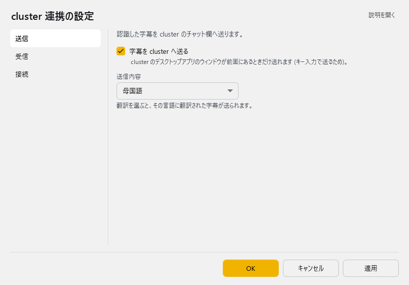
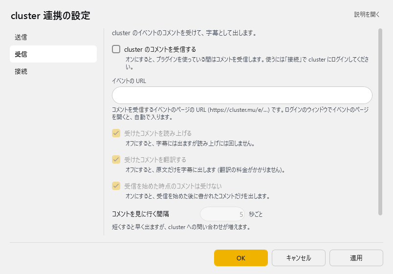
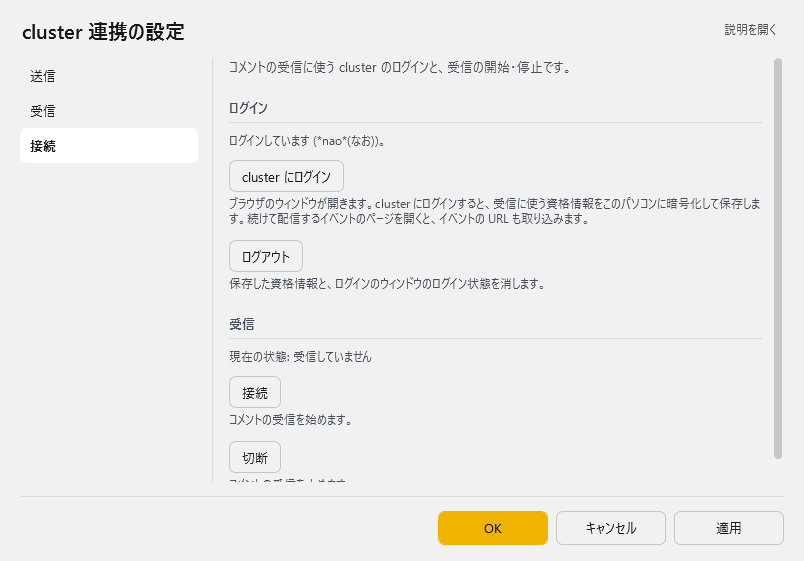

# cluster チャット転送プラグイン

<!-- version-banner -->
!!! info ""
    ゆかコネNEO **v3.0** のドキュメントです。v2.3 をお使いの方は [v2.3 版のこのページ](../../v2.3/plugin/plugin_clustertransfer.md) を、違いを知りたい方は [v2.3 から v3.0 への移行](../../mig/mig_neo_v3.0.md) をご覧ください。

  <h4>このプラグインでできること</h4>
  
あなたの音声認識結果を自動でclusterのチャット欄に送信し、VR空間でのコミュニケーションをサポートします。音声認識したメッセージをチャットに表示できるため、VR空間でのコミュニケーションがよりスムーズになります。

  
v3.0.12 からは、cluster のイベントの<strong>コメントを受信</strong>して、字幕として出したり読み上げたりもできます（<a href="#receive">受信</a>）。

  
<strong>注意：</strong> この機能はcluster公式が提供しているものではありません。何か問題が発生した場合は、ゆかコネDiscordのサポートフォーラムに質問してください。

  <a href="#_1" class="purpose-card">
    
⚙️

    <h3>基本設定をする</h3>
    
最短1分でセットアップ

  </a>
  <a href="#_2" class="purpose-card">
    
💬

    <h3>使ってみる</h3>
    
実際にclusterで使ってみる

  </a>
  <a href="#_3" class="purpose-card">
    
⚠️

    <h3>注意点</h3>
    
使用時の注意点

  </a>

## 準備するもの

1. **clusterデスクトップアプリ** - 事前にインストールしておく必要があります
2. **cluster内で参加可能なワールド** - 試してみるためのワールド
3. **ゆかコネの基本設定** - 音声認識が正しく動作する状態であること

## 設定

プラグイン一覧で、このプラグインの名前の右にある **「設定」** を押すと開きます。
画面は **3 ページ**に分かれていて、左の一覧で切り替えます（送信／受信／接続。v3.0.12～）。

!!! info "閉じるときの 3 択"
    設定は**下書き**として持たれ、「OK」か「適用」を押すまで動いているプラグインには効きません。
    変更したまま閉じようとすると「変更が保存されていません」と聞かれ、**［はい］保存して閉じる／［いいえ］破棄して閉じる／［キャンセル］閉じるのをやめる** から選べます。

### 送信

認識した字幕を cluster のチャット欄へ送ります。

| 項目 | 説明 |
|:--|:--|
| ☑ 字幕を cluster へ送る | cluster のデスクトップアプリのウィンドウが前面にあるときだけ送れます (キー入力で送るため)。（既定：ON） |
| 送信内容 | 翻訳を選ぶと、その言語に翻訳された字幕が送られます。（選択肢：母国語／翻訳 1／翻訳 2／翻訳 3／翻訳 4。既定：母国語） |

### 受信 { #receive }

cluster のイベントのコメントを受けて、字幕として出します（v3.0.12～）。

| 項目 | 説明 |
|:--|:--|
| ☑ cluster のコメントを受信する | オンにすると、プラグインを使っている間はコメントを受信します。使うには「接続」で cluster にログインしてください。（既定：OFF） |
| イベントの URL | コメントを受信するイベントのページの URL (https://cluster.mu/e/…) です。ログインのウィンドウでイベントのページを開くと、自動で入ります。 |
| ☑ 受けたコメントを読み上げる | オフにすると、字幕には出ますが読み上げには回しません。（既定：ON） |
| ☑ 受けたコメントを翻訳する | オフにすると、原文だけを字幕に出します (翻訳の料金がかかりません)。（既定：ON） |
| ☑ 受信を始めた時点のコメントは受けない | オンにすると、受信を始めた後に書かれたコメントだけを出します。（既定：ON） |
| コメントを見に行く間隔 | 短くすると早く出ますが、cluster への問い合わせが増えます。（3～30秒ごと。既定：5） |

> 受けたコメントは字幕として本体に渡ります。読み上げだけ (字幕に出さない) にはできません。自分がこのプラグインで cluster へ送った字幕は、受けても出しません。

### 接続

コメントの受信に使う cluster のログインと、受信の開始・停止です。

**ログイン**

いまのログインの様子（「ログインしています (名前)。」「ログインしていません。」など）が出ます。

| 項目 | 説明 |
|:--|:--|
| 「cluster にログイン」ボタン | ブラウザのウィンドウが開きます。cluster にログインすると、受信に使う資格情報をこのパソコンに暗号化して保存します。続けて配信するイベントのページを開くと、イベントの URL も取り込みます。 |
| 「ログアウト」ボタン | 保存した資格情報と、ログインのウィンドウのログイン状態を消します。次に受信するときは、もう一度ログインが必要です。 |

**受信**

> 現在の状態: …

| 項目 | 説明 |
|:--|:--|
| 「接続」ボタン | コメントの受信を始めます（OK を押す前の「イベントの URL」でも始められます） |
| 「切断」ボタン | コメントの受信を止めます |

!!! Info "ログインの情報について"
    * 資格情報は設定ファイルとは別に、このパソコンのこのユーザーだけが読める形で暗号化して保存します
    * 資格情報の期限が切れたときは、見えないところで取り直します。取り直せないときだけ、もう一度ログインを求めます
    * ログインのウィンドウには WebView2 を使います

!!! Warning "視聴者のコメントでキー操作をされないように (v3.0.12 で修正)"
    cluster へは字幕を**キー入力**で打ち込んでいます。v3.0.11 までは、字幕に `%{F4}`（Alt+F4）や `^a`（全選択）のような書き方が入っていると、それがキー操作として働いてしまいました。
    字幕には YouTube・Twitch・わんコメなどの**視聴者のコメントも流れる**ため、外の人が配信者の PC へキー操作を送り込めるおそれがありました。
    v3.0.12 からは、字幕はいつも**文字として**打ち込みます（改行などの制御文字は空白にし、長すぎる文は 500 文字で切ります）。**このプラグインで cluster へ送っている方は、v3.0.12 以降へ更新してください。**

## ライブ設定（配信中にその場で変える） { #live }

本体の **操作パネル → ライブ設定** に、このプラグインの「配信ごとに変わる値」が並びます。設定画面を開かずに値を入れて **「反映」** を押せば、すぐプラグインに入ります。しくみは [標準設定項目 - ライブ設定とプラグインの帯](../startup/startup_basic.md#live-settings) をご覧ください。

| 項目 | 説明 |
|:--|:--|
| イベントの URL | コメントを受信するイベントのページの URL です。 |
| コメントを受信する | 受けたコメントは字幕として出ます。 |
| 受けたコメントを読み上げる | 「受信」ページの同じ名前のスイッチです |
| 字幕を cluster へ送る | 送るときは cluster のウィンドウが前面にある必要があります。 |
| 送る字幕 | 母国語／翻訳 1～4 |

**「受信を開始」／「受信を停止」** ボタンでコメントの受信を切り替えます。画面上部のプラグインの帯で、このプラグインのアイコンを**ダブルクリック**しても同じように切り替えられます（1 回のクリックはこれまでどおり設定を開きます）。
ログインしていないときは、欄の上に「コメントを受信するには、プラグインの設定画面の「接続」で cluster にログインしてください。」と出ます。

## 基本設定の手順

  

    <h3>プラグインを有効にする</h3>
    
上のタブ <strong>プラグイン</strong> → <strong>プラグインを追加</strong> で「cluster チャット転送」を選んで <strong>追加する</strong> を押します（<a href="../enabled/">プラグインの有効化</a>）

    

      
    

  

  
  

    <h3>送信内容を選択する</h3>
    
一覧の <strong>設定</strong> を押し、<strong>送信</strong> のページの <strong>送信内容</strong> で、どの内容を送信するか選択します

    

      
    

    

      <h4>送信内容の選択肢</h4>
      <ul>
        <li><strong>母国語</strong>：あなたが話した言葉をそのまま送信</li>
        <li><strong>翻訳 1～4</strong>：その言語に翻訳された字幕を送信</li>
      </ul>
    

  

## 使い方

  

    <h3>clusterを起動する</h3>
    
clusterデスクトップアプリを起動し、ワールドに入ります

    

      <h4>ポイント</h4>
      
cluster公式クライアント（デスクトップアプリ版）が必要です。ブラウザ版では動作しません。

    

  

  
  

    <h3>チャット画面を表示する</h3>
    
cluster内でチャットパネルを開き、入力欄にカーソルを合わせます

    

      
      

        チャット入力欄にカーソルを合わせる
      

    

    

      <h4>重要</h4>
      
必ずチャット入力欄にカーソルを合わせた状態にしてください。そうしないと、音声認識の結果がキャラクターの動作に誤って反映される場合があります。

    

  

  
  

    <h3>音声認識を開始する</h3>
    
ゆかコネで音声認識を開始します

    <ul>
      <li>ゆかコネの音声認識ボタンをクリックし、認識を開始</li>
      <li>話し始めると、認識結果が自動的にclusterのチャット欄に送信されます</li>
    </ul>
  

## 注意事項

  <h4>正しく動作させるためのポイント</h4>
  <ul>
    <li><strong>clusterが前面にある必要があります</strong> - バックグラウンドになっていると送信されません</li>
    <li><strong>チャット入力欄にカーソルを合わせる</strong> - カーソルがない場合、アバターが意図しない動作をする可能性があります</li>
    <li><strong>タイミング</strong> - 音声認識が確定した時点でチャットに送信されます</li>
    <li><strong>翻訳設定</strong> - 翻訳機能も使いたい場合は、あらかじめゆかコネ本体で翻訳設定を行っておく必要があります</li>
  </ul>

  <h4>技術的な動作仕様</h4>
  <ul>
    <li><strong>ウィンドウ判定</strong>：アクティブウィンドウのタイトルに「cluster」が含まれる場合のみ動作</li>
    <li><strong>重複防止</strong>：同一IDのテキストの重複送信を自動的に防止</li>
    <li><strong>送信方式</strong>：字幕を文字としてキー入力し、Enterキーを自動送信（書き方の記号がキー操作として働かないようにしています）</li>
    <li><strong>翻訳対応</strong>：翻訳完了時（UpdateTranslation）の送信タイミングもサポート</li>
  </ul>

  <h4>対応していない機能</h4>
  <ul>
    <li>ブラウザ版clusterは非対応です</li> 
    <li>受信できるのは、イベントのページ（https://cluster.mu/e/…）に書かれたコメントです。受信には cluster へのログインが要ります</li>
  </ul>

## 活用アイデア

  

    
🌎

    <h3>多言語コミュニケーション</h3>
    
翻訳機能と組み合わせて国際交流を楽しむ

  

  

    
🎭

    <h3>ロールプレイサポート</h3>
    
キャラクターのセリフを音声認識で素早く入力

  

  

    
🎤

    <h3>イベントMC支援</h3>
    
話した内容を自動的にチャットに表示

  

  <h4>より快適に使うコツ</h4>
  
cluster内のボイスチャットを使いながら、同時に音声認識したテキストをチャットに流すことで、音声が聞き取りにくい環境でも会話を楽しめます。

