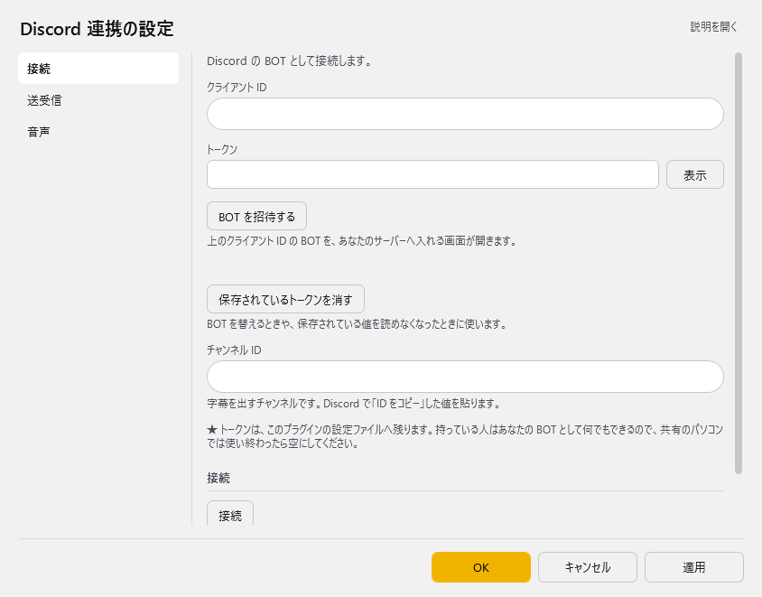
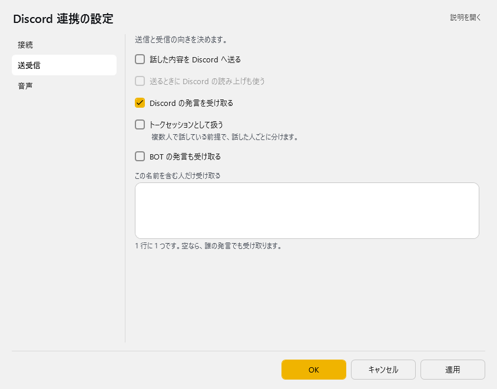
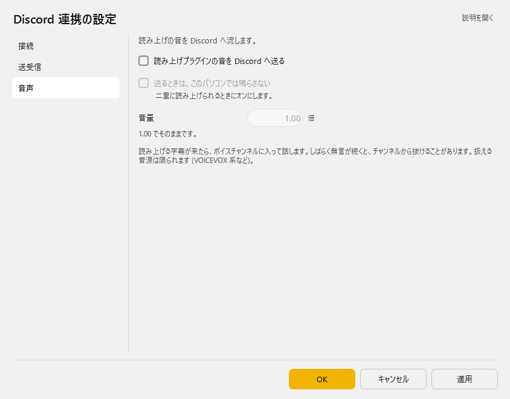
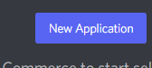
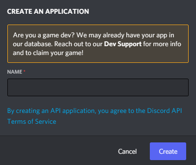
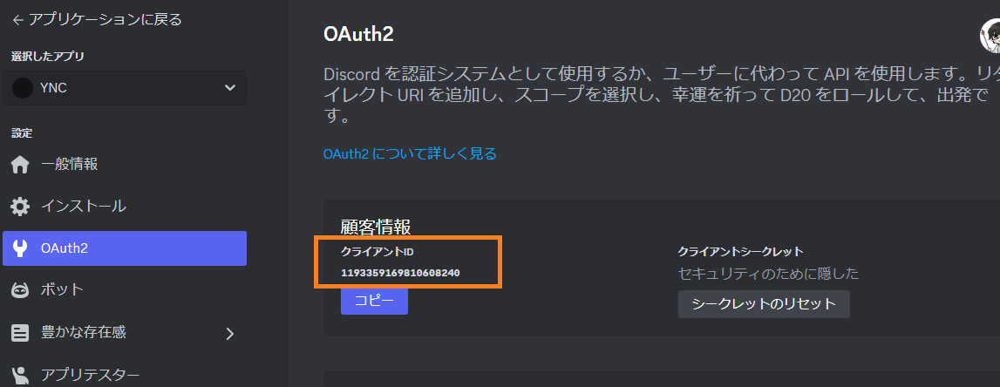
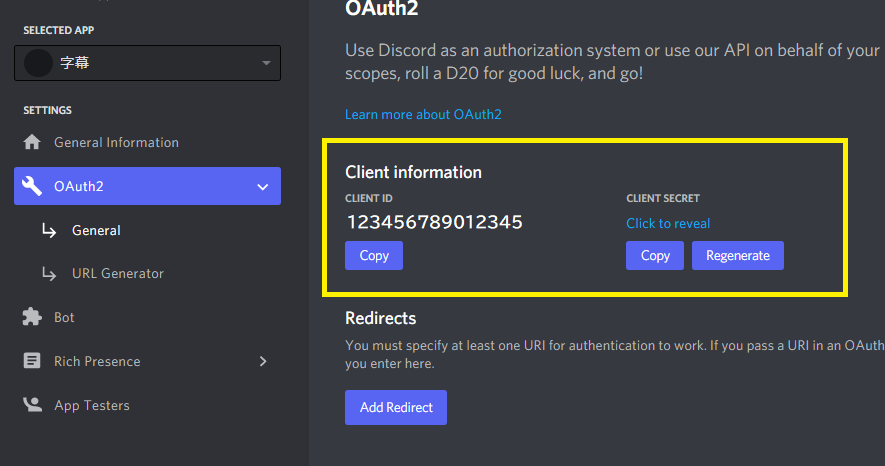
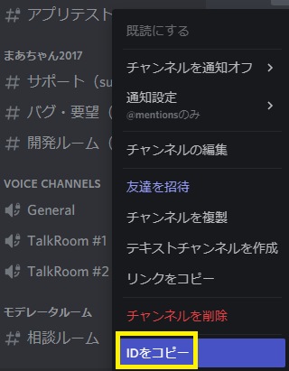

# Discord BOT連携プラグイン

<!-- version-banner -->
!!! info ""
    ゆかコネNEO **v3.0** のドキュメントです。v2.3 をお使いの方は [v2.3 版のこのページ](../../v2.3/plugin/plugin_dicord.md) を、違いを知りたい方は [v2.3 から v3.0 への移行](../../mig/mig_neo_v3.0.md) をご覧ください。

  <h4>このプラグインでできること</h4>
  
ゆかコネとDiscordを連携させ、以下のことができるようになります：

  <ul>
    <li>あなたの音声認識結果をDiscordチャンネルに自動送信</li>
    <li>Discordチャンネルの会話をゆかコネに取り込み</li>
    <li>読み上げ音声をDiscordボイスチャンネルに流し込み</li>
  </ul>

  <a href="#_1" class="purpose-card">
    
⚙️

    <h3>基本設定をする</h3>
    
Discord BOTの作成と連携設定

  </a>
  <a href="#_2" class="purpose-card">
    
💬

    <h3>使ってみる</h3>
    
実際の使い方と活用例

  </a>
  <a href="#_3" class="purpose-card">
    
🔊

    <h3>音声を流す</h3>
    
読み上げ音声をDiscordに流す

  </a>

## 準備するもの

1. **Discordアカウント** - BOT登録に必要です
2. **Discord BOTの設定情報** - この後の手順で作成します
3. **書き込み先のDiscordチャンネル** - テキストチャンネルのIDが必要です

## 設定

プラグイン一覧で、このプラグインの名前の右にある **「設定」** を押すと開きます。
画面は **3 ページ**に分かれていて、左の一覧で切り替えます（接続／送受信／音声）。

!!! info "閉じるときの 3 択"
    設定は**下書き**として持たれ、「OK」か「適用」を押すまで動いているプラグインには効きません。
    変更したまま閉じようとすると「変更が保存されていません」と聞かれ、**［はい］保存して閉じる／［いいえ］破棄して閉じる／［キャンセル］閉じるのをやめる** から選べます。

### 接続

Discord の BOT として接続します。

| 項目 | 説明 |
|:--|:--|
| クライアント ID | — |
| トークン | 入力は伏せ字で表示されます。「表示」を押すと中身を確かめられます（もう一度押すと伏せます） |
| 「BOT を招待する」ボタン | 上のクライアント ID の BOT を、あなたのサーバーへ入れる画面が開きます。 |
| 「保存されているトークンを消す」ボタン | BOT を替えるときや、保存されている値を読めなくなったときに使います。 |
| チャンネル ID | 字幕を出すチャンネルです。Discord で「ID をコピー」した値を貼ります。 |

> ★ トークンは、このプラグインの設定ファイルへ残ります。持っている人はあなたの BOT として何でもできるので、共有のパソコンでは使い終わったら空にしてください。

**接続**

| 項目 | 説明 |
|:--|:--|
| 「接続」ボタン | 入れた値で Discord へ接続します |
| 「切断」ボタン | 接続をやめます |

### 送受信

送信と受信の向きを決めます。

| 項目 | 説明 |
|:--|:--|
| ☑ 話した内容を Discord へ送る | 既定：OFF |
| ☑ 送るときに Discord の読み上げも使う | 既定：OFF |
| ☑ Discord の発言を受け取る | 既定：OFF |
| ☑ トークセッションとして扱う | 複数人で話している前提で、話した人ごとに分けます。（既定：OFF） |
| ☑ BOT の発言も受け取る | 既定：OFF |
| この名前を含む人だけ受け取る | 1 行に 1 つです。空なら、誰の発言でも受け取ります。 |

### 音声

読み上げの音を Discord へ流します。

| 項目 | 説明 |
|:--|:--|
| ☑ 読み上げプラグインの音を Discord へ送る | 既定：OFF |
| ☑ 送るときは、このパソコンでは鳴らさない | 二重に読み上げられるときにオンにします。（既定：OFF） |
| 音量 | 1.00 でそのままです。（0.2～2.0倍。既定：1.0） |

> 読み上げる字幕が来たら、ボイスチャンネルに入って話します。しばらく無言が続くと、チャンネルから抜けることがあります。扱える音源は限られます (VOICEVOX 系など)。

## ライブ設定（配信中にその場で変える） { #live }

本体の **操作パネル → ライブ設定** に、このプラグインの「配信ごとに変わる値」が並びます。設定画面を開かずに値を入れて **「反映」** を押せば、すぐプラグインに入ります。しくみは [標準設定項目 - ライブ設定とプラグインの帯](../startup/startup_basic.md#live-settings) をご覧ください。

| 項目 | 説明 |
|:--|:--|
| 「保存されているトークンを消す」ボタン | BOT を替えるときや、保存されている値を読めなくなったときに使います。 |
| チャンネル ID | 字幕を出すチャンネルです。Discord で「ID をコピー」した値を貼ります。 |
| 話した内容を Discord へ送る | 設定画面の同じ名前のスイッチです |
| Discord の発言を受け取る | 設定画面の同じ名前のスイッチです |

**「接続」／「切断」** ボタンで BOT の接続を切り替えます。画面上部のプラグインの帯で、このプラグインのアイコンを**ダブルクリック**しても同じように切り替えられます（1 回のクリックはこれまでどおり設定を開きます）。

* 自分で切断したときは、自動ではつなぎ直しません。「接続」で戻ります
* 切断している間は、字幕も読み上げの音も Discord へ送りません

## 基本設定の手順

### ステップ1：プラグインを有効にする

  

    <h3>プラグイン一覧からDiscord BOTを有効化</h3>
    
上のタブ <strong>プラグイン</strong> → <strong>プラグインを追加</strong> で Discord 連携を選んで <strong>追加する</strong> を押します（<a href="../enabled/">プラグインの有効化</a>）

    

      
    

  

### ステップ2：Discord BOTを作成する

  

    <h3>Discord開発者ポータルにアクセス</h3>
    
<a href="https://discord.com/developers/applications" target="_blank">Discord開発者ポータル</a>を開き、アカウントでログインします

    

      
      

        「New Application」をクリック
      

    

  

  
  

    <h3>アプリケーション名を設定</h3>
    
BOTの名前を入力します（例：「ゆかコネ連携BOT」など）

    

      
      

        わかりやすい名前を入力
      

    

  

  
  

    <h3>BOTの設定を行う</h3>
    
左メニューから「Bot」を選択し、BOTを作成します

    <ol>
      <li>左側のメニューから「Bot」をクリック</li>
      <li>「Add Bot」ボタンをクリック</li>
      <li>確認ダイアログが表示されたら「Yes, do it!」をクリック</li>
    </ol>
  

  
  

    <h3>重要：メッセージ閲覧権限を有効にする</h3>
    
BOTがメッセージを読めるように設定します（必須）

    

      
      

        「Message Content Intent」をONにする（重要）
      

    

    

      <h4>注意</h4>
      
この設定を忘れると、BOTがDiscordのメッセージを読み取れず、連携機能が動作しません！

    

  

### ステップ3：接続情報を取得する

  

    <h3>Client IDを取得</h3>
    
左メニューの「General Information」から「Application ID」をコピーします

    

      
      

        この「Application ID」をコピー
      

    

  

  
  

    <h3>トークンを取得</h3>
    
「Bot」ページで「Reset Token」をクリックし、トークンを表示してコピーします

    

      
      

        「Reset Token」→トークンをコピー
      

    

    

      <h4>トークンの取り扱いに注意</h4>
      
トークンは他人に知られると、あなたのBOTを操作される恐れがあります。安全に管理してください。

    

  

  
  

    <h3>チャンネルIDを取得</h3>
    
Discordアプリでチャンネル名を右クリックし「IDをコピー」を選択

    

      
      

        テキストチャンネルを右クリック→「IDをコピー」
      

    

    

      <h4>IDが見つからない場合</h4>
      
IDをコピーするオプションが表示されない場合は、Discordの設定で「開発者モード」をオンにしてください。（設定→詳細設定→開発者モード）

    

  

### ステップ4：プラグインに情報を設定

  

    <h3>プラグイン設定画面を開く</h3>
    
Discord BOTプラグインの「設定」ボタンをクリックします

    

      
    

  

  
  

    <h3>接続情報を入力</h3>
    
先ほど取得した3つの情報を入力します

    <table>
      <tr>
        <th>設定項目</th>
        <th>入力する内容</th>
      </tr>
      <tr>
        <td>クライアント ID</td>
        <td>コピーしたApplication ID</td>
      </tr>
      <tr>
        <td>トークン</td>
        <td>コピーしたBOTトークン</td>
      </tr>
      <tr>
        <td>チャンネル ID</td>
        <td>コピーしたチャンネルID</td>
      </tr>
    </table>
  

  
  

    <h3>接続する</h3>
    
設定の <strong>接続</strong> のページの <strong>接続</strong> ボタンを押して、BOTとつながることを確かめます

    

      
    

    

      <h4>接続に失敗する場合</h4>
      <ul>
        <li>入力情報（クライアント ID、トークン、チャンネル ID）が正しいか確認</li>
        <li>BOTの「Message Content Intent」がONになっているか確認</li>
        <li>インターネット接続に問題がないか確認</li>
      </ul>
    

  

### ステップ5：転送設定を行う

  

    <h3>転送方向を選択</h3>
    
設定の <strong>送受信</strong> のページで、どの方向でデータをやり取りするか設定します

    <ul>
      <li><strong>Discord の発言を受け取る</strong>：Discordのメッセージをゆかコネに取り込む</li>
      <li><strong>話した内容を Discord へ送る</strong>：ゆかコネの音声認識結果をDiscordに送信する</li>
    </ul>
    

      <h4>使い方に合わせて選択</h4>
      
両方向を有効にすると、音声認識した内容がDiscordに送信され、その返信も取り込めます。コラボ配信などで便利です。

    

  

  
  

    <h3>追加オプションを設定</h3>
    
必要に応じて追加設定を行います

    <ul>
      <li><strong>トークセッションとして扱う</strong>：コラボ配信など複数人のやり取りではONにする</li>
      <li><strong>BOT の発言も受け取る</strong>：BOTの投稿も受信したい場合はONにする</li>
      <li><strong>この名前を含む人だけ受け取る</strong>：特定の名前の人の発言だけ取り込みたい場合に設定（1 行に 1 つ）</li>
    </ul>
  

### ステップ6：BOTをDiscordサーバーに招待

  

    <h3>招待URLを生成</h3>
    
Discord開発者ポータルの「OAuth2」→「URL Generator」で招待URLを作成

    <ol>
      <li>左メニューから「OAuth2」→「URL Generator」を選択</li>
      <li>「SCOPES」で「bot」にチェック</li>
      <li>「BOT PERMISSIONS」で必要な権限（最低限「Send Messages」と「Read Message History」）にチェック</li>
      <li>生成されたURLをコピー</li>
    </ol>
  

  
  

    <h3>BOTをサーバーに追加</h3>
    
コピーしたURLをブラウザで開き、BOTを追加したいサーバーを選択

    

      
      

        必要な権限を選択
      

    

    

      <h4>最小限の権限設定</h4>
      
セキュリティのため、BOTに必要最小限の権限だけを与えることをおすすめします。基本は「メッセージの送信」と「メッセージ履歴の閲覧」だけで十分です。

    

  

## 具体的な使い方

設定が完了したら、以下のような使い方ができます：

  
  <a class="purpose-card">
    
🌐

    <h3>国際交流</h3>
    
翻訳字幕をDiscordに送信して多言語コミュニケーション

  </a>
  <a class="purpose-card">
    
📝

    <h3>議事録作成</h3>
    
会議の内容を自動的にDiscordに記録

  </a>

より詳しい使い方は、[Discord経由でコラボする方法](../cs/cs_colab_discord.md)を参考にしてください。

## 特殊な使い方：読み上げ音声をDiscordに流す

ゆかコネの読み上げ機能と組み合わせて、音声をDiscordのボイスチャンネルに流すことができます。

  

    <h3>前提条件を確認</h3>
    
以下の条件をすべて満たす必要があります

    <ul>
      <li>読み上げプラグインが有効になっている</li>
      <li>読み上げプラグインで読み上げる設定になっている</li>
      <li>Discord側でボイスチャンネルを用意している</li>
      <li>BOTに音声チャンネルへの参加権限を付与している</li>
    </ul>
  

  
  

    <h3>設定を有効にする</h3>
    
Discord 連携プラグインの設定の <strong>音声</strong> のページで「読み上げプラグインの音を Discord へ送る」にチェックを入れます

    

      <h4>使用許諾について</h4>
      
一部の音声合成エンジンでは、この使い方が禁止されている場合があります。使用する音声エンジンの利用規約を必ず確認してください。

    

  

  
  

    <h3>動作確認をする</h3>
    
ゆかコネで音声認識し、読み上げが行われるとDiscordのボイスチャンネルにも音声が流れます

    

      <h4>対応していないエンジン</h4>
      
音声ファイルを生成できるエンジンのみ対応しています。CeVIO CS/AI、A.I.Voiceなど一部のエンジンでは機能しない場合があります。

    

  

## トラブルシューティング

  <h4>BOTがメッセージを取得できない</h4>
  <ul>
    <li>Discord開発者ポータルのBot設定で「Message Content Intent」がONになっているか確認</li>
    <li>BOTがチャンネルのメッセージを読む権限を持っているか確認</li>
    <li>チャンネルIDが正しいか確認（カテゴリではなく個別のチャンネルIDが必要）</li>
  </ul>

  <h4>「接続」でエラーが出る</h4>
  <ul>
    <li>クライアント IDとトークンが正しいか確認</li>
    <li>インターネット接続に問題がないか確認</li>
    <li>トークンが再生成された場合は新しいトークンを設定</li>
  </ul>

  <h4>BOTがDiscordサーバーに表示されない</h4>
  <ul>
    <li>招待URLのパーミッション設定を確認</li>
    <li>開発者ポータルでBOTが作成されているか確認</li>
    <li>BOTを正しいサーバーに招待したか確認</li>
  </ul>

