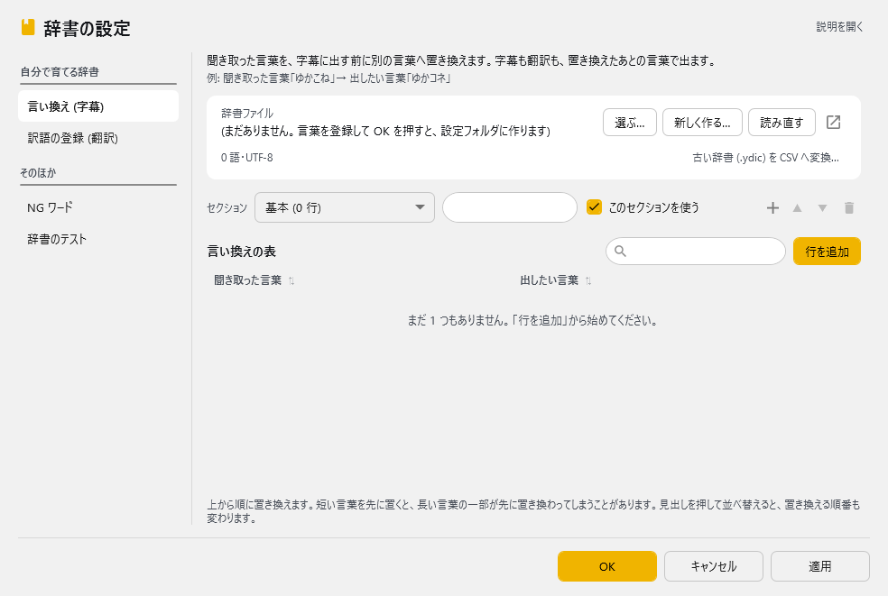
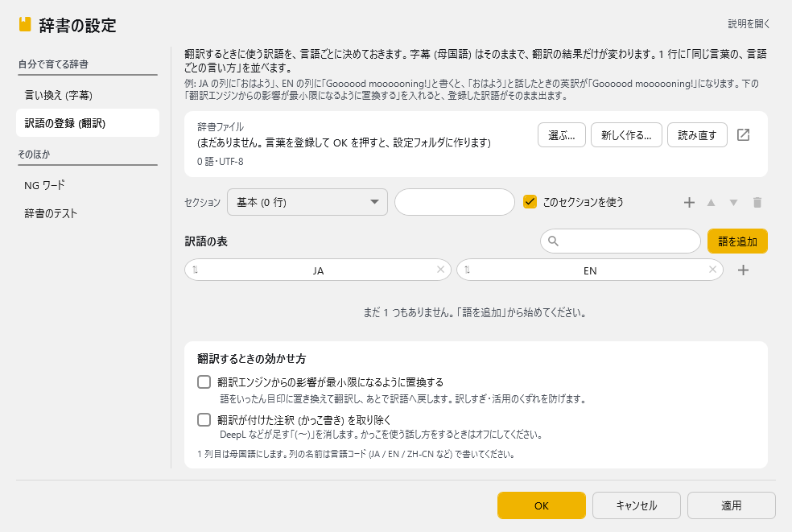
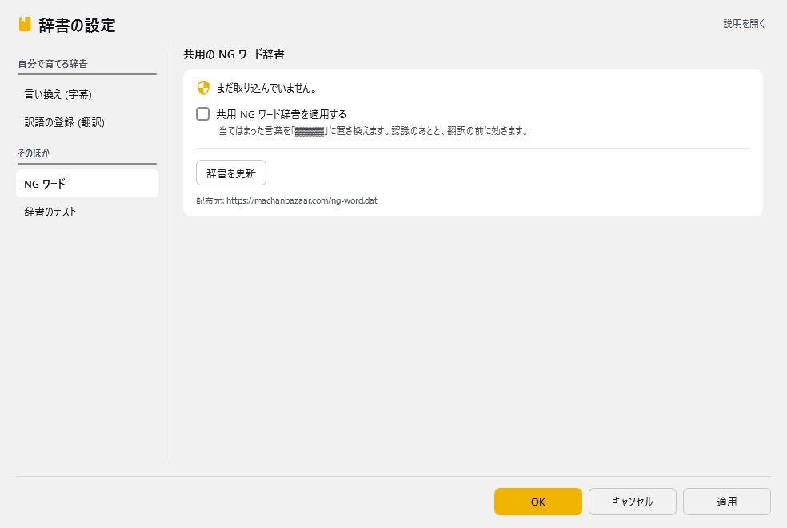
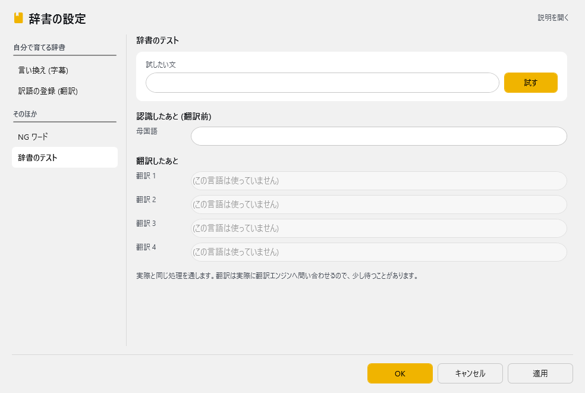

<!-- version-banner -->
!!! info ""
    ゆかコネNEO **v3.0** のドキュメントです。v2.3 をお使いの方は [v2.3 版のこのページ](../../v2.3/plugin/plugin_dictionary.md) を、違いを知りたい方は [v2.3 から v3.0 への移行](../../mig/mig_neo_v3.0.md) をご覧ください。

!!! Info "前提条件"
    * なし

## このプラグインで出来ること

* 認識後の文字を強制的に置き換えることができます
* 3層の辞書システム（母国語辞書、対訳辞書、除外辞書）
* 正規表現による高度なパターンマッチング
* DeepL注記の自動削除機能
* 共用の NG ワード辞書で、伏せたい言葉を伏せ字にする（v3.0～）
* 言い換え・訳語の表を**セクション**に分けて、セクションごとにオン・オフする。配信中は操作パネルのライブ設定から切り替えられます（v3.0.16～、辞書 v3.8～）

!!! warning "言い換えの CSV の 3 列目にメモを書いていた方へ（v3.0.16～）"
    v3.0.16（辞書 v3.8）から、言い換えの CSV の **3 列目はセクションの名前**として読まれます。
    3 列目にメモを書いていた場合は、そのメモがセクションの名前になり、行がメモごとに別々のセクションに分かれます。
    辞書の設定画面の「言い換え」で [セクション](#sections) の一覧を確かめ、要らなければ CSV の 3 列目を消してください。


## 有効化

* 上のタブ **プラグイン** → **プラグインを追加** でこのプラグインを選んで **追加する** を押します（一覧の **使う** が ON になります）。→ [プラグインの有効化](enabled.md)

## 設定

プラグイン一覧で、このプラグインの名前の右にある **「設定」** を押すと開きます。
左の一覧で 4 ページを切り替えます。

| まとまり | ページ | 中身 |
|:--|:--|:--|
| 自分で育てる辞書 | **言い換え (字幕)** | 聞き取った言葉を、別の言葉に置き換えます。字幕も翻訳も、置き換えたあとの言葉で出ます |
| | **訳語の登録 (翻訳)** | 翻訳するときの訳語を、言語ごとに決めておきます。字幕 (母国語) は変わりません |
| そのほか | NG ワード | 配布されている共用の辞書で、伏せたい言葉を伏せ字にします |
| | 辞書のテスト | 入れた文が、辞書を通るとどうなるかを試します |

!!! info "配信中に開いても字幕は変わりません"
    設定（ファイルの場所とスイッチ）も辞書の中身も、**「OK」か「適用」を押すまで動いている辞書に触りません**。
    開いて眺めるだけなら、配信中の字幕は変わりません。「適用 → キャンセル」で戻せるよう、書いたファイルの控えも取っています。

### 辞書ファイルの扱い（言い換え・訳語の登録で共通）

ページの上に、いま使っている辞書ファイルの欄があります。

| 項目 | 説明 |
|:--|:--|
| 「選ぶ…」ボタン | 使う辞書ファイル（`*.csv`）を選びます |
| 「新しく作る…」ボタン | 空の辞書ファイルを作ります |
| 「読み直す」ボタン | ファイルを外で書き換えたときに読み直します。保存していない変更があるときは確認が出ます |
| 「Excel / メモ帳で開く」ボタン（右端の矢印のアイコン） | 辞書ファイルをほかのソフトで開きます |

* ファイル名の下に、語の数と文字コード（UTF-8）が出ます。**Shift-JIS のファイルも読めます**（保存は UTF-8 になります）。
* まだ存在しないファイルを指定したときは、OK を押したときに作ります。
* 言い換えと訳語の登録に**同じファイルを指定すると保存できません**（その場で注意が出ます）。
* 辞書を切り替えるとき、書いていない変更があれば「先に書いてから切り替える／変更を捨てる／切り替えない」を聞かれます。

!!! info "辞書ファイルを決めていなくても保存できます（v3.0.16～）"
    辞書ファイルを選ばないまま言葉を登録して「OK」か「適用」を押すと、**設定フォルダに辞書ファイルを作って保存**し、そのファイルを使うように設定します。
    ファイル名の下に「設定フォルダに「（ファイル名）」を作って保存しました」と出ます。

    | 辞書 | 作るファイル |
    |:--|:--|
    | 言い換え | `yncneo_dic_replace.csv` |
    | 訳語の登録 (翻訳) | `yncneo_dic.csv` |

    * 同じ名前で中身のあるファイルがすでにあるときは、上書きせずに `yncneo_dic_replace (2).csv` のように別の名前で作ります。
    * 設定フォルダに書けなかったときだけ、保存先をたずねる画面が出ます。

### セクション（言い換え・訳語の登録で共通） { #sections }

言い換えの表と訳語の表は、行を**セクション**に分けられます（v3.0.16～、辞書 v3.8～）。
「大阪弁の言い換え」「この配信の固有名詞の訳語」のように分けておくと、セクションごとにオン・オフできます。


表の上の帯で、表に出すセクションを選んで操作します。

| 項目 | 説明 |
|:--|:--|
| セクション（選択欄） | 表に出すセクションを選びます。表にはこのセクションの行だけが出ます。一覧には「名前 (○ 行)」、オフのセクションは「名前 (○ 行)・オフ」と出ます |
| セクションの名前 | いまのセクションの名前です。空欄は「基本」になります。欄を離れると変わります（60 文字まで） |
| ☑ このセクションを使う | オフにすると、このセクションの行は効きません。「OK」か「適用」で確定します |
| ＋（セクションを追加） | いまのセクションのすぐ後ろに、新しいセクションを作ります（名前は「セクション 2」のように付きます） |
| ▲（セクションを前へ）／▼（セクションを後ろへ） | セクションの順番を変えます。前のセクションほど先に効きます |
| ゴミ箱（セクションを消す） | いまのセクションを、中の行ごと消します（確認が出ます） |

* **上のセクションから順に効きます。** 同じ言葉がオンの複数のセクションにあるときは、上のセクションが効きます。
* オフにしたセクションの行は、**字幕にも翻訳にも効きません**。いま開いているセクションがオフのときは、表の上に「このセクションはいまオフです。」と出ます。
* 「行を追加」は、いま開いているセクションの最後に行を足します。
* 「表の中を探す」で絞り込むのは、いまのセクションの中だけです。ほかのセクションにも当たる行があると「ほかのセクションにも ○ 行あります。」と出ます。
* 同じ言葉のダブりの注意は、同じセクションの中だけで出ます。セクションが違えば、同じ言葉を別の言葉に言い換える行を置けます（オン・オフで使い分けるため）。
* ファイルの中で同じセクションの行が離れていたときは、読み込んだときにセクションごとにまとめ直し、その旨が出ます。「OK」か「適用」を押すと、その順番で保存されます（置き換える順番も変わります）。
* 行の無いセクションは保存されません（セクションの名前は行の側に書くため）。
* オン・オフは**辞書ファイルではなく、プラグインの設定に覚えます**。辞書ファイルは書き換えません。

**ファイルの中でのセクション**

| 辞書 | セクションの名前を書く場所 |
|:--|:--|
| 言い換え | CSV の **3 列目** |
| 訳語の登録 (翻訳) | 1 行目（見出し）が `#section` の列。いちばん右に書きます |

* 名前の無いセクション（「基本」）しか使っていないときは、セクションの列は書きません。セクションを使わない人のファイルは、これまでと同じ形のままです。

#### 配信中に切り替える（ライブ設定） { #live }

本体の **操作パネル → ライブ設定** に、このプラグインのセクションが並びます。設定画面を開かずにオン・オフして **「反映」** を押せば、すぐ効きます。しくみは [標準設定項目 - ライブ設定とプラグインの帯](../startup/startup_basic.md#live-settings) をご覧ください。

| 項目 | 説明 |
|:--|:--|
| 言い換え: （セクションの名前） | 言い換えの表の、そのセクションのオン・オフです。説明に行の数が出ます |
| 訳語: （セクションの名前） | 訳語の表の、そのセクションのオン・オフです |

* セクションを作る・名前を変えるのは、辞書の設定画面で行います。
* 辞書にまだ言葉が無いときは「辞書に言葉がまだありません。」と出ます。
* ライブ設定を出したあとで辞書が読み直され、そのセクションが無くなっていたときは、反映しません（「このセクションはもうありません」と出ます）。

### 言い換え (字幕)

聞き取った言葉を、字幕に出す前に別の言葉へ置き換えます。字幕も翻訳も、置き換えたあとの言葉で出ます。



**言い換えの表**

| 列 | 説明 |
|:--|:--|
| 聞き取った言葉 | 音声認識が出してくる言葉（置き換えたい言葉） |
| 出したい言葉 | 字幕に出したい言葉 |

* **「行を追加」** で、いま開いている[セクション](#sections)に行を増やします。行の × で消せます。
* 右上の **「表の中を探す」** で、いまのセクションの中を絞り込めます。
* 辞書ファイルの欄の右下にある **「古い辞書 (.ydic) を CSV へ変換…」** で、以前の版の置換辞書（.ydic、XML 形式）を CSV に変換して、この表で使えるようにします。
* **同じセクションに同じ言葉が 2 つ以上あると、その場で注意が出ます。**
* 上のセクションから、セクションの中は上の行から順に置き換えます。**短い言葉を先に置くと、長い言葉が先に食われることがあります。**

**表の使い方（並べ替え）**

* 列の見出し（「聞き取った言葉」「出したい言葉」）を押すと、**いま開いているセクションの中で**、その列で並べ替えます（v3.0.16～。ほかのセクションの行は動きません）。押すたびに **昇順 → 降順 → 並べ替える前の順** と変わり、見出しの右に ▲／▼ が出ます（並べ替えていない列は薄い ⇅）。
* 見た目だけでなく**行の順番そのものが変わり、OK／適用でその順にファイルへ書きます**。言い換えは上から順に効くので、**置き換える順番も変わります**。
* 空の行は、向きにかかわらずいちばん後ろに並びます。数字だけの言葉は数として比べます。
* 元の順に戻したいときは、同じ見出しを続けて押して「並べ替える前の順」にします。セクションを切り替えると、並べ替える前の順には戻せなくなります。

### 訳語の登録 (翻訳)

翻訳するときに使う訳語を、言語ごとに決めておきます。字幕 (母国語) はそのままで、翻訳の結果だけが変わります。



**訳語の表**

* 見出しの欄が、そのまま**言語の列**になっています。**1 列目は母国語**にします。
* 列の名前は言語コード（`JA` / `EN` / `ZH-CN` など）で書きます。読めないコードや、同じ言語の列が 2 つあると注意が出ます。
* 見出しの右の **＋（言語を追加）** で言語の列を増やし、列の × で消します（その言語の訳語はファイルからも消えます）。
* **「語を追加」** で、いま開いている[セクション](#sections)に行を増やします。**「表の中を探す」** で、いまのセクションの中を絞り込めます。
* 見出しの欄の左端にある並べ替えのボタン（⇅）を押すと、いまのセクションの中で、その言語の列で並べ替えます。押すたびに **昇順 → 降順 → 並べ替える前の順** と変わります。言い換えの表と同じく、行の順番そのものが変わります。

**翻訳するときの効かせ方**

| 項目 | 説明 |
|:--|:--|
| ☑ 翻訳エンジンからの影響が最小限になるように置換する | 語をいったん目印に置き換えて翻訳し、あとで訳語へ戻します。訳しすぎ・活用のくずれを防げます |
| ☑ 翻訳が付けた注釈（かっこ書き）を取り除く | DeepL などが足す「(〜)」を消します。かっこを使う話し方をするときはオフにしてください |

!!! tip "v2.3 から変わったこと"
    v2.3 まで、用語集（対訳辞書）は**アプリの中に編集手段がありませんでした**。
    ファイルの場所を指定して Excel で開き、「1 行目に言語コード、2 行目以降に対訳」という決まりを自分で覚えている必要がありました。
    v3.0 では言語の増減も含めて画面の中で終わります。これまでどおり CSV を外で作って読ませることもできます。

!!! warning "「この訳語の表は、言い換えの表 (2 列) で上書きされている可能性があります」と出たとき"
    訳語の表のファイルが 2 列しかない（言い換えの表の形になっている）ときに出ます。
    中身を確かめて、必要ならファイルを選び直してください。

#### 辞書ファイルの作り方（外で作る場合）

1 行目に言語コード、2 行目以降に対訳を書いた CSV（UTF-8）です。

```
JA,EN,FR
ゆかコネ,Yukarinette-Connector,Yukarinette-Connector
ハローラ,Hello-la!,Hello-la!
おつあめ,OTSUAME!,OTSUAME!
```

セクションに分けるときは、1 行目のいちばん右に `#section` の列を足し、各行にセクションの名前を書きます（空欄は「基本」）。

```
JA,EN,FR,#section
ゆかコネ,Yukarinette-Connector,Yukarinette-Connector,
ハローラ,Hello-la!,Hello-la!,あいさつ
おつあめ,OTSUAME!,OTSUAME!,あいさつ
```

言い換えの CSV は「聞き取った言葉,出したい言葉」の 2 列で、セクションに分けるときは 3 列目にセクションの名前を書きます。

```
ゆかこね,ゆかコネ
おおきに,ありがとう,大阪弁
```

Excel で作る場合は「CSV UTF-8（コンマ区切り）」で保存してください。

### NG ワード

配布されている共用の辞書で、伏せたい言葉を伏せ字にします。



| 項目 | 説明 |
|:--|:--|
| ☑ 共用 NG ワード辞書を適用する | 当てはまった言葉を「▒▒▒」に置き換えます。認識のあとと、翻訳の前に効きます |
| 「辞書を更新」ボタン | 配布元から最新の辞書を取り直します。取れなかったときは元の辞書のままです |

いま取り込んでいる語の数と、配布元の URL がその場に出ます。

### 辞書のテスト

入れた文が、辞書を通るとどうなるかを試します。



1. **試したい文** を入れて **「試す」** を押します
2. **認識したあと（翻訳前）** に母国語の結果、**翻訳したあと** に翻訳 1〜4 の結果が出ます（使っていない言語は「この言語は使っていません」）

* 実際と同じ処理を通します。翻訳は実際に翻訳エンジンへ問い合わせるので、少し待つことがあります。
* 表の変更は、試す前にファイルへ書き込みます。

!!! Info "辞書の指定が空になっていたら"
    * 設定画面を開いたときに辞書の指定が空でも、同じフォルダに辞書ファイルが残っていれば、自動で候補を埋めます。(v2.3.128～)
    * 自動で埋めた内容は ``OK`` を押すまで保存されません。中身を確かめてから ``OK`` を押してください。

## 使うとき

1. 音声認識と同時に置換されます。
