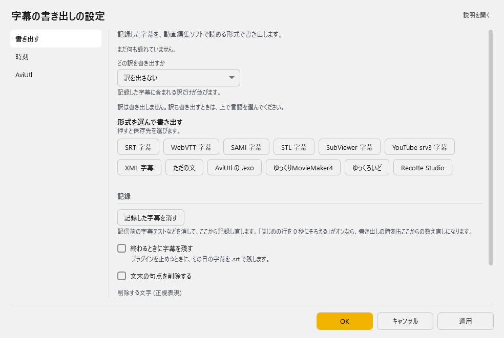
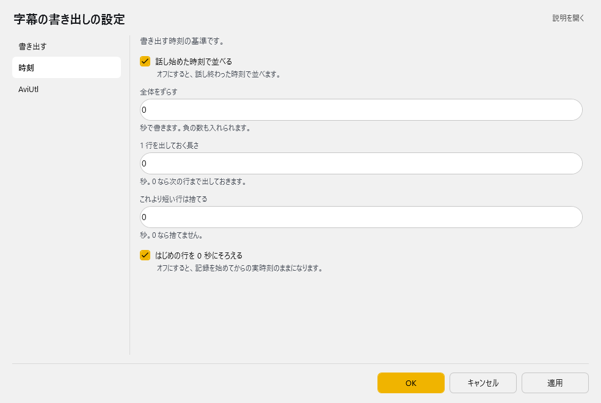
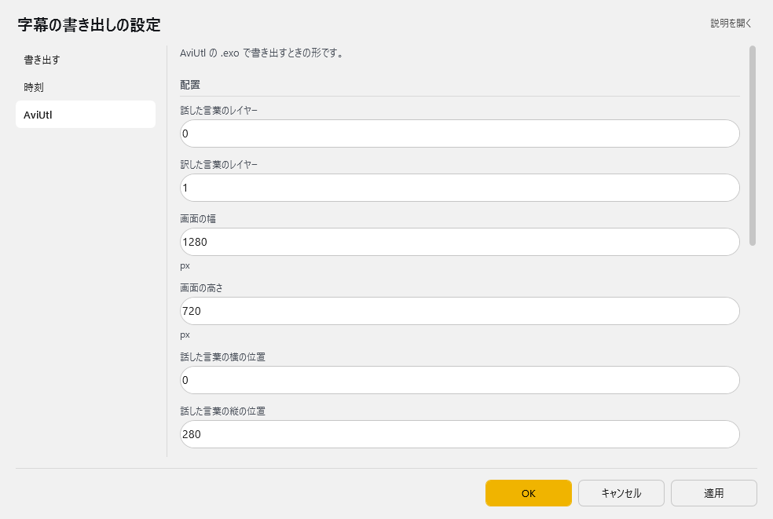

<!-- version-banner -->
!!! info ""
    ゆかコネNEO **v3.0** のドキュメントです。v2.3 をお使いの方は [v2.3 版のこのページ](../../v2.3/plugin/plugin_exporter.md) を、違いを知りたい方は [v2.3 から v3.0 への移行](../../mig/mig_neo_v3.0.md) をご覧ください。

!!! Info "前提条件"
    * なし

## このプラグインで出来ること

* 後編集工程に字幕を持っていくことができます。
* 12種類の字幕フォーマットに対応（SRT、STL、XML、ゆっくろいど、AviUtl、SAMI、VTT等）
* 高度なタイミング制御とオフセット調整
* 動画編集ツールとの直接連携
* リアルタイム字幕データ収集と自動保存
* 正規表現による高度な文字置換機能

## 有効化

* 上のタブ **プラグイン** → **プラグインを追加** でこのプラグインを選んで **追加する** を押します（一覧の **使う** が ON になります）。→ [プラグインの有効化](enabled.md)

## 設定

プラグイン一覧で、このプラグインの名前の右にある **「設定」** を押すと開きます。
画面は **3 ページ**に分かれていて、左の一覧で切り替えます（書き出す／時刻／AviUtl）。

!!! info "閉じるときの 3 択"
    設定は**下書き**として持たれ、「OK」か「適用」を押すまで動いているプラグインには効きません。
    変更したまま閉じようとすると「変更が保存されていません」と聞かれ、**［はい］保存して閉じる／［いいえ］破棄して閉じる／［キャンセル］閉じるのをやめる** から選べます。

### 書き出す

記録した字幕を、動画編集ソフトで読める形式で書き出します。

| 項目 | 説明 |
|:--|:--|
| どの訳を書き出すか | 記録した字幕に含まれる訳だけが並びます。 |
| 「形式を選んで書き出す」のボタン | 形式ごとにボタンが並びます。押すと保存先を選びます。 |

**記録**

| 項目 | 説明 |
|:--|:--|
| 「記録した字幕を消す」ボタン | 配信前の字幕テストなどを消して、ここから記録し直します。「はじめの行を 0 秒にそろえる」がオンなら、書き出しの時刻もここからの数え直しになります。（確認が出ます。元に戻せません） |
| ☑ 終わるときに字幕を残す | プラグインを止めるときに、その日の字幕を .srt で残します。（既定：OFF） |
| ☑ 文末の句点を削除する | 既定：OFF |
| 削除する文字 (正規表現) | 正規表現で書きます。一致した部分が書き出しから削除されます。 |

### 時刻

書き出す時刻の基準です。

| 項目 | 説明 |
|:--|:--|
| ☑ 話し始めた時刻で並べる | オフにすると、話し終わった時刻で並べます。（既定：ON） |
| 全体をずらす | 秒で書きます。負の数も入れられます。（既定：「0」） |
| 1 行を出しておく長さ | 秒。0 なら次の行まで出しておきます。（既定：「0」） |
| これより短い行は捨てる | 秒。0 なら捨てません。（既定：「0」） |
| ☑ はじめの行を 0 秒にそろえる | オフにすると、記録を始めてからの実時刻のままになります。（既定：ON） |

!!! info "書き出す時刻の決め方（v3.0.16～、字幕の書き出し v2.4～）"
    * 1 行の **OUT（消える時刻）は、必ず IN（出る時刻）より後ろ**になります。以前は、認識の記録の時刻が前後で重なると `00:00:21,513 --> 00:00:21,316` のように OUT が IN より前になることがありました。
    * 次の行の IN は、直前に書き出した行の OUT より少し（約 0.034 秒）後ろに置きます。前の行と重なりません。
    * 「はじめの行を 0 秒にそろえる」がオンのとき、IN の時刻が大きくずれる（日付ほど先へ飛ぶ）ことがありました。v3.0.16 で直しています。以前の版で書き出したファイルの時刻がおかしいときは、記録が残っていれば、v3.0.16 以降で書き出し直すと直ります。

### AviUtl

AviUtl の .exo で書き出すときの形です。

**配置**

| 項目 | 説明 |
|:--|:--|
| 話した言葉のレイヤー | 既定：「0」 |
| 訳した言葉のレイヤー | 既定：「1」 |
| 画面の幅 | px。（既定：「1280」） |
| 画面の高さ | px。（既定：「720」） |
| 話した言葉の横の位置 | 既定：「0」 |
| 話した言葉の縦の位置 | 既定：「280」 |
| 訳した言葉の横の位置 | 既定：「0」 |
| 訳した言葉の縦の位置 | 既定：「320」 |

**文字**

| 項目 | 説明 |
|:--|:--|
| 話した言葉のフォント | 既定：「ＭＳ ゴシック」 |
| 話した言葉の大きさ | 既定：「22」 |
| 訳した言葉のフォント | 既定：「ＭＳ ゴシック」 |
| 訳した言葉の大きさ | 既定：「22」 |
| 文字の色 | 既定：「#FFFFFF」 |
| 縁取りの色 | 既定：「#000000」 |

### 補足

!!! Info "「終わるときに字幕を残す」について"
    * ON にすると、**プラグインを止めたとき**（ゆかコネNEO を終了したときを含む）に、その日の字幕を `.srt` で残します。
    * 保存先は設定フォルダの中の `VoiceLog` フォルダで、`MessageLog_（日付）_（連番）.srt` という名前になります。
    * 同じ日に何度も保存した場合は連番が増えていきます。上書きはされません。

* どの訳を書き出すかは「書き出す」ページの **「どの訳を書き出すか」** で選びます（v2.3 は翻訳 1 に固定でした）。

## サポート出力フォーマット

### 対応形式一覧（12種類）

| ボタン | 用途 | 特徴 |
|:-----------|:----|:-----|
| SRT 字幕 | SubRip Subtitle (.srt) | 最も一般的な字幕形式 |
| WebVTT 字幕 | WebVTT (.vtt) | Web動画字幕形式 |
| SAMI 字幕 | Microsoft SAMI (.smi) | Windows Media Player対応 |
| STL 字幕 | DVD Studio Pro (.stl) | DVDオーサリング用 |
| SubViewer 字幕 | SubViewer形式 (.sbv) | 一部の動画プレイヤー対応 |
| YouTube srv3 字幕 | 字幕フォーマット (.srv3) | 特定アプリケーション用 |
| XML 字幕 | Generic XML (.xml) | 汎用XML字幕データ |
| ただの文 | プレーンテキスト (.txt) | シンプルなテキスト出力 |
| AviUtl の .exo | 日本の動画編集ソフト (.exo) | レイヤー対応の詳細設定 |
| ゆっくりMovieMaker4 | ゆっくりMovieMaker4 (.ymmp) | ゆっくり動画制作ツール |
| ゆっくろいど | ゆっくろいど (.oxk) | 日本語字幕制作に特化 |
| Recotte Studio | Recotte Studio (.ccproj) | 画面録画時の字幕 |

!!! Info "翻訳文は別ファイルとして同時に出力されます"
    * 母国語のファイルとは別に、翻訳文のファイルが同時に書き出されます。

    |形式|翻訳文のファイル名|
    |:--|:--|
    |SRT|``（指定した名前）_tr.srt``|
    |STL|``（指定した名前）_tr.stl``|
    |XML|``（指定した名前）_tr.xml``|
    |VTT|``（指定した名前）_tr.vtt``|
    |SubViewer|``（指定した名前）_tr.sbv``|
    |SRV3|``（指定した名前）_tr.srv3``|
    |AviUtl|``（指定した名前）_lang_1.exo`` / ``_lang_2.exo``（言語ごと）|
    |YMM4|``（指定した名前）_lang_1.ymmp`` / ``_lang_2.ymmp``（言語ごと）|

### 詳細設定項目

#### タイミング制御
| 設定項目 | 範囲 | 説明 |
|:--------|:-----|:-----|
| 全体をずらす | -1000～+1000秒 | 全字幕の時間調整 |
| 1 行を出しておく長さ | 秒 | 0 なら次の行まで出しておきます |
| これより短い行は捨てる | 秒 | 0 なら捨てません |
| はじめの行を 0 秒にそろえる | ON/OFF | 最初の字幕を基準時間とする |

#### 動画編集連携（AviUtl等）
| 設定項目 | デフォルト | 説明 |
|:--------|:----------|:-----|
| 画面の幅・画面の高さ | 1280x720 | 出力対象の画面サイズ |
| 話した言葉の横の位置・縦の位置 | 設定可能 | X,Y座標の個別設定 |
| 訳した言葉の横の位置・縦の位置 | 設定可能 | 翻訳テキストの位置 |
| 話した言葉のレイヤー・訳した言葉のレイヤー | 設定可能 | マルチトラック編集対応 |
| 話した言葉のフォント・訳した言葉のフォント | ＭＳ ゴシック | フォント名を書きます |
| 文字の色・縁取りの色 | #FFFFFF・#000000 | 色の個別設定 |

### 高度な機能

#### 文字処理オプション
* **文末の句点を削除する**: 出力テキストから文末の句点を削除
* **削除する文字 (正規表現)**: 一致した部分を書き出しから削除
* **多言語対応**: 母国語＋翻訳1-4の同時出力

#### 自動化機能
* **リアルタイムデータ収集**: 音声認識と翻訳の自動キャプチャ
* **自動保存**: プラグイン無効化時の自動エクスポート
* **履歴管理**: 過去の出力設定の保持

## 使うとき

1. プラグインをONにした状態で、音声認識を始めます。
1. 発話がおわったら、出力設定を調整します
1. 出力したい形式のボタンをおしてデータを保存します。

