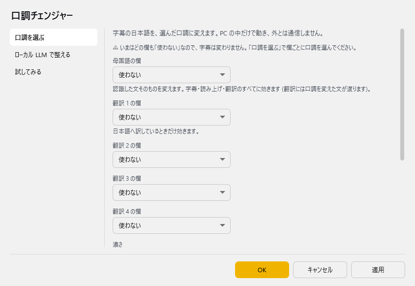
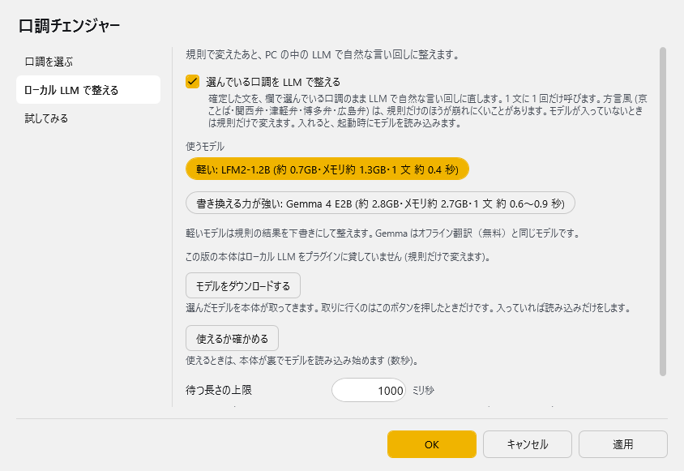
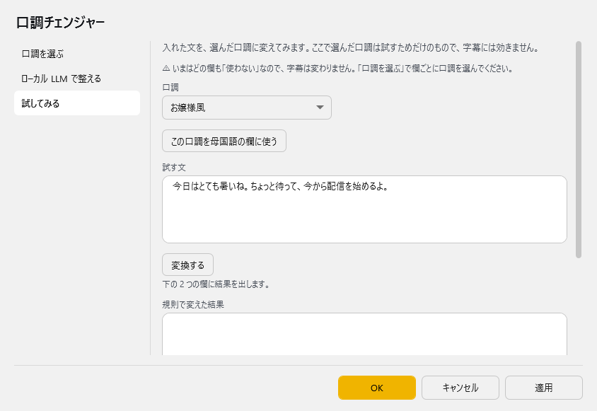

# 口調チェンジャー

<!-- version-banner -->
<!-- TODO(version): 同梱されるゆかコネNEO の版が決まったら「（ゆかコネNEO v3.0.xx から、プラグインの版は v1.0）」を書き足す -->
!!! info ""
    ゆかコネNEO **v3.0** のドキュメントです。このプラグインは **v3.0 で新しく入ったもの**（プラグインの版は v1.0）で、v2.3 にはありません。v2.3 との違いは [v2.3 から v3.0 への移行](../../mig/mig_neo_v3.0.md) をご覧ください。

!!! Info "前提条件"
    * ルビのプラグイン（同梱）の辞書を使います。ルビのプラグインを「使う」にする必要はありませんが、フォルダ（`plugin_Ruby` の中の `IpaDic`）は消さないでください
    * 「LLM で整える」を使うときだけ、設定画面からモデル（軽いもので約 0.7GB）をダウンロードします

## このプラグインで出来ること

字幕の日本語を、選んだ**口調**に変えます。

* お嬢様風・執事風・京ことば風・関西弁風・武士風など、**18 の口調**から選べます
* 母国語の欄と、翻訳 1〜4 の欄（日本語へ訳した欄）に、それぞれ別の口調を選べます
* 変えるのは **PC の中だけ**です。ふだんは外と通信しません（通信するのは、モデルの「ダウンロード」ボタンを押したときだけです）
* 規則で変えたあと、PC の中の小さな LLM で**自然な言い回しに整える**こともできます（既定で ON。モデルが入っていなければ規則だけで変えます）

たとえば「今日はとても暑いね。ちょっと待って、今から配信を始めるよ。」を、お嬢様風なら「ですわ」「わたくし」の話し方に、武士風なら「〜でござる」「拙者」の話し方にします。

### 選べる口調

| 口調 | 雰囲気 |
|:--|:--|
| 丁寧語 (です・ます) | 文末を「です・ます」にそろえます |
| お嬢様風 | 「ですわ」「ますの」「わたくし」 |
| 執事風 | 「でございます」「かしこまりました」。呼びかけは設定で選べます |
| 雅言葉 (古典風) | 「〜なり」「〜けり」「いと」 |
| 京ことば風 ※ | 「〜どす」「〜へん」「おおきに」 |
| 関西弁風 ※ | 「〜や」「ほんま」「めっちゃ」 |
| 津軽弁風 ※ | 「〜だじゃ」「〜べ」「わんつか」 |
| 武士風 | 「〜でござる」「拙者」「かたじけない」 |
| 殿様風 | 「〜じゃ」「余は」「そち」 |
| 公家風 | 「〜でおじゃる」「麿」「〜たもれ」 |
| 博士風 | 「〜じゃ」「わし」「〜かね」 |
| 猫風 | 語尾に「にゃ」 |
| ギャル風 | 「〜じゃん」「マジ」「ウケる」 |
| 体育会系 | 「〜っす」「自分」「あざっす」 |
| 江戸っ子風 | 「〜でぃ」「〜ぜ」「てやんでぃ」 |
| 博多弁風 ※ | 「〜たい」「〜ばい」「〜けん」 |
| 広島弁風 ※ | 「〜じゃ」「〜けぇ」「ぶち」 |
| ロボット風 | 「〜デス」「〜マス」。ふつう以上ではひらがなをカタカナにします |

!!! Note "※ 方言風の口調について"
    京ことば風・関西弁風・津軽弁風・博多弁風・広島弁風は、雰囲気を出すための近似です。実際の方言を正確に再現するものではありません。

## 有効化

上のタブ **プラグイン** → **プラグインを追加** で、ジャンル **「認識の修正や変換」** の **口調チェンジャー** を選んで **追加する** を押してください（一覧の **使う** が ON になります）。手順は [プラグインの有効化](enabled.md) をご覧ください。

!!! Warning "使うにしただけでは、字幕は変わりません"
    はじめは、どの欄の口調も **「使わない」** になっています。設定画面の「口調を選ぶ」で、欄ごとに口調を選んでください。

## 設定

プラグイン一覧で、このプラグインの名前の右にある **「設定」** を押すと開きます。
画面は **3 ページ**に分かれていて、左の一覧で切り替えます（口調を選ぶ／ローカル LLM で整える／試してみる）。

!!! info "閉じるときの 3 択"
    設定は**下書き**として持たれ、「OK」か「適用」を押すまで動いているプラグインには効きません。
    変更したまま閉じようとすると「変更が保存されていません」と聞かれ、**［はい］保存して閉じる／［いいえ］破棄して閉じる／［キャンセル］閉じるのをやめる** から選べます。

### 口調を選ぶ

ページのいちばん上に **「字幕に掛かる口調: 母国語 = お嬢様風 / …」** のように、いま効いている口調が出ます。どの欄も「使わない」なら、そのことが ⚠ 付きで出ます。

| 項目 | 説明 |
|:--|:--|
| 母国語の欄 | 認識した文そのものを変えます。**字幕・読み上げ・翻訳のすべてに効きます**（翻訳には口調を変えた文が渡ります）。既定：使わない |
| 翻訳 1 の欄〜翻訳 4 の欄 | 翻訳した文を変えます。**日本語へ訳しているときだけ**効きます。既定：使わない |
| 濃さ | **控えめ**（語尾だけ）／**ふつう**（一人称やよく使う言葉も）／**濃いめ**（強めの言い回しも）。既定：ふつう |
| 確定する前の文にも掛ける | 認識の途中経過にも、規則の変換だけを掛けます。切ると、確定した文だけが変わります。既定：ON |
| 執事風の呼びかけ | 執事風で「あなた」をこの言葉にします（例: お嬢様・旦那様・ご主人様）。既定：お嬢様 |

!!! Info "変えない文"
    * 日本語でない文は変えません（言語が分からないときは、文字を見て日本語かどうかを決めます）
    * 読み上げ API・翻訳サーバー経由で来た文（コメントの読み上げなど）は変えません

!!! Info "確定する前の文の扱い"
    「確定する前の文にも掛ける」が ON のとき、途中経過にも口調を掛けますが、**句点で閉じていない末尾（まだ話している所）は変えません**。
    話している途中で語尾が変わって、確定したときに別の言い回しになるのを防ぐためです。LLM で整えるのは確定した文だけです。

### ローカル LLM で整える

規則で変えたあと、PC の中の LLM で自然な言い回しに整えます。

| 項目 | 説明 |
|:--|:--|
| 選んでいる口調を LLM で整える | 確定した文を、欄で選んでいる口調のまま LLM で整えます。**1 文に 1 回だけ**呼びます。モデルが入っていないときは規則だけで変えます。オンにして、どれかの欄で口調を選んでいると、起動時にモデルを読み込みます（どの欄も「使わない」なら読み込みません）。既定：ON |
| 使うモデル | **軽い: LFM2-1.2B**（約 0.7GB・メモリ約 1.3GB・1 文 約 0.4 秒）／**書き換える力が強い: Gemma 4 E2B**（約 2.8GB・メモリ約 2.7GB・1 文 約 0.6〜0.9 秒）。既定：軽い |
| モデルの状態 | 入っているか・準備中か、これまでに呼んだ回数・使った回数・間に合わなかった回数などが出ます |
| 「モデルをダウンロードする」ボタン | 選んだモデルを本体が取ってきます。進み具合（MB と %）がボタンの下に出ます。入っていれば読み込みだけをします |
| 「使えるか確かめる」ボタン | 使えるかどうかを確かめます。使えるときは、本体が裏でモデルを読み込み始めます（数秒） |
| 待つ長さの上限 | 確定した文ごとに、LLM の答えをこの長さまで待ちます（100〜5000 ミリ秒）。**その間、字幕と読み上げも待ちます。** 過ぎたら規則の結果を出します。既定：1000 ミリ秒（おすすめは 700〜1000） |

!!! Info "通信するのはボタンを押したときだけ"
    * モデルを取りに行くのは **「モデルをダウンロードする」を押したときだけ**です。ふだん字幕を変えるときは、モデルが手元に無くても取りに行きません（規則だけで変えます）
    * 取ってくるのは本体で、このプラグインは外と通信しません
    * はじめてのときは、[オフライン翻訳（無料）](../startup/startup_option.md#offline-translation) と同じ **利用条件の画面** が出ます。同意するとダウンロードを始めます。同意しないとダウンロードしません
    * Gemma 4 E2B はオフライン翻訳（無料）と同じモデルです。モデルの保存先も同じです（[モデルの保存先と管理](../startup/startup_option.md#model-storage)）

!!! Tip "LLM で整えないとき"
    次のときは、LLM を使わずに規則の結果を出します。

    * 確定する前の文
    * 80 字を超える長い文（句点の無い長い文で字幕が止まらないように）
    * 答えが待つ長さの上限を過ぎたとき・答えがおかしかった（話が変わった・口調が崩れた）とき
    * 間に合わないことが続いたとき（60 秒ほど休みます）

!!! Note "方言風の口調"
    京ことば風・関西弁風・津軽弁風・博多弁風・広島弁風は、規則だけのほうが崩れにくいことがあります。気になるときは「選んでいる口調を LLM で整える」を切って比べてください。

### 試してみる

入れた文を、選んだ口調に変えてみます。**ここで選んだ口調は試すためだけのもので、字幕には効きません。**

| 項目 | 説明 |
|:--|:--|
| 口調 | 試す口調です。既定：お嬢様風 |
| 「この口調を母国語の欄に使う」ボタン | 試している口調を、母国語の欄に入れます。「OK」か「適用」を押すと字幕に効きます |
| 試す文 | 変える文を入れます |
| 「変換する」ボタン | 下の 2 つの欄に結果を出します。かかった時間はボタンの下に出ます |
| 規則で変えた結果 | 規則だけで変えた文です |
| LLM で整えた結果 | LLM で整えた文です。使わなかったときは、その理由（モデルが入っていない・待つ長さの上限を過ぎた など）が出ます |

濃さと LLM の設定は、「口調を選ぶ」「ローカル LLM で整える」の編集中の値（「OK」を押す前の値）で試せます。執事風の呼びかけは、保存した値で試します。

## 使うとき

1. 設定画面の **「試してみる」** で、口調と濃さを試します。
2. 気に入ったら **「この口調を母国語の欄に使う」** を押し、**「OK」** を押します。
3. 話すと、字幕と読み上げが選んだ口調になります。

!!! Info "翻訳との関係"
    母国語の欄の口調は、翻訳の前に掛かります。翻訳エンジンには口調を変えた文が渡ります。
    英語などへ訳した字幕には口調は出ませんが、言い回しによって訳が少し変わることがあります。

!!! Tip "AI アシスタントから切り替える"
    [MCP サーバー](plugin_mcpserver.md) のプラグインを使っていれば、AI アシスタントから欄の口調を切り替えたり、口調の一覧を見たりできます（「使えるツール」で口調チェンジャーの操作を選びます）。

## 困ったとき

| 起きること | 確かめること |
|:--|:--|
| 字幕の口調が変わらない | 「口調を選ぶ」のいちばん上に「⚠ いまはどの欄も「使わない」なので、字幕は変わりません」と出ていないか。**「試してみる」の口調は字幕には効きません**。母国語の欄に口調を選んで「OK」を押してください |
| 翻訳の字幕だけ変わらない | 翻訳 1〜4 の欄は、**日本語へ訳しているときだけ**効きます |
| 「変換する」で「辞書 (IPADIC) が見つかりません」と出る | ルビのプラグインのフォルダ（`plugin_Ruby\IpaDic`）があるか。消してしまったときは、ゆかコネNEO を入れ直してください |
| 「LLM で整えた結果」が「(使わなかった: モデルが入っていない)」 | 「ローカル LLM で整える」で「モデルをダウンロードする」を押します |
| 「(使わなかった: オフライン翻訳のライセンスに同意していない)」 | 「モデルをダウンロードする」を押し、出てきた利用条件の画面で同意します |
| 「(使わなかった: 待つ長さの上限を過ぎた)」が多い | 軽いモデル（LFM2-1.2B）にするか、「待つ長さの上限」を少し長くします。長くすると、その分だけ字幕と読み上げが遅れます |
| 字幕と読み上げが遅れる | 「待つ長さの上限」を短くするか、「選んでいる口調を LLM で整える」を切ります |
| 方言風の口調が不自然 | 「選んでいる口調を LLM で整える」を切って、規則だけで試してください |
