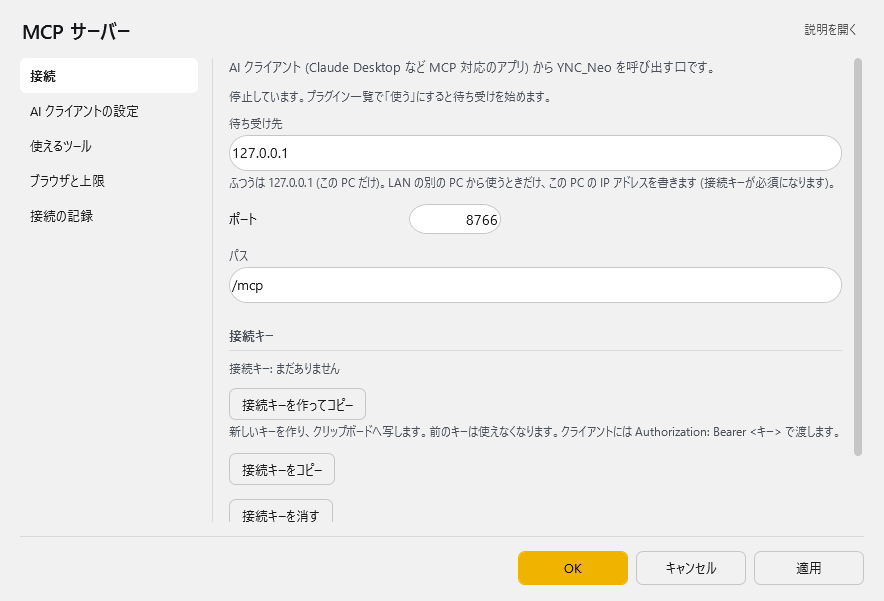
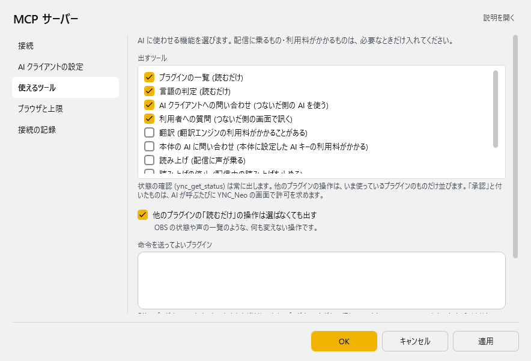

# MCP サーバー

<!-- version-banner -->
!!! info ""
    ゆかコネNEO **v3.0** のドキュメントです。このプラグインは **v3.0 で新しく入ったもの**（ゆかコネNEO v3.0.7 から。「AI クライアントの設定」のページは v3.0.11 から）で、v2.3 にはありません。v2.3 との違いは [v2.3 から v3.0 への移行](../../mig/mig_neo_v3.0.md) をご覧ください。

!!! Info "前提条件"
    * Streamable HTTP に対応した MCP クライアント（Claude Code・VS Code・Cursor・Claude Desktop・Codex CLI など）
    * 接続先は既定で `http://127.0.0.1:8766/mcp` です

## このプラグインで出来ること

AI アシスタント（MCP 対応のアプリ）から、ゆかコネNEO を操作できるようにします。

* ゆかコネNEO の状態を調べたり、プラグインの一覧を見たり、文の言語を判定したりできます
* 選んだ機能だけ、**読み上げ・字幕の送信・翻訳・本体の AI への問い合わせ** を AI に頼めます
* 対応しているプラグインの操作（OBS のシーン切り替え、読み上げの声の一覧 など）も、AI から呼べます

!!! Info "既定は「この PC から・読むだけ」"
    * 既定では **この PC からだけ** 接続でき、AI に使わせるのは **何も変えない（読むだけの）機能だけ** です
    * 配信に乗る機能や、利用料のかかる機能は、自分で選んだものだけが使えるようになります
    * 配信に見える操作は、AI が呼ぶたびに **ゆかコネNEO の画面で許可を求めます**

接続のしかた・クライアントごとの設定例・接続キーの詳しい扱いは、[AIアシスタント（MCP）からゆかコネを操作する](../tech/tech_api_neo.md#mcp) にまとめています。

## 有効化

上のタブ **プラグイン** → **プラグインを追加** で、ジャンル **「API・ツール拡張」** の **MCP サーバー** を選んで **追加する** を押してください（一覧の **使う** が ON になります）。手順は [プラグインの有効化](enabled.md) をご覧ください。

「使う」にすると待ち受けを始めます。切ると待ち受けを止めます。

## 設定

プラグイン一覧で、このプラグインの名前の右にある **「設定」** を押すと開きます。
画面は **5 ページ**に分かれていて、左の一覧で切り替えます（接続／AI クライアントの設定／使えるツール／ブラウザと上限／接続の記録）。

!!! info "閉じるときの 3 択"
    設定は**下書き**として持たれ、「OK」か「適用」を押すまで動いているプラグインには効きません。
    変更したまま閉じようとすると「変更が保存されていません」と聞かれ、**［はい］保存して閉じる／［いいえ］破棄して閉じる／［キャンセル］閉じるのをやめる** から選べます。

### 接続

ページの上に、いまの状態（「待ち受け中: http://127.0.0.1:8766/mcp　接続キー: なし (この PC からだけ)」など）が出ます。

| 項目 | 説明 |
|:--|:--|
| 待ち受け先 | ふつうは `127.0.0.1`（この PC だけ）。LAN の別の PC から使うときだけ、この PC の IP アドレスを書きます（接続キーが必須になります）。既定：`127.0.0.1` |
| ポート | 1024〜65535。既定：8766 |
| パス | 既定：`/mcp` |
| 「接続キーを作ってコピー」ボタン | 新しいキーを作り、クリップボードへ写します。**前のキーは使えなくなります** |
| 「接続キーをコピー」ボタン | 作ってあるキーをクリップボードへ写します |
| 「接続キーを消す」ボタン | キーを消します |
| この PC からの接続にも接続キーを求める | 他のアプリからの勝手な呼び出しを防ぎたいときに入れます。キーを作ると自動的に必須になります。既定：OFF |

接続キーは画面には出しません。キーの渡し方は [接続キー](../tech/tech_api_neo.md#mcp) をご覧ください。

### AI クライアントの設定

使っている AI クライアントの側に ゆかコネNEO を登録する書き方が、クライアントごとに並びます（Claude Code・VS Code・Cursor・Claude Desktop・Codex CLI・その他）。

* **「例をコピー」** で設定例を写し、そのクライアントの設定に貼り付けます
* 接続キーが要るときは、例の中のキーは `<接続キー>` という仮の文字になります。**「キー入りでコピー」** を押すと、本物のキーに差し替えて写します

書く場所はクライアントごとに違います。[AIアシスタント（MCP）からゆかコネを操作する](../tech/tech_api_neo.md#mcp) の「つなぎ方」の表をご覧ください。

### 使えるツール

AI に使わせる機能を選びます。**配信に乗るもの・利用料がかかるものは、必要なときだけ入れてください。**

| 項目 | 説明 |
|:--|:--|
| 出すツール | AI に出す機能にチェックを入れます。「状態の確認」は常に出します。他のプラグインの操作は、**いま使っているプラグインのものだけ**並びます |
| 他のプラグインの「読むだけ」の操作は選ばなくても出す | OBS の状態や声の一覧のような、何も変えない操作です。既定：ON |
| 命令を送ってよいプラグイン | 「他のプラグインへの命令」を入れたときだけ使います。プラグインのタグを 1 行に 1 つ書きます（例: `Plugin_OBS5`）。空なら何も呼べません |
| 本体の AI のモデル | 「本体の AI に問い合わせ」で使うモデル名（OpenAI のとき）。AI クライアントからは変えられません。既定：`gpt-4.1-mini` |

一覧の行には、次の印が付きます。

| 印 | 意味 |
|:--|:--|
| 読むだけ | 何も変えません |
| 承認 | AI が呼ぶたびに、ゆかコネNEO の画面で許可を求めます。**60 秒以内に答えないと断ります** |
| 変更あり | 許可を求めずに、設定や状態を変えます |

本体の機能のうち、既定で出さないもの（翻訳・本体の AI に問い合わせ・読み上げ・読み上げの停止・字幕の送信・他のプラグインへの命令）と、その注意は [AI に使わせる機能を選ぶ](../tech/tech_api_neo.md#mcp) の表をご覧ください。

### ブラウザと上限

ブラウザ上のヘルプデスクなどから直接接続するときの許可と、使いすぎを防ぐ上限です。

| 項目 | 説明 |
|:--|:--|
| 許可していないページから来たら、その場で訊く | この PC のページ（または接続キーがあるときのインターネット上のページ）から来たときだけ、「MCP サーバー: 接続の許可」のウィンドウで訊きます。一度断ったページには、次に起動するまで訊きません。既定：ON |
| 接続を許すページ (Origin) | 1 行に 1 つ（例: `http://localhost:3210`）。**空ならブラウザからの接続はすべて断ります。** この PC 以外のページ（`https://～`）を書くと接続キーが必須になります。既定：空 |
| 1 分あたりの呼び出し回数 | 既定：60 回 |
| 1 回の待ち時間の上限 | 既定：30 秒 |
| 文の長さの上限 | 既定：2000 文字 |
| 同時に処理する数 | 既定：8 |

### 接続の記録

接続した・断った・呼ばれた記録が、新しい順に出ます（ゆかコネNEO を閉じると消えます）。**接続できないときは、ここに理由が出ます。**

* 断ったページがあると、**「（ページ） を許可する」** のボタンが出ます。押すと「接続を許すページ」に足します。インターネット上のページは、先に接続キーを作っておく必要があります
* **「記録を写す」** でクリップボードへ写し、**「記録を消す」** で消せます

## 安全に使うために

!!! Warning "AI に任せる範囲は必要なだけに"
    * **待ち受け先は `127.0.0.1` のまま**にしておくのが安全です。LAN から使うときだけ IP アドレスに変えます（接続キーが必須になります。`0.0.0.0` は使えません）
    * 配信に乗る機能（読み上げ・字幕の送信）や、利用料のかかる機能（翻訳・本体の AI）は、使うときだけ入れてください
    * **「他のプラグインへの命令」は最も強い権限**です。入れるときは「命令を送ってよいプラグイン」を必要なものだけにします。本体の終了は、ここに書いても呼べません
    * 「承認」の付いた操作は、心当たりがないときは許可しないでください
    * 接続キーは画面・設定ファイル・ログには出しません。知られたときは「接続キーを作ってコピー」で作り直してください

## 困ったとき

| 起きること | 確かめること |
|:--|:--|
| 「停止しています」と出る | プラグイン一覧で「使う」になっているか確かめます |
| AI クライアントから接続できない | 「接続の記録」に理由が出ます。接続先の URL（ポート・パス）が「AI クライアントの設定」の例と同じか、接続キーが要る設定なのに渡していないかを確かめます |
| ブラウザのページから接続できない | ページ側には断った理由が見えません。「接続の記録」を見て、「（ページ） を許可する」で許可します |
| 使いたい機能が AI に見えない | 「使えるツール」でチェックを入れ、「OK」を押します。プラグインの操作は、そのプラグインを「使う」にしているときだけ並びます |
| AI が操作するたびに許可を求められる | 「承認」の付いた操作です。配信に見える操作なので、毎回確かめるようにしています |
| 「ポート 8766 は他のアプリが使っています」と出る | 「ポート」をほかの番号に変え、AI クライアントの設定も合わせて直します |
| 「この待ち受け先を開く権限がありません」と出る | 待ち受け先を `127.0.0.1` に戻します。LAN から使うときは、Windows で URL の予約（`netsh http add urlacl`）が要ります |
