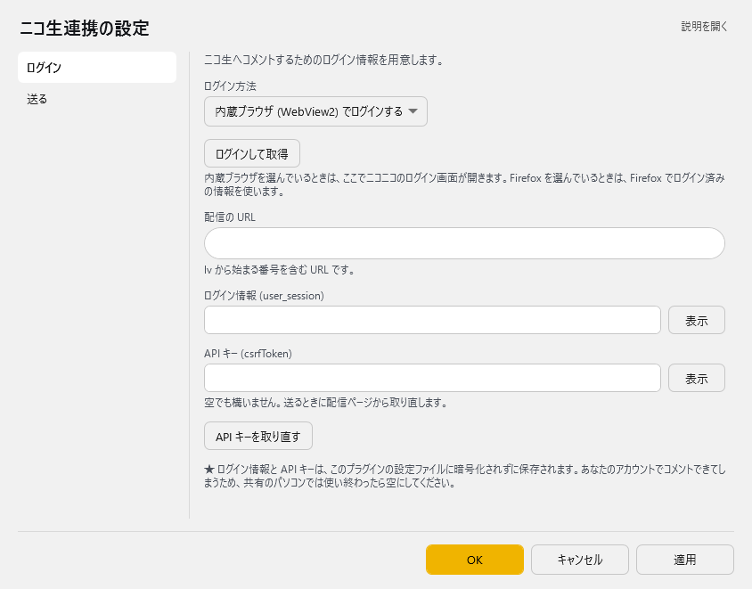
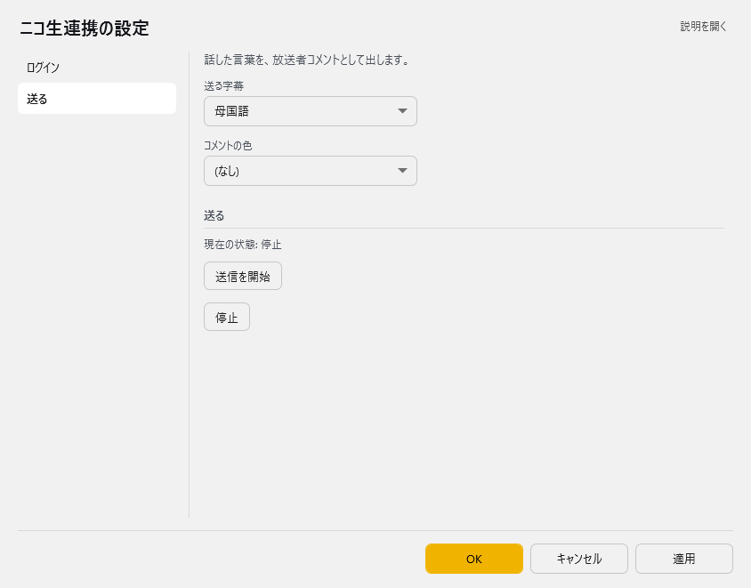

<!-- version-banner -->
!!! info ""
    ゆかコネNEO **v3.0** のドキュメントです。v2.3 をお使いの方は [v2.3 版のこのページ](../../v2.3/plugin/plugin_niconama.md) を、違いを知りたい方は [v2.3 から v3.0 への移行](../../mig/mig_neo_v3.0.md) をご覧ください。

!!! Info "前提条件"
    * ニコニコ生放送で配信をしていること
    * 配信中の番組のURL（``https://live.nicovideo.jp/watch/lv…``）

## このプラグインで出来ること

* 音声認識した字幕を、ニコニコ生放送のコメントとして送信できます
* 送信する言語（母国語・翻訳1～4）を選べます
* コメントの色を指定できます

## 有効化

* 上のタブ **プラグイン** → **プラグインを追加** で「ニコニコ生放送連携」を選んで **追加する** を押してください（一覧の **使う** が ON になります）。→ [プラグインの有効化](enabled.md)

## 設定

プラグイン一覧で、このプラグインの名前の右にある **「設定」** を押すと開きます。
画面は **2 ページ**に分かれていて、左の一覧で切り替えます（ログイン／送る）。

!!! info "閉じるときの 3 択"
    設定は**下書き**として持たれ、「OK」か「適用」を押すまで動いているプラグインには効きません。
    変更したまま閉じようとすると「変更が保存されていません」と聞かれ、**［はい］保存して閉じる／［いいえ］破棄して閉じる／［キャンセル］閉じるのをやめる** から選べます。

### ログイン

ニコ生へコメントするためのログイン情報を用意します。

| 項目 | 説明 |
|:--|:--|
| ログイン方法 | 選択肢：Firefox のログイン情報を使う／内蔵ブラウザ (WebView2) でログインする。既定：内蔵ブラウザ (WebView2) でログインする |
| 「ログインして取得」ボタン | 内蔵ブラウザを選んでいるときは、ここでニコニコのログイン画面が開きます。Firefox を選んでいるときは、Firefox でログイン済みの情報を使います。 |
| 配信の URL | lv から始まる番号を含む URL です。 |
| ログイン情報 (user_session) | 入力は伏せ字で表示されます。「表示」を押すと中身を確かめられます（もう一度押すと伏せます） |
| API キー (csrfToken) | 空でも構いません。送るときに配信ページから取り直します。入力は伏せ字で表示されます。「表示」を押すと中身を確かめられます（もう一度押すと伏せます） |
| 「API キーを取り直す」ボタン | — |

> ★ ログイン情報と API キーは、このプラグインの設定ファイルに暗号化されずに保存されます。あなたのアカウントでコメントできてしまうため、共有のパソコンでは使い終わったら空にしてください。

### 送る

話した言葉を、放送者コメントとして出します。

| 項目 | 説明 |
|:--|:--|
| 送る字幕 | 選択肢：母国語／翻訳 1／翻訳 2／翻訳 3／翻訳 4。既定：母国語 |
| コメントの色 | (なし)／white／red／pink／… などから選びます。既定：(なし) |

**送る**

> 現在の状態: …

| 項目 | 説明 |
|:--|:--|
| 「送信を開始」ボタン | — |
| 「停止」ボタン | — |

### 補足

!!! info "v3.0 で内蔵ブラウザが WebView2 になりました"
    v2.3 では内蔵ブラウザとして CefSharp（Chromium）と WebView2 を選べましたが、
    v3.0 では **WebView2 だけ**になりました。
    **WebView2 ランタイム**が必要です（Windows 11 は標準、Windows 10 も Edge が入っていれば入っています）。
    ログイン状態は WebView2 側に保存されるため、**v2.3 でログインしていても入り直しが必要になることがあります**。

## ライブ設定（配信中にその場で変える） { #live }

本体の **操作パネル → ライブ設定** に、このプラグインの「配信ごとに変わる値」が並びます。設定画面を開かずに値を入れて **「反映」** を押せば、すぐプラグインに入ります。しくみは [標準設定項目 - ライブ設定とプラグインの帯](../startup/startup_basic.md#live-settings) をご覧ください。

| 項目 | 説明 |
|:--|:--|
| 配信の URL | lv から始まる番号を含む URL です。番号 (lv……) だけでも構いません |
| 送る字幕 | 母国語／翻訳 1～4 |

**「送信を開始」／「停止」** ボタンでコメントの送信を始める・止めるを切り替えます。画面上部のプラグインの帯で、このプラグインのアイコンを**ダブルクリック**しても同じように切り替えられます（1 回のクリックはこれまでどおり設定を開きます）。

## 使うとき

1. ニコニコ生放送で配信を開始します。
2. 設定画面の「ログイン」ページで、配信の URL を貼り付けます。
3. **「ログインして取得」** を押します（API キーは空でも構いません。送るときに配信ページから取り直します。先に取っておきたいときは **「API キーを取り直す」** を押します）。
4. 「送る」ページで送る字幕を選び、OK を押します。
5. 「送る」ページの **「送信を開始」** を押し、音声認識を始めると、確定した字幕がコメントとして送られます。

!!! Info "ログイン情報が取れないとき"
    * Firefox のログイン情報を使う場合は、Firefox にニコニコへログインした状態が残っていることが前提です。Firefox でログインし直してから、もう一度お試しください。
    * それでも取れない場合は、ログイン情報 (user_session) と API キー (csrfToken) を手で入力することもできます。

!!! Info "コメントが送れなくなったとき"
    * 送っている途中で API キーを断られたとき（401 / 403）は、**キーを配信ページから自動で取り直し、同じコメントをもう 1 回送ります**。コメントは落としません。
    * 取り直したキーは設定へ書き戻されるので、次に「送信を開始」を押したときも、設定画面の「API キー (csrfToken)」も新しいキーになります。
    * 送っている途中でログインし直したり、配信の URL・キーを直したりした場合も、OK か「適用」を押せば次のコメントから新しいログイン情報とキーで送ります。「送信を開始」を押し直す必要はありません。
    * 取り直しても断られることが続くときは、ログイン情報が切れています。「送る」ページの「現在の状態」に **「再ログインしてください (401)」** と出るので、「ログインして取得」でログインし直してください。
    * 内蔵ブラウザが自動で開くことはありません。「現在の状態」は、設定画面を開いたままでも新しい様子に変わります。

!!! Warning "コメントの投稿間隔について"
    * ニコニコ生放送には、コメントの投稿間隔や内容についてのルールがあります。
    * 認識のたびに大量のコメントを投稿すると、配信の見え方を損なったり、制限がかかることがあります。送信する言語をしぼって使うことをおすすめします。
