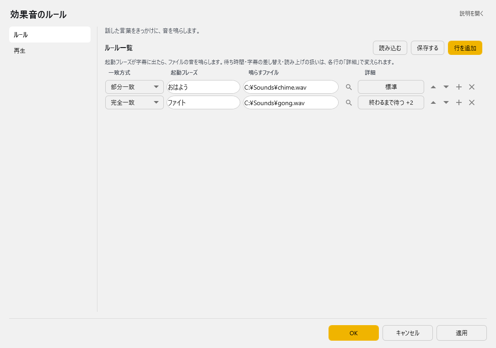
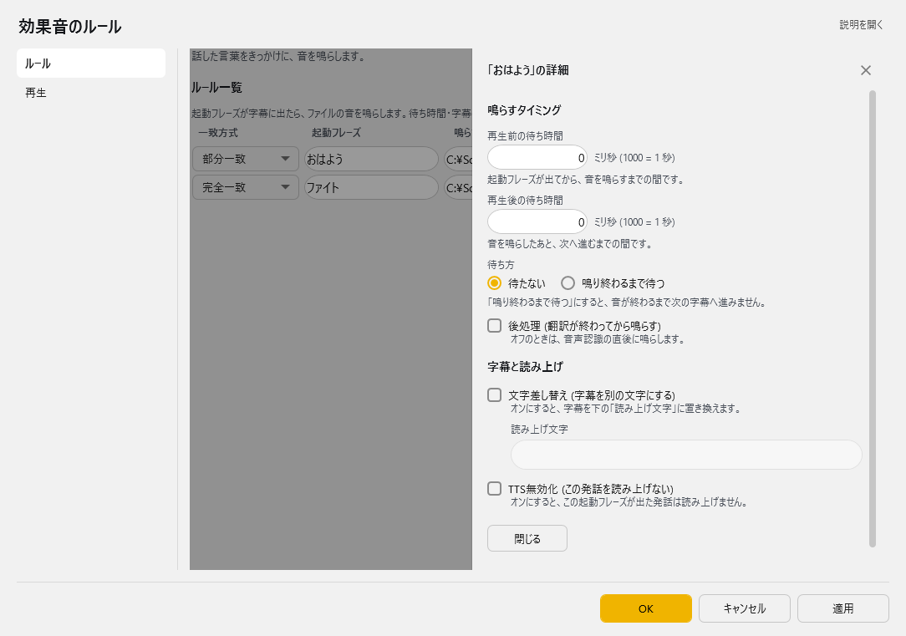
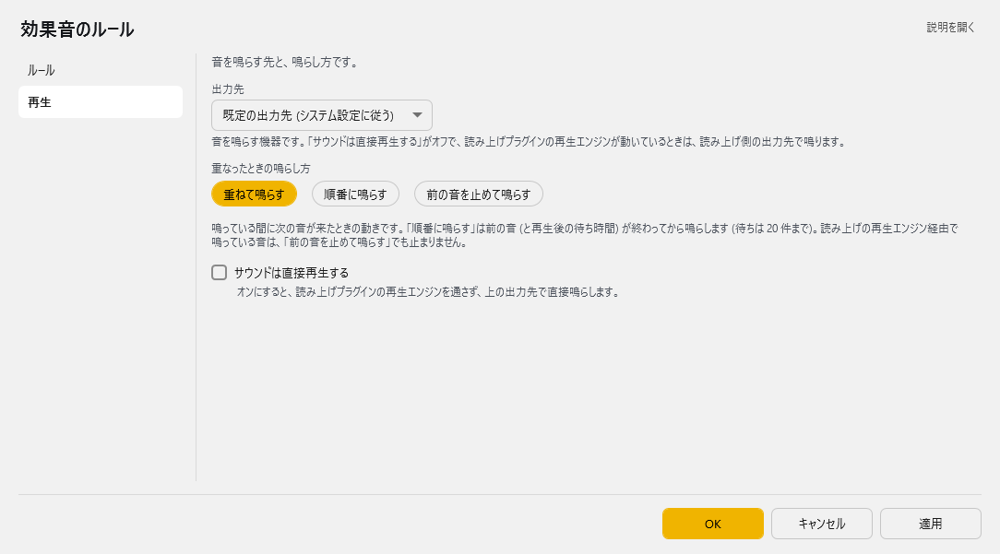

<!-- version-banner -->
!!! info ""
    ゆかコネNEO **v3.0** のドキュメントです。v2.3 をお使いの方は [v2.3 版のこのページ](../../v2.3/plugin/plugin_playsound.md) を、違いを知りたい方は [v2.3 から v3.0 への移行](../../mig/mig_neo_v3.0.md) をご覧ください。

!!! Info "前提条件"
    * なし

## このプラグインで出来ること

* 言葉に反応してサウンドファイルを再生できます。
* WASAPI/ASIOによる高品質・低遅延音声出力
* PlayVoiceプラグインとの統合音声管理
* 複数出力デバイスの自動検出・選択
* プロオーディオ向けASIO対応
* 多言語インターフェース対応

## 有効化

* 上のタブ **プラグイン** → **プラグインを追加** でこのプラグインを選んで **追加する** を押します（一覧の **使う** が ON になります）。→ [プラグインの有効化](enabled.md)

## 設定

プラグイン一覧で、このプラグインの名前の右にある **「設定」** を押すと開きます。
画面は **2 ページ**に分かれていて、左の一覧で切り替えます（ルール／再生）。

!!! info "閉じるときの 3 択"
    設定は**下書き**として持たれ、「OK」か「適用」を押すまで動いているプラグインには効きません。
    変更したまま閉じようとすると「変更が保存されていません」と聞かれ、**［はい］保存して閉じる／［いいえ］破棄して閉じる／［キャンセル］閉じるのをやめる** から選べます。

### ルール

話した言葉をきっかけに、音を鳴らします。



行の **「詳細」** を押すと、右に詳細のパネルが開きます。



**ルール一覧**（表）

列：一致方式／起動フレーズ／鳴らすファイル／詳細

| 列 | 説明 |
|:--|:--|
| 一致方式 | 完全一致／部分一致／使わない。既定：部分一致 |
| 起動フレーズ | この言葉が字幕に出たら鳴らします |
| 鳴らすファイル | 鳴らす音のファイル (*.wav;*.mp3) です |
| 詳細 | 待ち時間・字幕の差し替え・読み上げの扱いを決めるパネルが右に開きます。ボタンには、既定から変えた項目が「終わるまで待つ +1」のように出ます（何も変えていなければ「標準」） |

起動フレーズが字幕に出たら、ファイルの音を鳴らします。上から順番に見て、当たったらその行で終わります。

表の右上の **「行を追加」** で行を増やします。行の右端のボタンは ▲▼＝1 つ上へ／下へ、＋＝この下に足す、×＝この行を消す です。**「保存する」** はいまの中身を CSV へ書き出します（控え用）。**「読み込む」** は CSV から読み込んで、いまの中身と入れ替えます。
行が 10 行以上になると、表の上に **絞り込み** の欄が出ます（Ctrl+F）。入れた文字を含む行だけが表示され、「詳細」の中身にも当たります。Esc で解除します。

**「詳細」のパネル** (v3.0.0～)

| 項目 | 説明 |
|:--|:--|
| 再生前の待ち時間 | 起動フレーズが出てから、音を鳴らすまでの間です。（ミリ秒。1000 = 1 秒） |
| 再生後の待ち時間 | 音を鳴らしたあと、次へ進むまでの間です。（ミリ秒） |
| 待ち方 | 待たない／鳴り終わるまで待つ。「鳴り終わるまで待つ」にすると、音が終わるまで次の字幕へ進みません。既定：待たない |
| 後処理 (翻訳が終わってから鳴らす) | オフのときは、音声認識の直後に鳴らします。 |
| 文字差し替え (字幕を別の文字にする) | オンにすると、字幕を下の「読み上げ文字」に置き換えます。読み上げ文字が空のままだと、字幕が空になります。 |
| 読み上げ文字 | 差し替える文字です |
| TTS無効化 (この発話を読み上げない) | オンにすると、この起動フレーズが出た発話は読み上げません。 |

入力した値はすぐ表に反映されます。取り消すときは、設定画面の「キャンセル」で戻せます。

### 再生

音を鳴らす先と、鳴らし方です。



| 項目 | 説明 |
|:--|:--|
| 出力先 | 音を鳴らす機器です。「サウンドは直接再生する」がオフで、読み上げプラグインの再生エンジンが動いているときは、読み上げ側の出力先で鳴ります。（既定：既定の出力先 (システム設定に従う)） |
| 重なったときの鳴らし方 | 重ねて鳴らす／順番に鳴らす／前の音を止めて鳴らす。既定：重ねて鳴らす（v3.0.8～） |
| ☑ サウンドは直接再生する | オンにすると、読み上げプラグインの再生エンジンを通さず、上の出力先で直接鳴らします。 |

**重なったときの鳴らし方** は、鳴っている間に次の音が来たときの動きです。

| 選択肢 | 動き |
|:--|:--|
| 重ねて鳴らす | 前の音を鳴らしたまま、次の音も同時に鳴らします |
| 順番に鳴らす | 前の音 (と再生後の待ち時間) が終わってから鳴らします。待てるのは 20 件までです |
| 前の音を止めて鳴らす | 鳴っている音を止めて、次の音を鳴らします。読み上げの再生エンジン経由で鳴っている音は止まりません |

!!! Info "v3.0.8 で直った不具合"
    以前の版では、効果音が 2 つ重なると、先に鳴り終わった音につられてもう一方が途中で切れることがありました。v3.0.8 で直っています。

### 補足

!!! Info "対応メディア"
    * MP3もしくはWave形式に対応しています。
    * コーデックによっては再生がうまくいかないものがあります。
    * Waveの場合は、44.1KHz 16bit 2ch を推奨します

## 使うとき

1. 音声認識をすれば自動的に再生されます。

## 高度な機能

### 高品質音声出力システム

#### WASAPI対応
* **低遅延出力**: Windowsの高性能音声API使用
* **高音質**: 44.1kHz以上の高サンプリングレート対応
* **排他モード**: 他のアプリケーションからの影響を最小化
* **自動デバイス選択**: 最適な出力デバイスの自動検出

#### ASIO対応
* **プロオーディオ**: プロ用音声インターフェース対応
* **極低遅延**: ハードウェア直結による最小遅延
* **多チャンネル**: 複数チャンネル出力対応
* **スタジオ品質**: 放送・録音スタジオレベルの音質

### PlayVoice統合管理

#### 連携システム
* **PlayEngine連携**: 読み上げプラグインとの自動連携
* **統合音声制御**: 音声合成と効果音の統一管理
* **競合回避**: 複数音声の適切な制御

#### soundDirectlyモード
* **直接再生**: PlayEngineを経由しない高速再生
* **軽量動作**: システムリソースの効率的使用
* **独立制御**: 読み上げと独立した音声制御

### 複数デバイス対応

#### 自動検出システム
* **DirectSound**: 標準的な音声出力
* **WASAPI**: Windows高性能音声API
* **ASIO**: プロオーディオインターフェース
* **デバイス情報**: 利用可能デバイスの詳細情報表示

#### 出力品質設定
| 出力方式 | 遅延 | 品質 | 用途 |
|:---------|:-----|:-----|:-----|
| DirectSound | 中程度 | 標準 | 一般用途 |
| WASAPI | 低 | 高品質 | ゲーミング・配信 |
| ASIO | 極低 | スタジオ級 | プロオーディオ |

### 高度な設定オプション

#### 音声処理設定
* **レイテンシ調整**: 再生前・再生後の遅延制御
* **バッファサイズ**: 音声バッファの最適化
* **サンプリングレート**: 出力品質の詳細制御

#### システム統合
* **プロキシ対応**: Windows設定からの自動プロキシ検出
* **多言語UI**: 7言語対応のインターフェース
* **リソース管理**: メモリ・CPU使用量の最適化

### 技術実装詳細

#### アーキテクチャ
```csharp
// 出力デバイス自動選択
if (AsioAvailable()) {
    UseAsioOutput();
} else if (WasapiAvailable()) {
    UseWasapiOutput();
} else {
    UseDirectSoundOutput();
}
```

### 実用例

#### 配信・実況での活用
```
キーワード: "ありがとう" → thankyou.wav (WASAPI出力)
キーワード: "すごい" → amazing.mp3 (ASIO出力)
```

#### プロオーディオ環境
- ASIO対応音声インターフェースでの超低遅延再生
- 複数チャンネルでの効果音分散
- スタジオモニタリング環境での利用

### トラブルシューティング

#### ASIO関連
* **ドライバー確認**: ASIO対応音声インターフェースの接続確認
* **排他制御**: 他のASIOアプリケーションとの競合回避
* **設定確認**: ASIO制御パネルでの適切な設定

#### WASAPI関連
* **排他モード**: 他のアプリケーションによる音声デバイス使用状況確認
* **サンプリングレート**: デバイス対応レートとの一致確認
* **権限設定**: Windowsオーディオサービスの権限確認

#### 一般的な問題
* **コーデック**: 非対応音声形式での再生失敗
* **ファイルパス**: 音声ファイルの存在・アクセス権限確認
* **デバイス競合**: 複数アプリケーションでの音声デバイス競合

## 特性等

* 上から順番に条件判定します。
* 条件が一致したら、その行で判断を終了します。

