<!-- version-banner -->
!!! info ""
    ゆかコネNEO **v3.0** のドキュメントです。v2.3 をお使いの方は [v2.3 版のこのページ](../../v2.3/plugin/plugin_playvoice.md) を、違いを知りたい方は [v2.3 から v3.0 への移行](../../mig/mig_neo_v3.0.md) をご覧ください。

!!! Info "前提条件"
    * つかいたい音声ソフトウェアがインストールされていること
    * 音声ソフトウェアが正しく発声できる状態であること
    * つかう音声ソフトウェアが立ち上がっていること

!!! Warning "関連ツールについて"
    * RecotteStudio プラグイン、AssistantSeika、各音源と連携できるように設計しています
    * 連携部分については仕様を参考に実装しています
    * うまくいかない件は各製作者様に直接問い合わせせず、Discordサポートｃｈでご質問ください

## このプラグインで出来ること

* 各種音声合成ソフトを使って音声認識結果を読み上げできます
* VOICEROID、CeVIO、A.I.Voice、VOICEVOXなど多数の音声ソフトに対応
* 長い文章を高速で読み上げる機能
* インターネット上のAI音声サービスも利用可能
* 読み上げ用の辞書を自動管理
* 外部の読み上げ制御ソフト（AssistantSeikaなど）と連携
* PC の中で動く **Irodori-TTS** で、自分で作った声で読み上げ（[Irodori-TTS](#irodori-tts)）
* チャットの「教育」コマンドで読み方を覚えさせる（[読み上げの教育](#speech-teach)）
* 声を WAV ファイルに書き出す（[音声ファイルの生成](#export)）

## 対応音声エンジン詳細

### 無料で使える音声エンジン

#### VOICEVOX
- **価格**: 完全無料
- **公式サイト**: https://voicevox.hiroshiba.jp/
- **動作要件**: Windows 10/11、GPU推奨（CPU版もあり）
- **対応パラメータ**: 音量(0-100)、速度(50-200)、音程(50-200)、抑揚(0-100)
- **注意点**: 初回起動時にエンジンダウンロード（約10分）

#### COEIROINK
- **価格**: 基本無料（追加声優は有料）
- **特徴**: カスタムモデル対応、高品質音声
- **対応パラメータ**: 音量、速度、音程
- **注意点**: **ゆかコネより先に起動する必要あり**

#### Irodori-TTS { #irodori-tts }
- **価格**: 無料（プラグインに同梱。初回にモデルをダウンロード）
- **特徴**: PC の中で動く音声合成。**キャラクター作成ページ**で声を作って保存すると、ボイスの一覧に出ます
- **動作要件**: NVIDIA の GPU があると速く作れます。GPU が無くても CPU で動きます
- **注意点**: 初回はモデルのダウンロード（最大 約 6.5GB）があり、同意を確認する窓が出ます。設定は [Irodori-TTS を使う](#irodori-setup) を見てください

#### 読み上げの教育 { #speech-teach }

棒読みちゃんの「教育」と同じ書き方で、**チャットから言葉の読みを覚えさせる**ことができます（v3.0.11～）。
命令を受け取るのは [Twitch 連携](plugin_twitch.md#speech-teach) と [わんコメ連携](Plugin_OCComm.md) で、覚えた言葉はこの読み上げ連携が持ちます。

|チャットに書くこと|動き|
|:--|:--|
|`教育(言葉=読み)`|言葉の読みを覚えます|
|`(Study 言葉=読み)`|同じく覚えます|
|`忘却(言葉)`|覚えた言葉を忘れます|

かっこと `=` は全角でも構いません。

**使う準備**

1. 読み上げ連携を「使う」にします
2. Twitch 連携の「読み上げの教育」ページ、またはわんコメ連携の「わんコメから受信」ページの **「読み上げの教育コマンドを有効にする」** を入れます（だれに許すかもそこで決めます）

**覚えた言葉を見る・忘れさせる**

詳細設定の **読み方と補正 → 教育で覚えた言葉** に、言葉・読み・教えた人・教えた日時の一覧が出ます（「○ / 1000 語」）。

|ボタン|動き|
|:--|:--|
|選んだ言葉を忘れる|一覧で選んだ言葉を忘れさせます|
|全部忘れる|教育で覚えた言葉を全部忘れさせます。元に戻せません|

ここで忘れさせると、**その場で消えます**（キャンセルでは戻りません）。

!!! Info "覚えられないもの"
    * 覚えた言葉は、配信者の辞書（「認識のあとに直す」）のあとに当てます。**同じ言葉は配信者の辞書が勝ち**、配信者の辞書にある言葉は教育では覚えさせられません
    * 1 文字のかな・数字・記号だけの言葉は覚えません
    * 覚えられるのは 1000 語まで、同じ人からは 1 分に 5 件までです
    * 覚えた言葉は配信者の辞書とは別のファイルに保存します

## 音声ファイルの生成 { #export }

読み上げの声を **WAV ファイルに書き出す** 上級者向けの機能です（v3.0.0～）。詳細設定の左メニューの **上級者向け → 音声ファイルの生成** から開きます。

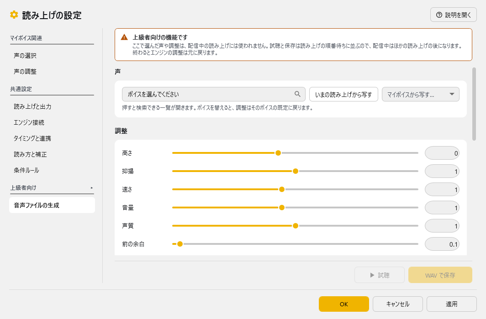

!!! Warning "上級者向けの機能です"
    ここで選んだ声や調整は、**配信中の読み上げには使われません**。試聴と保存は読み上げの順番待ちに並ぶので、配信中はほかの読み上げの後になります。終わるとエンジンの調整は元に戻ります。

|項目|意味|
|:--|:---|
|声|押すと検索できる一覧が開きます。ボイスを替えると、調整はそのボイスの既定に戻ります。WAV にできないボイス（エンジンのアプリが自分で鳴らす方式）は「試聴のみ」と出ます|
|いまの読み上げから写す|声の選択・声の調整で選んでいる声と調整を写します（写すだけで、読み上げの設定は変わりません）|
|マイボイスから写す…|マイボイスの声と調整を写します|
|調整・感情スタイル|このページだけで使う調整です|
|読ませる文|書き出す文です|
|読みの辞書を使う|ひらがな化など「読み方と補正」の設定は、そのまま使います。条件ルールはここでは使いません|
|保存先のフォルダ|「選ぶ…」で選び、「開く」でフォルダを開きます|
|ファイル名の型|`{date}` 日付 / `{time}` 時刻 / `{voice}` ボイス / `{engine}` エンジン / `{text}` 文の頭。同じ名前があれば `_2` を付けます（上書きしません）|
|試聴|読み上げの順番待ちに並べて鳴らします（Ctrl+Enter）|
|WAV で保存|**最後に試聴した音声をそのまま保存します**（作り直しません。Ctrl+S）。試聴していなければ、鳴らさずに作って保存します。保存したら「フォルダで表示」で確かめられます|

!!! Info "使えないとき"
    * 音声コントローラが **PlayEngine（ゆかコネ内蔵）のときだけ**ファイルにできます（エンジン接続のページで切り替えます）
    * PlayEngine をネットワークへ公開している間は、ファイルにできません
    * Irodori-TTS のように合成のたびに声が変わるエンジンでは、「試聴」で気に入った声が出てから「WAV で保存」を押すと、その声がそのまま残ります

## ブラウザ連携
- **価格**: 無料（Windows標準機能）
- **特徴**: インストール不要、複数言語対応
- **対応パラメータ**: 音量、速度
- **制限**: 音質は機械的、カスタマイズ性低

### 有料音声エンジン

#### A.I.Voice
- **特徴**: 高品質、感情表現、多言語対応
- **対応パラメータ**: 全パラメータ対応
- **対応言語**: 日本語、英語、中国語
- **注意点**: **標準フォルダーにインストール必須**

#### CeVIO AI
- **特徴**: 感情豊か、歌声合成も可能
- **対応パラメータ**: 感情(0-100)、音量(0-100)、速度(50-300)
- **必須環境**: 64bit環境、.NET Framework 4.8以上

#### VOICEROID2
- **特徴**: 安定した音質、豊富な調整項目
- **対応パラメータ**: 音量(0-100)、速度(50-300)、音程、抑揚
- **注意点**: 64bit版のみ対応

### クラウド音声サービス

#### AivisSpeech(Cloud）
- **価格**: 従量課金制
- **特徴**: 高品質AI音声、ネット接続必要
- **利用条件**: API契約必要

### 設定可能パラメータ一覧

| エンジン | 音量 | 速度 | 音程 | 抑揚 | 感情 | 特記事項 |
|:---------|:-----|:-----|:-----|:-----|:-----|:---------|
| VOICEVOX | 0-100 | 50-200 | 50-200 | 0-100 | - | GPU推奨 |
| A.I.Voice | 0-100 | 50-300 | 50-200 | 0-100 | 0-100 | 標準フォルダ必須 |
| CeVIO AI | 0-100 | 50-300 | 50-200 | 0-100 | 0-100 | 64bit環境必須 |
| VOICEROID2 | 0-100 | 50-300 | 50-200 | 0-100 | - | 64bit版のみ |
| COEIROINK | 0-100 | 50-200 | 50-200 | 0-100 | - | 先行起動必要 |
| ブラウザ | 0-100 | 50-200 | - | - | - | 設定制限あり |

### エンジン別トラブルシューティング

#### 「使えないものが表示される」場合
| エンジン名表示 | 原因 | 解決方法 |
|:-------------|:-----|:---------|
| VOICEVOX（灰色） | VOICEVOX未起動 | VOICEVOX起動後、ゆかコネ再起動 |
| A.I.Voice（エラー） | インストール場所が非標準 | 標準フォルダに再インストール |
| CeVIO AI（接続失敗） | CeVIO未起動 | CeVIO AI起動を確認 |
| VOICEROID2（×表示） | 32bit版を使用 | 64bit版に変更 |

#### 音声が出ない場合の確認順序
1. **エンジンソフトが起動しているか**
2. **出力デバイスが正しく設定されているか**
3. **音量設定が0になっていないか**
4. **他のアプリが音声デバイスを占有していないか**
5. **Windows音声設定で該当デバイスが有効か**

## 有効化

* 上のタブ **プラグイン** → **プラグインを追加** でこのプラグインを選んで **追加する** を押します（一覧の **使う** が ON になります）。→ [プラグインの有効化](enabled.md)

## ボイスを選ぶ (ボイスパレット)

設定ボタンを押すと、まず **ボイスパレット** が開きます。
使えるボイスがタイルで並び、**押した瞬間に切り替わります**。配信中に開いたままにしておけます。

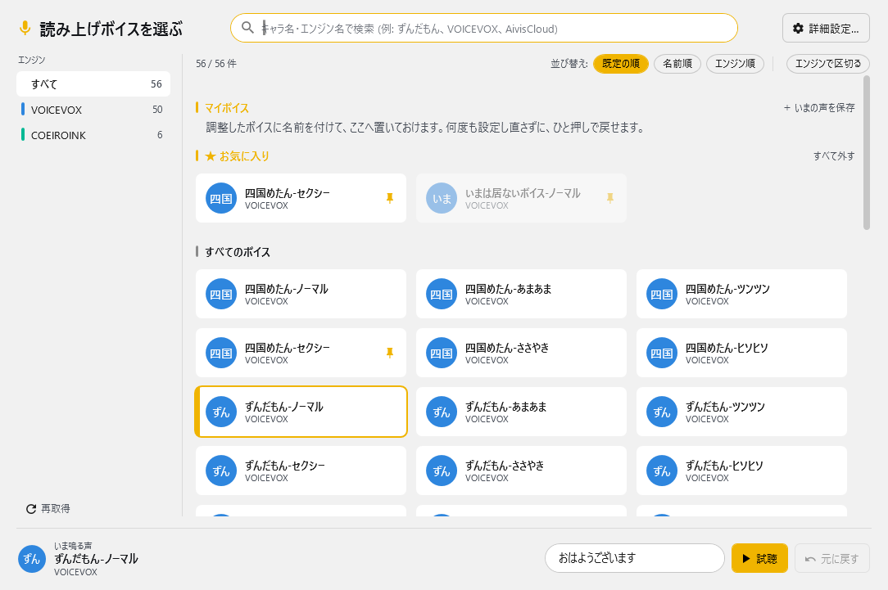

|できること|やり方|
|:--|:---|
|探す|上の検索欄にキャラ名かエンジン名を入れると、打つそばから絞り込まれます。<br>・ひらがな / カタカナ、全角 / 半角はどちらで打っても当たります<br>・空白で区切ると「両方を含むもの」だけが残ります (例: `ずんだ ノーマル`)|
|エンジンで絞る|左の一覧からエンジンを選びます。件数も出ます|
|お気に入り|タイル右上のピンを押すと、上の「★ お気に入り」に集まります|
|マイボイス|調整した声に名前を付けて残せます。後述の「マイボイス」を見てください|
|最近使った|選んだボイスは「最近使った」に残ります|
|並び替え|「既定の順 / 名前順 / エンジン順」。「エンジンで区切る」でエンジンごとの見出しが付きます|
|試聴|下の欄に文を入れて「試聴」。設定は変えずに声だけ確かめられます|
|元に戻す|直前のボイスに戻します。押し間違えたときに使ってください|

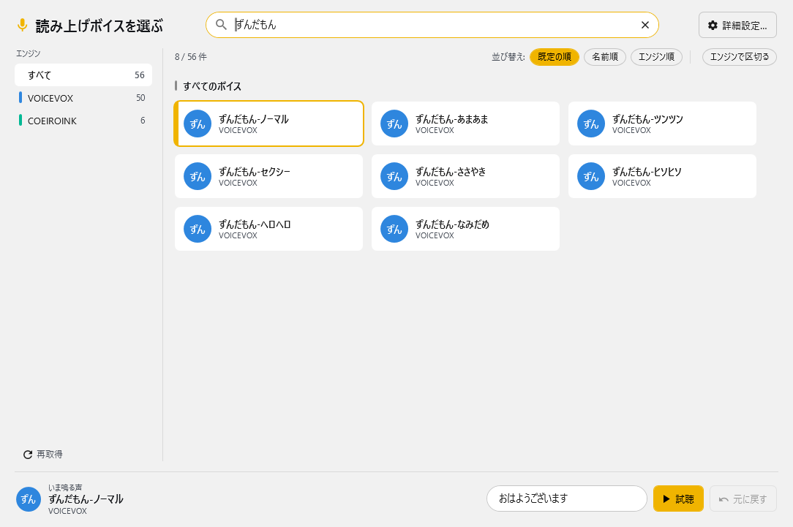

!!! Tips "ボイスが出てこないとき"
    * 音源のソフトを立ち上げてから、左下の「再取得」を押してください。
    * それでも出ないときは、詳細設定の「エンジン接続」から音源制御プログラムを起動し直せます。
    * お気に入りに入れたボイスが今は使えないときは、薄い表示で残ります。消えてしまうことはありません。

## 詳細設定

ボイスパレットの右上「詳細設定…」から開きます。

**この窓での変更は、OK か「適用」を押すまで読み上げには効きません。**
キャンセルで閉じれば、開く前の状態に戻ります。

左のメニューは 2 つに分かれています。

|区切り|中身|
|:--|:--|
|**マイボイス関連**|声の選択 / 声の調整。**この 2 つがマイボイスに保存される範囲**です|
|**共通設定**|読み上げと出力 / エンジン接続 / タイミングと連携 / 読み方と補正 / 条件ルール。マイボイスには入らず、どの声に切り替えてもそのまま使われます|
|**上級者向け**|音声ファイルの生成。押すと開け閉めします（最初は閉じています）。ここの機能は、配信中の読み上げの設定には影響しません|

### 声の選択

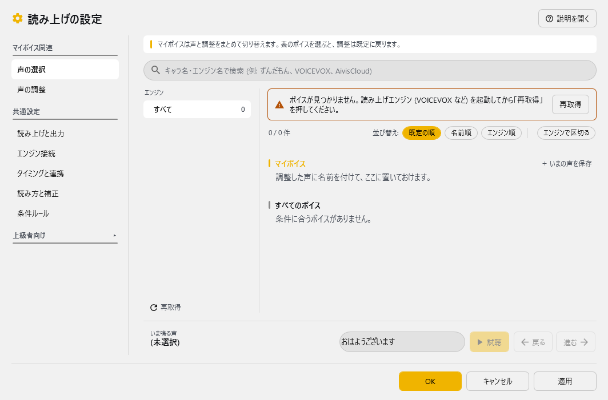

いま使うボイスを選びます。ボイスパレットと同じ画面です。
ここで選んでも、OK を押すまでは切り替わりません。

### 声の調整

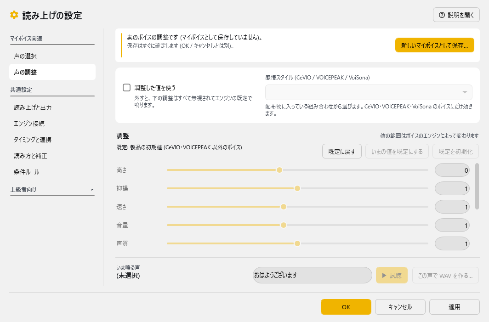

* 高さ・抑揚・速さ・音量・声質・前後の余白・句読点の間を決めます。
* **値の範囲はボイスのエンジンによって変わります**。スライダーの端が自動で変わるので、数字の意味はエンジンごとに違うと思ってください。
* 「調整した値を使う」を外すと、下の調整はすべて無視されてエンジンの既定で鳴ります。
* 「感情スタイル (CeVIO / VOICEPEAK / VoiSona)」は、配布物に入っている組み合わせから選びます。CeVIO・VOICEPEAK・VoiSona のボイスにだけ効きます（VoiSona Talk は v3.0.10～。Bright / Dark / Normal / Strong など）。
* 「この声で WAV を作る…」で、いま調整中の声と値を写して [音声ファイルの生成](#export) を開けます（写すだけで、読み上げの設定は変わりません）。
* 「既定に戻す」で調整だけを既定の値に戻せます（「いまの値を既定にする」で覚えた値があればそれ、無ければ製品の初期値）。OK／適用で確定します。
* 「いまの値を既定にする」で、いまの調整をこの系統のボイスの既定として覚えます。「既定を初期化」で、この系統の既定を製品の初期値へ戻します（つまみはいまの値のままです）。この 2 つはその場で確定します（OK／キャンセルとは別）。
* 上の帯の「新しいマイボイスとして保存…」で、いまの声と調整を 後述の「マイボイス」として残せます（保存はすぐに確定します。OK／キャンセルとは別）。

### 読み上げと出力

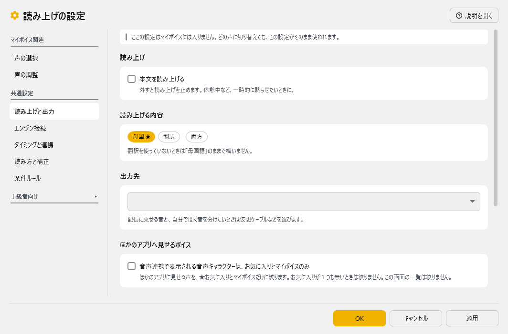

|設定|意味|
|:--|:---|
|本文を読み上げる|外すと読み上げを止めます。休憩中など、一時的に黙らせたいときに|
|読み上げる内容|母国語 / 翻訳 / 両方のどれを読ませるか|
|出力先|どのスピーカーから音を出すか。配信に乗せる音と自分で聞く音を分けたいときは仮想ケーブルを選びます|
|音声連携で表示される音声キャラクターは、お気に入りとマイボイスのみ|ほかのアプリ（StreamDeck や API 連携など）に見せるボイスを絞ります。既定は OFF|

!!! Tips "ボイスが多すぎて連携先で選びにくいとき"
    * エンジンによってはボイスが数百件あり、連携先の一覧から探すのが大変になります。
    * 上の設定を入れると、ほかのアプリには**★お気に入りとマイボイスだけ**を見せます。
    * **この設定画面とボイスパレットは絞られません。** お気に入りはそこで決めるためです。
    * お気に入りが 1 つも無いときは絞りません（ほかのアプリから何も選べなくなるため）。
    * すでに指定されている名前は、絞っていても引き続き使えます。

#### 文に合わせて声を自動で調整

!!! Tech "使用条件"
    * 読み上げ連携 v5.2 ～（ゆかコネNEO v3.0.0 beta 24 ～）
    * Jev の API キー（本体の「APIキー」画面で入れます）

|設定|意味|
|:--|:---|
|パラメータを Jev に調整させる|読み上げる文ごとに勢い・気分・声の大きさを Jev に判定させ、話速・高さ・抑揚・音量を少し動かします。既定は OFF|
|強さ|どれだけ動かすか（0～100%）。既定は 50%。チェックを入れたときだけ動かせます|
|感情プリセット・スタイルも文に合わせて切り替える|感情プリセット (CeVIO・VOICEPEAK) や、同じキャラのスタイル (VOICEVOX など) も文ごとに選び直します。判断に迷ったときは替えません|

* **Jev** は、文章を作らずに「どのくらい当てはまるか」を数値で答える、判定専用の AI です。ここでは 1 文ごとに勢い・気分・声の大きさを判定させています。
* **API キーは、このプラグインではなく本体の「APIキー」画面で入れてください**（[オプション設定項目 - Jev](../startup/startup_option.md#jev) を参照）。キーは本体だけが持ち、プラグインへは渡りません。
* 本体が古く Jev の呼び出し口が無いときは、チェックが押せず「この機能は本体の更新が必要です」と表示されます。
* この設定は声ではなく読み上げ全体に掛かるので、マイボイスには保存されません。

|設定|意味|
|:--|:---|
|Irodori-TTS の声色を絵文字で補正する|Irodori-TTS の声で読むとき、文に合う絵文字 (😊 嬉しそう・😭 泣きながら・🤔 疑問など) を読み上げる文の頭に 1 つ付けて、声色や演技を変えます。字幕には付きません。判断に迷ったときは付けません。既定は OFF（v3.0.1～）|

* 文がもともと絵文字で始まっているときは、重ねて付けません。
* 「声の調整」の「調整した値を使う」が切れていても、絵文字の補正だけは効きます。

!!! Info "効かないとき・遅れが気になるとき"
    * 答えが **4 秒以内**に来なければ、その文はいつもの調整のまま読みます。
    * Jev の失敗が続いたときは、**1 分休みます**（そのあいだはいつもの調整で読みます）。
    * 「声の調整」の「調整した値を使う」が切れているときと、OpenAI / RecotteStudio には効きません。
    * いまは原文を読む設定でだけ働き、ほかのアプリからの読み上げ依頼（API）には効きません。

### エンジン接続

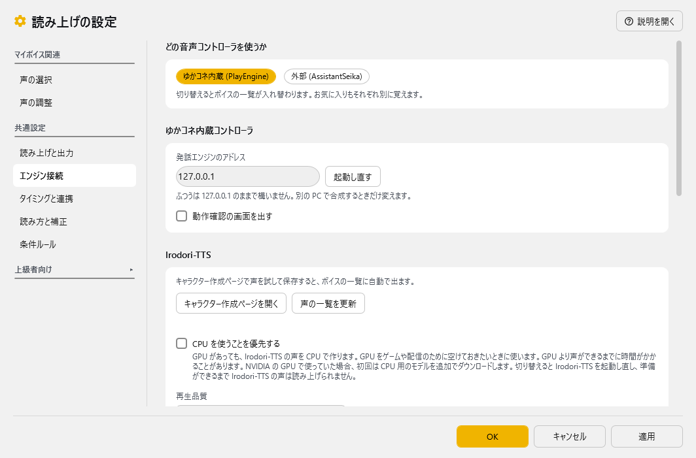

|設定|意味|
|:--|:---|
|どの音声コントローラを使うか|・ゆかコネ内蔵 (PlayEngine) か、外部 (AssistantSeika)（[AssistantSeika](https://hgotoh.jp/wiki/doku.php/documents/voiceroid/assistantseika/assistantseika-001a)）かを選びます<br>・切り替えるとボイスの一覧が入れ替わります。お気に入りもそれぞれ別に覚えます<br>・AssistantSeika連携：（ゆかコネNEO v2.0.115以降）|
|発話エンジンのアドレス|ふつうは `127.0.0.1` のまま。別の PC で合成するときだけ変えます|
|起動し直す|音源制御プログラムを立ち上げ直します。ボイスが出てこないときに|
|動作確認の画面を出す|音源制御プログラムの状態を見る画面（コントローラウィンドウ）を出します|
|エンジンごとの資格情報|CoeFont / AivisSpeech Cloud / VoiSona などの API キーやパスワードを入れます。入力は伏せ字で表示されます|
|エンジンに登録して起動し直す|**VoiSona と VOICEVOX Cloud はこのボタンが必要です**。下を参照|

!!! Warning "VoiSona と VOICEVOX Cloud は「登録」を押してください"
    * この 2 つは、合成する側が Windows に控えた値を直接読む仕組みになっています。
    * OK で設定を保存しただけでは合成に使われません。**「エンジンに登録して起動し直す」を押してください。**
    * 押すと音源制御プログラムが立ち上がり直します（読み上げが一瞬止まります）。

#### Irodori-TTS を使う { #irodori-setup }

Irodori-TTS がプラグインに入っているときだけ、「エンジン接続」ページに **Irodori-TTS** の欄が出ます。

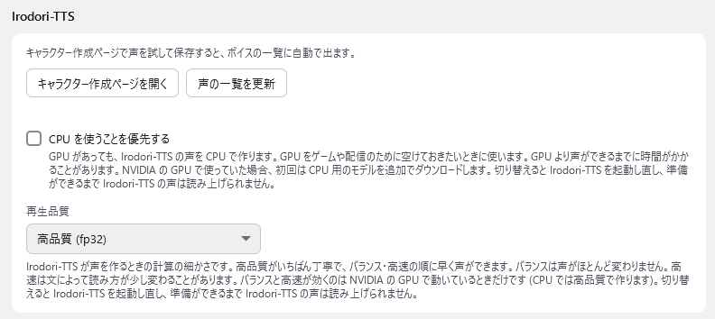

|設定|意味|
|:--|:---|
|キャラクター作成ページを開く|Irodori-TTS の準備を待ってから、キャラクター作成ページをブラウザで開きます。ここで声を試して保存すると、**ボイスの一覧に自動で出ます**（削除も自動で反映されます）。準備中は「Irodori-TTS を準備しています… (○ 秒。初回はモデルのダウンロードで数分かかります)」と出ます|
|声の一覧を更新|発話エンジンにボイスの一覧を取り直させます。後から起動したエンジンを一覧に出したいときにも使います|
|CPU を使うことを優先する|GPU があっても、Irodori-TTS の声を CPU で作ります。GPU をゲームや配信のために空けておきたいときに使います。GPU より声ができるまでに時間がかかることがあります。NVIDIA の GPU で使っていた場合、初回は CPU 用のモデルを追加でダウンロードします。既定は OFF（v3.0.8～）|
|再生品質|高品質 (fp32)／バランス (tf32)／高速 (bf16)。高品質がいちばん丁寧で、バランス・高速の順に早く声ができます。バランスは声がほとんど変わりません。高速は文によって読み方が少し変わることがあります。**バランスと高速が効くのは NVIDIA の GPU で動いているときだけ**です（CPU では高品質で作ります。「CPU を使うことを優先する」の間は選べません）。既定は高品質（v3.0.11～）|

**はじめて使うとき**

1. 「エンジン接続」ページで **「キャラクター作成ページを開く」** を押します
2. 初回は **「Irodori-TTS - ダウンロードの確認」** の窓が出ます。音声合成モデル（約 3.4GB）と、PC に合わせた部品（NVIDIA の GPU がある PC は LibTorch の CUDA 版 約 2.9GB など）をダウンロードしてよいか確かめます。ダウンロードは最大 約 6.5GB、展開後は最大 約 8GB です。「いいえ」を選ぶと Irodori-TTS の声は読み上げません（ほかの声には影響しません）
3. 準備ができるとキャラクター作成ページが開きます。声を試して保存します
4. ボイスパレットに Irodori-TTS の声が出るので、選びます

!!! Info "Irodori-TTS のこまかい動き"
    * 読み上げに Irodori-TTS の声を使う設定なら、**起動したときに準備を先に始めます**（v3.0.7～）。準備が終わるまでの Irodori-TTS の発話は鳴らずに捨てられます
    * 「CPU を使うことを優先する」「再生品質」を変えて OK を押すと Irodori-TTS を起動し直し、準備ができるまで Irodori-TTS の声は読み上げられません
    * ダウンロードしたモデルは、本体の **モデルの保存先** の設定に従って置かれ、モデルの管理画面で消せます（v3.0.2～）
    * 別の PC の発話エンジンを使っているときは、キャラクター作成ページは開けません
    * 同じ文・同じ値でも、合成のたびに声が少し変わります

!!! Warning "資格情報はマイボイスに入りません"
    * API キーやパスワードは、マイボイスには**保存されません**。人に渡した時点で漏れてしまうためです。
    * このページの API キーやパスワード（AssistantSeika のパスワードも含みます）は、画面共有や配信に映り込まないよう**伏せ字で表示されます**。v5.2 から、AssistantSeika のパスワードと CoeFont のアクセスキーも伏せ字になりました。
    * CoeFont は仕様変更により、```CoeFont企業契約者以外はご利用いただけなくなりました```

### タイミングと連携

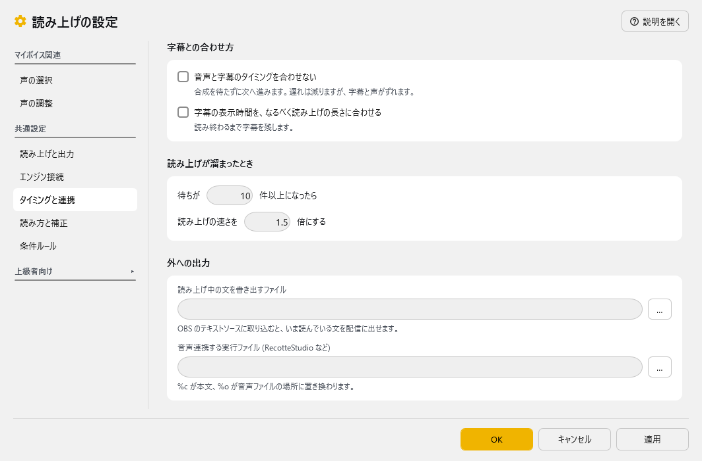

|設定|意味|
|:--|:---|
|音声と字幕のタイミングを合わせない|合成を待たずに次へ進みます。遅れは減りますが、字幕と声がずれます|
|字幕の表示時間を、なるべく読み上げの長さに合わせる|読み終わるまで字幕を残します。v3.0 の字幕と読み上げの同期はこれで入切します（下の注意も読んでください）|
|読み上げが溜まったとき|待ちが決めた件数以上になったら、読み上げの速さを上げます (長文の早口化)|
|読み上げ中の文を書き出すファイル|OBS のテキストソースに取り込むと、いま読んでいる文を配信に出せます|
|音声連携する実行ファイル (RecotteStudio など)|RecotteStudio プラグインなど。`%c` が本文、`%o` が音声ファイルの場所に置き換わります|

!!! danger "字幕を読み上げに合わせると、代償があります"
    v3.0 では、**字幕が読み上げの終わりに合わせて消える**ようになりました。
    そのぶん、次のことが起きます。理解したうえで使ってください。

    1. **字幕は読み上げが終わるまで消えません。**
       読み上げが遅れれば字幕も遅れます。読み上げ終了の通知が来ない事故のときは、最大 30 秒残ります
    2. **1 枠型のレイアウトでは、次の字幕が前の読み上げの終わりまで待ちます。**
       待ちが 8 件を超えると、間の字幕は表示されずに飛びます。
       1 文ずつ確実に出したい方は、**積み上げ型のレイアウト**にするか、この同期を切ってください
    3. **エンジン側のアプリが音を鳴らす方式では、本来の精度が出ません。**

    | エンジン | 同期の効き方 |
    |:--|:--|
    | VOICEVOX / COEIROINK など（ゆかコネが音を鳴らす） | 効きます |
    | CeVIO / A.I.VOICE / ITVoice / VoiSona | 待ち時間の申告が 0 になるため、**本来の精度は出ません** |
    | AssistantSeika / ブラウザ読み上げ | 読み上げ終了の通知そのものが無いため、**同期しません**（即座に解除します） |

    この同期は、下の「タイミングと連携」ページの **「字幕の表示時間を、なるべく読み上げの長さに合わせる」** で入切します。

### 読み方と補正

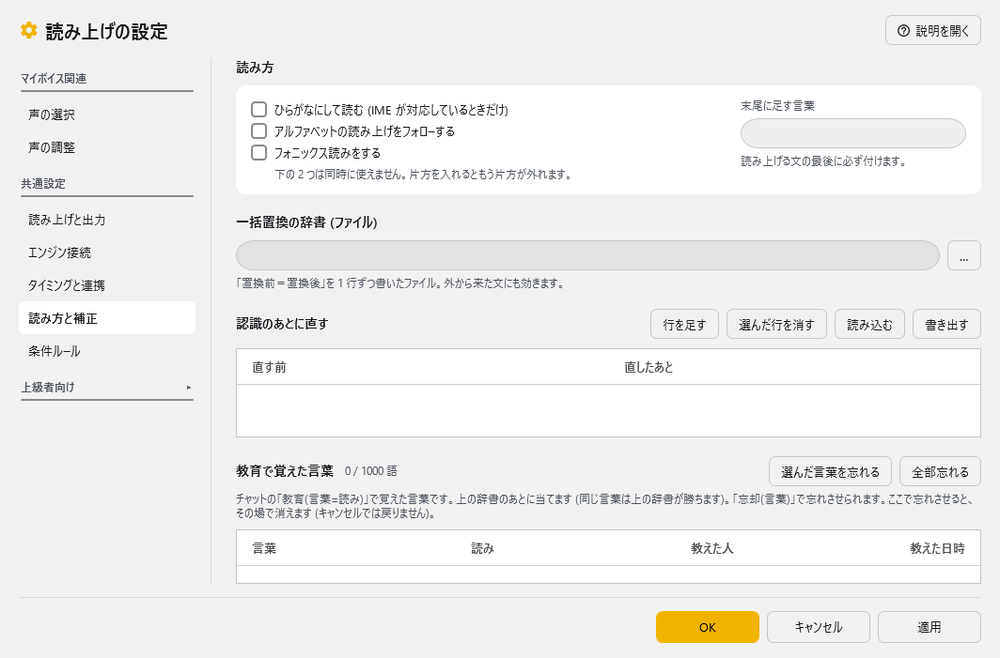

|設定|意味|
|:--|:---|
|ひらがなにして読む (IME が対応しているときだけ)|・IME辞書をつかって漢字をすべてひらがなに変換して渡します<br>・UDトーク併用時は認識時のひらがなに直します|
|アルファベットの読み上げをフォローする|英語が読めない音源では、それっぽい発音に置き換えます。正しく発音できないこともあります|
|フォニックス読みをする|アルファベットをフォニックス読み（A→ア、B→ブ など）で読ませます。「アルファベットの読み上げをフォローする」とは同時に使えません（片方を入れるともう片方が外れます）|
|末尾に足す言葉|読み上げる文の最後に必ず付けます (かわいい語尾)|
|一括置換の辞書 (ファイル)|「置換前＝置換後」を 1 行ずつ書いたファイル。外から来た文にも効きます|
|認識のあとに直す|「直す前 / 直したあと」の表。「行を足す」「選んだ行を消す」で行を足したり消したりできます。「読み込む」「書き出す」でファイルと受け渡しします。長い言葉から先に当てます|
|教育で覚えた言葉|チャットの「教育(言葉=読み)」で覚えた言葉の一覧です。上の [読み上げの教育](#speech-teach) を見てください|

### 条件ルール

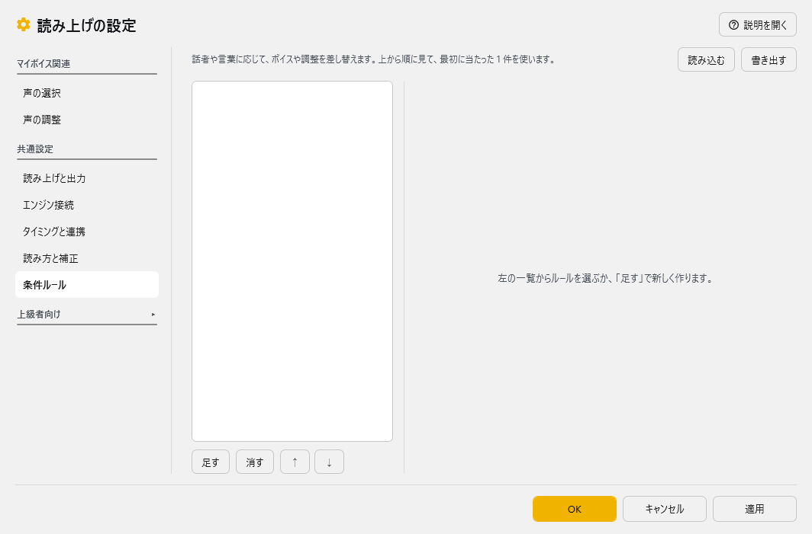

話者や言葉に応じてボイスを差し替える決まりごとです。後述の「条件ルール」を見てください。

!!! Info "前の画面に戻したいとき"
    * **Shift を押しながら設定ボタン**を押すと、以前の設定画面が開きます。
    * 設定フォルダの `Plugin_PlayVoice_library.json` で `ui` の `legacyConfigWindow` を `true` にすると、いつも以前の画面が開くようになります。
    * 以前の画面は次の版で無くなる予定です。困ったことがあれば Discord サポートｃｈへお知らせください。

## マイボイス (調整した声を覚えておく)

ボイスと声の調整を一度決めたら、**名前を付けて「マイボイス」として残せます**。
使い分けたい声がいくつかあっても、そのたびに設定し直す必要はありません。

マイボイスは、ボイスパレットの**いちばん上の段**に並びます。
素のボイスと同じタイルなので、**押せばその場で切り替わります**。

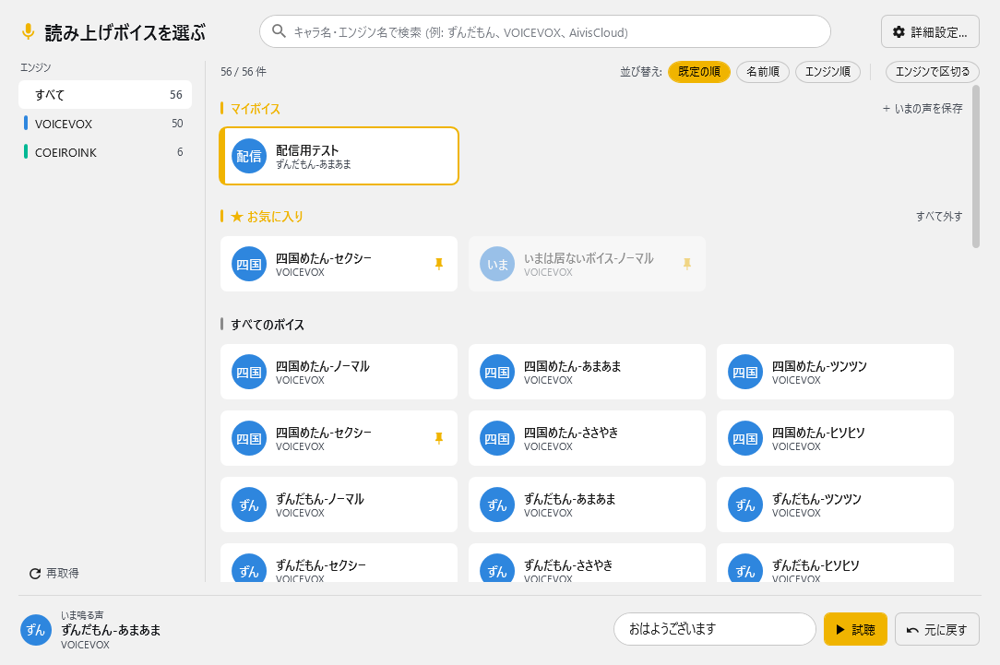

|やりたいこと|やり方|
|:--|:--|
|作る|好きなボイスを選び、詳細設定で声の調整を決めてから、「マイボイス」の見出しの右にある**「＋ いまの声を保存」**を押して名前を付けます（下の図）|
|使う|タイルを押すだけです。覚えたボイスと調整がまとめて戻ります|
|消す|タイルにカーソルを乗せると出る**×**を押します|
|名前を変える|タイルを右クリック →「名前と中身を変える」。中身を今の設定に入れ替えることもできます|
|探す|名前でも、もとのボイス名でも検索に引っかかります。エンジンでの絞り込みにも入ります|

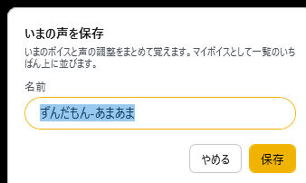

覚えるのは**ボイスと声の調整**です。出力先や読み方は入りません
（声を選んだだけのつもりで読み方まで変わってしまわないように）。

マイボイスは**外からも指定できます**。音声の一覧に `(名前)/USER-PRESET` という名前で並ぶので、
StreamDeck や API から、ほかのボイスと同じように選べます。指定されたその回だけ、
覚えてあるボイスと調整に切り替わります（設定そのものは変わりません）。

!!! Info "素のボイスを選ぶと、調整は標準に戻ります"
    * マイボイスのタイルは「**調整した声**」、その下に並ぶ素のボイスのタイルは「**調整していない、そのままの声**」です。
    * 素のボイスを選ぶと「調整した値を使う」が外れ、高さや速さはそのボイスの標準値に戻ります。前の声の癖が残らないようにするためです。
    * **API から素のボイスを名指ししたときも同じです。** 設定画面で調整していても、その回は標準の音で鳴ります。
    * 調整を残しておきたいときは、マイボイスとして保存し、そちらを名指ししてください。

!!! Tips "番号 (スロット) が振られます"
    * 作った順に 1〜99 の番号が振られ、StreamDeck などから番号で呼び出せます。
    * 番号はタイルにカーソルを乗せると出ます。

!!! Warning "切り替えられないことがあります"
    * 覚えたときとエンジンの系列が違うと、調整値の意味が変わってしまうので切り替えを断ります。
    * もとのボイスがいま一覧に無いときは確認が出ます。マイボイス自体は消えません。
    * 詳細設定の窓を開いている間は、外部からの切り替えを断ります (OK でも閉じたときに上書きされてしまうため)。

## 配信中に切り替える (外部から)

StreamDeck などから、HTTP コールでボイスパレットとマイボイスを操作できます。

|やりたいこと|コマンド|
|:--|:--|
|ボイスパレットを出す / 隠す|`command=palette&action=show` / `hide` / `toggle`|
|マイボイスに切り替える|`command=preset&action=apply&slot=1`|
|マイボイスの一覧|`command=preset&action=list`|
|いま使っているマイボイス|`command=preset&action=current`|
|次 / 前のマイボイス|`command=preset&action=next` / `prev`|

* 名前でも呼べます (`name=雑談ずんだもん`) が、URL に日本語を書くのは面倒なので**番号 (`slot`) をおすすめします**。
* うまくいったかどうかは、返ってくる `ok` で分かります (通信自体はいつも成功扱いになるため)。

## 使うとき

1. 音源を立ち上げます。
1. ゆかコネNEOを立ち上げます。
1. ゆかコネNEOで音声認識をしましょう。
1. 文章が確定すると同時に読み上げが行われます。

## 注意点

!!! Tips "負荷が上がる場合があります"
    * VOICEVOXなど、GPUを使うソフトウェアの場合、PCに負荷がかかる場合があります。
    * VOICEPEAKは生成処理が多く、若干待ち時間が長くかかります。

!!! Warning  "音声ソフトウェアがサポートする声が使えない場合があります"
    * 起動時にVOICEVOXなどへ問い合わせ通信をしているため、後からVOICEVOXを起動すると音源が表示されない場合があります。
    * COEIROINK のカスタムモデルを使う場合は、必ずCOEIROINKを先に立ち上げる必要があります。

!!! Success "使用中はバックグラウンドプロセスが立ち上がります"
    * 音源の制御をおこなう関係上、playengine.exe という発話管理プログラムが裏で起動します。
    * PlayEngineは32bit版、64bit版の２つがあり、最大それぞれ１つずつ（合計２つ）が起動します。

!!! Warning  "音源を標準のフォルダ以外に導入すると動かない場合があります"
    * A.I.Voiceなどは、インストールフォルダを変更すると連動できないことがあります。

!!! Info "音声パラメータについて"
    * 初期値として、デフォルトで使用される音源の設定値を採用します
    * 途中で音声を切り替える場合は、パラメータ不一致が起きる可能性があります。設定項目で値を設定してください。

## 条件ルール

* 話者や言葉に応じて、ボイスや調整を差し替えられます。
* 詳細設定の「条件ルール」で、左の一覧から 1 件選び、右で中身を決めます。
* **上から順に見て、最初に当たった 1 件だけが使われます。** 並び順が効くので、「↑」「↓」で動かしてください。

### このルールの当て方

|項目|意味|
|:--|:--|
|使わない|その行は処理しません|
|完全一致|文がまるごと同じときだけ当たります|
|部分一致|その言葉が含まれていれば当たります|
|外部から|ふだんは当たりません。HTTPコールや VRChat 連携から名指しされたときだけ使います|

### こういうとき (当てる条件)

|項目|意味|
|:--|:--|
|文に含まれる言葉|文章に対しての条件です。空にすると文の中身は問いません|
|話者の名前|話者名に対しての条件です。空にすると問いません。表示名でもユーザー ID でも当たります。▼で最近届いた名前から選べます|
|どこから来た文か|Twitch / YouTube など、文の出どころに対する条件です。コメントの取り込み元などが送ってくる名前です。▼で最近届いた名前から選べます|
|言語|発話しようとしている言語に対する条件です。一覧から選びます（「指定しない (どの言語でも)」もあります）。「日本語 (ja)」のように地域なしを選ぶと、ja-JP など地域違いにもまとめて当たります|
|呼び出しの合い言葉|「外部から」のときに、どのルールを使うかを指す名前です (旧「APIタグ」)。▼で最近呼ばれた名前から選べます|

### こうする (当たったときにすること)

|項目|意味|
|:--|:--|
|使うボイス|押すと検索できる一覧が開きます（かな／カナ・全角／半角を問わず、エンジン名でも探せます。↑↓ で移動、Enter で決定、Esc で閉じる）。お気に入り・最近使ったボイスが先に並びます。マイボイスはここでは選べません。「基本設定のボイスのまま」も選べます|
|出力先|このルールのときだけ別のスピーカーから出せます。一覧から選びます（「基本設定の出力先のまま」も選べます）|
|高さ / 抑揚 / 速さ / 音量 / 声質|数字で指定します。**空の欄は基本設定の値のまま**にします (`0` と空欄は違う意味です)<br>・指定範囲はエンジンによって異なります。「声の調整」のスライダーの端を参考にしてください<br>・速さを遅くしすぎると音声が著しく劣化することがあります|
|この文は読み上げない|発話をスキップします|
|当てた言葉を読み上げから消す|条件に設定した言葉を文から除去します|
|当たった内容を基本設定にも反映して、以降ずっと使う|通常つかわれる設定そのものが書き換わります。配信中に声を切り替えたままにしたいときに使います|

!!! Info "選べる候補について"
    * 話者・どこから来た文か・呼び出しの合い言葉の ▼（候補から選ぶ）には、読み上げが動いている間に実際に届いた値と、ほかのルールで使っている値が並びます。ゆかコネNEO を閉じると、届いた値は消えます。
    * いまの PC に無いボイスや出力先は「(この PC にはありません)」付きで残ります。開いただけで書き換わることはありません。

!!! Tips "カンマは使えません"
    * ルールは 1 行ずつカンマで区切った形で保存されます。欄にカンマを入れると区切りとして扱われてしまいます。
    * カンマの入った欄があるときは、画面の上に注意が出ます。

* VRChatプラグインの左ジェスチャーと連携する場合には、呼び出しの合い言葉 (旧「APIタグ」) と下記の文字が一対となります

|呼び出しの合い言葉|意味                     |
|---------------|----------------------------|
|VRC:Neutral    |なにも指示していない状態    |
|VRC:Fist       |握りこぶし                   |
|VRC:HandOpen   |手を開いた状態               |
|VRC:FingerPoint|指さしポーズ                 |
|VRC:Victory    |Vサイン                      |
|VRC:RockNRoll  |電話ハンドサイン             |
|VRC:HandGun    |Lポーズ                      |
|VRC:ThumbsUp   |親指ポーズ                   |

## ブラウザ連携

* 従来通り、ブラウザがサポートする機械音声を使うことができます。
* ブラウザを起動して音声を選ぶと、ブラウザ経由で声が再生されます。
* 内蔵コントローラ使用中のみ利用可能です。
* この機能は、**Shift を押しながら設定ボタン**を押して開く以前の設定画面にあります（下の画像はその画面です）。

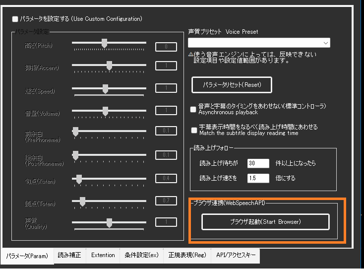

## 一括置換辞書の設定

読み上げ前に特定の文字や単語を自動で置き換える辞書ファイルを設定できます。

### 辞書ファイルの作り方

#### CSVファイル形式
- **ファイル名**: 任意（例：voice_replace.csv）
- **文字コード**: UTF-8
- **形式**: 「置換前,置換後」の1行1ペア

#### 具体例
```csv
ありがとう,ありがとうございます
おつかれ,お疲れ様でした
www,わらわらわら
ゆかりさん,結月ゆかりさん
```

#### 作成方法
1. **メモ帳で作る場合**:
   - メモ帳を開いて上記形式で入力
   - 保存時に「文字コード: UTF-8」を選択

2. **Excelで作る場合**:
   - A列に「置換前」、B列に「置換後」を入力
   - 「名前を付けて保存」→「CSV UTF-8(コンマ区切り)(*.csv)」を選択

### 使い方
1. 詳細設定の「読み方と補正」→「一括置換の辞書 (ファイル)」の「…」で辞書ファイルを指定
2. 「OK」か「適用」を押す
3. 音声認識時に自動で置換が適用される

!!! Tips "置換のタイミング"
    * この置換は音声認識結果に対して適用されます
    * 外部からの入力（API経由など）にも適用されます
    * 他のプラグインの処理よりも後で実行されます

## 読み上げしている文章の取り込み

* 今読み上げ指示している文章をテキストに吐き出します。
* OBS Studio のテキストソースで参照することで、リアルタイム表示ができます。
* 詳細設定の「タイミングと連携」→「読み上げ中の文を書き出すファイル」で指定します。

## RecotteStudioプラグイン連携

* RecotteStudioプラグインを使って発話ができます。
* このモードは、ゆかコネ内蔵コントローラの時のみ使用可能です。
* たとえば、[りんなプラグイン](https://vtool.booth.pm/items/4591912)などを連携させて使うことが可能です。
* 詳細設定の「タイミングと連携」→「音声連携する実行ファイル (RecotteStudio など)」で指定します。

## 一括置換

* TwiChaDashに搭載されていた機能です
* インストールフォルダに サンプルとして、``bsr.txt``があります。
* 詳細設定の「読み方と補正」→「一括置換の辞書 (ファイル)」でファイルを指定します。

!!! Info "フォーマットを作るツールについて"
    * 正規表現のフォーマットを組み立てるツールは、**以前の設定画面**にあります。
    * Shift を押しながら設定ボタンを押すと開けます。

## 高度な機能

### AI音声合成サービス統合

#### AivisSpeech (Cloud) 対応
* **クラウドAPI**: 高品質AI音声合成サービス連携
* **多様な声質**: 豊富な声質バリエーション
* **低遅延処理**: クラウド経由での高速音声生成

#### 新世代音声エンジン
* **VOICEPEAK**: より自然な音声合成
* **VOICEVOXNemo**: 新しいVOICEVOXバリアント
* **API統合**: 各エンジン固有機能の活用

### 音声スピードアップ機能

#### 長文最適化
* **SpeedUp_Border**: 文字数閾値の設定
* **SpeedUp_Ratio**: 高速化倍率の指定
* **自動適用**: 設定値を超えた長文の自動高速化

#### 実用例
```
設定例:
SpeedUp_Border = 50文字
SpeedUp_Ratio = 1.5倍

結果:
50文字以下: 通常速度
51文字以上: 1.5倍速で再生
```

### 非同期音声処理

#### 並列実行システム
* **voicePlayAsync**: 音声再生の非同期実行
* **ConcurrentQueue**: 効率的な音声キューイング
* **voiceCaptionAsync**: 字幕と音声の同期制御

#### パフォーマンス向上
* **UIブロッキング回避**: メインUIの応答性維持
* **高速処理**: 複数音声の並行生成・再生
* **メモリ効率**: 最適化されたリソース管理

### 動的辞書管理

#### ReplaceDictionary システム
* **ReplaceDictionaryFile**: 外部辞書ファイルの動的読み込み
* **実行時更新**: アプリケーション再起動不要の辞書更新
* **多言語対応**: 各言語別の置換辞書管理

### GPT連携機能

#### callGPTFunction
* **AI統合**: GPTプラグインとの直接連携
* **音声応答**: AI生成テキストの自動音声化
* **インテリジェント処理**: 文脈に応じた音声パラメータ調整

### 拡張API システム

#### ExtentionExe機能
* **外部プログラム実行**: カスタムスクリプト・アプリケーション連携
* **パラメータ渡し**: 音声内容・話者情報の外部プログラム渡し
* **拡張性**: プラグイン機能の無限拡張

### 高度なユーザーインターフェース

#### 動作確認の画面
* **コントローラウィンドウ**: 音源制御プログラムの状態を見る専用画面
* 詳細設定の「エンジン接続」の「動作確認の画面を出す」から出せます

#### 呼び名について
よく似た名前のものが 3 つあるので、区別できるように呼び分けています。

|呼び名|中身|
|:--|:--|
|マイボイス|この版で入った、ボイスと調整に名前を付けて覚える仕組み|
|感情スタイル (CeVIO / VOICEPEAK / VoiSona)|CeVIO・VOICEPEAK・VoiSona の音源が持つ、配布物に入っている声の組み合わせ|
|CoeFont 音声|CoeFont のサービス側で用意されている声|

### トラブルシューティング

#### PlayEngine 関連
* **プロセス確認**: タスクマネージャーでのPlayEngine.exe確認

#### AI音声サービス
* **API キー**: AivisSpeech Cloud等のAPIキー設定確認
* **ネットワーク**: インターネット接続・プロキシ設定確認
* **クォータ**: サービス利用制限の確認

#### 非同期処理
* **キュー詰まり**: 音声キューの処理状況確認
* **同期エラー**: 字幕と音声のタイミング調整
* **並行数制限**: 同時実行数の適切な設定

## コントローラ設定

* 内蔵コントローラの通信先や再起動指示を出せる枠になります。
* 詳細設定の「エンジン接続」にまとまっています。
