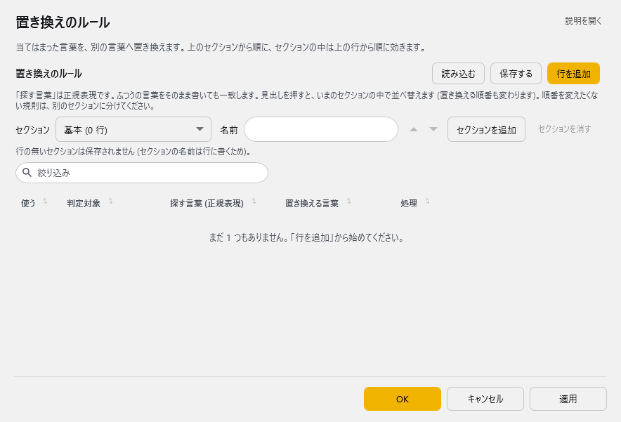

<!-- version-banner -->
!!! info ""
    ゆかコネNEO **v3.0** のドキュメントです。v2.3 をお使いの方は [v2.3 版のこのページ](../../v2.3/plugin/plugin_regexp.md) を、違いを知りたい方は [v2.3 から v3.0 への移行](../../mig/mig_neo_v3.0.md) をご覧ください。

!!! Info "前提条件"
    * なし

## このプラグインで出来ること

* 認識された文字を自動的に置き換えることができます
* 言い間違いや不適切な言葉を修正できます
* 専門用語を分かりやすい言葉に変換できます

!!! note "この置換機能について"
    * ゆかりねっととの互換があるようにつくっています

##　有効化

* プラグインを使うチェックをONにしてください。

## 設定

プラグイン一覧で、このプラグインの名前の右にある **「設定」** を押すと開きます。

!!! info "閉じるときの 3 択"
    設定は**下書き**として持たれ、「OK」か「適用」を押すまで動いているプラグインには効きません。
    変更したまま閉じようとすると「変更が保存されていません」と聞かれ、**［はい］保存して閉じる／［いいえ］破棄して閉じる／［キャンセル］閉じるのをやめる** から選べます。

当てはまった言葉を、別の言葉へ置き換えます。上のセクションから順に、セクションの中は上の行から順に効きます。

<!-- TODO(screenshot): images/v30/regexp_1.png を v3.0.11 以降の画面で撮り直す。表の上に「セクション」の選択欄・名前の欄・セクションの追加/削除ボタン、「絞り込み」の欄、押せる見出し (⇅) が見えている状態 -->

**置き換えのルール**（表）

| 列 | 説明 |
|:--|:--|
| 使う | 切ると、その行は使いません |
| 判定対象 | 母国語／翻訳 1〜4 のどれに効かせるか |
| 探す言葉 (正規表現) | 当てる言葉 |
| 置き換える言葉 | 置き換えたあとの言葉 |
| 処理 | 一致した部分を消す／一致した部分を置き換える／文まるごと置き換える／字幕を出さない |

「探す言葉」は正規表現です。ふつうの言葉をそのまま書いても一致します。

### 表の使い方

* **「行を追加」** で、いま開いているセクションに行を増やします。行の右端のボタンは ▲▼＝1 つ上へ／1 つ下へ、＋＝この下に追加、×＝この行を消す です。
* **見出しで並べ替え**：列の見出しを押すと、いまのセクションの中で並べ替えます。押すたびに 昇順 → 降順 → 並べ替える前の順 と変わります。見た目だけでなく**行の順番そのもの（＝置き換える順番）が変わります**。順番を変えたくない規則は、別のセクションに分けてください。
* **絞り込み**：表の上の「絞り込み」に文字を入れると、その文字を含む行だけを出します（Ctrl+F で欄へ、Esc で解除）。絞り込むのはいまのセクションの中だけで、ほかのセクションにも当たる行があると「・ほかのセクションに ○ 行」と出ます。
* **「保存する」** はいまの中身を CSV へ書き出します（控え用）。**「読み込む」** は CSV から読み込みます（読み込み方は下の「セクション」を参照）。

### セクション

規則をまとまりごとに分けられます。表の上の **「セクション」** で、表に出すセクションを選びます。

| 項目 | 説明 |
|:--|:--|
| セクション（選択欄） | 表に出すセクションを選びます。表にはそのセクションの行だけが出ます |
| 名前 | いまのセクションの名前。空にすると「基本」になります |
| ▲／▼ | セクションを 1 つ前へ（先に処理する）／1 つ後ろへ（後で処理する） |
| 「セクションを追加」ボタン | いまのセクションのすぐ後ろに、新しいセクションを作ります |
| 「セクションを消す」ボタン | いまのセクションを、中の行ごと消します（確認が出ます） |

* **上のセクションから順に処理します。**
* 行の無いセクションは保存されません（セクションの名前は行に書くため）。
* 「読み込む」を押すと、読み込み方を **新しいセクションとして足す／セクションごとに統合する／今の表と置き換える** から選べます。
    * **新しいセクションとして足す**：ファイルの行をまとめて 1 つのセクションにし、いちばん後ろへ足します。今の行はそのままです。
    * **セクションごとに統合する**：ファイルに書かれたセクション名どおりに入れます。同じ名前のセクションには後ろへ足し、無い名前は新しく作ります。
    * **今の表と置き換える**：今の行をすべて捨てて、ファイルの中身にします。

## よく使うパターン例

### 言い間違いの修正
- 「です」→「だ」（関西弁風に変更）
- 「えー」→「」（削除）
- 「あの」→「」（削除）

### 専門用語の分かりやすい言葉への変更
- 「API」→「アプリの接続機能」
- 「レスポンシブ」→「画面サイズに合わせて表示を変える」
- 「UI」→「画面デザイン」

### 不適切な言葉のフィルタ
- 特定の言葉を「****」に置き換える

## 基本的な使い方

1. 「設定」→「ルール」の表で **「行を追加」** を押します
2. 「探す言葉 (正規表現)」に変えたい言葉を入れます
3. 「置き換える言葉」に変えたあとの言葉を入れます
4. 「処理」を選び、「使う」が ON になっていることを確かめます
5. 「OK」か「適用」で保存し、実際に話して字幕で確かめます

!!! tip "初心者の方へ"
    複雑な正規表現は使わずに、そのまま文字を入力するだけでも十分に機能します。例：「です」→「だ」

## よくある質問

**Q: 正規表現って何ですか？**  
A: 文字列の検索パターンを指定する書き方ですが、普通の文字をそのまま入力するだけでも使えます。

**Q: うまく置換されません**  
A: 「使う」が ON か、「判定対象」が合っているかを確かめてください。大文字・小文字や全角・半角の違いも確認してください。前の行（前のセクション）の置き換えで、言葉がすでに変わっていることもあります。

**Q: 見出しを押したら順番が変わってしまいました**  
A: 同じ見出しを続けて押すと「並べ替える前の順」に戻ります（昇順 → 降順 → 並べ替える前の順）。保存する前なら、閉じるときに「破棄して閉じる」を選んでも戻せます。

**Q: 設定がたくさんあって分かりません**  
A: まずは簡単な例（「です」→「だ」など）から始めてみてください。