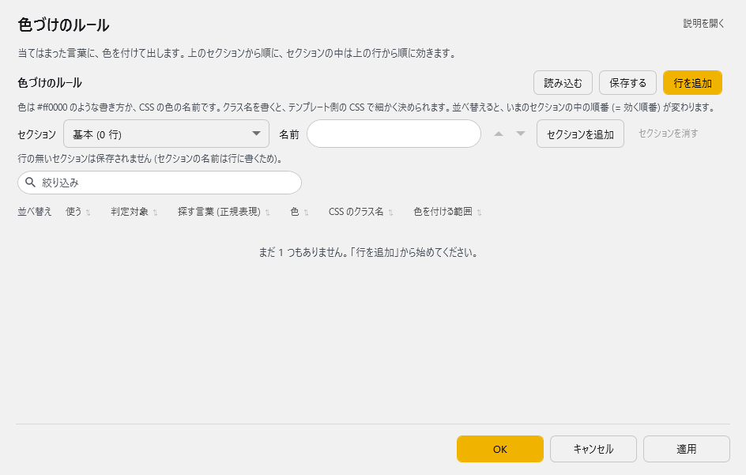
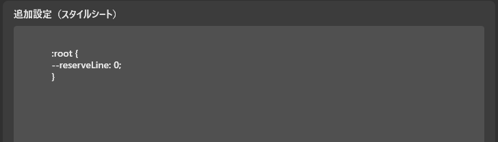

<!-- version-banner -->
!!! info ""
    ゆかコネNEO **v3.0** のドキュメントです。v2.3 をお使いの方は [v2.3 版のこのページ](../../v2.3/plugin/plugin_regexp_color.md) を、違いを知りたい方は [v2.3 から v3.0 への移行](../../mig/mig_neo_v3.0.md) をご覧ください。

!!! Info "前提条件"
    * なし

## このプラグインで出来ること

* 認識された文字の色を自動的に変更できます
* 正規表現で文字列にマッチさせて、特定の文字やフレーズに色を付けられます
* 重要な単語やキーワードを目立たせることができます
* 母国語と翻訳後の文字にそれぞれ異なる色付けルールを適用できます

!!! note "この文字色変更機能について"
    * 正規表現パターンマッチングを使用した高度な色付け機能です
    * HTMLのstyle属性とclass属性による装飾に対応しています

## 有効化

* 上のタブ **プラグイン** → **プラグインを追加** でこのプラグインを選んで **追加する** を押します（一覧の **使う** が ON になります）。→ [プラグインの有効化](enabled.md)
* 音声認識後と翻訳サーバーの両方で自動的に有効化されます。

## 設定

プラグイン一覧で、このプラグインの名前の右にある **「設定」** を押すと開きます。

!!! info "閉じるときの 3 択"
    設定は**下書き**として持たれ、「OK」か「適用」を押すまで動いているプラグインには効きません。
    変更したまま閉じようとすると「変更が保存されていません」と聞かれ、**［はい］保存して閉じる／［いいえ］破棄して閉じる／［キャンセル］閉じるのをやめる** から選べます。

当てはまった言葉に、色を付けて出します。上のセクションから順に、セクションの中は上の行から順に効きます。



**色づけのルール**（表）

1 行が 2 段に分かれています（上の段：使う／判定対象／探す言葉、下の段：色／CSS のクラス名／色を付ける範囲）。

| 列 | 説明 |
|:--|:--|
| 使う | 切ると、その行は使いません |
| 判定対象 | 母国語／翻訳 1〜4 のどれに効かせるか |
| 探す言葉 (正規表現) | 色を付ける言葉 |
| 色 | `#ff0000` のような書き方か、CSS の色の名前。欄に打つか、横の色見本のボタンで選べます |
| CSS のクラス名 | クラス名を書くと、テンプレート側の CSS で細かく決められます |
| 色を付ける範囲 | 一致した部分だけ／その文ぜんぶ |

### 表の使い方

* **「行を追加」** で、いま開いているセクションに行を増やします。行の右端のボタンは ▲▼＝1 つ上へ／1 つ下へ、＋＝この下に追加、×＝この行を消す です。
* **並べ替え**：表の上の **「並べ替え」** に列の名前のボタンが並んでいます。押すと、いまのセクションの中で並べ替えます。押すたびに 昇順 → 降順 → 並べ替える前の順 と変わります。見た目だけでなく**行の順番そのもの（＝効く順番）が変わります**。
* **絞り込み**：表の上の「絞り込み」に文字を入れると、その文字を含む行だけを出します（Ctrl+F で欄へ、Esc で解除）。絞り込むのはいまのセクションの中だけで、ほかのセクションにも当たる行があると「・ほかのセクションに ○ 行」と出ます。
* **「保存する」** はいまの中身を CSV へ書き出します（控え用）。**「読み込む」** は CSV から読み込みます。

### セクション

規則をまとまりごとに分けられます。表の上の **「セクション」** で、表に出すセクションを選びます。

| 項目 | 説明 |
|:--|:--|
| セクション（選択欄） | 表に出すセクションを選びます。表にはそのセクションの行だけが出ます |
| 名前 | いまのセクションの名前。空にすると「基本」になります |
| ▲／▼ | セクションを 1 つ前へ（先に処理する）／1 つ後ろへ（後で処理する） |
| 「セクションを追加」ボタン | いまのセクションのすぐ後ろに、新しいセクションを作ります |
| 「セクションを消す」ボタン | いまのセクションを、中の行ごと消します（確認が出ます） |

* **上のセクションから順に処理します。**
* 行の無いセクションは保存されません（セクションの名前は行に書くため）。
* 「読み込む」を押すと、読み込み方を選べます。
    * **新しいセクションとして足す**：ファイルの行をまとめて 1 つのセクションにし、いちばん後ろへ足します。今の行はそのままです。
    * **セクションごとに統合する**：ファイルに書かれたセクション名どおりに入れます。同じ名前のセクションには後ろへ足し、無い名前は新しく作ります。
    * **今の表と置き換える**：今の行をすべて捨てて、ファイルの中身にします。

### CSV の形式

「保存する」で書き出す CSV は、次の並びです（7 列目のセクション名が空なら「基本」）。

```
"有効(True/False)","対象","条件文字","指定色","指定クラス","指定範囲","セクション"
```

例：
```csv
"True","1:母国語(Native)","テスト","#FF0000","","0:一部",""
```

## よく使うパターン例

例の項目名は CSV の列名です。画面では「条件文字」＝探す言葉 (正規表現)、「指定色」＝色、「指定クラス」＝CSS のクラス名、「指定範囲」＝色を付ける範囲（0:一部＝一致した部分だけ／1:全部＝その文ぜんぶ）にあたります。

### 重要な単語を強調表示
```
条件文字: 重要|注意|警告
指定色: #FF0000 (赤色)
指定範囲: 0:一部
```

### 特定のキーワードに色付け
```
条件文字: API|データベース|サーバー
指定色: #00FF00 (緑色)
指定範囲: 0:一部
```

### 数値を目立たせる
```
条件文字: \d+
指定色: #FFFF00 (黄色)
指定範囲: 0:一部
```

### 質問文を強調
```
条件文字: .*\?$
指定色: #00FFFF (シアン)
指定範囲: 1:全部
```

### カスタムクラスの適用
```
条件文字: コードブロック
指定色: #AAAAAA (グレー)
指定クラス: code-block
指定範囲: 0:一部
```

## 基本的な使い方

1. プラグインの設定画面を開きます
2. 「ルール」の表で **「行を追加」** を押します
3. 「使う」が ON になっていることを確かめます
4. 「判定対象」で適用する言語を選択します
5. 「探す言葉 (正規表現)」に正規表現パターンを入力します
6. 「色」に色を入れるか、横の色見本のボタンで選びます
7. 「色を付ける範囲」で、一致した部分だけか文ぜんぶかを選びます
8. 「OK」か「適用」で保存し、実際に話して字幕で確かめます

!!! tip "初心者の方へ"
    正規表現が分からなくても、そのまま文字を入力するだけで動作します。例えば「テスト」と入力すれば、「テスト」という文字だけに色が付きます。

## 正規表現の基本

| パターン | 説明 | 例 |
|:--------|:----|:---|
| `abc` | 文字列「abc」に完全一致 | `テスト` → 「テスト」にマッチ |
| `a\|b` | 「a」または「b」にマッチ | `犬\|猫` → 「犬」または「猫」にマッチ |
| `\d` | 任意の数字1文字 | `\d+` → 「123」「45」などにマッチ |
| `\w` | 英数字とアンダースコア | `\w+` → 「test_123」などにマッチ |
| `.*` | 任意の文字列（0文字以上） | `こんにちは.*` → 「こんにちは」で始まる文字列 |
| `^` | 行の先頭 | `^Hello` → 行頭の「Hello」 |
| `$` | 行の末尾 | `です$` → 行末の「です」 |
| `[abc]` | a、b、cのいずれか1文字 | `[あいう]` → 「あ」「い」「う」のいずれか |
| `[^abc]` | a、b、c以外の1文字 | `[^0-9]` → 数字以外 |
| `+` | 直前のパターンの1回以上の繰り返し | `あ+` → 「あ」「ああ」「あああ」 |
| `*` | 直前のパターンの0回以上の繰り返し | `あ*` → 「」「あ」「ああ」 |
| `?` | 直前のパターンの0回または1回 | `です?` → 「で」「です」 |

## よくある質問

**Q: 正規表現って何ですか？**  
A: 文字列の検索パターンを指定する強力な書き方です。普通の文字をそのまま入力するだけでも使えますが、正規表現を使うとより柔軟なパターンマッチングができます。

**Q: 色が適用されません**  
A: 
- 「使う」が ON になっているか確認してください
- 「判定対象」が正しい言語になっているか確認してください
- 正規表現のエスケープが必要な文字（`.` `*` `?` など）は `\` でエスケープしてください

**Q: 色の指定方法が分かりません**  
A: 「色」の欄の横にある色見本のボタンを押すと、色を選ぶ画面が開きます。カラーコードを知らなくても大丈夫です。

**Q: 複数の単語に同じ色を付けたい**  
A: 正規表現の「|」（パイプ）を使って、「単語1|単語2|単語3」のように指定できます。

**Q: テキスト全体の色を変えたい**  
A: 「色を付ける範囲」を「その文ぜんぶ」に設定してください。条件にマッチした場合、テキスト全体に色が適用されます。

**Q: 設定をバックアップしたい**  
A: 「保存する」ボタンでCSVファイルとして書き出せます。別のPCで使う場合は「読み込む」で取り込めます。

**Q: 正規表現が難しくて使えません**  
A: まずは単純な文字列から始めてください。例えば「こんにちは」と入力すれば、その文字列だけに色が付きます。慣れてきたら正規表現の機能を少しずつ試してみましょう。

**Q: フォントなどをかえたいです**  
A: 上のタブ **ホーム** → **すべての設定** の **表示内容** の下にある **追加設定（スタイルシート）** に追記してみましょう（字幕デザインの分類のタブ「表示」からも開けます）。このとき、span.(クラス名)を設定し、条件式の画面にはクラス名をいれます。

例：
```
span.s1
{
    font-size: 26pt;
    font-family: ＭＳ 明朝;
}
```


## トラブルシューティング

### 色が反映されない

1. プラグインが有効になっているか確認
2. 設定を保存してから再起動
3. 「使う」と「判定対象」を確認
4. 正規表現のエラーがないか確認

### パフォーマンスが低下する

- 複雑すぎる正規表現を使用していないか確認
- 不要なルールは無効化する
- 「.*」などの広範囲にマッチするパターンは慎重に使用

### 意図しない場所に色が付く

- 正規表現が広すぎる可能性があります
- 実際の字幕で期待通りの動作か確認
- より具体的なパターンに変更
