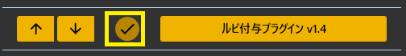
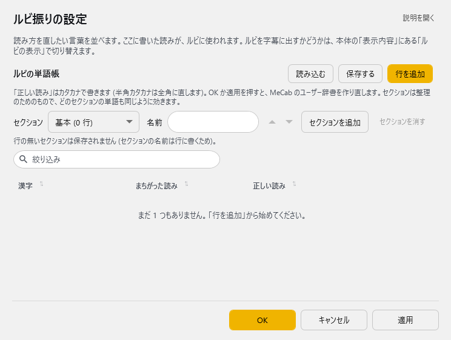

<!-- version-banner -->
!!! info ""
    ゆかコネNEO **v3.0** のドキュメントです。v2.3 をお使いの方は [v2.3 版のこのページ](../../v2.3/plugin/plugin_ruby.md) を、違いを知りたい方は [v2.3 から v3.0 への移行](../../mig/mig_neo_v3.0.md) をご覧ください。

!!! Info "前提条件"
    * 日本語もしくは中国語の場合
    * 本体の「字幕デザイン」→「デザイン」→ 分類のタブ「表示」で **「ルビの表示（対応している場合）」** が ON になっていること
    * ルビに対応したテンプレートを使っていること

## このプラグインで出来ること

* 認識後の文章に付けるルビ（かな、もしくはピンイン）を、形態素解析（MeCab）で作ります
* 読み方を直したい言葉を「ルビの単語帳」に登録し、MeCab のユーザー辞書を作り直せます

!!! Info "ルビを字幕に描くのは本体です (v3.0.0 beta 23～)"
    * ルビを出すかどうかは、本体の「字幕デザイン」→「デザイン」→ 分類のタブ「表示」にある **「ルビの表示（対応している場合）」** で切り替えます。詳しくは [標準設定項目の「表示内容」](../startup/startup_basic.md#display-content) をご覧ください。
    * このプラグインは、本体に頼まれて**字幕の文字から語と読みの組を作る係**です。字幕の HTML を書き換えることはしません。
    * UDトークや [/api/input の Morph](../tech/tech_api_neo.md) から読みが届いた文は、このプラグインを使わずにその読みでルビが付きます。このプラグインが作るのは、読みが届かなかった日本語・中国語の文の分です。
    * このプラグインを無効にすると、読みが届かなかった文にはルビが付きません。

!!! warning "beta 22 以前からお使いの方へ"
    「ルビの表示（対応している場合）」の既定は OFF です。beta 23 に上げて最初に起動したときだけ、このプラグインを有効にしていた方は自動で ON になります（それまでと同じ見た目のままです）。

!!! warning "ルビはNEOの表示レイアウト内のみ有効で、OBS転送などには反映されません"

##　有効化

* プラグインを使うチェックをONにしてください。

## 設定

プラグイン一覧で、このプラグインの名前の右にある **「設定」** を押すと開きます。

!!! info "閉じるときの 3 択"
    設定は**下書き**として持たれ、「OK」か「適用」を押すまで動いているプラグインには効きません。
    変更したまま閉じようとすると「変更が保存されていません」と聞かれ、**［はい］保存して閉じる／［いいえ］破棄して閉じる／［キャンセル］閉じるのをやめる** から選べます。

読み方を直したい言葉を並べます。ここに書いた読みが、ルビに使われます。ルビを字幕に出すかどうかは、本体の「表示内容」にある「ルビの表示」で切り替えます。

<!-- TODO(screenshot): images/v30/ruby_1.png を v3.0.11 以降の画面で撮り直す。表の上に「セクション」の欄と「絞り込み」の欄、押せる見出し (⇅) が見えている状態 -->

**ルビの単語帳**（表）

| 列 | 説明 |
|:--|:--|
| 漢字 | 読み方を直したい言葉 |
| まちがった読み | いまの（まちがった）読み。控え用で、辞書には使いません。空でもかまいません |
| 正しい読み | ルビに出したい読み |

「正しい読み」はカタカナで書きます (半角カタカナは全角に直します)。OK か適用を押すと、MeCab のユーザー辞書を作り直します。

### 読み方を登録する（ユーザー辞書）

1. 「ルビ振りの設定」→「単語」の表で **「行を追加」** を押します。
2. 「漢字」に言葉（例：`雪華`）、「正しい読み」にカタカナで読み（例：`セッカ`）を書きます。
3. **「OK」** か **「適用」** を押します。ユーザー辞書が作り直され、すぐに新しい読みでルビが付くようになります（少し時間がかかります）。

* 「漢字」か「正しい読み」が空の行は、辞書に入りません。
* 表を空にして OK を押すと、ユーザー辞書そのものを外します。
* 辞書を作り直せなかったときは、その場で注意が出ます。そのときも、**今まで登録できていた単語はそのまま残っています**。

!!! Info "辞書編集は必須ではありません"
    ふつうはそのままで正しくルビが振れます。読みがまちがう言葉があるときだけ、単語帳に登録してください。

!!! warning "以前の版で「登録した読みが効かない」「辞書のコンパイルが失敗する」「Access to the path is denied」と出ていた方へ"
    v3.0.11 までは、ユーザー辞書を作るのに必要なファイルが配られておらず、単語帳に登録した読みが効いていませんでした（v2.3 から同じ状態でした）。
    また、作り直しで「Access to the path is denied」と出て差し替えられないことがありました。
    前者は v3.0.12（ルビ v2.6）、後者は v3.0.13（ルビ v2.7）で直っています。**v3.0.13 以降**に上げてから、設定画面を開いて **「OK」** を押すと、登録してある単語で辞書が作り直されます。

### 表の使い方

* **「行を追加」** で、いま開いているセクションに行を増やします。行の右端のボタンは ▲▼＝1 つ上へ／1 つ下へ、＋＝この下に追加、×＝この行を消す です。
* **見出しで並べ替え**：列の見出しを押すと、いまのセクションの中で並べ替えます。押すたびに 昇順 → 降順 → 並べ替える前の順 と変わります。
* **絞り込み**：表の上の「絞り込み」に文字を入れると、その文字を含む行だけを出します（Ctrl+F で欄へ、Esc で解除）。絞り込むのはいまのセクションの中だけです。
* **セクション**：表の上の「セクション」で、単語をまとまりに分けられます（「セクションを追加」「セクションを消す」、名前の欄。空の名前は「基本」）。**セクションは整理のためのもので、どのセクションの単語も同じように効きます**（順番も関係ありません）。行の無いセクションは保存されません。
* **「保存する」** はいまの中身を CSV へ書き出します（控え用）。**「読み込む」** は CSV から読み込みます。新しいセクションとして足す／セクションごとに統合する／今の表と置き換える から選べます。

## 使うとき

1. このプラグインを有効にします。
2. 本体の「字幕デザイン」→「デザイン」→ 分類のタブ「表示」で、**「ルビの表示（対応している場合）」** を ON にします。
3. 音声認識した日本語・中国語の字幕に、ルビが付いて表示されます。

!!! Info "ルビが出ないとき"
    * 「ルビの表示（対応している場合）」が OFF になっていないか確かめてください。
    * ルビに対応していないテンプレートでは表示されません。
    * ルビを作るのが間に合わなかった文（1.5 秒まで待ちます）は、ルビ無しで表示されます。
