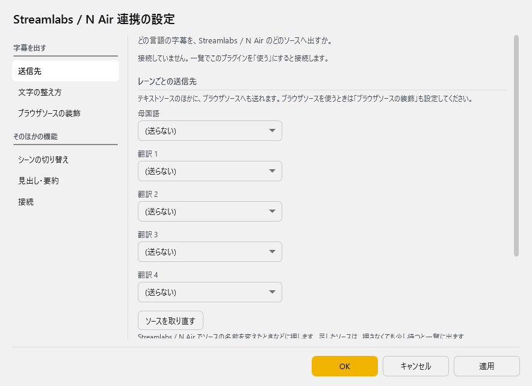
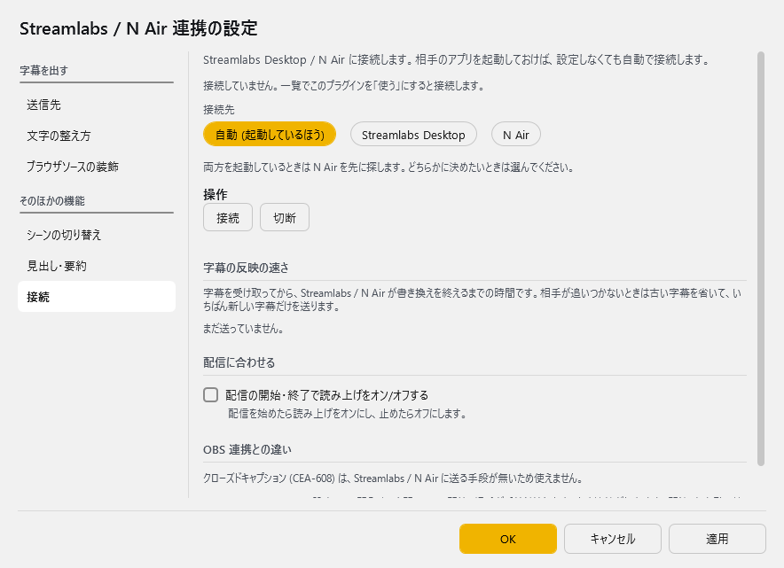

# Streamlabs / N Air 連携

<!-- version-banner -->
!!! info ""
    ゆかコネNEO **v3.0** のドキュメントです。このプラグインは **v3.0 で新しく入ったもの**（ゆかコネNEO v3.0.0 beta 30 から、プラグインの版は v1.0）で、v2.3 にはありません。v2.3 との違いは [v2.3 から v3.0 への移行](../../mig/mig_neo_v3.0.md) をご覧ください。

!!! Info "前提条件"
    * **Streamlabs Desktop** または **N Air** を、ゆかコネNEO と**同じ PC** で起動しておきます
    * 相手のアプリの設定は変えなくても接続できます（同じ PC からなら認証も要りません）
    * 見出し・要約を使うときは、ゆかコネNEO 本体で ChatGPT が使える設定にしておきます

## このプラグインで出来ること

[OBS 連携 WSv5](plugin_OBS5.md) の、Streamlabs Desktop / N Air 版です。

* 字幕（母国語と翻訳 1〜4）を、Streamlabs Desktop / N Air の **テキストソース** や **ブラウザソース** へ直接送れます
* ブラウザソースへ送るときは、CSS で見た目を決められます
* 話した言葉に合わせて **シーンを切り替え** られます
* トークの内容を AI で **見出し・要約** にして、ソースへ流せます
* 配信の開始・終了に合わせて、読み上げをオン・オフできます

字幕はファイルを経由せず、相手のアプリへ直接送ります（字幕のたびにディスクへ書きません）。

!!! Info "OBS 連携との違い"
    * **クローズドキャプション（CEA-608）は使えません。** Streamlabs / N Air に送る手段が無いためです
    * 送り先は、接続して取ってきたソースの一覧から選びます。名前を手で書いて送ることはできません

## 有効化

上のタブ **プラグイン** → **プラグインを追加** で、ジャンル **「配信（OBS・コメント）」** の **Streamlabs / N Air 連携** を選んで **追加する** を押してください（一覧の **使う** が ON になります）。手順は [プラグインの有効化](enabled.md) をご覧ください。

「使う」にすると、起動している Streamlabs Desktop / N Air へ自動で接続します。相手のアプリを後から起動しても、起動すると自動で接続します。

## 設定

プラグイン一覧で、このプラグインの名前の右にある **「設定」** を押すと開きます。
画面は **6 ページ**に分かれていて、左の一覧で切り替えます（送信先／文字の整え方／ブラウザソースの装飾／シーンの切り替え／見出し・要約／接続）。

!!! info "閉じるときの 3 択"
    設定は**下書き**として持たれ、「OK」か「適用」を押すまで動いているプラグインには効きません。
    変更したまま閉じようとすると「変更が保存されていません」と聞かれ、**［はい］保存して閉じる／［いいえ］破棄して閉じる／［キャンセル］閉じるのをやめる** から選べます。

### 送信先

どの言語の字幕を、どのソースへ出すかを決めます。ページの上に接続の状態（「● N Air に接続しています … 字幕を出せるソース ○件 / シーン ○件」など）が出ます。

| 項目 | 説明 |
|:--|:--|
| 母国語・翻訳 1〜翻訳 4 | 字幕を送るソースを、一覧から選びます。**（送らない）** なら送りません。既定：（送らない） |
| 「ソースを取り直す」ボタン | Streamlabs / N Air でソースの名前を変えたときなどに押します。足したソースは、押さなくても少し待つと一覧に出ます |
| 名前がこの送信先で始まるソースすべてへ送る | 例: 送信先が「字幕」なら「字幕_メイン」「字幕_サブ」の両方へ送ります。シーンごとに別のソースを置いているときに使います。既定：OFF |
| 話した人ごとのソースへも送る | 送信先の名前に「_話した人の名前」を付けたソースへも送ります（例: 字幕_Aさん）。既定：OFF |

接続していないときや、選んでいたソースが見つからないときも、選んだ名前は一覧に残ります（接続中に見つからなければ「(見つかりません)」と付きます）。

### 文字の整え方

送る前に字幕の文字をどう整えるかを決めます。文字数は母国語・翻訳 1〜4 ごとに決められます。

| 項目 | 説明 |
|:--|:--|
| 改行をすべて取り除いて送る | 1 行しか表示できないテキストソースへ送るときに使います。既定：OFF |
| 決まった文字数で改行を入れ直す | 文は切らず、折り返すだけです。既定：OFF |
| 折り返し（母国語・翻訳 1〜4） | 折り返す文字数です。既定：45 文字 |
| 長い文をそのままは出さない | 下の文字数を超えたときに、どうするかを選びます。既定：OFF |
| 長い文の扱い | **前を切り落として、後ろだけ出す**（既定）／**改行を挟んで、続けて出す** |
| 切れ目を探さず、決まった文字数ごとに区切る | 「前を切り落として、後ろだけ出す」のときに効きます。既定：OFF |
| 長い文の扱い（母国語・翻訳 1〜4） | 長い文とみなす文字数です。既定：45 文字 |
| 決まった行数を超えたら、古い行から省く | 前の発言も続けて見せます。行数を超えた分は古い行から消えます。既定：OFF |
| 残す行数 | 既定：3 行まで |

### ブラウザソースの装飾

ブラウザソースへ送るときの見た目（CSS）です。**テキストソースには要りません。**

| 項目 | 説明 |
|:--|:--|
| 母国語・翻訳 1〜4 の CSS | `{ync.text}` と書いたところへ、そのとき出す字幕の文字が入ります。テキストソースへ送るレーンは空のままで構いません |

それぞれの欄の下に、送信先がブラウザソースかどうか（この CSS を使うか）が出ます。CSS の書き方の例は [OBS 連携 WSv5 の CSS スタイリング機能](plugin_OBS5.md) をご覧ください。

### シーンの切り替え

話した言葉に合わせてシーンを切り替えます。

| 項目 | 説明 |
|:--|:--|
| 対応表のファイル | 1 行につき「キーワード,切り替えたいシーン名」の形で書き、UTF-8 で保存したファイル（`.csv` / `.txt`）を選びます。例: `休憩,休憩中` |

* 母国語の字幕にキーワードが**含まれていれば**、そのシーンに切り替えます。いくつも当てはまるときは、長いキーワードを先に使います
* 接続していると、ページの下に**いまあるシーンの名前**が出ます。シーン名はここからそのまま写してください
* 対応表の作り方（Excel・メモ帳）は [OBS 連携 WSv5 の対応表の作り方](plugin_OBS5.md) と同じです

### 見出し・要約

トークの内容をまとめて、ソースへ流します。**ゆかコネNEO 本体で ChatGPT が使える設定になっているときだけ動きます。**

| 項目 | 説明 |
|:--|:--|
| トークの要約を作って送る | 既定：OFF |
| 送信先のソース | 要約を送るソースです |
| 要約に使う行数 | 5〜50 行。既定：50 行 |
| 要約を作る間隔 | 1〜120 分ごと。既定：2 分ごと |
| 出し方 | `$title` に見出し、`$summary` に要約が入ります。既定：`【$title】$summary` |
| 翻訳先の言語と交互に出す | 既定：OFF |
| 切り替える間隔 | 5〜2000 秒ごと。既定：20 秒ごと |

### 接続

| 項目 | 説明 |
|:--|:--|
| 接続先 | **自動 (起動しているほう)**（既定）／**Streamlabs Desktop**／**N Air**。両方を起動しているときは N Air を先に探します。どちらかに決めたいときは選んでください |
| 「接続」ボタン | 接続し直して、結果をボタンの下に出します（最大 10 秒待ちます） |
| 「切断」ボタン | 切断します。一覧でこのプラグインを入れ直すか「接続」を押すと、また接続します |
| 字幕の反映の速さ | 字幕を受け取ってから、相手が書き換えを終えるまでの時間と、省いた数が出ます |
| 配信の開始・終了で読み上げをオン/オフする | 配信を始めたら読み上げをオンにし、止めたらオフにします。既定：OFF |

!!! Info "字幕は溜めません"
    相手のアプリが一時的に遅くなったときは、古い字幕を省いて**いちばん新しい字幕だけ**を送ります。古い字幕が後からまとめて流れ出すことはありません。最後の字幕（消すときの空の字幕も）は必ず送ります。

!!! Info "接続のしかた（参考）"
    * Streamlabs Desktop へは **TCP（127.0.0.1 のポート 28194）** で接続します
    * N Air へは **名前付きパイプ** で接続します
    * どちらも相手のアプリで既定で有効になっていて、同じ PC からなら認証は要りません

## 使うとき

1. Streamlabs Desktop か N Air に、字幕を出すテキストソース（またはブラウザソース）を作っておきます。
2. このプラグインを「使う」にし、設定の **「送信先」** で、母国語・翻訳ごとにソースを選んで **「OK」** を押します。
3. 話すと、選んだソースの文字が書き換わります。

### 外から操作する

`/api/command`（[プラグインコマンド](../tech/tech_api_neo.md)）で、`target=Plugin_StreamlabsNAir` に次の命令を送れます。

| command | 動き | ほかに渡すもの |
|:--|:--|:--|
| `set` | ソースへ文字を送る | `source`（ソース名）・`text`（文字）・`sourceNo`（CSS を使うレーンの番号 1〜5） |
| `scene` | シーンを切り替える | `scene`（シーン名） |
| `startreplay` / `stopreplay` / `savereplay` | リプレイバッファーの開始・停止・保存 | なし |

[MCP サーバー](plugin_mcpserver.md) のプラグインを使っていれば、AI アシスタントからシーンの一覧を見たり、シーンを切り替えたりもできます（シーンの切り替えなどは、そのたびにゆかコネNEO の画面で許可を求めます）。

## 困ったとき

| 起きること | 確かめること |
|:--|:--|
| 「Streamlabs Desktop も N Air も起動していません」と出る | 相手のアプリを起動します。起動すると自動で接続します |
| 「▲ … に接続していますが、字幕を書き換えられません」と出る | 相手のアプリの映像の処理が止まっています（Streamlabs の「Failed to make IPC call, verify IPC status」など）。**Streamlabs Desktop / N Air を起動し直してください。** このプラグインの不具合ではありません |
| Streamlabs Desktop で、ときどき接続が切れる | [設定] → [開発者] を開いている間は、相手が受け付けを止めるため接続が切れます。閉じると自動で接続し直します |
| 起動の直後やシーンコレクションを読み込んでいる間、送信先の一覧が空 | 相手が準備中です。少し待つと一覧に出ます（20 秒ほどかかることがあります） |
| 送信先の一覧に、作ったソースが無い | 「ソースを取り直す」を押します。字幕を出せるのはテキストソースとブラウザソースです |
| 長い字幕が出ない | 1 回に送れる長さには上限があり、超えた字幕は送りません。「文字の整え方」で行数や文字数を絞ってください |
| 要約が出ない | 本体で ChatGPT が使える設定になっているか、「送信先のソース」を選んでいるかを確かめます |
