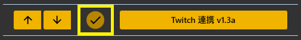
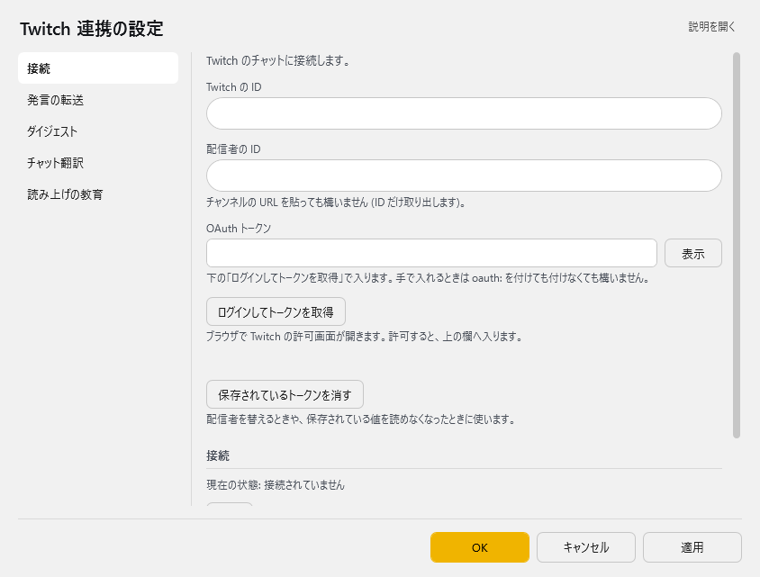
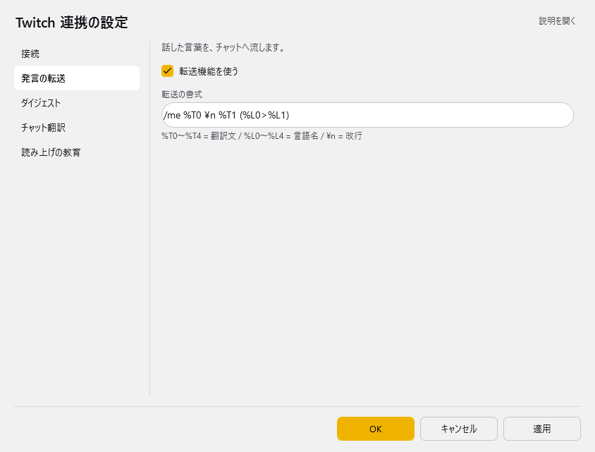
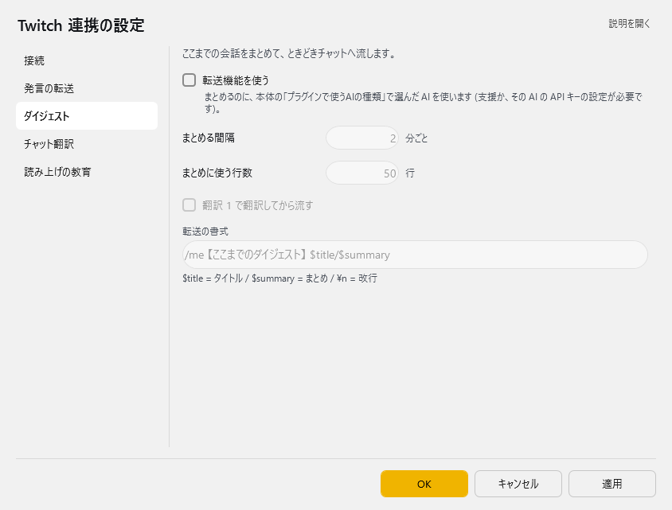

<!-- version-banner -->
!!! info ""
    ゆかコネNEO **v3.0** のドキュメントです。v2.3 をお使いの方は [v2.3 版のこのページ](../../v2.3/plugin/plugin_twitch.md) を、違いを知りたい方は [v2.3 から v3.0 への移行](../../mig/mig_neo_v3.0.md) をご覧ください。

!!! Info "前提条件"
    * Twitch アカウントが必要です。

## このプラグインで出来ること

* 音声認識結果をTwitchチャットチャネルに転送することができます
* チャットの発言を翻訳して、チャットへ送り返せます（[チャット翻訳](#chat-translate)）
* チャットの命令で、読み上げの読み方を覚えさせられます（[読み上げの教育](#speech-teach)）

##　有効化

* プラグインを使うチェックをONにしてください。

## 設定

プラグイン一覧で、このプラグインの名前の右にある **「設定」** を押すと開きます。
画面は **5 ページ**に分かれていて、左の一覧で切り替えます（接続／発言の転送／ダイジェスト／チャット翻訳／読み上げの教育）。

!!! info "閉じるときの 3 択"
    設定は**下書き**として持たれ、「OK」か「適用」を押すまで動いているプラグインには効きません。
    変更したまま閉じようとすると「変更が保存されていません」と聞かれ、**［はい］保存して閉じる／［いいえ］破棄して閉じる／［キャンセル］閉じるのをやめる** から選べます。

### 接続

Twitch のチャットに接続します。

| 項目 | 説明 |
|:--|:--|
| Twitch の ID | 書き込みに使う Twitch アカウントの ID です |
| 配信者の ID | チャンネルの URL を貼っても構いません (ID だけ取り出します)。 |
| OAuth トークン | 下の「ログインしてトークンを取得」で入ります。手で入れるときは oauth: を付けても付けなくても構いません。入力は伏せ字で表示されます。「表示」を押すと中身を確かめられます（もう一度押すと伏せます） |
| 「ログインしてトークンを取得」ボタン | ブラウザで Twitch の許可画面が開きます。許可すると、上の欄へ入ります。 |
| 「保存されているトークンを消す」ボタン | 配信者を替えるときや、保存されている値を読めなくなったときに使います。OK か「適用」を押すと空になります |

**接続**

> 現在の状態: …

| 項目 | 説明 |
|:--|:--|
| 「接続」ボタン | いま画面に入っている ID とトークンでつなぎます |
| 「切断」ボタン | 切断します。自分で切断したときは、次の字幕の転送で勝手につなぎ直しません（「接続」を押すと戻ります） |

### 発言の転送

話した言葉を、チャットへ流します。

| 項目 | 説明 |
|:--|:--|
| ☑ 転送機能を使う | 既定：ON |
| 転送の書式 | %T0〜%T4 = 翻訳文 / %L0〜%L4 = 言語名 / \n = 改行（既定：「/me %T0 \n %T1 (%L0>%L1)」） |

### ダイジェスト

ここまでの会話をまとめて、ときどきチャットへ流します。

| 項目 | 説明 |
|:--|:--|
| ☑ 転送機能を使う | まとめるのに、本体の「プラグインで使うAIの種類」で選んだ AI を使います (支援か、その AI の API キーの設定が必要です)。（既定：OFF） |
| まとめる間隔 | 1～120分ごと。既定：2 |
| まとめに使う行数 | 5～50行。既定：50 |
| ☑ 翻訳 1 で翻訳してから流す | 既定：OFF |
| 転送の書式 | $title = タイトル / $summary = まとめ / \n = 改行（既定：「/me 【ここまでのダイジェスト】 $title/$summary」） |

### チャット翻訳 { #chat-translate }

チャットに来た発言を翻訳して、チャットへ送り返します（v3.0.9～）。翻訳には本体の翻訳の設定（母国語・翻訳 1〜4 の言語とエンジン）を使います。

<!-- TODO(screenshot): images/v30/twitch_4.png — Twitch 連携の設定「チャット翻訳」ページ -->

| 項目 | 説明 |
|:--|:--|
| ☑ チャット翻訳を使う | 既定：OFF |
| 翻訳の向き | 多国語→母国語 (母国語以外の発言を母国語へ)／母国語→多国語 (母国語の発言を翻訳 1〜4 の言語へ)／母国語⇔多国語 (母国語の発言は翻訳 1〜4 の言語へ、それ以外は母国語へ)。既定：多国語→母国語 |
| 翻訳しない ID | 1 行に 1 つ、Twitch の ID か表示名を入れます。このプラグインが投稿した文は、入れなくても翻訳しません。ほかの翻訳 bot がいるときは、その ID も入れてください (訳し合いが続くのを防ぎます)。（既定：Nightbot／StreamElements／Moobot／Fossabot） |
| ☑ 「!」で始まるコマンドは翻訳しない | 既定：ON |
| 翻訳の書式 | %T0 = 元の発言 / %T1 = 翻訳文 / %L0 = 元の言語 / %L1 = 翻訳先の言語 / %U = 発言した人の表示名 / %I = 発言した人の ID / \n = 改行。先頭に付けられるコマンドは /me だけです。（既定：「/me [%U] %T1 (%L0>%L1)」） |

!!! Info "訳しすぎないための決まり"
    * 自分の投稿（このプラグインが送った文）は訳し直しません
    * エモートだけの発言や、英数字 3 文字以下の短い発言は訳しません
    * 同じ人の発言は 1 分に 5 件まで訳します。投稿の枠の一部は「発言の転送」のために残しておきます
    * 視聴者の発言でチャットのコマンドが動かないよう、差し込む文の改行は消し、先頭の `/` `.` `!` は /me 以外送りません

### 読み上げの教育 { #speech-teach }

チャットの命令で、[読み上げ連携](plugin_playvoice.md) に言葉の読みを覚えさせます（棒読みちゃんの教育と同じ書式。v3.0.11～）。

<!-- TODO(screenshot): images/v30/twitch_5.png — Twitch 連携の設定「読み上げの教育」ページ -->

| 項目 | 説明 |
|:--|:--|
| ☑ 読み上げの教育コマンドを有効にする | 「教育(言葉=読み)」か「(Study 言葉=読み)」で覚えさせ、「忘却(言葉)」で忘れさせます。（既定：OFF） |
| 教育を有効にする ID (ホワイトリスト) | 1 行に 1 つ、Twitch の ID か表示名を入れます。空なら、だれでも教育できます。 |
| 教育を除外する ID (ブラックリスト) | 1 行に 1 つ、Twitch の ID か表示名を入れます。ホワイトリストに入っていても、こちらが優先します。 |
| ☑ 結果をチャットに表示 | 「〇〇を〇〇と覚えました」のように、結果をチャットへ返します。（既定：OFF） |

!!! Warning "使うときの注意"
    * **読み上げ連携が「使う」になっているときだけ**効きます。覚えた言葉は、読み上げ連携の **詳細設定 → 読み方と補正 →「教育で覚えた言葉」** に並び、そこで忘れさせることもできます。くわしくは [読み上げ連携 - 読み上げの教育](plugin_playvoice.md#speech-teach) をご覧ください
    * わんコメで Twitch のチャットも受けているときは、**Twitch 連携とわんコメ連携のどちらか片方だけ**で有効にしてください（両方だと同じ命令が 2 回届きます）

### 補足

!!! Info "OAuthについて"
    * この文字列は、認証したアカウントに入るための認証済み手形みたいなものです。
    * この文字が漏洩するとアカウントの安全性が脅かされるため慎重に取扱いをしてください
    * この文字列は無効化されるまで　有効です。

## ライブ設定（配信中にその場で変える） { #live }

本体の **操作パネル → ライブ設定** に、このプラグインの「配信ごとに変わる値」が並びます。設定画面を開かずに値を入れて **「反映」** を押せば、すぐプラグインに入ります。しくみは [標準設定項目 - ライブ設定とプラグインの帯](../startup/startup_basic.md#live-settings) をご覧ください。

| 項目 | 説明 |
|:--|:--|
| 配信者の ID | 参加するチャンネルです。チャンネルの URL を貼っても構いません (ID だけ取り出します)。 |
| 話した言葉をチャットへ流す | 「発言の転送」の「転送機能を使う」と同じです |
| チャット翻訳を使う | 「チャット翻訳」の「チャット翻訳を使う」と同じです |

**「接続」／「切断」** ボタンでチャットへの接続を切り替えます。画面上部のプラグインの帯で、このプラグインのアイコンを**ダブルクリック**しても同じように切り替えられます（1 回のクリックはこれまでどおり設定を開きます）。
自分で切断したときは、自動ではつなぎ直しません。

## 具体的な使い方
1. IDを入れ、Twitchアカウント認証を行います
2. 認証後に得られる OAuth トークンを入れます
3. 接続先を決めます
4. 「接続」を押します

## 便利な機能

### 簡単認証
「ログインしてトークンを取得」ボタンを押すだけで、ブラウザが開いてTwitchアカウントでログイン。認証が完了すると自動でOAuthコードが設定画面に入力されます。

### 柔軟なメッセージ形式
転送パターンで以下のような設定が可能：
- `%T0` : 音声認識した原文
- `%T1` : 翻訳1の結果
- `%L0` : 原文の言語名
- `%L1` : 翻訳1の言語名

例：`%T0 \n %T1 (%L0>%L1)` → 「こんにちは Hello (ja>en)」

### URL貼り付け対応
設定画面の配信者IDに「https://www.twitch.tv/channel_name」のようなURLを貼り付けると、自動で「channel_name」だけ抽出してくれます。

## よくある問題

### 接続できない場合
- Twitchアカウント名（配信者ID）が正しいか確認
- 「ログインしてトークンを取得」ボタンで認証をやり直してみる
- インターネット接続を確認

### メッセージが送信されない場合
- プラグインが有効（チェックON）になっているか確認
- 転送パターンが正しく設定されているか確認
- Twitchチャンネルに正常に接続されているか確認