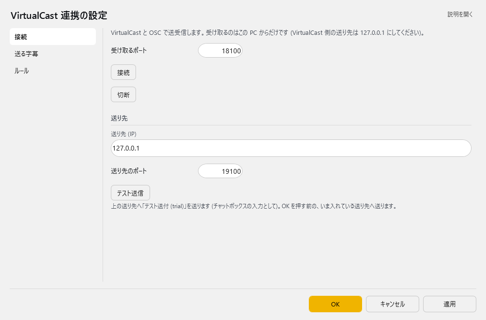
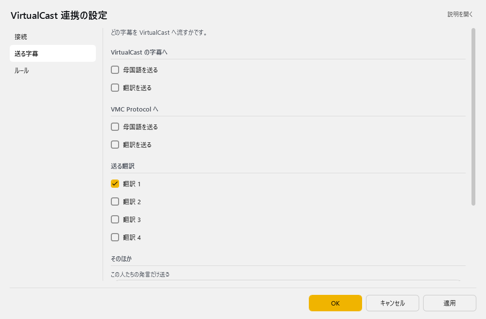
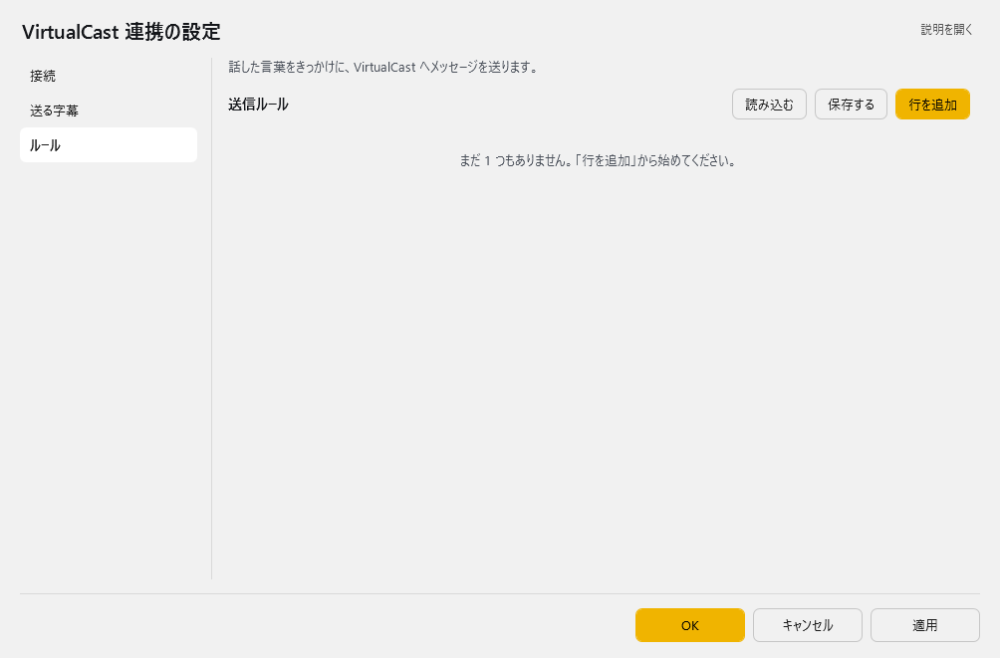

<!-- version-banner -->
!!! info ""
    ゆかコネNEO **v3.0** のドキュメントです。v2.3 をお使いの方は [v2.3 版のこのページ](../../v2.3/plugin/plugin_vcas.md) を、違いを知りたい方は [v2.3 から v3.0 への移行](../../mig/mig_neo_v3.0.md) をご覧ください。

!!! Info "前提条件"
    * バーチャルキャスとTHE SEED ONLINE を連携させることが必要です。
    * バーチャルキャストを動かすPCとゆかコネNEOを動かすPCは同一である必要があります

!!! question "バーチャルキャストについて"
    * ここで説明している使い方は株式会社バーチャルキャスト非公認のものです。
    * １ユーザが公開しているVCIの使い方となります。

## このプラグインで出来ること

* バーチャルキャストのワールド内に字幕を出すことができます。

## 有効化

* 上のタブ **プラグイン** → **プラグインを追加** でこのプラグインを選んで **追加する** を押します（一覧の **使う** が ON になります）。→ [プラグインの有効化](enabled.md)

## 設定

プラグイン一覧で、このプラグインの名前の右にある **「設定」** を押すと開きます。
画面は **3 ページ**に分かれていて、左の一覧で切り替えます（接続／送る字幕／ルール）。

!!! info "閉じるときの 3 択"
    設定は**下書き**として持たれ、「OK」か「適用」を押すまで動いているプラグインには効きません。
    変更したまま閉じようとすると「変更が保存されていません」と聞かれ、**［はい］保存して閉じる／［いいえ］破棄して閉じる／［キャンセル］閉じるのをやめる** から選べます。

### 接続

VirtualCast と OSC で送受信します。受け取るのはこの PC からだけです (VirtualCast 側の送り先は 127.0.0.1 にしてください)。

| 項目 | 説明 |
|:--|:--|
| 受け取るポート | 1～65535番。既定：9001 |
| 「接続」ボタン | — |
| 「切断」ボタン | — |

**送り先**

| 項目 | 説明 |
|:--|:--|
| 送り先 (IP) | 既定：「127.0.0.1」 |
| 送り先のポート | 1～65535番。既定：9000 |
| 「テスト送信」ボタン | 上の送り先へ「テスト送付 (trial)」を送ります (チャットボックスの入力として)。OK を押す前の、いま入れている送り先へ送ります。 |

### 送る字幕

どの字幕を VirtualCast へ流すかです。

**VirtualCast の字幕へ**

| 項目 | 説明 |
|:--|:--|
| ☑ 母国語を送る | 既定：OFF |
| ☑ 翻訳を送る | 既定：OFF |

**VMC Protocol へ**

| 項目 | 説明 |
|:--|:--|
| ☑ 母国語を送る | 既定：OFF |
| ☑ 翻訳を送る | 既定：OFF |

**送る翻訳**

| 項目 | 説明 |
|:--|:--|
| ☑ 翻訳 1 | 既定：OFF |
| ☑ 翻訳 2 | 既定：OFF |
| ☑ 翻訳 3 | 既定：OFF |
| ☑ 翻訳 4 | 既定：OFF |

**そのほか**

| 項目 | 説明 |
|:--|:--|
| この人たちの発言だけ送る | 名前をカンマで区切って書きます。空なら誰の発言でも送ります。 |
| ☑ 値を整数で送る | 既定：OFF |

**アバターと連動する**

| 項目 | 説明 |
|:--|:--|
| ☑ ミュートに合わせて字幕も止める | 既定：OFF |
| ☑ 手の形で読み上げの声を切り替える | 既定：OFF |

### ルール

話した言葉をきっかけに、VirtualCast へメッセージを送ります。

**送信ルール**（表）

列：使う／一致方式／判定対象／起動フレーズ／送り先 (OSC アドレス)／送る値／話した人／API タグ

表の右上の **「行を追加」** で行を増やします。行の右端のボタンは ▲▼＝1 つ上へ／下へ、＋＝この下に追加、×＝この行を消す です。**「保存する」** はいまの中身を CSV へ書き出します（控え用）。**「読み込む」** は CSV から読み込んで、いまの中身と入れ替えます。

### 補足

1. [THE SEED ONLINE](https://seed.online/products/66338c22802dab2dc2960fcfef0da39b7c916fcd9c7bdd24d5afd4e1d6fa7dde) でゆかコネNEO字幕VCIを手に入れます。
2. 一度バーチャルキャストの中で VCI を開いてください。
3. 「接続」ページで **接続** を押します。受け取るポート・送り先のポートは、VirtualCast 側の OSC の設定と合わせてください。

## 使い方
1. バーチャルキャスト内でVCIを表示します
2. 音声認識されると、ボードに表示されます。

!!! info "バーチャルキャスト内での操作について"
    * ボード自体は伸縮可能です。
    * パーツをUseすると背景色が変わります。

