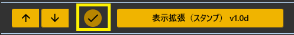
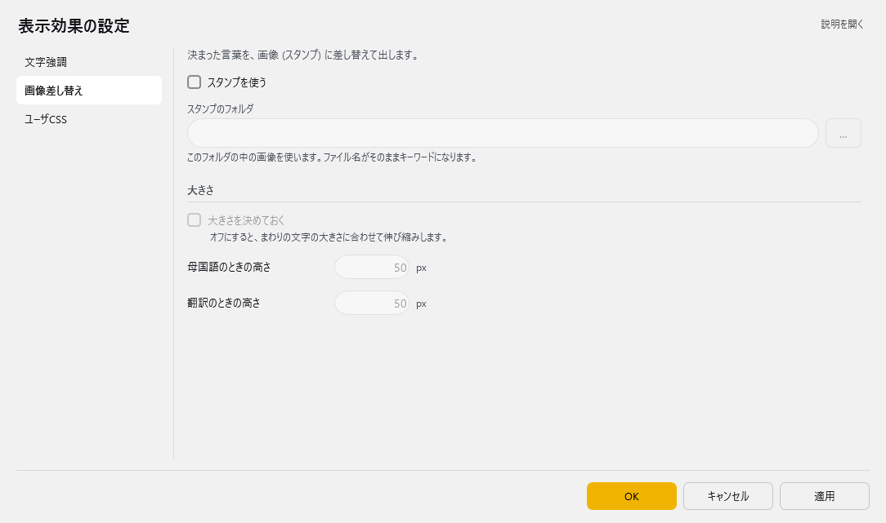

<!-- version-banner -->
!!! info ""
    ゆかコネNEO **v3.0** のドキュメントです。v2.3 をお使いの方は [v2.3 版のこのページ](../../v2.3/plugin/plugin_viewextend.md) を、違いを知りたい方は [v2.3 から v3.0 への移行](../../mig/mig_neo_v3.0.md) をご覧ください。

!!! Info "前提条件"
    * レイアウト表示（ブラウザテンプレート）のみに適用されます

## このプラグインで出来ること

* **文字強調**：決めた言葉に、太字・点滅・レインボー・ネオン・縁取りなどの効果を付けて出します。効果は重ねられ、大きさ (%) や文字の色も決められます
* **画像への差し替え**：決めた言葉を、文字の代わりに画像で出します（文字強調の 1 行ごと、またはスタンプのフォルダから）
* **ユーザCSS**：字幕テンプレートへ、自分で書いたスタイルシートを足します

!!! tip "v3.0.13 で文字強調が大きく変わりました"
    * 効果の数が増え（光と影・縁取り・フォント・動き・出かた・1文字ずつ など）、**1 つの言葉に効果をいくつも重ねられる**ようになりました。
    * 設定画面が「表＋右の編集欄」になり、**触るとすぐ字幕へ仮に効く**ようになりました。
    * 大きさ (%)・文字の色・効果ごとの色（蛍光ペン・ネオンの光・縁）を、言葉ごとに決められます。

##　有効化

* プラグインを使うチェックをONにしてください。

## 設定

プラグイン一覧で、このプラグインの名前の右にある **「設定」** を押すと開きます。
「表示効果の設定」の画面が開き、左の一覧で 3 ページを切り替えます。

| ページ | 中身 |
|:--|:--|
| **文字強調** | 決まった文字に効果（太字・点滅・レインボーなど）を付けて出します |
| **画像差し替え** | 決まった言葉を、画像（スタンプ）に差し替えて出します |
| **ユーザCSS** | 字幕テンプレートへ足すスタイルシートを書きます |

!!! info "触るとすぐ仮に効きます／閉じるときの 3 択"
    * 設定画面は開いたまま字幕を確かめられます（ほかの画面も操作できます）。
    * **「文字強調」と「ユーザCSS」のページは、触るとすぐ、次の字幕から仮に効きます。**「適用」を押さなくても見た目を確かめられます。
    * 仮に効かせているだけで、まだ保存はしていません。「OK」か「適用」を押すと保存されます。
    * 変更したまま閉じようとすると「変更が保存されていません」と聞かれ、**［はい］保存して閉じる／［いいえ］破棄して閉じる／［キャンセル］閉じるのをやめる** から選べます。破棄すると、字幕も保存してあった見た目に戻ります。
    * 「画像差し替え」（スタンプ）のページは仮には効きません。「OK」か「適用」で効きます。

### 文字強調

決まった文字に効果を付けて出します。左の表で文字を選び、右の欄で見た目を決めます。

<!-- TODO(screenshot): images/v30/viewextend_emphasis_1.png — 「表示効果の設定」→「文字強調」。左に「強調する文字」の表 (例: 「おはよう」=レインボー・跳ねる 140% など 2〜3 行)、右に選んだ行の編集欄 (大きさ・文字の色・画像に差し替え・効果) が見えている状態 -->

| 項目 | 説明 |
|:--|:--|
| ☑ 文字強調を使う | 切ると、表に書いた文字強調をすべて止めます。（既定：ON） |
| 強調する文字（表） | 強調したい文字を 1 行に 1 つ書きます。列は「文字」と「見た目」です |

* 「見た目」の列には、その行の見た目の要約（例：`レインボー・跳ねる / 140%`）が出ます。何も決めていない行は「効果なし」です。押すとその行を選び、右の編集欄に出します。
* 字幕（母国語・翻訳のどの枠も）にその文字が出たところに効果が付きます。長い言葉が先に当たります（「ありがとう」と「ありがとうございます」なら後者が先）。
* 「画像差し替え」のスタンプと同じ言葉は、スタンプのほうが優先されます。

#### 言葉を足して効果を付ける

1. 「表示効果の設定」→「文字強調」を開き、**「文字強調を使う」** を ON にします。
2. 表の **「行を追加」** を押し、「文字」の欄に強調したい言葉（例：`おはよう`）を書きます。
3. その行を選ぶと、右に **「「おはよう」の見た目」** の編集欄が出ます。
4. 編集欄の **「効果」** で、付けたい効果にチェックを入れます。いくつでも重ねられます（例：レインボー + 跳ねる）。
5. 必要なら **「大きさ」**・**「文字の色」**・**「画像に差し替え」** も決めます。
6. 字幕で見た目を確かめて、よければ **「OK」** か **「適用」** で保存します。

#### 右の編集欄の項目

**大きさ**

| 項目 | 説明 |
|:--|:--|
| スライダー／% の欄 | 30〜400% で決めます（5% きざみ）。欄に数を打っても決められます |
| 「75%」「100%」「140%」「200%」ボタン | よく使う大きさをすぐ選べます |
| 「決めない」ボタン | テンプレートの大きさのままにします（既定） |

**文字の色**

| 項目 | 説明 |
|:--|:--|
| 色見本（赤・オレンジ・金・緑・水色・紫・ピンク・白） | 押すとその色になります |
| 「色を選ぶ…」ボタン | 好きな色を選べます |
| 「決めない」ボタン | テンプレートの色のままにします（既定） |

* 「赤字」「レインボー」「虹色の波」のように**色が変わる効果と、文字の色は重ねられません**（色が変わる効果のほうが使われます）。
* 「ネオン」の光は、光の色を決めていなければ文字の色になります（文字の色も無ければ水色）。

**画像に差し替え**

文字の代わりに画像を出します。

| 項目 | 説明 |
|:--|:--|
| 「画像を選ぶ…」ボタン | 出したい画像を選びます。左に小さく見本が出ます |
| 「外す」ボタン | 画像をやめて、文字を出します |

* 使える画像は png / jpg / gif / webp で、**1 枚 512 KB まで**です。画像は字幕のスタイルに埋めて渡します。
* 画像の高さは文字のおよそ 1.5 倍です。「大きさ」で拡大・縮小できます。
* 画像にも効くのは **動き・出かた・文字の飾り・大きさ** です。文字にしか効かない効果（太さ・傾き・フォント・色・光と影・縁取り・1文字ずつ）と文字の色は、画像のときは使いません（チェックは残ったまま薄くなり、画像を外すと戻ります）。

**効果**

種類ごとにチェックボックスが並んでいます。チェックを入れた効果がすべて重なって付きます（一覧は [効果の一覧](#effect-list) をご覧ください）。

* 同じ種類の中で **1 つまで** のものがあります（縁取り・色が変わる・フォント・1文字ずつ）。ほかを選ぶと、前に選んでいたものは自動で外れます。
* 「フォント」の種類の下には、[PC に入っているフォント](#pc-font) を選ぶ欄もあります（v3.0.14～）。
* 「光と影」と「縁取り」は、「1文字ずつ」の効果とは重ねられません。
* 次の効果を選んでいるときだけ、その下に色の欄が出ます。言葉（行）ごとに色を変えられます。

| 欄 | 出るとき | 決めないとき |
|:--|:--|:--|
| 蛍光ペンの色 | 「蛍光ペン」を選んだとき | 黄色 |
| 光の色 (ネオン) | 「ネオン」「ネオン (ちらつかない)」を選んだとき | 文字の色（無ければ水色） |
| 縁の色 | 「白フチ」「黒フチ」「二重フチ」のどれかを選んだとき | 白フチは白、黒フチと二重フチの外側は黒 |

それぞれ色見本・「色を選ぶ…」・「決めない」で決めます。効果のチェックを外すと、その色も消えます。

**PC に入っているフォント**

効果の「フォント」の下にある欄で、決まったフォント（明朝体・ポップ体など）のほかに、**この PC に入っているフォント**を選べます（v3.0.14～、表示効果 v3.1～）。

<!-- TODO(screenshot): images/v30/viewextend_pcfont.png — 文字強調の右の編集欄。効果の「フォント」の下に「PC に入っているフォント」の選択欄と「決めない」ボタンが見えている状態 -->

| 項目 | 説明 |
|:--|:--|
| PC に入っているフォント（選択欄） | 本体の字幕のフォントと同じく、この PC に入っているフォントから選べます。一覧の行は、そのフォントで見本が出ます |
| 「決めない」ボタン | PC のフォントを外します（既定） |

* 一覧の最後には、本体のフォントの一覧に足した **Web フォント**（`FontList.json`）も並びます。Web フォントは字幕を出すときにネットから読み込みます。
* フォントは 1 つまでです。PC のフォントを選ぶと上の決まったフォントのチェックは外れ、決まったフォントにチェックを入れると PC のフォントは外れます。
* 選んだフォントの名前は、表の「見た目」の列の先頭に出ます。
* 字幕を出す PC にそのフォントが無いときは、ゴシック体で出ます。
* 「画像に差し替え」の行では使えません（欄が薄くなります）。
* 表を「保存する」で書き出した JSON にも入ります。ほかの PC で読み込んで、その PC に無いフォントのときは、一覧の先頭にその名前が出ます。

**カスタム (CSS クラス)**

自分で作った見た目を付けるときに、クラス名を書きます（例：`my-effect`）。見た目そのものは「ユーザCSS」のページに書きます（例：`.my-effect { color: gold; }`）。チェックを入れた効果と一緒に付けることもできます。

!!! note "以前の表をお使いの方へ"
    * 以前の「効果名」は「CSSクラス名」になり、いまは編集欄の「カスタム (CSS クラス)」で書きます。
    * 以前の効果「大きくする」「小さくする」は、編集欄では大きさ 140%・75% として出ます。何か触ると、その大きさで書き直されます。
    * カスタムなのにクラス名が空の行など、付ける効果が無い行は使われません（ログに出ます）。

#### 表の使い方

* **「行を追加」** で行を増やします。行の右端のボタンは ▲▼＝1 つ上へ／1 つ下へ、＋＝この下に追加、×＝この行を消す です。
* **「保存する」** はいまの表を JSON ファイルへ書き出します。**「読み込む」** は JSON ファイルから読み込んで、いまの表と置き換えます。ほかの PC へ持って行くときや控えに使えます。
* 行が 10 行以上になると、表の上に **「絞り込み」** の欄が出ます。入れた文字を含む行だけを出します（Ctrl+F で欄へ、Esc で解除）。

#### 効果の一覧

編集欄に出る順に並べています。

| 種類 | 効果 | 見え方 |
|:--|:--|:--|
| 太さ・傾き | 太字 | いちばん太い字にします |
| | 斜体 | 字を傾けます |
| 文字の飾り | 下線 | 太めの下線を引きます |
| | 取り消し線 | 横線で消したように見せます |
| | 蛍光ペン | 文字の下半分に、蛍光ペンを引いたような色を付けます（既定は黄色） |
| | きらきら | 言葉の前後で小さな星がまたたきます |
| | 星が舞う | 言葉の上へ星が舞い上がります（きらきらより大きく動きます） |
| 光と影 | ネオン | 文字の後ろが光り、ときどきちらつきます |
| | ネオン (ちらつかない) | ネオンと同じ光り方で、ちらつきません（読みやすさ優先・点滅が苦手な方に） |
| | 光が走る | 金色の光の帯が、文字の上を走ります |
| | 影を落とす | 文字の右下に濃い影を落とします |
| | グリッチ | 赤と水色の残像がずれて、映像が乱れたように見せます |
| 縁取り（1 つまで） | 白フチ | 文字のまわりに白い縁を付けます |
| | 黒フチ | 文字のまわりに黒い縁を付けます |
| | 二重フチ | 内側が白、外側が黒の二重の縁を付けます（縁の色を決めると外側の色が変わります） |
| 色が変わる（1 つまで） | 赤字 | 文字を赤くします |
| | レインボー | 文字の色が虹の色へ順に変わり続けます |
| フォント（1 つまで） | 明朝体 | 明朝体で出します |
| | 教科書体 | 教科書体（UD デジタル 教科書体 など）で出します |
| | ポップ体 | ポップ体（HG創英角ポップ体 など）の太字で出します |
| | 丸ゴシック | 丸ゴシックで出します |
| | 極太ポスター | Impact などの極太の書体で出します |
| | 等幅 | 等幅の書体で出します |
| | 手書き風 | 手書き風の書体で出します |
| くり返す動き | 点滅 | 一定の間隔で点滅します |
| | 揺れる | 小刻みに震えます |
| | 跳ねる | ぴょんと跳ねるのをくり返します |
| | 鼓動 | どくん、と大きくなるのをくり返します |
| | ゆらゆら | ゆっくり上下に揺れながら傾きます |
| | ぷるぷる | ゼリーのように縦横に伸び縮みします |
| 出かた（出たときに 1 回） | ふわっと出す | 少し下からふわっと現れます |
| | ドンと迫る | 大きな文字から、手前へ迫るように現れます |
| | 横から滑り込む | 左から滑り込んで現れます |
| | くるっと出る | 回転しながら現れます |
| 1文字ずつ（1 つまで） | 波打つ | 1 文字ずつ順に跳ねて、波のように動きます |
| | 1文字ずつポップ | 1 文字ずつ弾けるように現れます |
| | 1文字ずつ落ちる | 1 文字ずつ上から落ちてきます |
| | 虹色の波 | 波打ちながら、1 文字ずつ虹色に変わります（色が変わる効果なので「赤字」「レインボー」・文字の色とは重ねられません） |
| | タイプライター | 1 文字ずつ打ち込むように現れます |

!!! note "縁取りについて（v3.0.14～）"
    * 縁取り（白フチ・黒フチ・二重フチ）は、大きい字幕でも縁がなめらかに出るようにしています。
    * 縁取りした言葉の前後には、縁の太さぶんの間をあけます。**前後の文字に縁がかぶりません。**

!!! note "フォントについて"
    フォントの効果は、**字幕を表示する PC に入っている書体**を使います。入っていなければ、似た系統の別の書体で出ます（ポップ体・丸ゴシックなどの HG 書体は、Office に付いてくることが多い書体です）。
    決まったフォントに無い書体を使いたいときは、[PC に入っているフォント](#pc-font) で選べます（v3.0.14～）。

!!! tip "重ねる例"
    * レインボー + 跳ねる + 大きさ 140%
    * 黒フチ + ネオン（光の色：金）
    * 太字 + 蛍光ペン（ピンク）+ ドンと迫る

### 画像差し替え（スタンプ）

決まった言葉を、画像（スタンプ）に差し替えて出します。フォルダに画像を置くだけで、**ファイル名と同じ言葉**が字幕に出たら画像に差し替えます。

<!-- TODO(screenshot): images/v30/viewextend_1.png は旧画面 (窓の名前が「スタンプの設定」)。v3.0.13 の「表示効果の設定」→「画像差し替え」で撮り直す -->

| 項目 | 説明 |
|:--|:--|
| ☑ スタンプを使う | 既定：OFF |
| スタンプのフォルダ | このフォルダの中の画像を使います。ファイル名がそのままキーワードになります。（右の「…」で選べます） |

**大きさ**

| 項目 | 説明 |
|:--|:--|
| ☑ 大きさを決めておく | オフにすると、まわりの文字の大きさに合わせて伸び縮みします。（既定：OFF） |
| 母国語のときの高さ | 1～2000px。既定：50 |
| 翻訳のときの高さ | 1～2000px。既定：50 |

!!! Note "扱える写真の形式"
    * PNG
    * JPEG
    * BMP
    * GIF
    * そのほかにもブラウザが対応しているもの

!!! tip "スタンプと、文字強調の「画像に差し替え」の違い"
    * **スタンプ**：フォルダに置いた画像をまとめて使います。ファイル名がそのまま言葉になります。
    * **文字強調の「画像に差し替え」**：言葉ごとに 1 枚ずつ選びます。言葉とファイル名が違っていてもよく、動き・出かた・大きさ (%) も一緒に付けられます。

### ユーザCSS

字幕テンプレートへ足すスタイルシートを書きます。

<!-- TODO(screenshot): images/v30/viewextend_usercss_1.png — 「表示効果の設定」→「ユーザCSS」。CSS の入力欄に `.my-effect { color: gold; }` を書いた状態 -->

| 項目 | 説明 |
|:--|:--|
| ユーザCSS | ここに書いた CSS は、本体が書き出す user.css の後ろに足されます。文字強調の「カスタム」で付けたクラスの見た目もここに書きます |

* 開いている字幕の画面（ブラウザソース）にもそのまま効きます。このプラグインを無効にすると外れます。
* 画面の下に、決まった効果のクラス名（`.ync-fx-bold` など）の一覧が出ます。効果の見た目を少し変えたいときの手がかりにしてください。

## 使い方

1. このプラグインを有効にします。
2. 「設定」から、強調したい言葉（文字強調）や、スタンプのフォルダ（画像差し替え）を決めます。
3. 字幕を表示して音声認識させると、当てはまる言葉に効果が付いたり、画像に差し替わったりします。
