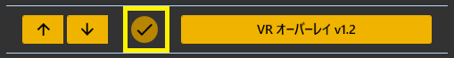
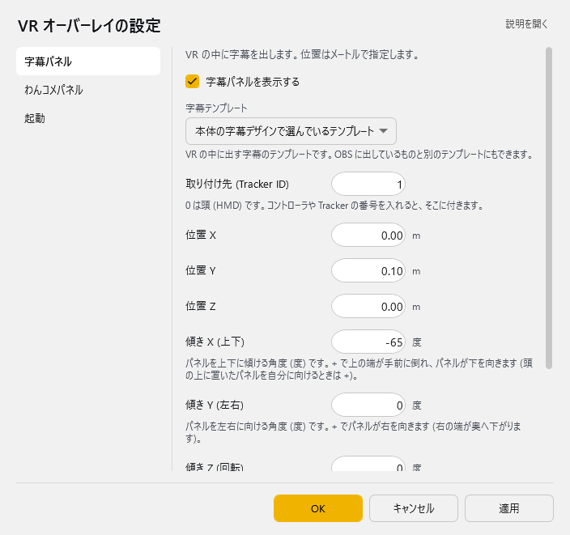
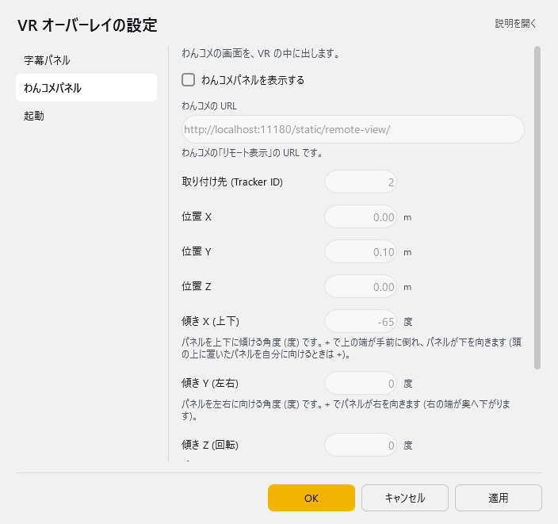

<!-- version-banner -->
!!! info ""
    ゆかコネNEO **v3.0** のドキュメントです。v2.3 をお使いの方は [v2.3 版のこのページ](../../v2.3/plugin/plugin_vroverlay.md) を、違いを知りたい方は [v2.3 から v3.0 への移行](../../mig/mig_neo_v3.0.md) をご覧ください。

!!! Info "前提条件"
    * SteamVR（OpenVR）で動く VR 環境であること
    * WebView2 ランタイム（Windows 11 は標準。Windows 10 も Edge が入っていれば入っています）

## このプラグインで出来ること

* VRゲーム内で字幕とコメントをみることができます。
!!! Warning "オーバーレイについて"
    * リアルタイム合成するため、多少VRに負荷がかかります（FPSが低下します）。
    * 環境などによっては、オーバーレイが表示できないことがあります。(OpenVRを使っていない場合など)

##　有効化

* プラグインを使うチェックをONにしてください。

## 設定

プラグイン一覧で、このプラグインの名前の右にある **「設定」** を押すと開きます。
画面は **3 ページ**に分かれていて、左の一覧で切り替えます（字幕パネル／わんコメパネル／起動）。

!!! info "閉じるときの 3 択"
    設定は**下書き**として持たれ、「OK」か「適用」を押すまで保存されません。
    変更したまま閉じようとすると「変更が保存されていません」と聞かれ、**［はい］保存して閉じる／［いいえ］破棄して閉じる／［キャンセル］閉じるのをやめる** から選べます。

!!! Tip "触るとすぐ VR の中に映ります (v3.0.8～)"
    オーバーレイが動いているあいだは、設定画面で値を変えると**すぐ VR の中の表示に映ります**。位置や傾きを、VR の中を見ながら合わせられます。
    **キャンセル**で閉じると、保存してある値に戻ります。

### 字幕パネル

VR の中に字幕を出します。位置はメートルで指定します。

<!-- TODO(screenshot): images/v30/vroverlay_1.png を撮り直す — 「字幕パネル」ページ（字幕テンプレート・傾き X/Y/Z・透過度が増えた） -->

| 項目 | 説明 |
|:--|:--|
| ☑ 字幕パネルを表示する | 既定：ON |
| 字幕テンプレート | VR の中に出す字幕のテンプレートです。OBS に出しているものと別のテンプレートにもできます。並びは「本体の字幕デザインで選んでいるテンプレート」→ ★お気に入り → 残り です。（既定：本体の字幕デザインで選んでいるテンプレート） |
| 取り付け先 (Tracker ID) | 0 は頭 (HMD) です。コントローラや Tracker の番号を入れると、そこに付きます。（0～64。既定：1） |
| 位置 X / 位置 Y / 位置 Z | -1000～1000m。既定：X 0.00／Y 0.10／Z 0.00 |
| 傾き X (上下) | パネルを上下に傾ける角度 (度) です。+ で上の端が手前に倒れ、パネルが下を向きます (頭の上に置いたパネルを自分に向けるときは +)。（-180～180度。既定：-65） |
| 傾き Y (左右) | パネルを左右に向ける角度 (度) です。+ でパネルが右を向きます (右の端が奥へ下がります)。（-180～180度。既定：0） |
| 傾き Z (回転) | パネルを画面の中で回す角度 (度) です。+ で反時計回りに回ります。（-180～180度。既定：0） |
| 大きさ | 0～100000倍。既定：1.0 |
| 透過度 | パネルの背景の透け具合です。0% で背景を黒く塗り、明るい景色の上でも字幕が読めます。100% で背景なし (字幕の文字だけ)。文字は薄くなりません。（0～100%。既定：60） |

!!! Info "前の版から更新した方へ"
    既定の置き方（位置 Y 0.1・傾き X -65）は、新しく使い始めたときの値です。前の版から更新した方は、傾き X が 0 のまま（取り付け先の正面を向いたまま）になっています。見やすい向きに合わせてください。

### わんコメパネル

わんコメの画面を、VR の中に出します。

| 項目 | 説明 |
|:--|:--|
| ☑ わんコメパネルを表示する | 既定：OFF |
| わんコメの URL | わんコメの「リモート表示」の URL です。（既定：http://localhost:11180/static/remote-view/） |
| 取り付け先 (Tracker ID) | 0～64。既定：2 |
| 位置 X / 位置 Y / 位置 Z | -1000～1000m。既定：X 0.00／Y 0.10／Z 0.00 |
| 傾き X (上下)／傾き Y (左右)／傾き Z (回転) | 字幕パネルと同じです。（-180～180度。既定：X -65／Y 0／Z 0） |
| 大きさ | 0～100000倍。既定：1.0 |
| 透過度 | 字幕パネルと同じです。（0～100%。既定：60） |

### 起動

| 項目 | 説明 |
|:--|:--|
| 「オーバーレイを起動し直す」ボタン | いま画面に入っている値 (OK を押す前の値) で、オーバーレイを止めてから起動し直します。 |

VR の中の表示が止まったとき・SteamVR を後から起動したときは、ここから起動し直します。**OK を押しただけでは起動し直しません。**
起動し直すと、結果（起動した／すぐ終わった／WebView2 が無い／表示するものが無い／字幕の URL が取れない など）が理由ごとに出ます。

### 補足

!!! Info "URLについて"
    * わんコメテンプレートからのドラッグ＆ドロップを受け付けます。
    * わんコメ以外でもURLアクセスできるものであれば表示できます

## 使い方
1. SteamVR と VR ゲームを起動します
2. プラグインを「使う」にします。オーバーレイが起動し、VR の中に字幕パネルが出ます
3. 位置や傾きは、設定画面で値を変えながら VR の中で確かめて合わせます
4. 表示が出ないとき・止まったときは、設定画面の「起動」ページで **「オーバーレイを起動し直す」** を押します

!!! Info "オーバーレイの窓について"
    * v3.0.8 から、オーバーレイは**窓を出さずに**裏で動きます（以前の黒い窓は出ません）
    * パネルの表示には **WebView2** を使います。WebView2 が無いときは、そう知らせます
