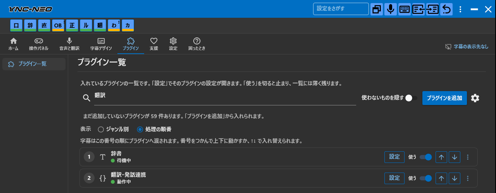
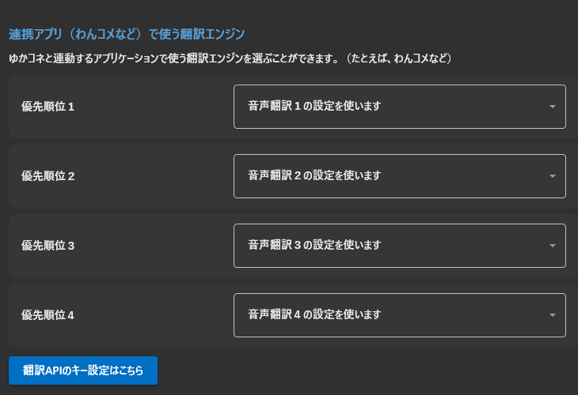
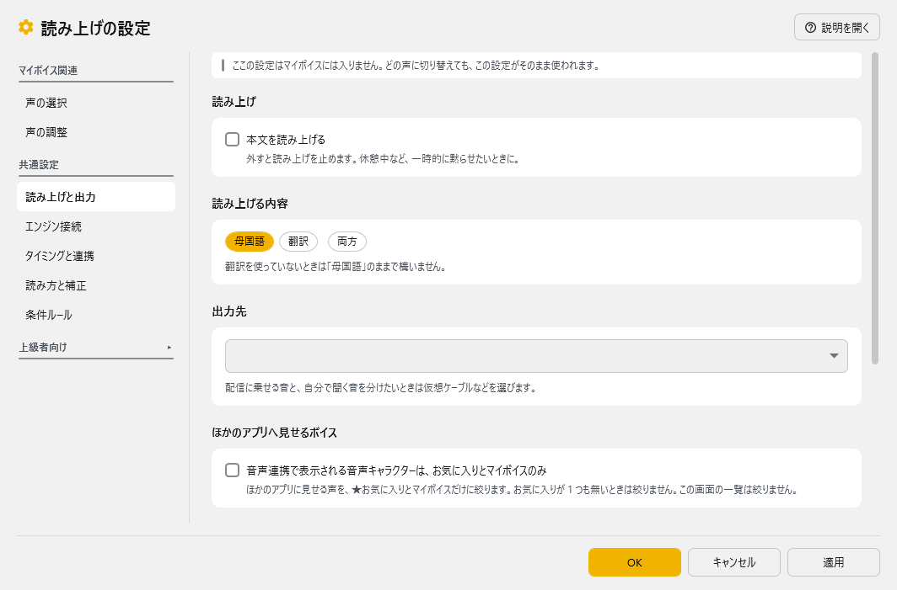
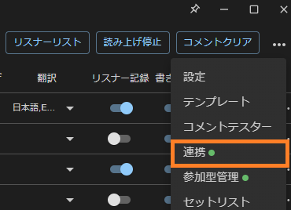
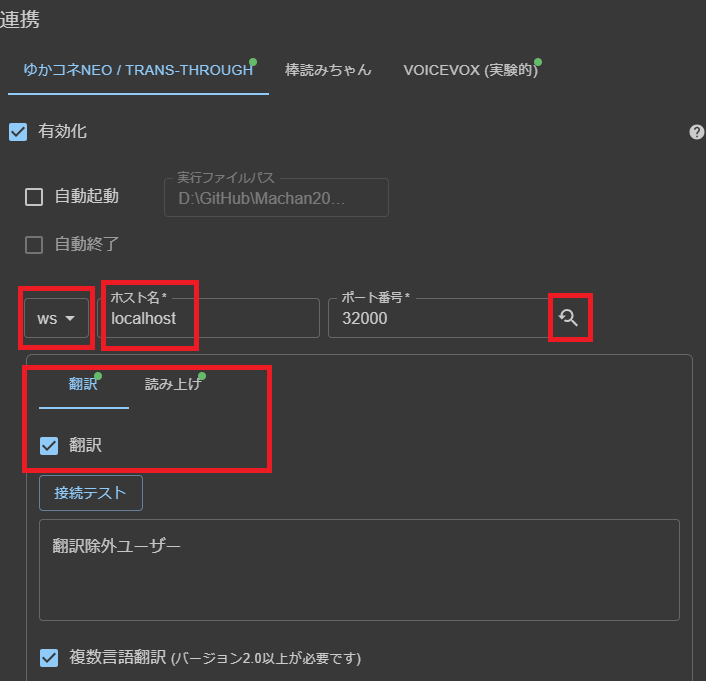
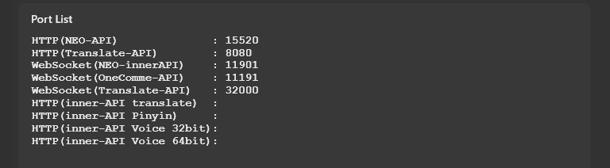
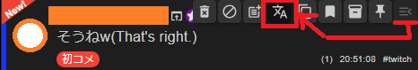
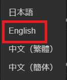
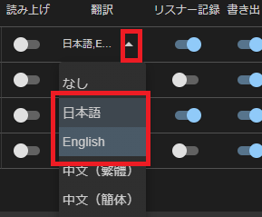

# わんコメ連動がうまくいかないとき

<!-- version-banner -->
!!! info ""
    ゆかコネNEO **v3.0** のドキュメントです。v2.3 をお使いの方は [v2.3 版のこのページ](../../v2.3/qa/ts_onecomme.md) を、違いを知りたい方は [v2.3 から v3.0 への移行](../../mig/mig_neo_v3.0.md) をご覧ください。

ゆかコネは、わんコメと連動させて翻訳や読み上げができますが、うまく連動できないとお問い合わせ頂くことがあります。下記の項目を確認してみてください。

!!! Notice "始める前に"

    * 一息おいてみましょう。
    * わんコメのバージョンを上げてみましょう
    * ゆかコネのバージョンを上げてみましょう
    * 再起動しても直りませんか？

## 1.ゆかコネのプラグインを確認

まずは、ゆかコネのプラグインを確認します。上のタブ **プラグイン** → **プラグイン一覧** を開き、上の欄に名前を入れると探せます。

下記のプラグインが一覧にあり、**使う** が ON になっていることを確認します。一覧に無いときは **プラグインを追加** から入れます（[プラグインの有効化](../plugin/enabled.md)）。

* 読み上げを使う場合は、**読み上げ** を ON にします
* 翻訳、読み上げいずれかを使う場合には、**翻訳・発話連携** を ON にします

## 2.ゆかコネの翻訳設定を確認

翻訳を使う場合は、連携アプリ用の翻訳設定を確認してください。
上のタブ **音声と翻訳** → **翻訳する言語** の下のほうにある **連携アプリ（わんコメなど）で使う翻訳エンジン** で、今使える翻訳エンジンが選ばれていることを確認します。

!!! Info "使える翻訳エンジンとは？"
    FANBOXで支援していて、有効な状態であればFANBOX特典として利用な翻訳エンジンが使えます。支援１，２ではMicrosoftとGoogle v2が、支援３以降ではDeepLなどが利用できます。

## 3.ゆかコネの読み上げ設定を確認

* 連携した読み上げが必要な方は、こちらを確認します。
* 読み上げをつかわないなら、この確認は不要です

プラグイン一覧の **読み上げ** の **設定** を押して詳細設定を開き、**読み上げと出力** のページで出力先を選びます。
うまくいっていれば、ボイスパレットの **試聴** で声がだせます。詳しくは [読み上げ](../plugin/plugin_playvoice.md) をご覧ください。

## 4.わんコメの連携をONに

わんコメの画面で、通信の選択を確認してください。

* 通信方法は「WS」
* ホスト名は、「127.0.0.1」か「localhost」
* ポート番号は、横の虫眼鏡ボタンを押せば自動で入ります
* 翻訳をする場合には翻訳タブのチェックをいれます
* 読み上げをする場合には、読み上げのチェックをいれてボイスをえらんでおきます

なお、この数字が正しいのかどうかについては、ゆかコネの上のタブ **困ったとき** → **動作チェック** の **詳しい情報** にある **Port List** でたしかめることができます（「WebSocket(OneComme-API)」の番号）。

## 5.翻訳をONになっているか確認します

* うまく通信できていれば、これで翻訳がされます。

枠の設定で、翻訳の設定ができているかをかくにんしてください。

## 6.翻訳を確認します

## 7.それでも駄目なら…

* サポート依頼をしましょう
* ゆかコネやわんコメのログを開発者に共有してください
