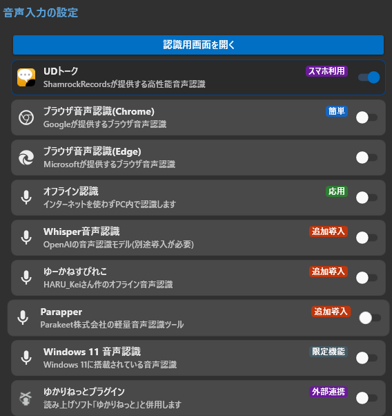

# 音声認識がうまくいかないときの解決法

<!-- version-banner -->
!!! info ""
    ゆかコネNEO **v3.0** のドキュメントです。v2.3 をお使いの方は [v2.3 版のこのページ](../../v2.3/startup/startup_asr.md) を、違いを知りたい方は [v2.3 から v3.0 への移行](../../mig/mig_neo_v3.0.md) をご覧ください。

  <h4>このページについて</h4>
  
音声認識機能がうまく動かないときに、原因を特定して解決するためのガイドです。よくあるトラブルを順番に確認していきましょう！

  <a href="#mic-settings" class="purpose-card">
    
🎤

    <h3>マイクが認識されない</h3>
    
ブラウザのマイク設定を確認する方法

  </a>
  <a href="#volume" class="purpose-card">
    
🔊

    <h3>音声が正しく拾われない</h3>
    
音量レベルの調整方法

  </a>
  <a href="#change-browser" class="purpose-card">
    
🌐

    <h3>ブラウザを変更したい</h3>
    
別のブラウザで試す方法

  </a>
  <a href="#chrome-local-network" class="purpose-card">
    
🔌

    <h3>「接続中」のまま止まる</h3>
    
Chromeの接続の許可を確認する方法

  </a>
  <a href="#offline-recognition" class="purpose-card">
    
💻

    <h3>オフライン認識を使う</h3>
    
モデルの選び方・句読点・保存先

  </a>

## ブラウザ音声認識について

ブラウザ音声認識は、ブラウザに搭載されている音声認識機能を使って、あなたの声を文字に変換するシンプルな方法です。使うブラウザによって、次の2種類から選べます。

|選択肢|使われる音声認識|
|:--|:--|
|ブラウザ（Chrome / Google音声認識）|Googleの音声認識|
|ブラウザ（Edge / Microsoft音声認識）|Microsoftの音声認識|

* どちらもインターネット接続が必要です。
* 認識の癖が違うので、片方でうまくいかないときはもう片方を試してみてください。

## ブラウザ音声認識の画面でできること { #browser-recognition }

!!! Tech "使用条件"
    * ゆかコネNEO v3.0.0～
    * マイクを選ぶ機能は Chrome / Edge 135 以降

「認識用画面を開く」で開く音声認識画面では、ブラウザの設定を開かなくても、使うマイクを選んだり入力レベルを確かめたりできます。

<!-- TODO(screenshot): ブラウザ音声認識の画面（上の「接続・マイク・音声・認識」のランプ、入力レベルのメーター、「マイク」欄の第1入力・第2入力・名前・「2本同時に認識する」） -->

### マイクを選ぶ

* 画面の **「マイク」** の欄で、**第1入力**（優先して使うマイク）と **第2入力**（予備）を選びます。新しくつないだマイクが出てこないときは **「一覧を更新」** を押します。
* 青枠の入力を優先して使います。使っているマイクが抜けたり使えなくなったりすると、もう一方 → OS の既定のマイク の順で**自動で切り替え**、元のマイクが戻ったら話の切れ目で元に戻します。
* 第1入力で **「標準設定マイク（従来どおり）」** を選ぶと、以前と同じく、どのマイクを使うかをブラウザに任せます（このときは入力レベルを表示しません）。
* マイクを選べないブラウザでは「このブラウザではマイクを指定できないため、「標準設定マイク（従来どおり）」で認識します」と出ます。
* マイクの指定がうまくいかずに既定のマイクへ切り替わったあとでも、**認識を停止すれば選び直せます**（v3.0.9～）。

!!! Info "Edge でマイクを選ぶとき"
    Edge では、選んだマイクが認識に使われないことがあります。文字にならないときは、第1入力を「標準設定マイク（従来どおり）」に戻してください。

### 入力レベルと状態の表示

* 入力レベルのメーターで、声が届いているかを確かめられます。入力レベルを出すため、停止中もマイクは開いたままです。
* 上の **接続・マイク・音声・認識** のランプで、どこまで動いているかが分かります。お知らせは時刻つきで表示されます。
* マイクの入力が完全な無音のまま 8 秒続くと、「マイクの入力が完全に無音です。」と警告が出ます。マイクのミュートや OS の録音設定を確認するか、「マイク」の欄で別の入力に切り替えてください。

### 2人分を同時に認識する

* **「2本同時に認識する」** を ON にすると、第2入力を予備ではなく**別の話者**として同時に認識します。第2入力には **名前** と **言語** を別に設定できます。
* 送信形式が JSON 形式のときだけ使えます（下の「送信形式」を参照）。
* 第1入力と同じマイクを第2入力に選んでいると動きません。ブラウザによっては2本同時に動かせないことがあり、その場合は自動で1本に戻ります。

### 送信形式

* 「オプション」の **「YNC-NEO への送信形式」** で、ゆかコネNEO へ文字を送る形を選べます。ふつうは **「自動（おすすめ）」** のままにしてください。

|選択肢|意味|
|:--|:--|
|自動（おすすめ）|ゆかコネNEO が対応していれば JSON 形式、そうでなければ従来形式で送ります|
|JSON 形式|文ごとに ID・話者・言語を付けて送ります。2本同時の認識はこの形式のときだけ使えます|
|従来形式（ゆかりねっと互換）|以前と同じ形で送ります|

!!! Tip "ゆかりねっと向けの認識ページ"
    ゆかりねっとと組み合わせるときに使うブラウザ音声認識のページにも、同じマイク選択・入力レベル表示が入っています。

## ブラウザ音声認識が「接続中」のまま止まる（Chrome） { #chrome-local-network }

!!! Tech "使用条件"
    * ゆかコネNEO v3.0.9～（案内の表示）

* 新しい Chrome では、Web のページ（音声認識画面）からこの PC のアプリ（ゆかコネNEO）へつなぐときに、**「このデバイス上のアプリ」「ローカル ネットワーク」へのアクセスの許可**を求められます。許可しないと、認識した文字がゆかコネNEO に届きません。
* 音声認識画面に **「ゆかコネNEO への接続を許可してください」** と出たら、ブラウザの上のほうに出ている確認で **「許可」** を押してください。
* **「ゆかコネNEO への接続がブラウザに止められています」** と出たら、一度「ブロック」を選んでいます。次の手順で許可に変えてください。
    1. アドレスバーの左にあるアイコン（サイト情報）を押します。アドレスバーがない窓のときは、ふだんのブラウザの「設定 → プライバシーとセキュリティ → サイトの設定」で ``https://yukari-connect.app`` を開いても変えられます。
    2. 「このデバイス上のアプリ」または「ローカル ネットワーク」を **「許可」** にします。
    3. 許可すると自動でつなぎ直します。つながらないときは、F5 キーでページを読み直してください。
* 確認が出ていないのにつながらないときは、ゆかコネNEO が起動しているかを確かめてください。

## オフライン音声認識について { #offline-recognition }

「音声入力の設定」で **「オフライン認識」** を選ぶと、インターネットを使わずにPCの中で認識します。「認識用画面を開く」で、オフライン認識の窓（Offline Recognition）が開きます。

<!-- TODO(screenshot): オフライン認識の窓の「⚙ 設定」部分（言語・入力デバイス・モデル・「取得」ボタン・句読点・GPU高速化） -->

### モデルを選ぶ

* 窓の **「⚙ 設定」** の **「モデル」** で、認識に使うモデルを選びます。モデルは「高速 (Fast)」「バランス (Balanced)」「高精度 (High accuracy)」「日本語調整 (Japanese tuned)」「VOSK」「Sherpa-ONNX」に分かれて並んでいます。
* 日本語向けには次のモデルがあります。

|モデル|特徴|
|:--|:--|
|Haas-ja v1.0 (JA・CPU で高速)|日本語専用の軽量モデル（v3.0.10～）。GPU が無い PC でも速く、同じ言葉の繰り返しが出にくいモデルです|
|kotoba-v2.0 Q5 (JA)|日本語向けの Whisper（約 540MB）。v3.0.10 で、認識精度が下がっていた件を直しました|
|kotoba-bilingual Q5 (JA/EN)|日本語と英語の両方向け（約 540MB）|
|[VOSK] Small Japanese (48MB) など|小さく軽いモデル|

### モデルのダウンロードと同意

!!! Tech "使用条件"
    * ゆかコネNEO v3.0.1～

* まだ PC に無いモデルを選んで開始する（または「取得」を押す）と、**ダウンロードしてよいかの確認**が出ます。
* 確認には、モデルの名前・取得元・大きさの目安・保存先が表示されます。**「はい」** を押すとダウンロードが始まります。
* **「いいえ」** を押すと、ダウンロードせず、認識も開始しません。既定のボタンは「いいえ」なので、Enter を押しただけでダウンロードが始まることはありません。
* モデルのライセンスは、窓の「ライセンス」の一覧で確認できます。
* モデルの保存先を C: 以外に変えたり、要らなくなったモデルを消したりするときは、ゆかコネNEO 側の **「モデルの保存先と管理」** を使います（[オプション設定項目](startup_option.md#model-storage) を参照）。オフライン認識の窓が開いているあいだは、認識のモデルを削除・移動できません。

### 句読点を付ける

!!! Tech "使用条件"
    * ゆかコネNEO v3.0.11～

* **「⚙ 設定」** の **「句読点」** で、確定した文に「、」「。」「？」を付けるかを選べます。

|選択肢|意味|
|:--|:--|
|付けない (モデルの出したまま)|既定です。モデルが出した文をそのまま使います|
|hayamimi-punct-ja (日本語・、。？)|句読点を付けるモデルで、日本語の文に句読点を補います|

* 句読点が付くのは、**Haas-ja と VOSK のモデルで認識した、まだ句読点の無い日本語の確定文**だけです（Whisper 系のモデルはもともと句読点を付けて出します）。
* 初めて選んで開始するときに、句読点のモデル（約 44MB）をダウンロードしてよいかの確認が出ます。

### 確定のテンポと、文ごとの言語の判定

* 話し続けても、文が一定のリズムで確定するようにしています（v3.0.4～）。GPU で速く動くときは細かく区切って早めに確定し、CPU のときは追いつけるよう区切りを長めにします（v3.0.10～）。
* 「言語」を **「自動検出 / Auto detect」** にしていると、確定した文ごとに話した言語を推定して ゆかコネNEO に知らせます。短い文での判定違いを避けるため、同じ言語が続いてから切り替えます（VOSK のモデルでは判定しません）。
* 「繰り返しをまとめる」（既定 ON）で、同じ言葉が何度も出る誤認識をまとめます。「テスト、テスト、テスト」のように実際に繰り返した言葉は残します。

## よくある問題と解決法

### マイク設定の確認 { #mic-settings }

  

    <h3>ブラウザのマイク設定画面を開く</h3>
    
ブラウザのアドレスバーに以下のいずれかを入力します：

    <ul>
      <li>Microsoft Edge: <code>edge://settings/content/microphone</code></li>
      <li>Google Chrome: <code>chrome://settings/content/microphone</code></li>
    </ul>
  

  
  

    <h3>正しいマイクを選択する</h3>
    
使いたいマイクが選択されているか確認します

    

      
      

        使用するマイクを選択
      

      

        「許可」になっていることを確認
      

    

  

  
  

    <h3>ブラウザが許可状態か確認する</h3>
    
「ブロック」になっていると音声認識ができません。必ず「許可」にしましょう。

  

!!! Tip "音声認識画面でもマイクを選べます"
    ブラウザの設定を開かなくても、音声認識画面の「マイク」の欄で使うマイクを選べます（Chrome / Edge 135 以降）。
    → [ブラウザ音声認識の画面でできること](#browser-recognition)

### 音量調整 { #volume }

音量が適切でないと、認識精度に大きく影響します。

  <h4>音量調整のポイント</h4>
  <ul>
    <li><strong>音量が小さすぎる場合</strong>：認識されない、結果が不明瞭、認識の確定が遅れる</li>
    <li><strong>音量が大きすぎる場合</strong>：音が割れて認識精度が下がる、認識結果が表示されないことも</li>
  </ul>

#### Windows 10/11での音量確認方法

1. タスクバーの音量アイコンを右クリック
2. 「サウンド設定を開く」を選択
3. 「入力」メニューで使用するマイクを選び、音量レベルを確認
4. レベルメーターが話しているときに中間くらいまで動くのが理想的です

### ブラウザの変更 { #change-browser }

ブラウザによって音声認識の精度や安定性が異なることがあります。

  

    <h3>別のブラウザで試す</h3>
    
現在のブラウザで問題がある場合は、別のブラウザに切り替えてみましょう

    <ul>
      <li>Microsoft Edge → Google Chrome</li>
      <li>Google Chrome → Microsoft Edge</li>
    </ul>
  

  
  

    <h3>認識に使うブラウザを変更する</h3>
    
音声認識に使うブラウザは「音声入力の設定」画面で切り替えます

    <ol>
      <li>左メニューの「音声入力の設定」を開く</li>
      <li>「ブラウザ（Chrome / Google音声認識）」か「ブラウザ（Edge / Microsoft音声認識）」を選ぶ</li>
      <li>音声認識ウィンドウを開き直す</li>
    </ol>
  

!!! Warning "「ブラウザと字幕ウィンドウ」画面とは別の設定です"
    * 「ブラウザと字幕ウィンドウ」画面（以前の「ブラウザのオプション」）にあるChrome / Edgeの選択は、**字幕を表示するため**に使うブラウザの設定です。音声認識には影響しません。
    * **音声認識**に使うブラウザは「音声入力の設定」画面（上のタブでは「音声と翻訳」→「音声の入れ方」）で選びます。ここを間違えると、いくら切り替えても認識の挙動が変わりません。

## その他のよくある問題

### 認識はされるが非常に遅い場合

  <h4>考えられる原因と対策</h4>
  <ul>
    <li>静かすぎる環境：少し大きめの声で話してみる</li>
    <li>PC負荷が高い：他のアプリを閉じてみる</li>
    <li>インターネット接続が不安定：接続状態を確認する</li>
  </ul>

### 特定の単語や専門用語が認識されない場合

「辞書」プラグインを使うと、特定の単語や専門用語の認識精度を高めることができます。

<a href="../../plugin/plugin_dictionary/" class="md-button">辞書プラグインの設定方法</a>

### それでも解決しない場合

  

    <h3>Windows の設定を確認する</h3>
    
Windows自体のマイク設定に問題がある可能性があります

    <ol>
      <li>Windowsの「設定」→「システム」→「サウンド」を開く</li>
      <li>「入力」セクションでマイクがデフォルトデバイスになっているか確認</li>
      <li>「デバイスのプロパティ」でマイクのアクセス許可を確認</li>
    </ol>
  

  
  

    <h3>デバイスドライバーを確認する</h3>
    
特に外付けマイクを使っている場合は、ドライバーが最新かチェックしましょう

  

  <h4>困ったときは</h4>
  
上記の方法を試しても解決しない場合は、<a href="../../qa/before_help/">ヘルプが欲しいとき</a>のページで詳しい問題解決方法を確認できます。

