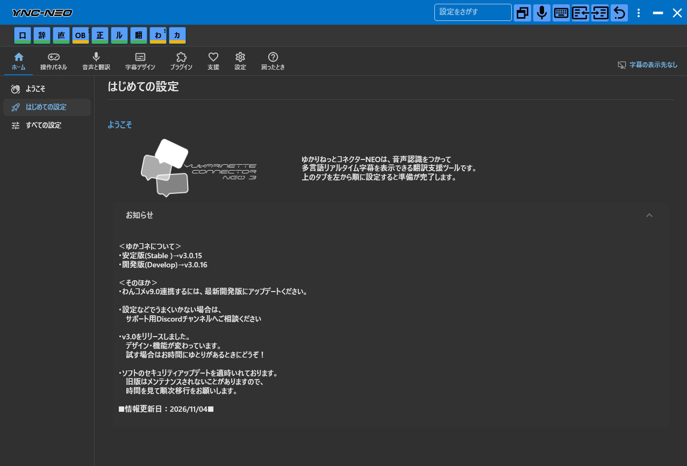
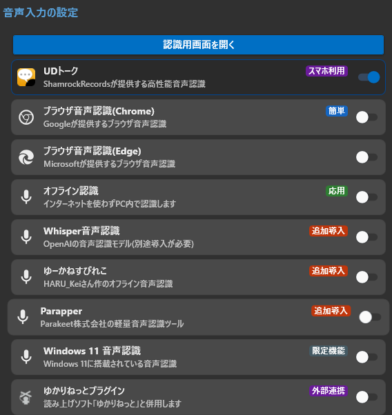
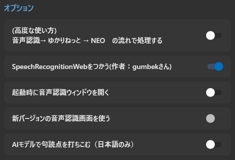
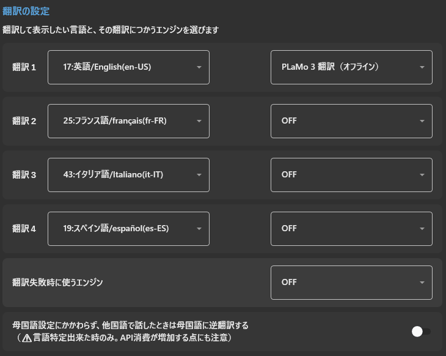
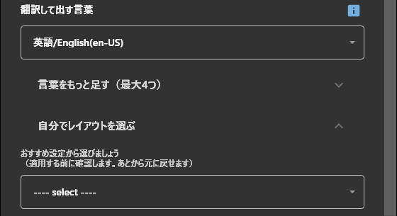
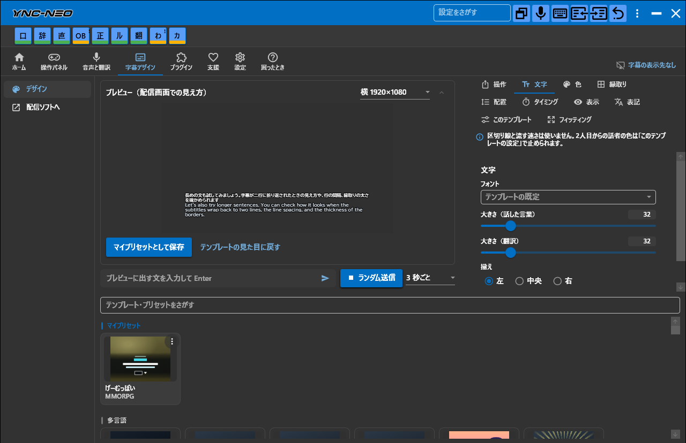
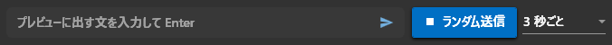
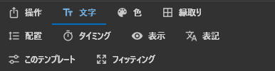
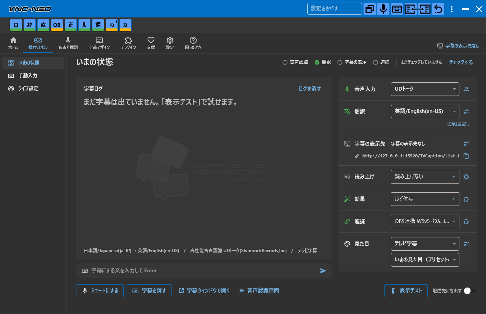
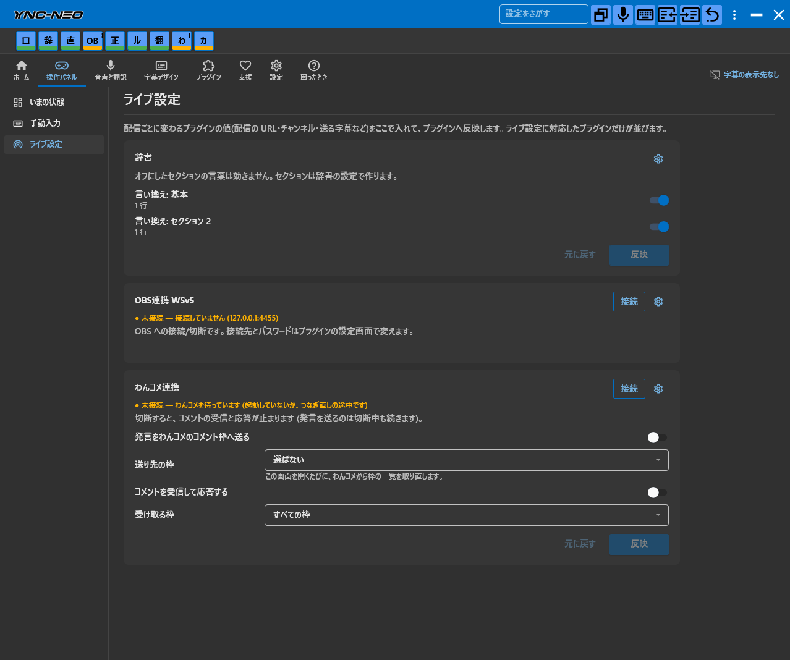

# 標準設定項目

<!-- version-banner -->
!!! info ""
    ゆかコネNEO **v3.0** のドキュメントです。v2.3 をお使いの方は [v2.3 版のこのページ](../../v2.3/startup/startup_basic.md) を、違いを知りたい方は [v2.3 から v3.0 への移行](../../mig/mig_neo_v3.0.md) をご覧ください。

このページは、**左メニューにある設定項目の説明**です。

- はじめて使う方は、先に[5分クイックスタート](../guide/quickstart.md)か[はじめての設定](../cs/cs_startup.md)をどうぞ
- 前半は「**これだけやれば字幕が出る**」、後半は「**項目ごとの詳しい説明**」です

---

# 前半：まずここだけ

## やることは 5 つだけ

左メニューを上から順に開いて、この 5 つを決めれば字幕が出ます。

| | 開く場所 | 決めること |
|:--|:--|:--|
| **1** | 共通設定項目 → **あなたの話す言語・名前** | 自分が話す言語と、画面に出す名前 |
| **2** | 共通設定項目 → **音声入力の設定** | 何で音声を聞き取るか（迷ったら「ブラウザ（Chrome）」） |
| **3** | 共通設定項目 → **翻訳の設定** | どの言語に翻訳するか（要らなければ飛ばせます） |
| **4** | レイアウトに関する設定 → **レイアウトデザインの選択** | 字幕の見た目 |
| **5** | レイアウトに関する設定 → **OBSからの参照設定** | 配信ソフトに貼るアドレスをコピー |

!!! tip "うまくいったか確かめる"
    上のタブ **操作パネル** → **いまの状態** を開くと、
    「いま出ている字幕（字幕ログ）」と「配信ソフトに貼るアドレス」が 1 画面で見られます。
    字幕が出ていないときは、画面の右下の **表示テスト** ボタンで試せます。
    → [いまの状態（ホーム画面）](#cockpit)

## 設定が見つからないとき

v3.0 には、設定を探すための入口が 3 つあります。

| 使うもの | 場所 | 使いかた |
|:--|:--|:--|
| **設定をさがす** | 左メニューの上のほうにある検索欄 | 項目名（例：`保持時間`）を入れて **Enter**。その設定まで画面が動いて、光ります |
| **全ての設定画面を表示** | 上のタブ「ホーム」→「すべての設定」（左メニューでは先頭） | すべての設定を 1 画面に並べます。ブラウザの検索（Ctrl+F）も使えます |
| **いまの状態** | 上のタブ「操作パネル」→「いまの状態」（左メニューでは先頭） | 配信中によく使うものだけを集めた画面（以前の「コックピット」） |

### 上のタブの並び

v3.0 の画面は、上に並んだ **タブ** から行き先を選び、左に出る縦の並びで画面を選ぶ作りです。
左メニュー（下の「左メニューの全体図」）は、右上の ⋮ →「すべての項目（目次）」から開ける**目次**として残っています。

| タブ | 中にある画面 |
|:--|:--|
| **ホーム** | ようこそ／はじめての設定／すべての設定 |
| **操作パネル** | いまの状態／手動入力／**ライブ設定**（配信中に触るものだけを集めたタブ。v3.0.12 で追加） |
| **音声と翻訳** | 音声の入れ方／翻訳する言語／話す言語と名前／翻訳の細かい設定／APIキーの設定 |
| **字幕デザイン** | デザイン／配信ソフトへ |
| **プラグイン** | プラグイン一覧 |
| **支援** | 支援版の翻訳 |
| **設定** | ブラウザと字幕ウィンドウ／ネットワーク／画面と動作／保存と復元 |
| **困ったとき** | 動作チェック／トラブルシュート／不具合を知らせる／ログを作る／マニュアル／サポート／このソフトについて／ライセンス |

!!! info "v3.0.11 以前から上げた方へ"
    「いまの状態」はホームのタブから、「手動入力」は音声と翻訳のタブから、**操作パネル** のタブへ移りました。
    設定（配信前に決めるもの）と、操作（配信中に押すもの）を分けるためです。

!!! warning "v2.3 から来た方へ"
    v2.3 にあった「母国語と言語の表示」「フォント設定と配置」「色（表示色や背景色）」は、
    左メニューから無くなりました。**「レイアウトデザインの選択」の中**に移っています。
    → [v2.3 から v3.0 への移行](../../mig/mig_neo_v3.0.md)

## 見た目を変えたいとき

文字・色・配置・タイミングは、すべて **字幕デザイン** の画面の中にあります。

1. 上のタブ **字幕デザイン** → **デザイン**（左メニューでは **レイアウトに関する設定** → **レイアウトデザインの選択**）
2. 見た目の一覧（タイル）から、テンプレートかプリセットを押して選びます
3. 右に並ぶ **分類のタブ** から、直したいものを選びます

| 分類のタブ | 直せるもの |
|:--|:--|
| **操作** | 配信ソフトへドラッグ・URL をコピー・字幕ウィンドウで開く |
| **文字** | フォント・大きさ・揃え |
| **色** | 文字・背景・縁取り・枠線・話者名／言語名の色 |
| **縁取り** | 縁取りの太さ・内側の縁取り・枠線の形 |
| **配置** | 行間・段落の間・文字の間隔・枠の高さ・表示する行数 |
| **タイミング** | 表示しておく秒数・流れる速さ |
| **表示** | 話者名／言語名／テンプレートの枠／ルビを出すか・話した言葉の位置と出し方 |
| **表記** | 字幕に出す言語名を、好きな書き方に変える |
| **このテンプレート** | そのテンプレートだけが持つ設定（持っているテンプレートのときだけ出ます）。→ [テンプレートごとの設定](startup_layout.md#template-options) |

変えた見た目は、**「マイプリセットとして保存」** ボタンで残せます。
くわしくは後半の「[5. 字幕デザイン（レイアウトデザインの選択）](#design)」をご覧ください。

!!! Info "調整しても変わらないとき"
    テンプレートによっては、その項目を持っていないことがあります
    （例：ウィンドウ枠の高さは「トークセッション」でしか効きません）。
    使われない分類を開くと、頭に「選んでいるテンプレートでは使われない設定です。」と出ます。
    どのテンプレートで何が効くかは、後半の「反映される設定の対応表」を見てください。

---

# 後半：項目ごとの説明

ここから先は、設定項目を 1 つずつ説明します。
上から順に読む必要はありません。必要なところだけ見てください。

## 画面の全体図

設定は、**上のタブ**を選び、その下の**左の項目**を選ぶと右側に出てきます。別ウィンドウは開きません。

|上のタブ|左の項目|
|:--|:--|
|ホーム|ようこそ／はじめての設定／すべての設定|
|操作パネル|いまの状態／手動入力／ライブ設定|
|音声と翻訳|音声の入れ方／翻訳する言語／話す言語と名前／翻訳の細かい設定／APIキーの設定|
|字幕デザイン|デザイン／配信ソフトへ|
|プラグイン|プラグイン一覧|
|支援|支援版の翻訳|
|設定|ブラウザと字幕ウィンドウ／ネットワーク／画面と動作／保存と復元|
|困ったとき|動作チェック／トラブルシュート／不具合を知らせる／ログを作る／マニュアル／サポート／このソフトについて／ライセンス|

* 右上の **設定をさがす** に項目名を入れると、その設定まで移動します。
* 右上の **⋮** のメニューには、v2.3 のころの左メニューと同じ並びの項目が残っています。下の表はその並びです。

|グループ|メニュー項目|内容|
|:--|:--|:--|
|（先頭）|いまの状態|配信中によく使うものだけを 1 枚にまとめた画面（以前の「コックピット」）|
||ライブ設定|プラグインの「配信ごとに変わる値」をまとめて入れる画面 (v3.0.12～)|
||はじめてのセットアップご案内|3 ステップのセットアップウィザードを開きます|
||全ての設定画面を表示|すべての設定を1画面にまとめて表示|
||設定をさがす|項目名を入れて Enter を押すと、その設定まで移動します|
|**共通設定項目**|あなたの話す言語・名前|母国語と表示名|
||音声入力の設定|音声認識の種類と細かい調整|
||手動入力枠|キーボードから字幕を入れる|
||支援版翻訳の有効化|プロモーションコードの入力、翻訳残量の確認|
||翻訳の設定|翻訳先の言語と翻訳エンジン|
||プラグイン一覧|拡張機能の有効化と設定|
|**レイアウトに関する設定**|レイアウトデザインの選択|字幕の見せ方と、見た目の調整すべて|
||字幕のタイミング|保持時間・スクロール速度|
||OBSからの参照設定|配信ソフトに貼るアドレス（言語ごとの取り込みもここ）|
|**オプション設定**|ブラウザのオプション|字幕表示に使うブラウザの設定|
||翻訳（API、設定）|翻訳の節約設定・自分のAPIキー・翻訳キャッシュ|
||ネットワークの設定|通信の許可範囲・使うネットワーク|
||フォルダの指定（廃止）|項目は各画面へ移りました → [オプション設定「フォルダの指定」](startup_option.md#folders)|
||起動時設定|見た目のテーマ・スタートアップ登録・調査用ログ|
|**設定**|設定保存・復元|設定の保存／読み込み／プロファイル管理／v2.3設定の移行|
|**その他**|サポートｃｈを開く|サポート用Discordを開きます|
||マニュアルを開く|このマニュアルページを開きます|
||ゆかコネNEOについて|バージョン情報|
|**トラブルシュート**|動作チェック|各機能が動いているかをランプで確認|
||トラブルシュート|初期化やフォルダを開くなどの復旧メニュー|
||不具合レポートをする|うまく動かないときの報告|
||報告用ログファイルを作る|報告に添付するファイルを作ります|

!!!note "メニューの開け閉め"
    メニューは開いたり閉じたりできます。1 つずつ開いて作業すると、いまどこを設定しているかが分かりやすくなります。

## 1. あなたの話す言語・名前

* 自分が話す言語を設定します。ゆかコネNEOは、この言語を基準に翻訳をします。
* 表示上の名前を設定します。コラボレーション時の名前や、配信画面に出る名前として使われます。

|項目|意味|既定|
|:--|:--|:--|
|母国語設定にかかわらず、他国語で話したときは母国語に逆翻訳する|母国語以外の言葉で話したとき、母国語へ翻訳して表示します|OFF|

## 2. 音声入力の設定

音声認識に何を使うかをえらびます。**一番簡単なのはブラウザ音声認識**です。

|種類|特徴|
|:---|:---|
|ブラウザ（Chrome / Google音声認識）|●Chromeとマイクがあれば認識ができます。 ●インターネット接続が必要です。 ●既定で選ばれています。|
|ブラウザ（Edge / Microsoft音声認識）|●Edgeとマイクがあれば認識ができます。 ●インターネット接続が必要です。 ●Chromeで思うように認識しないときに試してみてください。|
|オフライン|●インターネットがなくても認識できます。 ●認識精度が少し落ちます。|
|UDトーク|●商用向けの音声認識を採用しており認識精度が高く優秀です。 ●スマホかエミュレータでUDトークアプリを動かす事が必要です。|
|ゆかりねっとプラグイン|●ゆかりねっとの音声認識を利用します。 ●ボイスロイド等と連動する場合に効果的です。|
|音声認識モデル(Whisper)|●音声認識AIをパソコンにダウンロードして動かすパターンを使うときに選びます。 ●別途、実行ファイルの場所を、この入れ方を選んだときの右の欄で設定します。|
|ゆーかねすぴれこ|●HARU_Keiさんが公開しているオフライン認識ツールと連携します。 ●別途ツールの導入と、この入れ方を選んだときの右の欄での設定が必要です。|
|Parapper|●Parakeet株式会社の軽量な音声認識ツールと連携します。 ●パソコンの中だけで認識できます。 ●別途ツールの導入と、この入れ方を選んだときの右の欄での設定が必要です。|
|Windows11音声認識|●Windows11に入っている音声認識を使います。 ●Windows側で音声認識を有効にしておく必要があります。|

!!! Info "カードに付いているバッジについて"
    それぞれの選択肢には、目印としてバッジが付いています。

    |バッジ|意味|
    |:--|:--|
    |簡単|マイクとブラウザだけで始められます|
    |スマホ利用|スマートフォンなど別の機器が必要です|
    |応用|少し設定に慣れてから使うのがおすすめです|
    |追加導入|別のソフトをインストールする必要があります|
    |限定機能|動作条件がかぎられています|

同じ画面にある、そのほかの設定です。

|種類|説明|
|:---|:---|
|UDトークとの接続パネル|UDトークのトークルームに接続するときの設定画面です|
|音声区切り|長く話したとき、どれぐらいの息継ぎの間を見て文を区切るか？を指定します。（100～10000ミリ秒。既定は3000）|
|起動時に音声認識ウィンドウを開く|ゆかコネNEOを立ち上げたときに、認識画面を自動で開きます|
|SpeechRecognitionWebをつかう(作者：gumbekさん)|「オプション」の欄にあります（ブラウザ音声認識のとき）。ガムベックさん作成の音声認識ページを使います。認識の機能はブラウザに依存します（下の注を参照）|
|AIモデルで句読点を打ちこむ（日本語のみ）|「オプション」の欄にあります。日本語の確定文に句読点を付けます（既定OFF・v3.0.15～。[下の節](#punctuation-restore)を参照）|
|新バージョンの音声認識画面を使う|「オプション」の欄にあります（ブラウザ音声認識のとき）。「SpeechRecognitionWebをつかう」が ON のあいだは触れません|
|(高度な使い方) 音声認識→ ゆかりねっと → NEO　の流れで処理する|「オプション」の欄の先頭にあります。上級者向けの機能です|

「オプション」の欄は、選んだ入れ方で意味のある行だけが出ます。下はブラウザ音声認識(Chrome)を選んだときです。

!!! tip "認識用画面を開く (v3.0.11～)"
    上のタブ **音声と翻訳** → **音声の入れ方** の右欄に、**音声認識画面** の区画と **「認識用画面を開く」** ボタンがあります。
    ブラウザやオフラインなど、認識用の画面を使う方式では、**この画面を開いているあいだ認識します**。
    （UDトーク・ゆかりねっとプラグインは開く画面が無いので、この区画は出ません）

!!! tip "起動時に開くウィンドウは「設定」タブにもあります"
    上のタブ **設定** → **ブラウザと字幕ウィンドウ** の先頭の **起動時に開くウィンドウ** に、
    「起動時に音声認識ウィンドウを開く」「起動時に字幕ウィンドウを開く」が並んでいます。
    元の場所のスイッチとつながっていて、どちらで切り替えても同じです（変更はすぐ保存されます）。

!!! Info "SpeechRecognitionWebをつかう について (v3.0.14～)"
    * ON にしているあいだだけ、そのページ（``storage.googleapis.com``）からの接続を受け付けます。v3.0.8〜v3.0.13 では、ON にするとすぐ接続が切れていました。
    * OFF にすると、ページを開いたままでも、そこから届いた文字は使いません。

### AIモデルで句読点を打ちこむ（日本語のみ） { #punctuation-restore }

!!! Tech "使用条件"
    * ゆかコネNEO v3.0.15～

* 「音声の入れ方」の **「オプション」** の欄にある **「AIモデルで句読点を打ちこむ（日本語のみ）」** を ON にすると、音声認識から届いた**日本語の確定文**に「、」「。」「？」を付けます。既定は OFF です。
* ブラウザ音声認識のように、句読点を付けずに文を返す認識で使います。
* 付けるのは **確定した文だけ**です。次の文はそのままにします。
    * 認識の途中経過
    * もう句読点のある文
    * 日本語以外の文
    * 読み（ルビ）付きで届いた文や、API から送った文
* 初めて ON にしたときに、句読点のモデル **hayamimi-punct-ja-4class**（MIT ライセンス・約 44MB）を Hugging Face からダウンロードします。置き場所はオフライン翻訳のモデルと同じフォルダです（[モデルの保存先と管理](startup_option.md#model-storage) では種類「句読点の復元」で並びます）。オフライン認識の画面で同じモデルをダウンロード済みなら、それを使います。
* ダウンロードが終わるまでは、句読点を付けずに送ります。準備ができると「句読点のAIモデルの準備ができました。音声認識の日本語の文に句読点を付けます」とお知らせが出ます。

!!! Info "出ない・使えないとき"
    * **UDトーク**を選んでいるときは効かないため、欄は出ません。
    * **オフライン認識**を選んでいるあいだは OFF になり、欄も出ません（v3.0.17～）。オフライン認識は自分の画面の「句読点」で付けるので、二重に付かないようにしています。→ [オフライン認識の句読点](startup_asr.md#offline-recognition)
    * オフライン認識からほかの入れ方に戻しても、自動では ON に戻りません。使うときは入れ直してください。

### UDトークとの接続パネル

|項目|意味|
|:--|:--|
|使うネットワークの指定|複数のネットワークがある場合にどれを使うか選びます|
|招待確認 / 接続 / 切断|トークルームへの参加・退出を行います|
|ユーザID|自分のIDが表示されます（変更はできません）|
|認識結果が細分化されるのを抑制します|短く区切られすぎた認識結果をつなげて、読みやすくします|

!!! Info "音声区切りについて"
    * 音声区切りは、音声認識の間（ま）を見て強制的に文章を確定する手法です。
    * 音声認識エンジンそのものに手を入れるわけではないので、設定によってはうまく出ないことがあります。
    * 話しながら、一番自然に区切れる位置をチューニングしてみてください。
    * 特定の音声認識のときだけ使えるオプション機能です。

## 3. 翻訳の設定

* 言語は４つまで選べます。
* 言語に合わせて翻訳エンジンも選んでください。

!!! warning "言語設定について"
    翻訳エンジンによっては、言語に対応していないことがあり、翻訳できないことがあります。その場合は別の翻訳エンジンを選んでください。

!!! Info "商用翻訳エンジンについて"
    翻訳エンジンは、「共用翻訳サーバ」以外は、個人で契約する必要があります。ただし、「みんなで支える翻訳支援」の仕組みがあり、そちらで支援いただくと多くの翻訳エンジンを利用することが可能になります。(その場合は「支援版翻訳の有効化」から手続きをしてください)

!!! Info "支援が必要なエンジンを選んだ場合"
    * 一覧の項目が選べなくなる（グレーアウトする）ことはありません。どのエンジンも選択そのものはできます。
    * 支援の条件を満たしていない状態で使うと、**翻訳を実行したときにエラーになる**か、無料の翻訳エンジンに切り替わって翻訳されます。
    * 支援の状態は「支援版翻訳の有効化」画面で確認できます。

!!! warning "v2.3 から移行した方へ"
    提供が終わったエンジン（**Google 無料翻訳** / **IBM Watson**）を選んでいた枠は、
    移行のときに「翻訳しない」に置き換わります。ここで選び直してください。

### 翻訳失敗時に使うエンジン

* 5つ目のエンジン選択欄です。指定したエンジンで翻訳できなかったときの、予備のエンジンを決めます。
* 既定は「共用翻訳(m2m100/無料)」です。

### 連携アプリで使う翻訳エンジン

* わんコメなど、ほかのアプリからの翻訳依頼に使うエンジンを、優先順位1～4の順に決められます。
* 先頭の「音声翻訳Nの設定を使います」を選ぶと、字幕用の設定と同じエンジンを使います。
* 字幕は高品質なエンジン、連携アプリは無料のエンジン、というような使い分けができます。

## 4. おすすめ設定（簡易設定）

* おすすめ設定は、右上の **⋮** のメニューの **はじめてのセットアップご案内** で開くガイドの、**1. やりたいこと** の下のほうにある **「自分でレイアウトを選ぶ」** を開くと出ます。一般的には「多言語」が使われています。
* 一覧から選ぶと、適用する前に確認が出ます。
* 適用する前に復元ポイントが作られるので、気に入らなければ戻せます。

## 5. 字幕デザイン（レイアウトデザインの選択） { #design }

上のタブ **字幕デザイン** → **デザイン** で開きます（左メニューでは **レイアウトに関する設定** → **レイアウトデザインの選択**）。
選べるテンプレートの一覧は [レイアウトについて](startup_layout.md) をご覧ください。

画面は大きく 3 つに分かれています。

| 場所 | 中身 |
|:--|:--|
| **プレビュー（配信画面での見え方）** | いまの見た目を、配信画面と同じ形で見せます。右上で配信画面の大きさ（OBS のキャンバスと同じもの）を選べます。下に **「マイプリセットとして保存」** などのボタン |
| **見た目の一覧（タイル）** | ★ お気に入り → マイプリセット → テンプレート（分類ごと）の順に並びます。上の欄で **テンプレート・プリセットをさがす** こともできます。押すとその見た目に切り替わります |
| **分類のタブ** | 操作／文字／色／縁取り／配置／タイミング／表示／表記／このテンプレート。選んだ分類の値だけが出ます |

!!! tip "タイルを OBS へドラッグして取り込む (v3.0.4～)"
    一覧のタイルを、マウスでつかんで **OBS のプレビューの上へドラッグ** すると、
    そのテンプレート（またはプリセット）専用のアドレスで **ブラウザソースが追加** されます。

    * ソース名は「YNC-NEO （タイルの名前）」、大きさは 1920×1080 で入ります
    * 落としたときに OBS が確認を出すことがあります（OBS の仕様です）
    * ドラッグできるタイルには、マウスを乗せると「OBS へドラッグすると、ブラウザソースとして追加できます（この項目専用の URL）」と出ます
    * 星（お気に入り）や ⋮ からつかんだときはドラッグになりません。ふつうに押したときは今までどおり切り替えです

!!! info "わんコメのテンプレートでプレビューが出ないとき"
    わんコメのテンプレートを選んでいて、わんコメが起動していないと、プレビューに
    「わんコメと通信できません。」と案内が出ます（OBS などの表示先も、わんコメが起動していないと字幕が出ません）。
    わんコメを起動すれば、自動で読み直します。

### プレビューで文を試す（入力欄とランダム送信） { #design-preview-input }

!!! Tech "使用条件"
    * ゆかコネNEO v3.0.16～

プレビューの枠の下に、文を入れる欄と **「ランダム送信」** があります。話さなくても、見た目をその場で確かめられます。

| 項目 | 意味 |
|:--|:--|
| プレビューに出す文を入力して Enter | 入れた文を、確定した字幕としてプレビューに出します。翻訳の設定どおりに**訳も付きます**。右のボタン「プレビューに出す」でも送れます |
| ランダム送信 | 見本の文を 1 文字ずつ未確定で送り、1 文を送りきったら確定（訳つき）にして、選んだ秒数あけて次の文へ進みます |
| 秒数（1 / 2 / 3 / 5 / 10 秒ごと） | ランダム送信で文と文のあいだをあける長さです。既定は 3 秒ごと |

* 出すのは **このプレビューだけ**です。分類のタブ「操作」の **見本の字幕を配信先にも出す** をオンにしたときだけ、OBS などの配信先にも出ます。
* プラグインには渡しません（読み上げや連携には流れません）。翻訳は回すので、翻訳エンジンの呼び出しにはなります。
* ランダム送信は、**1 分たつか、もう一度押すか、字幕デザインの画面を離れると止まります**。
* 未確定の文が出るかどうかは、本物の発話と同じく「母国語表示の仕方」（[表示内容](#display-content)）に従います。
* 確定した見本は保持時間で消えます。画面を離れると、出した見本はまとめて下げます。

### 操作（配信ソフトへ渡す）

分類のタブのいちばん左です。見た目を決めたその場で、配信ソフトへ渡せます。

|項目|意味|
|:--|:--|
|配信ソフトへドラッグ|ボタンを押したまま、配信ソフトの画面（OBS ならプレビューの上）へ運んで離すと取り込めます|
|URL をコピー|配信ソフトに貼るアドレスをコピーします|
|字幕ウィンドウで開く|字幕ウィンドウで、いまの見た目を開きます|
|配信ソフトへ（詳しく）|[OBSからの参照設定](#obs)（上のタブ「字幕デザイン」→「配信ソフトへ」）を開きます|
|起動時に字幕ウィンドウを開く|ゆかコネNEOを立ち上げたときに、字幕画面を自動で開きます|
|見本の字幕を配信先にも出す|オフのときは、見本の字幕はこのプレビューにだけ出ます。オンにすると OBS などの配信先にも出ます（配信中は視聴者にも見えます）|

!!! warning "配信ソフトへ渡すのは「選んでいるプリセット」のアドレスです (v3.0.5～)"
    「配信ソフトへドラッグ」「URL をコピー」で渡すアドレスは、**いま選んでいるプリセット専用**のものです。
    貼った枠には、そのプリセットの**保存済みの見た目**が出ます。

    * プリセットを選んだあとに見た目を変えると「保存していない変更があります」と出ます。**上書き保存** すると、貼った枠にも反映されます
    * プリセットに保存していない見た目（内蔵のプリセットを変えたときなど）は、そのままでは渡せません。
      ボタンが **「プリセットとして保存して配信ソフトへ」** に変わるので、保存してから渡してください
    * テンプレートを替えて戻すと、外れていたプリセットが選び直されます（同じ見た目のプリセットが増えないように）

### 数字を手で入れる (v3.0.8～)

分類のタブにある数字（大きさ・行間・秒数など）は、**数字そのものを押すと入力欄**になります。

* 数字を打って **Enter**（または欄の外を押す）で反映、**Esc** で取り消し
* 範囲の外の数字は、入れられるいちばん近い値に寄せます
* 小数も表示します（以前は 198.62 が「199」と見えていました）

### 色の見本 (v3.0.5～)

色の見本の後ろには **市松模様** が敷いてあります。透明や半透明の色を選んだときも、どれぐらい透けているかが見て分かります。

### 表記（言語名の書き方）

分類のタブ **表記** で、テンプレートに出す **言語名** を好きな書き方に変えられます（v3.0.0～）。
たとえば、字幕に出る「JA」を「日本語」に、「EN」を「English」にできます。

1. 字幕デザイン → デザイン → 分類のタブ **表記**
2. 「話した言葉」「翻訳 1」～「翻訳 4」の行のうち、変えたい行の **「表記を指定」** を入れます
3. 横の欄に、出したい言語名を入れます

* 「表記を指定」を入れていない行と、欄が空の行は、従来どおりの表記（JA などの言語コード）のままです
* 各行には「いまの言語」と「従来の表記」が出るので、どの欄がどの言語か確かめながら入れられます
* 値は **テンプレートごと** に覚え、字幕プリセットにも入ります
* 多くのテンプレートでは、言語名は「表示」タブの **言語名を出す** をオンにしたときに出ます

### 分類のタブ

言語ごとのフォント・色・縁取りなど、細かく作り込むときは、デザイン画面の右にある **分類のタブ** を切り替えます（以前の「詳しい調整」ボタンは無くなり、タブはいつも出ています）。

| タブ | 中身 |
|:--|:--|
| 操作 | 配信ソフトへ渡す手順です（上の「操作（配信ソフトへ渡す）」） |
| 文字 | フォント・大きさ（話した言葉／翻訳）・揃え・言語ごとのフォントと大きさ |
| 色 | 文字色・背景色・言語名の色・区切り線の色など |
| 縁取り | 縁取りの色と太さ |
| 配置 | 行間・段落間・文字間隔・ウィンドウ枠の高さ・整形モード |
| タイミング | 保持時間・スクロール速度・保持を待つかどうか |
| 表示 | 母国語の表示位置・言語名の表示・話者名を出す・テンプレートの枠・ルビの表示・追加スタイルシートなど |
| 表記 | 言語名の表記（上の「言語名の表記」） |
| このテンプレート | 選んでいるテンプレートだけが持つ設定（[字幕テンプレート](startup_layout.md)） |
| フィッティング | 字幕の位置や大きさを、プレビューの上で合わせます |

* テンプレートによって使わない項目は、タブの下に「区切り線と流す速さは使いません」のように出ます。
* プレビューの下の **「マイプリセットとして保存」** でいまの見た目をプリセットに保存し、**「テンプレートの見た目に戻す」** で調整を捨ててテンプレートの見た目に戻します。

!!! info "「テンプレートを再生成」の場所"
    字幕テンプレートを初期状態に戻す **「テンプレートを再生成」** は、上のタブ **困ったとき** → **トラブルシュート** にあります。
    表示がおかしくなったときに使います。

#### 文字

|項目|意味|範囲・既定|
|:--|:--|:--|
|フォントサイズ|文字の大きさ|2～200（既定32）|
|フォント種類|使うフォント|—|
|文字配置|左寄せ／中央／右寄せ|既定は左寄せ|

!!! info "フォントについて"
    * ブラウザによって、指定のフォントが採用されないことがあります。
    * 言語に応じたフォントを選ばないと文字化けすることがあります。
    * 「個別にフォントを調整する」をONにすると、翻訳1～翻訳4のフォントを別々に決められます（既定OFF）。

#### 色

|項目|意味|
|:--|:--|
|文字色|文字の色です|
|背景色|背景の色です（既定は緑／Lime）|
|縁取り色|文字のふちの色です（既定は黒）|
|言語名の色|言語名を出す設定のときの、文字色と背景色です|
|区切り線の色|リスト表示などで文と文の間に出る線の色です|
|縁取りサイズ|文字の縁取りをします。あまり大きくするとエッジが出たり、ふちがぼけるので注意|
|縁取り（内側）|縁取りをもう一段追加します。既定は0（使わない）。**上限が 20 になりました**|

!!! Tip "言語ごとに色を変えたい場合"
    * 「言語ごとに色を設定」をONにすると、言語ごとに文字色と縁取り色を決められます。
    * 「個別に縁取りを調整する」をONにすると、縁取りの太さも言語ごとに決められます。
    * どちらも既定はOFFです。

!!! warning "v2.3.128 以前から移行した方へ"
    「個別に縁取りを調整する」は、v2.3.128 以前は**保存されない不具合**がありました。
    移行のときに言語別の太さが残っていれば自動でONに戻しますが、
    そうでない場合は手でONにすると v2.3 で作った太さに戻ります。

#### 配置

|項目|意味|範囲・既定|
|:--|:--|:--|
|行間|文字の行間を設定します|最大10（既定2）|
|段落間|認識のかたまり毎の隙間です。リスト表示レイアウトなどで有効です|最大10（既定2）|
|文字間隔|文字ごとのすき間を設定します|最大2|
|ウィンドウ枠の高さ|表示内の枠の高さを設定します|50～1000（既定300）|
|整形モード|強制的に指定行数に絞り込みます。レイアウトによっては指定行数にならないことがあります|加工なし／1行／2行（既定は加工なし）|

#### 表示内容 { #display-content }

|項目|意味|選択肢|
|:--|:--|:--|
|母国語の表示位置|翻訳文の上に出すか、下に出すかを選べます|上に表示する／下に表示する／表示しない|
|母国語表示の仕方|認識過程を出すか、文章確定後に出すかを選べます。過程を出すとリアルタイム感が出ますが、ちらつきも増えます|音声認識の過程を表示／音声認識の結果のみ表示|
|言語名の表示|字幕に言語名を添えるかどうか|ON／OFF（既定OFF）|
|話者名を出す|字幕に話者名を添えます。名前を置く場所を持たないテンプレートでは効きません|ON／OFF（既定ON）|
|テンプレートの枠|テンプレートが文字の後ろに描く板・吹き出し・縁の出し方を選びます|常に出す／字幕があるときだけ出す／出さない（既定は常に出す）|
|ルビの表示（対応している場合）|日本語と中国語の字幕にルビ（読み）を付けます (v3.0.0 beta 23～)|ON／OFF（既定OFF）|

!!! Info "テンプレートの枠の 3 つの選びかた (v3.0.0～)"
    * **常に出す**：文字が無いあいだも枠を残します（以前の「テンプレートの枠を出す」ON と同じ）
    * **字幕があるときだけ出す**：字幕と一緒に枠が出て、字幕が終わると枠も消えます
    * **出さない**：映像の上に文字だけが残ります

    分類のタブ「表示」にも同じ選択があります。以前の設定やプリセットは「常に出す」として引き継がれます。

!!! Info "ルビの表示（対応している場合）について"
    * UDトークや API（``/api/input`` の ``Morph``）から読みが届いた文はその読みを、届かない文は[ルビ付与プラグイン](../plugin/plugin_ruby.md)が有効なら自動で作った読みを使います。
    * ルビに対応していないテンプレートでは表示されません。
    * ルビ付与プラグインを有効にしていた方は、beta 23 に上げて最初に起動したときだけ自動で ON になります。
    * 外部からは ``/api/ruby-on`` ``/api/ruby-off`` で切り替えられます。詳しくは [本体内蔵API](../tech/tech_api_neo.md) をご覧ください。

!!! Info "追加設定（スタイルシート）について"
    * 同じ画面に、字幕の見た目をCSSで直接調整できる欄があります。
    * 標準の設定項目では届かない細かい調整をしたい方向けの、上級者向け機能です。
    * 書き方を間違えると字幕が表示されなくなることがあります。困ったときは中身を空にして、既定の状態に戻してください。

## 6. 字幕のタイミング

デザイン画面の分類のタブ **「タイミング」** と同じ項目です。
分類のタブ「タイミング」でも同じ値（表示しておく秒数・流れる速さ）を変えられます。

|項目|意味|
|:--|:--|
|保持時間|確定した字幕を何秒間キープするか？を設定します。（1～30秒。最大にすると消去しなくなります）|
|スクロール速度|字幕スクロールに対応しているレイアウトの場合は、速さを指定できます。**数字を大きくすると速くなります**|
|次の字幕が来ても保持時間経過まで表示切り替えを待つ|次の発話が来ても、いまの字幕を保持時間いっぱいまで残します（既定OFF）|

!!! Info "保持時間の数え方"
    * 保持時間は、**確定した字幕が画面に出た時点**から数えます。(v2.3.128～)
    * v2.3.127以前は翻訳が終わった時点から数えていたため、翻訳にかかった時間のぶんだけ、実際の表示が設定より長くなっていました。

!!! warning "レイアウトによっては効きません"
    保持を必要としないレイアウト（積み上げ型など）では、このチェックは効きません。
    v3.0 では、その場に「効かない」旨が表示されます。

!!! warning "読み上げと同期させている場合"
    字幕を読み上げの終わりに合わせる設定（[読み上げ](../plugin/plugin_playvoice.md)の詳細設定 →「タイミングと連携」→
    「字幕の表示時間を、なるべく読み上げの長さに合わせる」）にしていると、
    **読み上げが遅れれば字幕も遅れます**。1 枠型のレイアウトでは、待ちが 8 件を超えると
    間の字幕が表示されずに飛びます。詳しくは[移行ページ](../../mig/mig_neo_v3.0.md)の「字幕と読み上げの同期について」をご覧ください。

## 7. OBSからの参照設定 { #obs }

v3.0 で独立した画面です。上のタブ **字幕デザイン** → **配信ソフトへ**（左メニューでは **レイアウトに関する設定** → **OBSからの参照設定**）で開きます。配信ソフトに貼るアドレスがここにあります。

!!! tip "配信ソフトへ取り込む簡単な方法"
    * ブラウザ機能がついた配信ソフトをお使いの場合は、**「OBSへ」** の所をマウスでつかみ、配信ソフトにドラック＆ドロップすることで取り込み作業が１発完了します。
    * うまくいかない場合は、アドレスが表示されているところをダブルクリックしてください。そうするとアドレスがコピーされます。あとはOBSなどのブラウザソースで表示してください。
    * 「OBSへ」の右の **「ブラウザで開く」** を押すと、表示用に設定したブラウザ (Edge / Chrome) で字幕を開けます。配信ソフトに貼る前の確認に使えます。
    * 字幕デザインの画面からも渡せます（分類のタブ「操作」→「配信ソフトへドラッグ」、または一覧のタイルを OBS へドラッグ）。→ [5. 字幕デザイン](#design)

!!! Info "文字がすごく小さく見える場合"
    * OBSに取り込んだときにサイズがOBSによって自動設定されているため小さくなっています。
    * OBSのブラウザソース→プロパティにある幅と高さを小さくしてみてください（たとえば 幅800,高さ300）

!!! Tip "言語ごとに別々に取り込みたい場合"
    「応用パターン（１言語ごとの取り込み）」を開くと、母国語・翻訳1～翻訳4を**それぞれ別のブラウザソースとして**取り込めます。言語ごとに位置やサイズを変えたいときに使います。

## 反映される設定の対応表

テンプレートによって、効く設定と効かない設定があります。

|   |多言語|リスト|ゲーム風|トークセッション|
|:-|:-----|:-----|:------|:--------------|
|縁取りサイズ|〇|〇|〇|〇|
|保持時間|〇|〇|〇|〇|
|行間|〇|〇|〇|〇|
|段落間|－|〇|－|－|
|文字間隔|〇|〇|〇|〇|
|ウィンドウ枠の高さ|－|－|－|〇|
|整形モード|〇|－|－|－|

## いまの状態（ホーム画面） { #cockpit }

上のタブ **操作パネル** → **いまの状態** で開く、**配信中によく使うものだけを集めた画面**です（以前の名前は「コックピット」）。
v3.0.5 で「**中央にログ・右で選ぶ・下に機能**」の並びに作り直しました。細かく調整しなくても、ここだけで「さっと状態を作る」ことができます。

### 中央：字幕ログ

| 項目 | 中身 |
|:--|:--|
| 字幕ログ | いま出ている字幕と、これまでの字幕が並びます。まだ無いときは「まだ字幕は出ていません。「表示テスト」で試せます。」と出ます。**ログを消す** で一覧を空にできます |
| 字幕を手で入れる 1 行 | 「字幕にする文を入力して Enter」の欄に文を入れて **Enter**（または右の送信ボタン「字幕として送る」）で、字幕として送ります。手動入力と同じ入口です |

### 右：その場で選ぶ欄

右に、選ぶものが縦に並びます。各行の右端の小さなボタンで、くわしい設定の画面へ移れます。

| 行 | その場でできること | 右端のボタン |
|:--|:--|:--|
| **音声入力** | 音声認識のしかたを選びます（音声の入れ方の画面のカードと同じ） | 聞き取り設定 |
| **翻訳** | 1 つ目の翻訳先の言語を選びます。2 つ目以降があるときは「ほか N 言語 ›」と出ます | 翻訳の設定 |
| **字幕の表示先** | いまの表示先（内訳）と、配信ソフトに貼るアドレス・コピーのボタン | 配信ソフトへ |
| **読み上げ** | 読み上げのプラグインを、チェックの一覧で入れたり切ったりします | プラグイン一覧 |
| **効果** | 遅延・表示効果・ルビ付与・表示時間の自動調整・色の変更など、字幕の出方を変えるプラグインを入切します（重ねて使えます） | プラグイン一覧 |
| **連携** | OBS・VRChat・わんコメなど、ほかのツールへ字幕を渡すプラグインを入切します | プラグイン一覧 |
| **見た目** | テンプレートと、見た目のプリセットを選びます。表示先があるときは「いま表示先に字幕が出ています。ここで選ぶと、配信の見た目がすぐに変わります。」と注意が出ます | くわしく調整（字幕デザインへ） |

!!! tip "見出しを押すと画面が開きます (v3.0.12～)"
    * **音声入力** の見出し（アイコンと名前）を押すと、上のツールバーの「音声認識画面」と同じく、音声認識の画面が開きます
    * **字幕の表示先** の見出しを押すと、「字幕ウィンドウを表示」と同じく、字幕ウィンドウが開きます

!!! info "読み上げ・効果・連携の入切について"
    チェックの入切は、プラグイン一覧の「使う」と同じ処理です。止めたときに「完全に止めるには再起動」の案内が出ることがあります。

### 下：配信中の機能

| ボタン | 意味 |
|:--|:--|
| ミュートにする／ミュートを解除 | 声を拾うのを止めます（キーボードの **Ctrl+M** でも切り替えられます） |
| 字幕を消す | いま表示中の字幕だけを消します（**Ctrl+Delete** でも消せます） |
| 字幕ウィンドウで開く | 字幕ウィンドウを開きます |
| 音声認識画面 | 音声認識の画面を開きます |
| 表示テスト | テスト用の字幕を出します。右の **配信先にも出す** が切のときは、この画面と字幕デザインのプレビューにだけ出ます（視聴者には出ません）。入にすると、本物の字幕と同じく OBS などの表示先・読み上げ・プラグインへ流れます。このスイッチは起動のたびに切に戻ります |

### 上：動作チェックのアイコン

題の行の右に、動作チェックの結果が区画ごとのアイコン（**音声認識・翻訳・字幕の表示・連携**）で出ます。

* まだチェックしていない区画は、中抜きの丸で出ます（v3.0.16 から。以前は「?」でした）。帯の名前には ①〜④ の番号を付けません

* アイコンにマウスを乗せると、その区画の各行の結果が出ます。押すと [動作チェック](#diagnostic) の画面へ移ります
* 横の **チェックする** で、その場でチェックを走らせられます。チェックした時刻（「HH:MM にチェック」）も出ます
* 一度チェックしたあとは、× と ! の行を自動で見直し、直れば緑になります

## ライブ設定とプラグインの帯 { #live-settings }

### ライブ設定 (v3.0.12～)

配信の URL・チャンネル・送る字幕など、**配信ごとに変わるプラグインの値**を、1 枚の画面でまとめて入れてプラグインへ反映する画面です。
配信のたびにプラグインの設定画面を 1 つずつ開かなくても、ここで済みます。

1. 上のタブ **操作パネル** → **ライブ設定** を開きます（左メニューでは先頭の **ライブ設定**）
2. ライブ設定に対応したプラグインごとに、欄が並びます。値を入れて **反映** を押します
3. 接続のあるプラグインは、**接続**／**切断** のボタンと、いまの状態（**接続中**／**未接続**）が出ます

| 表示・ボタン | 意味 |
|:--|:--|
| 反映 | 入れた値をプラグインへ送ります。「反映しました。」と出れば完了です。範囲の外や数でない値は赤い文で知らせます |
| 元に戻す | プラグイン側で値が変わったとき（「プラグイン側で値が変わりました。」と出ます）に、最新の値を読み込み直します。反映していない入力は消えます |
| 接続／切断 | プラグインの接続を切り替えます |
| このプラグインの設定を開く | そのプラグインの設定画面を開きます |
| オン・オフのスイッチ | 名前と説明が左、スイッチが右端に並びます（v3.0.16～） |
| 設定済み(変えるときだけ入力)／未設定 | 配信キーなど秘密の値の欄です。中身は伏せたまま、入っているかどうかだけを出します |

!!! info "何も並ばないとき"
    「ライブ設定に対応したプラグインが使われていません。」と出るときは、プラグイン一覧で、下の表の対応プラグインを「使う」にしてください。
    「プラグインから応答がありませんでした。」と出るときも、プラグイン一覧で「使う」になっているか確かめてください。

ライブ設定に対応しているプラグインと、載っている項目です。各項目のくわしい意味は、それぞれのプラグインのページをご覧ください。

| プラグイン | ライブ設定に載る項目 | 接続／切断でできること |
|:--|:--|:--|
| [YouTube](../plugin/plugin_youtube.md) | 字幕の送り先（伏せ字）・送る字幕・遅らせる秒数 | 字幕送信の開始／停止 |
| [Twitch](../plugin/plugin_twitch.md) | 参加するチャンネル・話した言葉の転送・チャット翻訳 | チャットへの接続／切断 |
| [ニコ生](../plugin/plugin_niconama.md) | 配信の URL・送る字幕 | コメント送信の開始／停止 |
| [Zoom](../plugin/plugin_zoom.md) | 字幕の送り先（伏せ字）・送る字幕 | 字幕送信の開始／停止 |
| [Discord](../plugin/plugin_dicord.md) | チャンネル・送る／受け取る | Bot の接続／切断 |
| [わんコメ連携](../plugin/Plugin_OCComm.md) | 送る／受け取る・送り先の枠・受け取る枠（v3.0.16 からプルダウンで選べます） | わんコメへの接続／切断 |
| [コメントスクリーン](../plugin/plugin_comscr.md) | 部屋の名前 | 部屋を開く／閉じる |
| [字幕共有](../plugin/plugin_captionshare.md) | 送る・受け取る | — |
| [OBS 連携 (WebSocket v5)](../plugin/plugin_OBS5.md) | — | 接続／切断 |
| [VRChat OSC](../plugin/plugin_vrchat_osc.md) | 送る字幕・自動送信・ミュート連動 | — |
| [InfoGraphics](../plugin/plugin_infographics.md) | 有効・セッション・埋め込み URL（伏せ字） | — |
| [cluster チャット転送](../plugin/plugin_clustertransfer.md) | イベントの URL・受信・読み上げ・送信・送る字幕 | 受信の開始／停止 |
| [辞書](../plugin/plugin_dictionary.md) | セクションごとのオン・オフ（v3.0.16～） | — |
| [正規表現](../plugin/plugin_regexp.md) | 規則のセクションごとのオン・オフ（v3.0.16～。規則が無いときは出ません） | — |

!!! warning "自分で切断したら、自動ではつなぎ直しません"
    Twitch・OBS 連携 (v5)・わんコメ連携・Discord は、ライブ設定や帯のダブルクリックで**切断**すると、自動ではつなぎ直しません。
    つなぐときは **接続** を押してください。

### プラグインの帯（ダブルクリックで接続／切断）

タイトルの帯と上のタブのあいだに、使っているプラグインのアイコンが 1 列に並んでいます（プラグインの帯）。
アイコンの色は、そのプラグインの状態を表しています。

* **1 回押す**：今までどおり、そのプラグインの設定を開きます
* **ダブルクリック**：接続のあるプラグイン（上の表で「接続／切断」があるもの）は、**接続と切断を切り替えます** (v3.0.12～)

接続を切り替えられるアイコンは、マウスを乗せると「ダブルクリックで接続」または「ダブルクリックで切断」と出ます。
切り替えの結果は画面の下に「（プラグイン名）: 接続します」のように知らせが出ます。
続けて押したときは、前の切り替えが終わるまで「接続を切り替えている途中です。少し待ってください。」と出ます。

## ようこそ画面

上のタブ **ホーム** → **ようこそ** の画面です。

!!! tip "わんコメと連動しますか？"
    ゆかコネNEO を起動したときに **わんコメが起動していると**、ようこそ画面のお知らせの下に
    **「わんコメと連動しますか？」** のカードが出ます。

    * **「プラグインを追加」** を押すと、わんコメとの連動に要るプラグイン（**わんコメ連携**・**翻訳・発話連携**・**読み上げ連携**）のうち、まだ一覧に無いものをまとめて追加します。追加されるものはカードの「追加するもの:」に出ます
    * 3 つとも一覧にある（止めているものも含む）ときは、カードは出ません
    * わんコメが起動しているかは、起動のときに 1 回だけ見ます（わんコメとは通信しません）

## クイックボタン

画面右上（タイトルバー）に並ぶボタンです。左から順に次のとおりです。

|項目|意味|
|:--|:--|
|字幕ウィンドウを表示|字幕画面を表示します|
|ミュート|ONにすると字幕を消し、音声認識結果を出さなくなります（Ctrl+M）|
|手動入力|キーボードから字幕を入力する画面を出します|
|＜ / ＞|前後のメニューページに移動します|
|戻る|１つ前のメニューページに戻ります|
|⋮|オプションメニューを開きます（下の表）|

* その下の段には、使っているプラグインの帯（アイコン）が並びます。帯をダブルクリックすると接続／切断できるものがあります。→ [ライブ設定とプラグインの帯](#live-settings)
* 音声認識の画面は、上のタブ **音声と翻訳** → **音声の入れ方** の **認識用画面を開く**、または **操作パネル** → **いまの状態** の **音声認識画面** から開きます。

!!! tip "キーボードで操作する"
    | キー | 動き |
    |:--|:--|
    | **Ctrl+M** | ミュートの切り替え |
    | **Ctrl+Delete** | 表示中の字幕を消す |

    文字の入力欄にカーソルがあるときは効きません（入力欄では、ふだんの文字の操作になります）。

右上の「⋮」を押すとオプションメニューが出ます。

|項目|意味|
|:--|:--|
|動作チェック|各機能が正しく動いているかをランプで確認できます|
|トラブルシュート|初期化などができるメニューを表示します|
|不具合レポートをする|うまく動かないときはこのレポートを提出してください|
|報告用ログファイルを作る|レポートを出すときにこのファイルを提出すると改善しやすいです|
|作者へフィードバックを送る|感想や要望を送れます|
|ゆかコネNEOについて|バージョンなどの情報を表示します|

!!! Info "以前の「…」メニューにあった項目について"
    * 「ユーザリスト」「ステータス」「動作状況」は、左メニューの「全ての設定画面を表示」から出る画面に移りました。
    * 「サポートｃｈをひらく」「マニュアルを開く」は左メニューの「その他」に移りました。

## 動作チェック { #diagnostic }

* 上のタブ **困ったとき** → **動作チェック**（左メニューでは **トラブルシュート** → **動作チェック**）を選び「チェックする」を押すと、各機能の状態をランプで確認できます。
* 翻訳1～4、翻訳サーバ、わんコメ翻訳、FANBOX支援、音声認識、入力モード、出力モード、ゆかりねっと連動、翻訳の呼び出しと最終処理が並びます。
* うまく動かないときは、まずここでどこが赤くなっているかを確認してください。
* 一度チェックしたあとは、× と ! の行のうち状態を読むだけで確かめられる行を 10 秒ごとに見直し、直れば緑にします（v3.0.5～）。翻訳 1～4・わんコメ翻訳の行は勝手に翻訳を使わず、ふだんの翻訳が実際に成功したときに緑になります。
* FANBOX の支援分を使い切ったとき（残量 0）は、無料の翻訳で動き続けるので × ではなく ! になります。

## 手動入力枠と入力リスト

* キーボードから字幕を入れられます。音声認識が使えない場面や、決まった文言を出したいときに使います。
* 「入力リスト」には定型文を5つ登録でき、ボタン1つで送れます。

---

## 関連ページ

* [オプション設定](startup_option.md) — ブラウザ／翻訳API／ネットワーク／フォルダ／起動時
* [レイアウト](startup_layout.md) — テンプレートの一覧
* [設定の保存・復元](startup_profile.md) — バックアップと v2.3 設定の移行
* [音声認識できないとき](startup_asr.md)
* [プラグイン一覧](../plugin/index.md)
