# レイアウトについて

<!-- version-banner -->
!!! info ""
    ゆかコネNEO **v3.0** のドキュメントです。v2.3 をお使いの方は [v2.3 版のこのページ](../../v2.3/startup/startup_layout.md) を、違いを知りたい方は [v2.3 から v3.0 への移行](../../mig/mig_neo_v3.0.md) をご覧ください。

標準で用意しているレイアウト（字幕テンプレート）は **60 種類**あります。さらに、演出重視の追加テンプレート集（ext-pack）が **40 本**同梱されています。
お好みのレイアウトを配信ソフトに取り込むことで簡単に字幕が出せます。

* 「レイアウトデザインの選択」画面のプルダウンから選びます。プルダウンはカテゴリごとに分かれているので、このページも同じ順番で並べています。
* 選んだあと、右横のボタンを押すと字幕画面が開きます。
* テンプレートによっては、そのテンプレートだけの設定があります。詳しくは [テンプレートごとの設定（このテンプレート）](#template-options) をご覧ください。

!!! Tip "まず試すなら"
    * 迷ったら「**多言語**」を選んでください。いちばんよく使われている、汎用的なレイアウトです。
    * たくさん話す配信なら「**リスト**」、画面のすみに小さく置きたいなら「**ショート**」が向いています。

!!! Info "設定が反映されないレイアウトがあります"
    レイアウトによっては、フォントや色の設定項目が使われないことがあります。どの設定が効くかは [標準設定項目](startup_basic.md) の「反映される設定項目について」をご覧ください。
    使われない設定は、字幕デザイン画面でテンプレートを選んだときに、タブの下のお知らせや「選んでいるテンプレートでは使われない設定です」の表示で分かります。

!!! Info "一覧からなくなったレイアウトを使っていた方へ"
    v3.0 では、ほとんど同じ見た目のレイアウトを 1 つにまとめました（例：「多言語(横)」は「多言語」に、「リスト（下スクロール）」は「リスト」に）。
    前に選んでいたものは、起動したときに**自動でまとめた先のレイアウトに切り替わり、同じ見た目になる設定も一緒に入ります**。選び直す必要はありません。対応は [まとめられたレイアウト](#merged-layouts) をご覧ください。

## 多言語

言語を縦や横に並べて表示します。言語は最大５つ並べられます。

|レイアウト|説明|
|:--|:--|
|多言語|よく使われる多言語表示です。「このテンプレート」の「並べ方」で、言語ごとに行（縦に積む）か列（横に並べる）かを選べます|
|オーロラガラス|装飾を削った磨りガラスの板です。内側を淡いオーロラが流れ、確定すると光の帯が一度だけ横切ります。ジャンルを選ばない定番|
|バブルガム|文字の形に沿った厚い白フチの塊です。背景を四角く覆わず文字だけを浮き上がらせます|
|アウトライン|塗りを持たず、太い色フチだけで文字を作ります。中が透けるので背景を隠しません。切り抜きやショート動画にそのまま重ねられます|
|キャンディポップ|太い白フチのステッカー文字です。確定の瞬間にキラ粒子が弾けます。言語ごとに色が変わります|
|シティポップ|1980年代のシティポップのレコードジャケットのような帯です。左に縞の夕日、上に3色のストライプ、斜体の文字にネオンのにじみ。言い終わるとクロームの下線が伸びます。場面（夜のドライブ／昼のプールサイド／ネオン街／夕暮れ）や左のアイコンを選べます|
|コミック|漫画の効果音のような文字です。確定の瞬間に背後で集中線が弾けます。擬音の多い実況やリアクション配信向き|
|グミ|ぷるっとした立体感の文字です。確定するとぷるんと横に潰れて戻ります|
|断層|紙を斜めに裂いたような黒い板のすきまに本文を置きます。モノクロと朱の1色だけなので、どんな配信画面に重ねても濁りません|
|マーカー|蛍光ペンの帯が文字の後ろを左から右に走ります。言語の区別を帯の色で付けるので、本文は濃いまま読みやすさが保たれます|
|ネオンHUD|暗いガラス板に細いネオン枠。最新の発話だけを1枚のパネルに出し、確定した瞬間に本文が左からデコードして定着します|
|ぷっくりドロップ|ぷっくり盛り上がった透明なシールのような、つやつやのパステルの板です。言い終わるとキラ粒が灯って光の筋が横切ります。配色は ゆめかわ／ソーダ／いちごミルク から選べます|
|レトロ|シアンとマゼンタに色ズレした3枚重ねの文字です。レトロゲームやシンセ系の配信向き|
|紹介動画テロップ|製品や機能の紹介動画のようなテロップです。画面の左下に差し色の縦棒と太い白文字、その下に訳を小さく添えます。確定した文は要点だけが差し色に色づきます|
|墨流し|和紙のような地に墨書き。話者名は朱の落款、区切りは細い金線。演劇・朗読・和風ゲーム向き|
|テレビ字幕|テレビの字幕放送のような表示です。縁取りした文字を画面下の中央に出し、話者ごとに 白／黄／水色／緑 で色を分けます。黒い帯の見た目や、画面の上に出す配置も選べます|

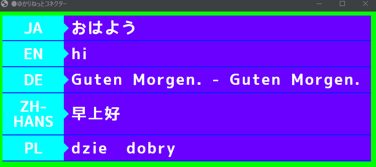

* 設定により、色や言語表示、枠を消すことができます。

<!-- TODO(screenshot): 「シティポップ」「ぷっくりドロップ」「紹介動画テロップ」「テレビ字幕」の字幕画面。images/startup_layout_citypop.png などとして撮影 -->

### シティポップの左のアイコン

「このテンプレート」の「左のアイコン」で、縞の太陽・月・レコード・音符のほか、**好きな文字や画像**も出せます。

* 「文字・絵文字」を選ぶと、「アイコンの文字・絵文字」に書いた文字が出ます（1〜3文字くらいが収まります）。
* 「画像」を選ぶと、「アイコンの画像」に書いた画像が出ます。使えるのは **https で始まる画像のアドレス**か、字幕テンプレートの置き場（Template フォルダ）の直下に作ったフォルダの画像（例：`/myimages/icon.png`）です。
* パソコンの中のファイルの場所（`C:\…`）は配信ソフトから読めないので使えません。

### 紹介動画テロップの要点の色付け

「このテンプレート」の「要点の色付け」が「自動」のときは、確定した文の「」『』【】の中を差し色で塗ります（括弧そのものは隠します）。括弧が無いときは、最後の読点より後ろを塗ります。
「しない」にすると色付けをせず、括弧もそのまま出ます。

## アバター表示対応

話し手の顔（アバター）の画像を一緒に出すレイアウトです。コラボレーションや、ゲームの会話画面のような演出に向いています。

|レイアウト|説明|
|:--|:--|
|カットイン|ゲームの話し手カットインのような字幕です。斜めの赤い帯に顔を大きく出し、白い札に太い斜めの名前、本文は横の黒い板に出します。話し手が替わると帯が横から差し込みます|
|ノベルゲーム|ノベルゲームの会話画面のような字幕です。半透明の会話窓の上に話し手の立ち絵が乗り、名前の札が立ち絵の側に出ます。話し手が替わると立ち絵が入れ替わります|
|パーティチャット|MMORPG のパーティ会話ログ風です。顔・話者の色の輪・名前・吹き出しを1行にして下へ積み、いちばん新しい発言がほのかに光ります|
|RPG ポートレート会話|家庭用 RPG の会話窓のような字幕です。会話窓の横に顔窓、上辺に名前の札が出て、言い終わると右下に ▼ が出ます。枠の型はクラシック（青）／ダーク／セピアから選べます|
|ボイスチャット HUD|Discord やゲームのボイスチャットのような、画面の隅に置く小さなリストです。いちばん新しく話した人の輪が光って脈打ちます。本文を消して「誰が話しているか」だけの表示にもできます|
|トークセッション|顔、名前、文章を並べて出します。話者が２名以上になると枠が増えます。「このテンプレート」の「見た目」で、標準／言語の間を空ける／高さ広め／母国語と翻訳1を左右に分ける を選べます|
|トークセッション(横)|トークセッションを横に並べたものです。「自分の位置」で自分を左右どちらに置くか選べます|

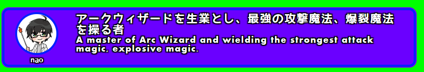

* トークセッションは、「表示時間が過ぎたら枠ごと消す」をオフにすると、発言がなくなっても枠を残し、中の文字だけを消します。
* 保持時間の設定で枠や文字の動作が変わります。保持時間を最大化すると、消去動作をしなくなります。
* 「母国語と翻訳1を左右に分ける」では、翻訳2以降は出ません。

<!-- TODO(screenshot): 「カットイン」「ノベルゲーム」「パーティチャット」「RPG ポートレート会話」「ボイスチャット HUD」の字幕画面（話者画像を置いた状態）。images/startup_layout_avatar.png などとして撮影 -->

### 話し手の画像の置き方

顔の画像は、話者名ごとの PNG ファイルで用意します。

1. 「フォルダの指定」画面の「**話し手のイメージデータ**」で、画像を置くフォルダを選びます。詳しくは [オプション設定](startup_option.md) をご覧ください。
2. そのフォルダに「**話者名.png**」という名前で画像を置きます（例：話者名が「ゆかり」なら `ゆかり.png`）。
3. その人が話すと、字幕にその画像が出ます。

* 顔の部分だけをくり抜いた、**背景が透明な PNG** がおすすめです。
* 画像を置いていない人には、**灰色の人影**の画像が出ます。
* 同じフォルダに `default.png` を置くと、画像を置いていない人にはその画像が出ます。

## ゲーム

ゲームのようなウィンドウに文字が表示されます。

|レイアウト|説明|
|:--|:--|
|ブロックチャット|ブロックで世界を作るサンドボックスゲームのチャット欄のような字幕です。画面の左下に、半透明の黒い帯で1発話ずつ積み上がります。行頭に <名前>、翻訳は黄色や灰色の行で続きます|
|ゲームメッセージ風|RPGゲームっぽく出します。「このテンプレート」で、文末のカーソル（■ の点滅）と、文字が出るたびに鳴る音を付けられます|
|横ならべ（2画面）|画面を左右2つに分け、母国語と翻訳１を並べます。「このテンプレート」で中身（ゲーム風／リスト）と、母国語を置く側（左／右）を選べます|
|MMORPG|オンラインRPGで NPC に話しかけたときの会話字幕です。画面の横幅いっぱいの暗い帯の上に、水色の話者名と白い本文を中央揃えで出します。言い終わると「NEXT ▼」が出て、▼ が小さく弾みます|
|クエストダイアログ|大作オンラインRPGの会話・クエスト受注画面のような字幕です。深い藍の半透明の板に金の罫、話者名は左上の金の銘板に出ます。言い終わると右下に「受注する」「次へ」のボタン風の印が出ます|

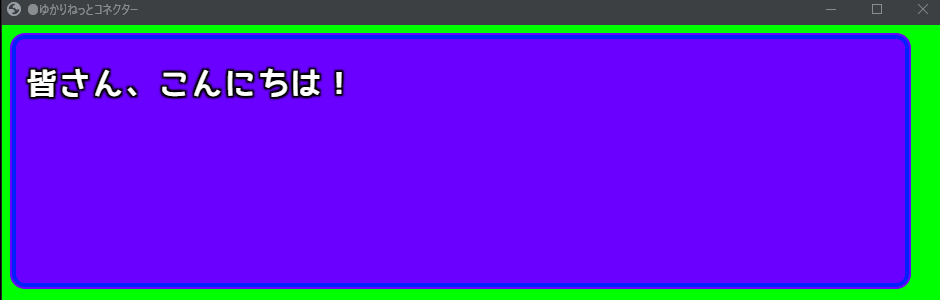

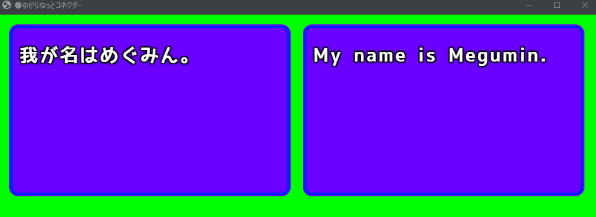

!!! Warning "横ならべは2言語までです"
    「横ならべ（2画面）」は、**母国語＋1言語まで**しか表示できません。3言語以上出したい場合は「多言語」や「リスト」を使ってください。

* 「文字が出るたびに音を鳴らす」の音は、配信ソフト側の音声として出ます。
* MMORPG の「キーの表示」は NEXT／PAUSE／Enter／Space／出さない から選べます。帯を字幕のあいだだけ出したいときは、「テンプレートの枠」を「字幕があるときだけ出す」にします。
* MMORPG で話者名の上に場所の札を出したいときは、追加スタイルシートに `:root { --mmo-place: "場所の名前"; }` と書きます。

<!-- TODO(screenshot): 「ブロックチャット」「MMORPG」「クエストダイアログ」の字幕画面。images/startup_layout_game.png などとして撮影 -->

## １行レイアウト

高さをとらない、1行だけのレイアウトです。画面の上端や下端に置く使い方に向いています。

|レイアウト|説明|
|:--|:--|
|コンベア|文字が流れていきます。「このテンプレート」の「流れる向き」で、横（右から左）と縦（下から上）を切り替えられます|
|新幹線|新幹線の車内にある LED 表示器のような字幕です。黒い盤面に光る点の文字で、日本語は橙・英語は緑。行に収まらない文は右から左へ流れ、文末が見えたところで止まります。左端の札に話者名を赤で出します|

* 新幹線の流れる速さは、「流す速さ」の設定ではなく「このテンプレート」の「流れる速さ」で変えます。

## カウンター連動

話した言葉やコメントを**数えて遊ぶ**ためのテンプレートです。**字幕は出しません。**
決めた言葉が出るたびにゲージがたまったり、敵の HP が減ったりします。

|レイアウト|説明|
|:--|:--|
|風船割り|決めた言葉が出るたびにガラスの球がふくらみ、決めた数で光を散らしてはじけます。数秒後にまた最初から|
|ボス戦|決めた言葉が出るたびに黒い結晶の HP が削れ、0 で砕けて CLEAR。言葉ごとにダメージを決められます（マイナスにすると回復）|
|コンボ|決めた言葉が続けて出るほど数字が伸び、光が段々強くなります。しばらく出ないと途切れます|
|ゲージ|決めた言葉が出るたびにたまるゲージです。横棒・輪・数字から選べます|
|星屑の瓶|決めた言葉が出るたびに光の粒が瓶に積もり、満ちると瓶が灯ります|
|綱引き|2 つの陣営の綱引きです。左右の名前と、それぞれを応援する言葉を決めます（例：いぬ派「いぬ」対 ねこ派「ねこ」）。決めた差がついたら勝ち|
|ワードバトル|出てきたお題と同じ言葉を声で言って敵を倒すゲームです。遊び方は [ワードバトルの遊び方](#word-battle) をご覧ください|

<!-- TODO(screenshot): 「風船割り」「ボス戦」「綱引き」「ワードバトル」の画面と、字幕デザイン画面の「このテンプレート」タブで「数える言葉」の表を編集しているところ。images/startup_layout_counter.png などとして撮影 -->

### 使い方

1. 一覧から使いたいもの（例：風船割り）を選びます。
2. 字幕デザイン画面の「**このテンプレート**」タブの「**数える言葉**」の表に、数えたい言葉と点数を書きます（点数を空にすると 1）。
3. 字幕デザイン画面の一覧から、その項目を **OBS へドラッグ**して、字幕とは別のブラウザソースとして置きます。こうしておけば、あとで字幕のテンプレートを選び直しても数え続けます。

* 数えるのは**確定した文**だけです。1つの文に言葉が何回出たかも数えます。全角・半角、大文字・小文字は区別しません。
* 「誰の言葉を数える」で、みんな／自分の声だけ／自分以外（コメントなど）を選べます。
* 最初に戻す方法は 3 つあります。
    * 決着してから決めた秒数で自動で戻す（「決着から最初に戻すまで」。0 で戻しません）
    * 自分の声で合言葉（既定は「リセット」）を言う。コメントでは戻りません
    * 「数を最初に戻す (切り替えるたび)」のスイッチを切り替える
* 数えた値はブラウザに覚えるので、OBS を開き直しても続きから始まります。

!!! Tip "プラグインがなくても遊べます"
    言葉を数えるだけなら、プラグインは要りません。「このテンプレート」の表に言葉を書くだけで動きます。
    [カウンター・トリガー](../plugin/plugin_countertrigger.md) プラグインのルールで数えた値を使いたいときは、「数え方」を「**プラグインの変数 (上級)**」に切り替えます。

### ワードバトルの遊び方 {#word-battle}

画面に出たお題と同じ言葉を声で言うと、敵を倒せるゲームです。

1. 一覧から「ワードバトル」を選び、OBS へドラッグして字幕とは別のソースとして置きます。
2. 「**スタート**」と言うと始まります（合言葉は「始める合言葉」で変えられます。空にすると、タイトルが出て数秒で始まります）。
3. お題が出たら、制限時間のうちに同じ言葉を言います。音声認識で確定した文字がお題と同じなら敵を倒せます。
4. 時間切れになると HP が減り、0 でゲームオーバーです。倒すと HP が少し戻ります。
5. レベル 10 までクリアすると、おめでとう画面とスコアが出ます。

* 画面の下に、音声認識で入った文字が小さく出ます。言えた文字はお題の上で光ります。
* お題はレベルが上がるほど難しくなります（あいさつ → 単語 → 短い文・同音異義語 → 長い文 → 早口言葉）。
* 時間切れのたびに同じお題がもう一度出ます。「同じお題に挑める回数」を超えると、次のお題へ進みます。
* 「ひらがなとカタカナを同じ文字とみなす」は最初からオンです。
* 「確定を待たずに、話している途中の文字でも倒せる」をオンにすると、言い終わる前でも判定します。

**主な設定（「このテンプレート」タブ）**

|設定|内容|
|:--|:--|
|遊び方|「同じ言葉を言う」か「翻訳で当てる」かを選びます|
|1 問の制限時間|既定は 10 秒です|
|1 レベルのお題の数|既定は 5 問です|
|HP／時間切れで減る HP／倒すと戻る HP|既定は 100／25／10 です|
|スコアの数え方|標準（文字数 × 速さ × 失敗の少なさ × 連続正解。クリアすると残りの HP も点に）か、かんたん（残り秒数 × (10 − そのお題の失敗回数)）|
|お題|組み込み + 自分のお題／組み込みだけ／自分のお題だけ|
|自分のお題|お題を表に1行ずつ書きます（書き方は下を参照）|
|誰の言葉で戦う|既定は「自分の声だけ」です。反応しないときは「みんな」にしてください|
|結果を出しておく時間|過ぎるとタイトルに戻ります（既定 15 秒。0 で戻しません）|

「自分のお題」の書き方

* 右の数は、そのお題を出すレベルです（1〜10。空は 1）。
* 半角の `|` で区切ると、別の書き方も正解になります（例：`行ってきます|いってきます`）。
* 半角の `=` の後ろはヒントです（例：`apple=りんご`）。
* 1 行 40 文字までです。

!!! Tip "翻訳で当てるモード"
    「遊び方」を「**翻訳で当てる**」にすると、**英語のお題**が出ます。お題の意味を自分の言葉（日本語など）で言い、**翻訳の結果にお題の英単語が入っていれば**倒せます。

    * 翻訳先に**英語**を入れておいてください。英語の翻訳が届かないときは、画面でお知らせします。
    * 英語は単語で比べます。a や the などの軽い言葉や、複数形の s は見ません。
    * 「翻訳で当てるとき、お題の下にヒントを出す」をオンにすると、お題の下にヒントが出ます。

!!! Info "UDトークで受けているとき"
    UDトークで受けているときは、設定の話者名と同じ名前の発話だけが「自分の声」になります。反応しないときは「誰の言葉で戦う」を「みんな」にしてください。

## 遊び

演出重視のレイアウトです。

|レイアウト|説明|
|:--|:--|
|確定演出|パチンコの確定演出のような、刺激の強い字幕です。話している間は保留の玉の色で予告し、確定の瞬間に 50 種類の演出（チャンス・熱・激アツ・確定・プレミア）のどれかが出ます|
|電光掲示板|駅の案内表示のように出します|
|自由落下(単語)|言葉が落下して積もります。「このテンプレート」の「落とす単位」で、1文字ずつ／文ごとにまとめて を選べます|
|リリックモーション|確定した発話を1つずつ、文字PV（リリックビデオ）のような動きで見せます|

* 自由落下では、話した言葉の書体・大きさ・文字色・縁取りだけが効きます。翻訳・話者名・言語名・ルビは出ません。
* リリックモーションは、文字・色・配置を演出側が決めます。色の設定で効くのは「枠の背景」だけです。字幕画面のアドレスに `?lang=1` を付けると翻訳1を、`?mode=song` を付けると [歌詞表示支援](../plugin/plugin_LyricAssist.md) の再生に合わせて曲全体を演出します。

### 確定演出の設定

発話ごとに抽選し、「やった」「最高」「!」などの言葉が入ると熱さが上がります。「このテンプレート」タブで次のように変えられます。

|設定|内容|
|:--|:--|
|演出を出す条件|抽選＋言葉／抽選だけ／言葉だけ／毎回|
|演出|おまかせ（抽選）か、50 種類から 1 つに固定|
|熱さの範囲|すべて／チャンス・熱まで／激アツ以上だけ|
|当たりの確率|熱い言葉が無い発話で演出が当たる確率です（既定 35）|
|強さ|控えめ／標準／全開。控えめでは、画面の広い範囲を覆う演出を出しません|
|保留の玉を出す|話している間、玉の色で熱さを予告します|
|演出のみ表示|字幕の文字を隠し、演出と保留の玉だけを出します。別の字幕テンプレートの上に重ねて使うときに|

* 熱い言葉を足すには、追加スタイルシートに `:root { --dp-words: "ナイス,勝ち"; }` のように書きます。
* 字幕画面のアドレスに `?demo=1` を付けると、全部の演出を順に試し見できます。

!!! Warning "光に敏感な視聴者がいる配信では"
    画面の明るさが大きく変わる演出は 1 秒に 2 回までに抑えていますが、刺激の強いテンプレートです。光に敏感な視聴者がいる配信では、「強さ」を「**控えめ**」にしてください。

<!-- TODO(screenshot): 「確定演出」の演出が出た瞬間（例：激アツ・確定）と、「このテンプレート」タブの設定。images/startup_layout_dopamine.png などとして撮影 -->

## リスト

文章が流れて出ていく方式です。たくさん話す方はこちらのほうが視認性を確保できます。

|レイアウト|説明|
|:--|:--|
|海外ドラマ|海外ドラマのような雰囲気で出します|
|海外ドラマ(リスト)|上にスクロールするタイプの海外ドラマ風表示です|
|ときめきレター|平成の手紙交換をイメージした会話のリストです。1発話が1枚のパステルの便箋になり、話者名はラメ入りのピンクの名札。言い終わるとハートのシールが貼られます。柄はギンガムチェック／水玉／罫線から選べます|
|リスト|上にスクロールしながら表示します。「このテンプレート」の「新しい行を上に出す(下へ流す)」をオンにすると、下にスクロールする表示になります|
|ライブCC|米国の生放送の字幕（クローズドキャプション）や同時通訳字幕のような表示です。黒い帯に等幅の白文字、通訳は黄色。新しい行が下から入って上の行を押し上げ、話者が替わると「>> 名前:」が付きます|
|マシュマロ|ぷにっと弾む角丸の吹き出しを縦に積みます。話者ごとに色が変わり、翻訳は吹き出しの下に小さな第2バブルとして出ます。雑談配信やコラボ向き|
|ねこみみ|丸枠の上に耳、横でしっぽが揺れます。話者ごとに色が変わり、確定の瞬間に耳がぴくっと動きます。キャラ性が強いので使える配信は選びます|
|ショート|1行に1文字ずつ流し、行が埋まると左へスクロールします。高さをとらないので、画面のすみに置く使い方に向いています|
|スマート|余計な飾りを省いてシンプルに出していきます|
|スマート v2|話した言葉と翻訳をそれぞれ別の行に、1文字ずつ流します。翻訳が複数あっても同時に流れるので、多言語を並べて見せたいときに向いています|
|付箋|少し傾いた付箋をマスキングテープで貼っていきます。話者ごとに紙の色と傾きが変わり、消えるときはペリっとめくれて剥がれます|

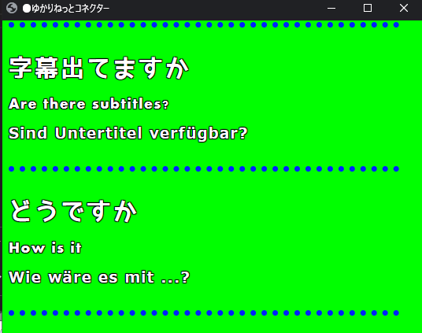

* 文字サイズ、区切り線の有無や色は設定で変更できます。
* 保持時間の設定をすると、過去の文章を消すことができます。
* ショートは、「このテンプレート」の「**動きを控えめにする**」をオンにすると、文字のフェードインを切って字幕を素早く消します。画面の動きが気になるゲーム配信に向いています（以前の「ショート(動き控えめ)」と同じ見せ方です）。

<!-- TODO: 「ショート」（動きを控えめにする オン／オフ）のスクリーンショット未撮影。撮ったら images/startup_layout7.png / startup_layout8.png として置き、この節に追加する -->
<!-- TODO(screenshot): 「ときめきレター」「ライブCC」の字幕画面。images/startup_layout_list2.png などとして撮影 -->

## レトロ

昔のパソコンや携帯電話、掲示板の画面を再現したレイアウトです。

|レイアウト|説明|
|:--|:--|
|匿名掲示板|2000年代の匿名掲示板のスレッドのような会話のリストです。「番号 名前：名前：日時 ID:xxxxxxxx」の見出し行と本文が下へ積もります。名前が無いときは「名無しさん」、ID は話者ごとに同じです|
|コマンドライン|1980〜90年代の、文字だけで操作するパソコンの画面です。黒地の等幅文字で、発話の頭に `C:\名前>` のようなプロンプト、翻訳はその下に出力結果のように出ます。緑・琥珀の端末の色も選べます|
|クラシックデスクトップ|1990年代半ばのパソコンのデスクトップに開く灰色の窓です。立体の縁、タイトルバーに話者名、本文は白いくぼみに黒い文字。言い終わると右下に「OK」が出ます|
|ガラケー|2000年代の折りたたみ携帯電話でメールを読んでいるような会話のリストです。「From: 名前」と本文が下に積もり、受信の瞬間に ✉ が点きます|
|レトロPC|1990年前後のパソコンのアドベンチャーゲームのメッセージ窓です。黒い窓に白の二重線、上辺の札に【話者名】、言い終わると右下で ▼ が点滅します|
|ページャー|1990年代の小さな液晶の呼び出し端末です。1段目が原文、2段目が翻訳で、受信すると液晶のバックライトが一度だけ点きます。筐体はスケルトンの青・桃も選べます|
|ピンストライプ|1990年代後半の明るい灰色の上品な窓です。喋っているあいだは無地のタイトルバー、言い終わると細い横縞に切り替わります|

* 匿名掲示板の番号・日時・ID は、字幕画面が受け取った順と時刻で自動で付きます。「名前が無いときの名前」は「このテンプレート」で変えられます。

<!-- TODO(screenshot): レトロ系 7 本の字幕画面（特に「クラシックデスクトップ」「匿名掲示板」「ガラケー」）。images/startup_layout_retro.png などとして撮影 -->

### クラシックデスクトップの設定

!!! Tech "使用条件"
    * ゆかコネNEO v3.0.6～（タイトルバーのグラデーションの切り替え、枠線の色・太さへの対応）

「このテンプレート」タブで次の設定ができます。

|設定|内容|
|:--|:--|
|タイトルバーの色|濃紺／灰／緑／淡色|
|タイトルバーをグラデーションにする|オフにすると、左端の色一色で塗ります|
|タイトルバーのボタンを出す|右端の小さな立体ボタンです|
|「OK」ボタンを出す|喋っている途中は押せない淡い表示で、言い終わると押せる表示になり、消えるときに押されてから窓が閉じます|
|窓の外にデスクトップの地を敷く|青緑の地で画面全体を塗ります。配信画面に重ねるときはオフのままにしてください|

* 色の設定の「**枠線**」の色を変えると、本文のくぼみの縁がその色一色の線になります（透明にすると縁が消えます）。変えていなければ立体の縁のままです。
* 枠線の太さを変えると、本文の縁の太さもそれに合わせます。**0（なし）にすると縁が消えます。**

## スクロール

|レイアウト|説明|
|:--|:--|
|スマートスクロール2|シンプルに表示し、画面幅を超えたらスクロールします|

## テンプレートごとの設定（このテンプレート） {#template-options}

!!! Tech "使用条件"
    * ゆかコネNEO v3.0～

テンプレートによっては、そのテンプレートだけが持つ設定があります。そうしたテンプレートを選ぶと、字幕デザイン画面に「**このテンプレート**」タブが出ます。

* 設定の値はテンプレートごとに覚えます。字幕プリセットにも入ります。
* 「既定に戻す」で、そのテンプレートの設定を最初の状態に戻せます。
* 設定の形は、スイッチ・選択肢・つまみ・色・文字の入力欄・言葉の表（カウンター連動）などがあります。

<!-- TODO(screenshot): 字幕デザイン画面の「このテンプレート」タブ（例：クラシックデスクトップやシティポップを選んだ状態）。images/startup_layout_options.png などとして撮影 -->

## 追加テンプレート集（ext-pack）

!!! Tech "使用条件"
    * ゆかコネNEO v3.0～（v2.3 にも同名のものがありましたが、v3.0 で全面的に作り直されています）

ゆかコネNEO を入れたフォルダの中の **`ext-pack`** に、演出重視のテンプレートが **40 本**入っています。
使いたいものを取り込むと、レイアウトの一覧に出てきます。

### 入っているもの

| テンプレート | 系統 | 内容 |
|:--|:--|:--|
|オーロラ|自然|幻想的なオーロラのような光のエフェクト|
|コミックバブル|コミック|アメコミ風の吹き出しデザイン|
|サイバーパンクグリッド|SF|サイバーパンク風のグリッドとネオン|
|ファイアテキスト|炎|燃える炎のようなテキスト|
|フローティングバブル|ファンタジー|浮遊する泡のようなメッセージボックス|
|ガラスモーフィズム|モダン|透明感のあるガラス風。ブラーとグラデーション|
|ホログラム|SF|未来的なホログラム風の立体表現|
|アイスクリスタル|氷|氷の結晶のような冷たいエフェクト|
|リキッドメタル|メタル|液体金属のような流動的な反射|
|マトリックス雨|SF|デジタル雨とデコードアニメーション|
|ネオングロー|エフェクト|ネオンサイン風。光る縁取り|
|折り紙フォールド|和風|折り紙が展開するようなアニメーション|
|ペーパーカード|紙のカード風|舞い散る紙のカードのようなメッセージボックス|
|パーティクル爆発|エフェクト|華やかなパーティクル爆発|
|ピクセルアート|ゲーム|レトロゲーム風のドット絵|
|レインボーウェーブ|カラフル|虹色に輝く波打つエフェクト|
|レトロターミナル|レトロ|端末風。スキャンラインとタイプライター効果|
|タイプライター|クラシック|クラシックなタイプライター風のタイピング演出|
|ビンテージTV|レトロ|ブラウン管テレビ風。ノイズとスキャンライン|
|水彩スプラッシュ|アート|水彩絵の具のような滲みエフェクト|
|スマート○○（20 本）|リスト|「スマート」と同じ形で、文字の出かたの演出だけが違うシリーズ。バウンス／クリスタル／エラスティック／フリップ／グリッチ／グロー／グラデーション／ホログラム／リキッド／マトリックス／ネオン／パーティクル／パルス／レインボー／ローテート／スケール／シェイク／スライド／タイプライター／ウェーブ|

### v3.0 での変更

!!! warning "一度でも ext-pack を使ったことがある方へ"
    40 本すべてを作り直し、**3 本を削除**しました。**レイアウトを選び直してください。**

    | 削除されたもの | 理由 |
    |:--|:--|
    |`ListAddTime`|標準テンプレートとフォルダ名まで同じで、起動時の再同期で必ず上書きされていました|
    |`SmartScroll`|同上|
    |`Smart_Vue`|標準の「スマート」と内部 ID が衝突し、レイアウト名の復元が別のテンプレートへ飛んでいました|

**直ったこと**

* 文字サイズ・行間の設定が最初から効かなかった（40 本すべてにありました）
* 翻訳の行に設定が届かなかった（2 言語目以降が未実装でした）
* 認識・翻訳・読み上げまで一緒に止まることがあった
* インターネットにつながっていないと真っ白になった（外部サイトから部品を読んでいました）
* OBS で下のゲーム画面が見えなかった（背景を不透明に塗っていました）
* 使っていなくても CPU を食い続けた（終わらないアニメーションが入っていました）

## テンプレートの配色を取り込む

!!! Tech "使用条件"
    * ゆかコネNEO v3.0～

「字幕デザイン」→「デザイン」→「詳しい調整」→「色」に **「テンプレートの配色を取り込む」** ボタンがあります。

* いま選んでいるテンプレートが持っている配色を、色の設定へ写します
* 工場出荷値からではなく、**そのテンプレートの見た目を出発点にして**色を変えられます
* 文字そのものは変わりません

## わんコメ連携

* わんコメと連携させることで、わんコメが提供しているレイアウトをつかったエンタテインメント字幕を演出することが可能です。

* 以下、わんコメに標準搭載されているテンプレートのサンプルです。

* わんコメには、Pro版とそれ以外があります。Pro版のほうが応答が速く表示されます。

* 使うためには若干の設定が必要です。[設定方法](../plugin/plugin_OCTemplateGen.md) を参照してください。

<!-- TODO: 以下のわんコメテンプレートのスクリーンショットは2022年撮影。わんコメ側のテンプレートも更新されている可能性があるため確認・撮り直しが必要 -->

### audience
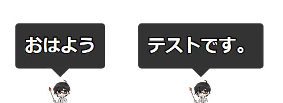

### BASIC
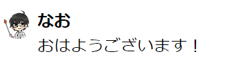

### cheer
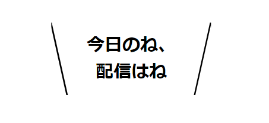

### cool-pop
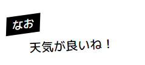

### flipboard
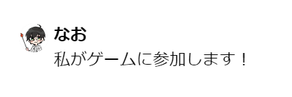

### jugon
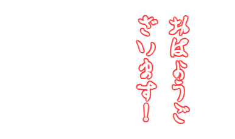

### ktx-quick-starter
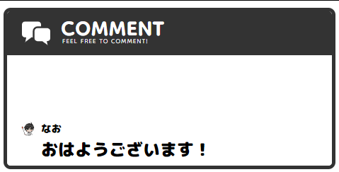

### line / line-right
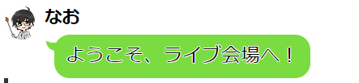

### neon
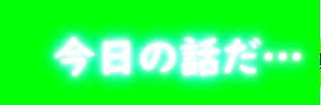

### newsticker
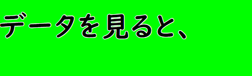

### persona / persona-right
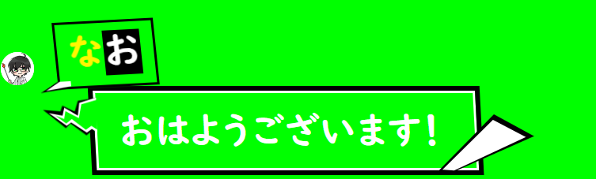

### rpg
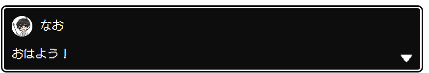

### slim
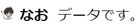

### vertical
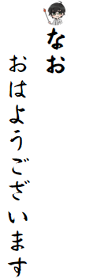

### yurucamp / yurucamp-right
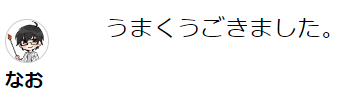

## まとめられたレイアウト {#merged-layouts}

!!! Tech "使用条件"
    * ゆかコネNEO v3.0～

ほとんど同じ見た目のレイアウトは、1 つにまとめて「このテンプレート」の設定で切り替えるようにしました。また、「コラボレーション」「ゲーム(リスト)」「サンプル」「個別カスタマイズ」のカテゴリはなくなりました。
前に下の左側のレイアウトを選んでいた場合は、起動したときに右側のレイアウトへ**自動で切り替わり**、同じ見た目になるように設定も入ります。

|前のレイアウト|いまのレイアウトと設定|
|:--|:--|
|多言語(横)|多言語（並べ方：言語ごとに列）|
|おちつきテロップ(文字送り抑制版)|多言語（並べ方：言語ごとに行）|
|リスト（下スクロール）|リスト（新しい行を上に出す：オン）|
|リスト(多行時間延長あり)／外部連携レイアウト(リスト)／ベーシック|リスト|
|ショート(動き控えめ)|ショート（動きを控えめにする：オン）|
|コンベア縦ロール|コンベア（流れる向き：縦）|
|ゲーム風（カーソルあり）|ゲームメッセージ風（文末にカーソルを出す：オン）|
|ゲーム風（カーソルあり/Beepあり）|ゲームメッセージ風（カーソル・音：オン）|
|RPG バウンス／RPG スムース|ゲームメッセージ風|
|ゲーム風（横ならべ　左：母国語、右：翻訳１）|横ならべ（2画面）（中身：ゲーム風、母国語：左）|
|ゲーム風（横ならべ　左：翻訳１、右：母国語）|横ならべ（2画面）（中身：ゲーム風、母国語：右）|
|リスト（横ならべ　左：母国語、右：翻訳１）|横ならべ（2画面）（中身：リスト、母国語：左）|
|リスト（横ならべ　左：翻訳１、右：母国語）|横ならべ（2画面）（中身：リスト、母国語：右）|
|自由落下(ブロック)|自由落下(単語)（落とす単位：文ごとにまとめて）|
|トークセッション（高さ広め）|トークセッション（見た目：高さ広め）|
|トークセッション（枠は消えないVer）|トークセッション（見た目：言語の間を空ける、枠ごと消す：オフ）|
|トークセッション(母国語・翻訳１　別)|トークセッション（見た目：母国語と翻訳1を左右に分ける）|
|トークセッション(横)　自分：左／右（枠自動消去を含む）|トークセッション(横)（自分の位置・枠ごと消す を設定）|

* 「リスト(多行時間延長あり)」「外部連携レイアウト(リスト)」「ベーシック」「RPG バウンス」「RPG スムース」は、まとめた先の標準の見た目になります。元のレイアウトだけの動き（文字量に応じて消えるまでの時間を延ばす、1文字ずつ跳ねる など）は引き継がれません。

## 廃止されたレイアウト

* 「多言語（縁取りくっきり）」と「リスト（縁取り）」は、一覧から削除されました。選択できません。
* 縁取りをはっきり見せたい場合は、「字幕デザイン」→「デザイン」→ 分類のタブ **「縁取り」**（または「詳しい調整」→「色」）にある縁取りサイズと、縁取り（内側）で調整してください。
* v3.0 では**縁取り（内側）の上限が 4 から 20 に広がりました**。テンプレートが想定している太さが上限で潰れてしまう問題が直っています。
