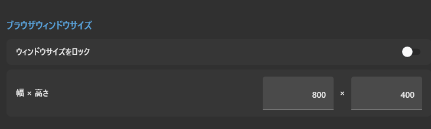
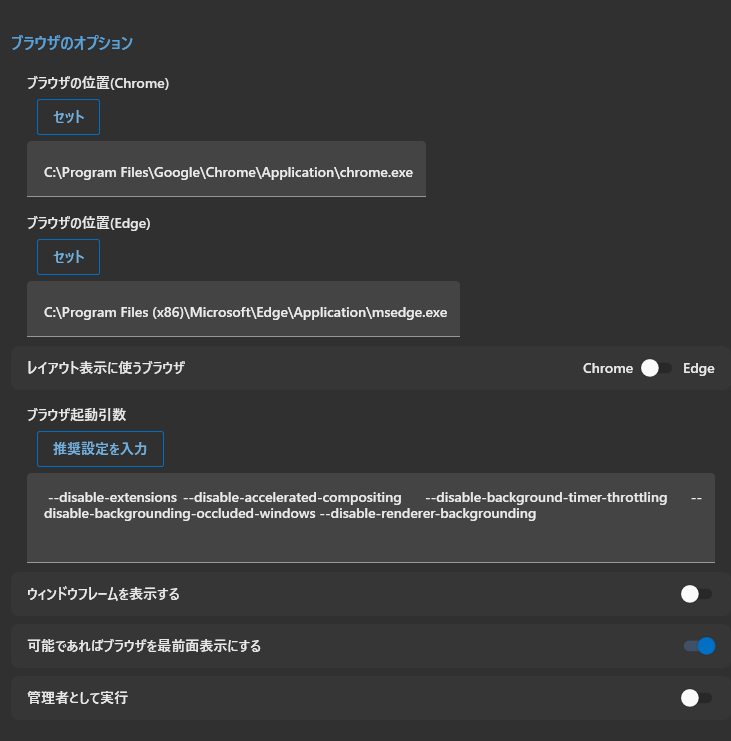
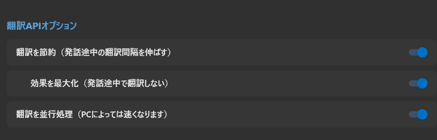
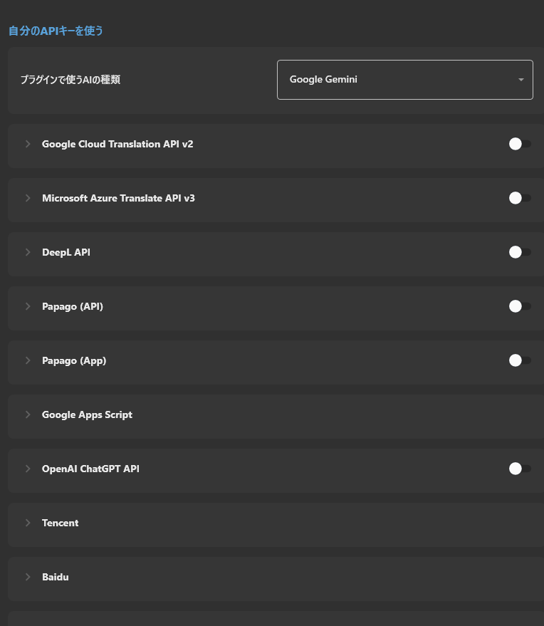
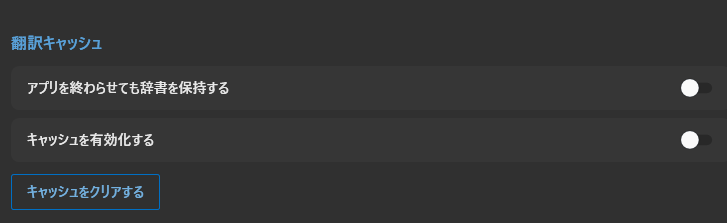
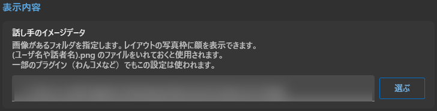
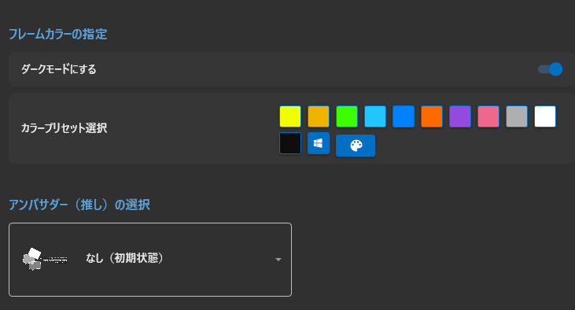
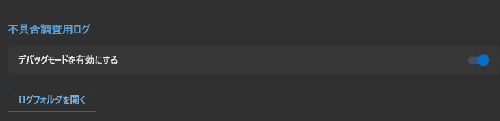

# オプション設定項目

<!-- version-banner -->
!!! info ""
    ゆかコネNEO **v3.0** のドキュメントです。v2.3 をお使いの方は [v2.3 版のこのページ](../../v2.3/startup/startup_option.md) を、違いを知りたい方は [v2.3 から v3.0 への移行](../../mig/mig_neo_v3.0.md) をご覧ください。

オプション設定は、左メニューの**オプション設定**グループにある5つの画面に分かれています。このページも同じ順番で説明します。

!!! tip "項目が見つからないとき"
    左メニューの **「設定をさがす」** に項目名を入れて **Enter** を押すと、その設定まで画面が移動します。
    上のタブの **「ホーム」→「すべての設定」**（左メニューでは先頭の **「全ての設定画面を表示」**）で、すべての項目を 1 画面に並べることもできます。

|画面（左メニューの名前）|上のタブからの開き方|主な内容|
|:--|:--|:--|
|ブラウザと字幕ウィンドウ|「設定」→「ブラウザと字幕ウィンドウ」|字幕表示に使うブラウザとウィンドウサイズ|
|翻訳の細かい設定|「音声と翻訳」→「翻訳の細かい設定」|翻訳の節約設定・翻訳キャッシュ・モデルの保存先と管理|
|APIキーの設定|「音声と翻訳」→「APIキーの設定」|自分のAPIキー・オフライン翻訳（無料）・PLaMo 3 翻訳（オフライン）・利用条件の確認|
|ネットワークの設定|「設定」→「ネットワーク」|通信の許可範囲・使うネットワーク・LAN からの操作に使うトークン・アクセス状況|
|画面と動作|「設定」→「画面と動作」|見た目のテーマ・スタートアップ登録・調査用ログ|

!!! Info "以前の画面名との対応"
    以前の「ブラウザのオプション」は「ブラウザと字幕ウィンドウ」、「翻訳（API、設定）」は「翻訳の細かい設定」と「APIキーの設定」の2画面、「起動時設定」は「画面と動作」になりました。
    「フォルダの指定」の画面は無くなりました。中身の移り先は、下の「フォルダの指定」の節をご覧ください。

## ブラウザと字幕ウィンドウ

### ブラウザウインドウサイズ

* 字幕を表示するウィンドウのサイズを強制的にロックします。
* OBSなどに取り込む際、数字でサイズを決めたい方に向いています。

|項目|意味|既定|
|:--|:--|:--|
|幅|字幕ウィンドウの横幅|800|
|高さ|字幕ウィンドウの高さ|400|
|ウィンドウサイズをロック|指定したサイズに固定します|OFF|

### 表示に使うブラウザの設定

<!-- TODO: スクリーンショットは v2.3.59 時点のもの。項目が増えているため撮り直しが必要 -->

* 字幕を表示するために使うブラウザの動作を変更できます。
* ChromeとEdgeのどちらを使うかを設定できます。（既定はEdge）

|オプション|機能|既定|
|:--------|:---|:--|
|Chrome / Edge|字幕表示に使うブラウザを選びます|Edge|
|ブラウザの位置(Chrome) / (Edge)|ブラウザの実行ファイルの場所です。自動で見つからない場合に指定します|自動|
|ブラウザ引数|ブラウザの動作を切り替えます。 例えば --incognito をいれると、シークレットモードで起動します。 「推奨設定を入力」ボタンで、おすすめの内容を入れられます|—|
|ウィンドウフレームを表示する|字幕ウィンドウに枠とタイトルバーを出します|OFF|
|可能であればブラウザを最前面表示にする|字幕ウィンドウをほかのウィンドウの手前に出します|ON|
|管理者として実行|ブラウザなどを管理者権限で起動します|OFF|

!!! Warning "音声認識に使うブラウザとは別の設定です"
    * ここで選ぶのは**字幕の表示**に使うブラウザです。
    * **音声認識**にChromeとEdgeのどちらを使うかは、「音声入力の設定」画面（上のタブでは「音声と翻訳」→「音声の入れ方」）で選びます。混同しやすいのでご注意ください。

## 翻訳の細かい設定・APIキーの設定

* 「翻訳APIオプション」「翻訳キャッシュ」「モデルの保存先と管理」は **翻訳の細かい設定** の画面にあります。
* 「自分のAPIキーを使う」（各社のキー・オフライン翻訳・Jev など）は **APIキーの設定** の画面にあります。

### 翻訳APIオプション

<!-- TODO: スクリーンショットは v2.3.59 時点のもの。ラベルの文言が変わっているため撮り直しが必要 -->

翻訳に関する動作を変更できます。翻訳エンジンの呼び出し回数を減らして、費用や制限を節約するための設定です。

|オプション|機能|既定|
|:--------|:---|:--|
|翻訳を節約（発話途中の翻訳間隔を伸ばす）|ON：翻訳途中の翻訳間隔を減らします。 OFF: 認識途中でも翻訳を実行します|ON|
|効果を最大化（発話途中で翻訳しない）|ON:文章確定時のみ翻訳します OFF:翻訳途中の翻訳間隔をさらに減らします。|ON|
|翻訳を並行処理（PCによっては速くなります）|複数言語の翻訳を同時に翻訳します。 PCや回線に余力がない場合はチェックを外した方が安定します。|ON|

### 自分のAPIキーを使う

<!-- TODO: スクリーンショットは v2.3.59 時点のもの。モデル選択とParapperのポート欄が増えているため撮り直しが必要 -->

* 自分で契約したAPIキーを使うことができます。
* 使いたい翻訳エンジンが決まったら、当該エンジン提供メーカーと契約を行い、キーを入手してください。
* 入手したキーを設定しチェックをONにすると、指定した翻訳エンジンを個人のAPIキーを用いて動かせるようになります。

エンジンごとに、キー以外の設定もここで行います。

|エンジン|設定できること|
|:--|:--|
|Google|APIキー|
|Microsoft|APIキー、Azureのリージョン（例: japaneast）|
|DeepL|APIキー、用語集ID（「再取得」ボタンで一覧を取り込めます）、翻訳のトーン（初期設定を採用／よりフォーマルに／よりカジュアルに）、翻訳モデル（低遅延／品質を優先）|
|OpenAI|APIキー、使用するモデルの選択|
|Google Gemini|APIキー、使用するモデルの選択（2.5 Flash / 2.5 Flash Lite / 2.5 Pro / 3.1 Pro / 3.1 Flash Lite / 3.5 Flash / 3.5 Flash Lite / 3.6 Flash / 3.7 Flash / 3.8 Flash）|
|Anthropic Claude|APIキー、使用するモデルの選択|
|OpenRouter|APIキー、使用するモデルの選択|
|Grok|APIキー、使用するモデルの選択|
|NAVER Papago|APIキー、クライアントID|
|Tencent|SecretID、SecretKey、リージョン|
|Baidu|APPID、SecretKey|
|Alibaba|APPID、SecretKey|
|PLaMo|APIキー、使用するモデル（既定: plamo-3.0-prime）。利用条件の確認チェック（後述）|
|みらい翻訳|接続先（Host）、APIキー、プロファイル、言語コードの読み替え。利用条件の確認チェック（後述）|
|みんなの自動翻訳＠TexTra|ログインID、API key、API secret、自動翻訳の種類（既定: generalNT）。利用条件の確認チェック（後述）|
|Google Apps Script|公開したスクリプトのURL（[GASの設定](startup_gas.md) を参照）|
|ローカル翻訳|接続先URL、通信の形式（POST(form) / POST(JSON) / OpenAI Format / plamo-2-translate）、モデル名|
|Parapper翻訳|ポート番号（後述）|
|オフライン翻訳（無料）|キーは不要。ライセンスの確認チェック、ダウンロードの状態、保存先（後述）|
|PLaMo 3 翻訳（オフライン）|キーは不要。ライセンスの確認チェック、モデルの大きさ（0.8B / 2B）、ダウンロードの状態、保存先（後述）|
|Jev (TypeSafe)|APIキー、使用するモデル（既定: jev-latest）。翻訳には使いません（後述）|

!!! warning "廃止されたモデルを選んでいた場合"
    提供が終わったモデルを選んでいると、翻訳時に 404 になります。
    ゆかコネNEO は起動時に**自動で近いモデルへ読み替えます**が、
    読み替えたときはお知らせが出るので、意図と違っていれば選び直してください。

!!! Info "v2.3 から移行した方へ"
    * **Gemini Flash Lite** は、選択肢の名前は同じまま、実際に呼ぶモデルが
      2.5 Flash Lite → 3.5 Flash Lite に変わっています。
    * **Alibaba 翻訳**は v2.3 では中身が動いていませんでした。v3.0 で実際に呼び出すようになったので、
      SecretId / SecretKey を入れていないと翻訳されません。
    * **Claude / OpenRouter** は、v2.3 初期の既定値の取り違えで API キー欄にモデル名が入っていることがあります。
      「v2.3設定を移行」が自動で直します。

### プラグインで使うAIの種類

* プラグイン（AIアシスタントなど）が使うAIを選びます。
* 選択肢は OpenAI ChatGPT-API / Claude API / OpenAPI / Google Gemini / Browser内蔵LLM(無料) です。
* ここで選んだAIのAPIキーが、上の「自分のAPIキーを使う」で設定されている必要があります。

### Parapper翻訳

!!! Tech "使用条件"
    * ゆかコネNEO v2.3.128～

* Parapper は、お使いのPCの中で動くローカル翻訳です。APIキーの契約は不要で、翻訳の通信が外に出ません。
* 設定欄は「自分のAPIキーを使う」グループのいちばん下にあります。
* 接続先・通信の形式・モデル名は自動で決まるため、**設定するのはポート番号だけ**です。

|設定|意味|
|:--|:---|
|Port|Parapper が待ち受けているポート番号です。既定は ``18081`` （1～65535）|

* 数字でない値や範囲外の値を入れた場合は、いまの値をそのまま保持します。
* 設定したら、翻訳エンジンの一覧から ``Parapper翻訳`` を選ぶと使えるようになります。

!!! Info "Parapper 本体を起動しておいてください"
    * ゆかコネNEO側は、すでに動いている Parapper へ接続しにいくだけです。
    * Parapper が起動していない、またはポートが違う場合は翻訳されません。

### PLaMo翻訳・みらい翻訳・みんなの自動翻訳＠TexTra { #user-key-engines }

!!! Tech "使用条件"
    * ゆかコネNEO v3.0.0 beta 37～

* どれも**自分で用意したAPIキー**で使う翻訳エンジンです。キーは各サービスと自分で契約して入手してください。
* 設定欄は「自分のAPIキーを使う」グループの中、Grok の下にあります。上のタブでは **「音声と翻訳」→「APIキーの設定」** から開けます。
* 各欄の見出しの下に、そのサービスの**利用条件**が表示されます。読んで当てはまることを確かめたら、**確認のチェックを ON** にしてください。
* チェックが OFF のあいだは、選んであっても翻訳を送りません（ほかのエンジンでの翻訳に回ります）。

#### 一覧から選んだときの同意 { #engine-terms-consent }

!!! Tech "使用条件"
    * ゆかコネNEO v3.0.1～（それより前は、チェックを ON にするまで一覧で灰色になり選べませんでした）

* PLaMo翻訳・みらい翻訳・みんなの自動翻訳＠TexTra・オフライン翻訳（無料）・PLaMo 3 翻訳（オフライン）は、**翻訳エンジンの一覧からいつでも選べます**。
* 選んだときに **「（エンジン名） の利用条件」** の画面が出ます。内容を読んで、使う場合は **「同意して使う」** を押してください。上の確認のチェックも自動で ON になります。
* **「使わない」** を押すと、そのエンジンは使わず、オフライン翻訳（無料）と PLaMo 3 翻訳（オフライン）は「共用翻訳(m2m100/無料)」に、ほかのエンジンは「翻訳しない」に切り替わり、画面の下にお知らせが出ます。
* 同意したあとでも、APIキーや接続先が入っていないエンジンは翻訳されません。そのときは画面の下に「（エンジン名） の API キーが入っていないため、このままでは翻訳されません。」などのお知らせが出ます。**「設定を開く」** を押すと「APIキーの設定」画面へ移れます。

!!! Info "外部ツール（API）から切り替える場合"
    API ではこの同意の画面を出せません。外部ツールからこれらのエンジンに切り替えたいときは、先に一度画面で選んで同意しておいてください。
    同意していないと切り替わらず、エラーが返ります（[本体内蔵API](../tech/tech_api_neo.md#api-change-translate-view) を参照）。

!!! warning "利用条件はサービスごとに大きく違います"
    下の表は 2026年10月時点の各社の規約から、配信で使うときに関係するところを抜き出したものです。
    使う前に、必ず各サービスの規約そのものを確認してください。

|エンジン|主な利用条件|
|:--|:--|
|PLaMo（Preferred Networks）|登録できるのは **18歳以上で日本国内の居住者（または法人）**。APIキーの共有は禁止。無償枠では入力がモデルの開発に使われることがある。**政治活動での利用は PFN の許諾が必要**|
|みらい翻訳|APIキーの使い道は**契約プランで決まります**（ワード数定額プランは翻訳支援ツール専用、ほかは別途の特約による）。**配信の字幕に使えるかは、みらい翻訳に確認してください**。APIキーの共有は禁止。利用は日本国内が原則|
|みんなの自動翻訳＠TexTra（NICT）|**非商用での利用に限られます**。広告・投げ銭・企業案件などで収益を得る配信は商用にあたるおそれがあり、個人向けの商用契約はありません。送った文は NICT のサーバに記録され、研究に使われることがあるため、**個人情報や視聴者のコメントは送らないでください**。翻訳結果には「Powered by NICT」の表示が必要です|

#### PLaMo翻訳

|設定|意味|
|:--|:---|
|Key|PLaMo の APIキー（[PLaMo API](https://plamo.preferredai.jp/) で発行）。入力は伏せ字で表示されます|
|Model|使うモデル。既定は ``plamo-3.0-prime``（一覧にない名前を直接入れることもできます）|

* 「やさしい日本語」「ひらがな」などの特別な翻訳先にも対応しています。

#### みらい翻訳

|設定|意味|
|:--|:---|
|Host|接続先のサーバ名（例: ``xxxx.miraitranslate.com``）。``https://`` 付きで貼っても受け付けます|
|Key|APIキー（X-Subscription-Key）。入力は伏せ字で表示されます|
|Profile|プロファイル。空欄なら ``default``|
|Lang map|言語コードの読み替え。言語コードが違うときだけ ``元=先`` をカンマ区切りで書きます（例: ``zh-CN=zh, zh-TW=zh-TW``）|

* 接続先・プロファイル・言語コードは、契約時にみらい翻訳から届く「サーバ接続情報」に書かれています。
* みらい翻訳は原文の言語の指定が必須です。話した言語が判定できないときは、母国語として送ります。

#### みんなの自動翻訳＠TexTra

|設定|意味|
|:--|:---|
|Login ID|みんなの自動翻訳＠TexTra のログインID|
|Key（API key）|API key。入力は伏せ字で表示されます|
|API secret|API secret。入力は伏せ字で表示されます|
|Engine|使う自動翻訳の種類。既定は ``generalNT``（汎用NT）|

* ログインID・API key・API secret は、[みんなの自動翻訳＠TexTra](https://mt-auto-minhon-mlt.ucri.jgn-x.jp/) のアカウントで発行されます。
* 確認のチェックの上に、NICT の「利用者向け制限事項」と「免責事項」が表示されます。チェックを ON にすると、これに同意したことになります。
* 汎用NT が対応していない言語の組では翻訳されません。

### オフライン翻訳（無料） { #offline-translation }

!!! Tech "使用条件"
    * ゆかコネNEO v3.0.0～

* お使いのPCの中で動く翻訳です。**翻訳の料金はかからず、翻訳する文がPCの外に出ません**。APIキーの契約も要りません。
* 翻訳エンジンの一覧では **「── 無料ですぐ使える ──」** の中にあります（「ブラウザ翻訳」の次）。
* 初めて使うときに、翻訳する言語に合ったモデルをインターネットからダウンロードします。

|翻訳する言語|使うモデル|大きさ|
|:--|:--|:--|
|英語⇔日本語|LFM2-350M-ENJP-MT（LFM Open License v1.0。年間売上 1000万米ドル未満の個人・団体は商用利用可）|約 229MB|
|それ以外の言語|Gemma 4 E2B（Apache 2.0）|約 2.8GB|

#### 使い方

1. 上のタブの **「音声と翻訳」→「翻訳する言語」** で、翻訳エンジンに **「オフライン翻訳（無料）」** を選びます。
2. **「オフライン翻訳（無料） の利用条件」** の画面が出るので、内容を確かめて **「同意して使う」** を押します。
3. 「適用」を押すと、裏でモデルのダウンロードと起動が始まります。

* 設定欄は **「APIキーの設定」** 画面の「自分のAPIキーを使う」グループの中、Parapper翻訳の下にあります。ここでも同意のチェック（「上のモデルのライセンスを確認し、ダウンロードに同意します。」）を ON / OFF できます。**チェックが OFF のあいだは、ダウンロードも翻訳もしません。**
* 欄の下には、ダウンロード先と、実行環境・英日モデル(229MB)・多言語モデル(2.8GB) がそれぞれ「あり」か「なし(使うときにダウンロード)」かが表示されます。
* **「フォルダを開く」** でダウンロード先のフォルダを開けます。**「保存先と管理…」** で保存先を変えたり、ダウンロード済みのモデルを消したりできます（下の「[モデルの保存先と管理](#model-storage)」を参照）。

<!-- TODO(screenshot): 「APIキーの設定」画面のオフライン翻訳（無料）の欄（注意書き・同意チェック・状態表示・「フォルダを開く」「保存先と管理…」ボタン） -->

#### ダウンロードの進み具合

* ダウンロードや読み込みのあいだは、画面の下のステータスバーに「オフライン翻訳 56%・残り約 20 秒」のように進み具合が出ます。終わると消えます。
* マウスを乗せると「（モデル名） をダウンロード中 2%(67/2709MB)・残り約 5 分」のように詳しく出ます。モデルの起動中は「読み込み中…」と出ます。
* 準備ができると「オフライン翻訳モデル （モデル名） の準備ができました」とお知らせが出ます。

!!! Info "準備が済むまでは、ほかのエンジンで訳します"
    * ダウンロードと起動が終わるまで、翻訳は止まらず**ほかの翻訳エンジンで**訳します。
    * 多言語モデルは約 2.8GB あるので、回線によっては時間がかかります。配信の前に一度選んで、準備を済ませておくと安心です。
    * ダウンロードが途中で切れても、次は続きから取り直します。

!!! Tip "PCへの負担について"
    * GPU は使わず、CPU だけで動きます。ほかのアプリの邪魔をしないよう、優先度を下げて動かします。
    * どの翻訳欄でもオフライン翻訳を選んでいないときは、止まっています。

### PLaMo 3 翻訳（オフライン） { #plamo3-translation }

!!! Tech "使用条件"
    * ゆかコネNEO v3.0.17～

* Preferred Networks の翻訳モデル **PLaMo 3 Translate** を、お使いのPCの中で動かす翻訳です。**翻訳の料金はかからず、翻訳する文がPCの外に出ません**。APIキーも要りません。
* 翻訳エンジンの一覧では **「── 無料ですぐ使える ──」** の中、「オフライン翻訳（無料）」の次にあります。
* 「オフライン翻訳（無料）」とは**別のエンジン**です。同意もモデルも別に持ち、片方を使うのをやめても、もう片方は止まりません。
* API キーで使う「PLaMo翻訳」（[上の節](#user-key-engines)）とも別のエンジンです。

#### モデルの大きさ

設定欄の **「モデルの大きさ」** で選びます。初めて使うときに、選んだほうを Hugging Face からダウンロードします。

|選択肢|大きさ|向いている使い方|
|:--|:--|:--|
|0.8B(軽い・約 573MB・メモリ約 0.9GB)|約 573MB|既定です。ふつうはこちら|
|2B(訳がよい・約 1.8GB・メモリ約 3GB・CPU の負担が大きい)|約 1.8GB|訳の質を上げたいとき。PCに余裕があるときに|

* 大きさを替えても、もう一方のダウンロードが途中なら、それは最後まで続きます。

#### 使い方

1. 上のタブの **「音声と翻訳」→「翻訳する言語」** で、翻訳エンジンに **「PLaMo 3 翻訳（オフライン）」** を選びます。
2. **「PLaMo 3 翻訳（オフライン） の利用条件」** の画面が出るので、内容を確かめて **「同意して使う」** を押します。
3. 「適用」を押すと、裏でモデルのダウンロードと起動が始まります。準備が済むまでは、**ほかの翻訳エンジンで**訳します。

* 設定欄は **「APIキーの設定」** 画面の「自分のAPIキーを使う」グループの中、オフライン翻訳（無料）の下にあります。同意のチェック（「PLaMo Community License の本文を確認し、同意します。」）が **OFF のあいだは、ダウンロードも翻訳もしません**。
* 欄の下に、ダウンロード先と、0.8B モデル・2B モデルがそれぞれ「あり」か「なし(使うときにダウンロード)」かが表示されます。**「フォルダを開く」** と **「保存先と管理…」** は、オフライン翻訳（無料）と同じです（[モデルの保存先と管理](#model-storage)）。
* ダウンロードや読み込みの進み具合は、オフライン翻訳と同じく画面の下のステータスバーに出ます。
* CPU だけで、優先度を下げて動かします。

<!-- TODO(screenshot): 「APIキーの設定」画面の PLaMo 3 翻訳（オフライン）の欄（説明・ライセンス本文のリンク・同意チェック・モデルの大きさ・「保存先と管理…」「フォルダを開く」・状態表示） -->

#### 訳せる言語

* 日本語・英語・中国語（簡体字／繁体字）・韓国語など **53 言語** と、**やさしい日本語** へ訳せます。
* 原文の言語はモデルが見分けます（訳先だけを伝えます）。
* **ポルトガル語・トルコ語・ウクライナ語など、PLaMo 3 が訳せない言語**や、「ひらがな」などの特別な翻訳先は、ほかの翻訳エンジンで訳します。

!!! Info "ライセンスについて"
    * モデルには **PLaMo Community License** が適用されます。利用の条件は、設定欄や利用条件の画面のリンクから、**ライセンスの本文**で確かめてください。
    * 条件は変わることがあるため、このページでは条件の中身を説明しません。

### Jev { #jev }

!!! Tech "使用条件"
    * ゆかコネNEO v3.0.0 beta 24～

* Jev (TypeSafe) は、文章を作らずに、問いへの答えを数値（点数や選択肢）で返す**判定専用の AI** です。
* 翻訳には使いません。いまは [読み上げ連携](../plugin/plugin_playvoice.md) の「パラメータを Jev に調整させる」が使います。
* 設定欄は「自分のAPIキーを使う」グループのいちばん下、PLaMo 3 翻訳（オフライン）の下にあります。

|設定|意味|
|:--|:---|
|API Key|Jev の API キー。入力は伏せ字で表示されます|
|MODEL|使うモデル。既定は ``jev-latest``（一覧にない名前を直接入れることもできます）|

!!! Info "キーはプラグインへ渡りません"
    * キーは本体だけが持ち、暗号化して保存します。
    * プラグインは本体に判定を頼むだけで、キーそのものは受け取りません。プラグインの設定画面にキーを入れる欄が無いのはこのためです。

### 翻訳キャッシュ

|オプション|機能|
|:--------|:---|
|キャッシュを有効化|以前の翻訳結果を記憶し、同じ文を翻訳するときに前回の結果を活用します|
|アプリを終わらせても辞書を保持|アプリ再起動しても前回の翻訳結果を活用します|
|キャッシュをクリア|記憶したデータをクリアします。|

### モデルの保存先と管理 { #model-storage }

!!! Tech "使用条件"
    * ゆかコネNEO v3.0.1～

* オフライン翻訳・PLaMo 3 翻訳（オフライン）・オフライン音声認識・句読点のAIモデル・GPU高速化パック・読み上げの Irodori-TTS は、使うときにモデルをダウンロードします。合わせると数 GB になるため、**C: ドライブではなく別のドライブに置く**ことができます。
* ダウンロード済みのモデルの一覧を見て、**要らないものを削除**することもできます。

#### 開き方

次の3か所のどこからでも、同じ **「モデルの保存先と管理」** の画面が開きます。

* **「翻訳の細かい設定」** 画面の「モデルの保存先と管理」→ **「保存先と管理…」**（今の保存先もここに表示されます）
* **「APIキーの設定」** 画面のオフライン翻訳（無料）・PLaMo 3 翻訳（オフライン）の欄 → **「保存先と管理…」**
* **「音声入力の設定」**（上のタブでは「音声と翻訳」→「音声の入れ方」）で「オフライン認識」を選んだときの右の欄 →「モデルの保存先と管理」→ **「保存先と管理…」**

<!-- TODO(screenshot): 「モデルの保存先と管理」画面（上に保存先と「変更…」「既定に戻す」、下に「ダウンロード済みのモデル」の一覧が置き場所ごとに並んでいるところ） -->

#### 保存先を変える

1. 画面の上の「保存先」の **「変更…」** を押し、保存先にするフォルダを選びます。選んだフォルダの中に ``YukarinetteConnector`` フォルダが作られ、そこに置かれます。
2. 確認が出たら「はい」を押します。
3. **「既定に戻す」** で、最初の場所（既定の場所）に戻せます。

* 保存先を変えても、**今あるモデルはそのまま使えます**（ダウンロードし直しません）。新しく取得するモデルから、選んだ場所に置かれます。
* 今あるモデルも移したいときは、一覧の行の **「保存先へ移す」** を押してください。

!!! Warning "選べない・注意が出るフォルダ"
    * 書き込めないフォルダや、ゆかコネNEO のフォルダの中は選べません。
    * ネットワークのドライブ・取り外せるドライブを選ぶと注意が出ます。つながっていない（外している）あいだは、オフライン翻訳・オフライン認識が使えません。
    * FAT32 のドライブには 4GB を超えるファイルを置けません。
    * 保存先のドライブが見つからないときは、C: へ勝手に取りに行かず、**新しいモデルのダウンロードを止めます**。外付けドライブをつなぐか、保存先を変えてください。

#### ダウンロード済みのモデルを消す・移す

* 「ダウンロード済みのモデル」の一覧は、**保存先・既定の場所・以前の保存先** の置き場所ごとにまとめて並びます。種類（オフライン翻訳・翻訳の実行環境・オフライン認識・GPU高速化パック・読み上げ・句読点の復元）と大きさ、合計が表示されます。PLaMo 3 翻訳のモデルは「オフライン翻訳」の種類で並びます。
* 行ごとに **「削除」** と **「保存先へ移す」** のボタンがあります。**「再読み込み」** で一覧を読み直せます。
* 次のような行には説明が付きます。消してよいかの目安にしてください。

|説明|意味|
|:--|:--|
|ダウンロードの途中で止まったファイルです|使われていないので削除できます|
|保存先にも同じものがあるので、こちらは使われていません|削除できます|
|以前の保存先にあります。もう使われていません|保存先へ移すか、削除してください|

!!! Info "削除・移動するときの注意"
    * 今の翻訳の設定で使っているモデルを消すと、次に翻訳するときにまたダウンロードされます。
    * **オフライン認識の画面が開いているあいだは、認識のモデルを削除・移動できません。** オフライン認識の画面を閉じてからやり直してください。
    * 読み上げの Irodori-TTS のモデルを消すと、次に Irodori の声で読み上げるときにもう一度ダウンロードします（数 GB）。作ったキャラクターの声は消えません。動いている Irodori-TTS のサーバーは、止めてから消します。

## ネットワークの設定

* ゆかコネNEOの通信に関する設定です。
* 外部ツールとの連携がうまくいかないときや、ほかのパソコンから字幕を見たいときに触ります。

|オプション|機能|既定|
|:--------|:---|:--|
|同時通信量を節約する|同時に行う通信を減らします。回線が細い環境で安定させたいときに使います|OFF|
|すべてのIPアドレスを有効にする(管理者として起動が必要）|ほかのパソコンやスマホからの接続を受け付けます|OFF|
|使うネットワークの指定|パソコンに複数のネットワークがある場合、どれを使うか選びます|自動|

### API・Webサーバ設定

|オプション|機能|
|:--------|:---|
|Web許可ホスト|接続を許可するアドレス・ホスト名・ページを、1行に1つずつ書きます|
|LAN からの操作に使うトークン|別のPC（LAN）から字幕を送ったり設定を変えたりするときに要る合言葉です。「コピー」で写し、「作り直す」で新しくします（後述）|
|アクセス状況|字幕の受け口に来た要求の許可・拒否と理由を、直近 20 件まで表示します（後述）|
|使える通信ポートを自動で選びます|ポートが使われていた場合に別のポートを自動で探します（既定ON）|

!!! Warning "「すべてのIPアドレスを有効にする」について"
    * このチェックをONにすると、同じネットワークにいるほかの端末から接続できるようになります。ネットカフェや共有Wi-Fiなど、信頼できないネットワークではONにしないでください。
    * ONにしても、**管理者としてゆかコネNEOを起動していない場合は有効になりません**（同じパソコンの中だけの通信に戻ります）。
    * 許可されるのは、同じパソコン・プライベートIPアドレス（``10.`` ``192.168.`` ``172.16``～``172.31`` で始まるもの）・Web許可ホストに書いたアドレスです。
    * ほかの端末から**字幕を送る・設定を変える**には、下の「LAN からの操作に使うトークン」が要ります。字幕テンプレートを表示するだけなら要りません。
    * 詳しくは [本体内蔵API](../tech/tech_api_neo.md#access-control) の「アクセス制御について」をご覧ください。

### LAN からの操作に使うトークン { #lan-token }

!!! Tech "使用条件"
    * ゆかコネNEO v3.0.8～

* 別のPC（LAN）から、ゆかコネNEO に字幕を送ったり設定を変えたりするときに要る合言葉です。最初から自動で作られています。
* **「コピー」** で写して、送る側のツールに設定してください。トークンは画面には表示しません（配信に映らないようにするため）。
* 送る側では、ヘッダー ``X-YNC-Token`` か、URL の ``?token=…`` で付けます。
* **「作り直す」** を押すと新しいトークンになり、今のトークンは使えなくなります。別のPC側も新しいトークンに変えてください。
* **この PC の道具（Stream Deck・自作スクリプトなど）や、ゆかコネNEO が配るページからは要りません。** 知らない Web ページからの操作は、トークンが無ければ断ります。
* この PC を独自の名前（Tailscale・hosts の別名など）で開くときは、その名前を「Web許可ホスト」に書いてください。書いていない名前で来た要求は断ります。

### アクセス状況 { #access-log }

!!! Tech "使用条件"
    * ゆかコネNEO v3.0.9～

* 字幕の受け口（HTTP・WebSocket）に来た要求を、**直近 20 件まで**表示します。「別のPCから字幕が送れない」「OBS に字幕が出ない」ときに、断られていないかを確かめられます。
* 表示されるのは、**断ったものすべて**と、**LAN から来て許したもの**です。この PC の配信ソフトの読み込みは出しません（WebSocket で受け取るだけの接続は、この PC からでも出します）。
* 1行の形は ``時刻 ： 名前 (IP) ： 結果 (理由)`` です。同じ相手の同じ結果が 1 分以上空かずに続くあいだは、1 行にまとめます。
* **「消す」** で表示を空にできます。

|結果|意味|
|:--|:--|
|許可|受け付けました|
|拒否|断りました|
|制限|つなぎましたが、受け取るだけにしました（送られてきたものは使いません）|

|理由|意味|
|:--|:--|
|許可していない IP|許可していない IP アドレスから来ました（「すべてのIPアドレスを有効にする」や Web許可ホストを確認）|
|許可していないホスト名|Web許可ホストに書いていない名前で来ました|
|知らない Web ページから|信頼できないページからの操作だったので断りました|
|トークンなし / トークン違い|LAN からの操作に、トークンが付いていない・違っていました|
|読み取り / 書き込み / 書き込み・トークンあり|許可した要求の種類です|
|受け取りのみ|WebSocket を、字幕を受け取るだけの接続にしました。LAN から送るにはトークン（``?token=``）が要ります|

!!! Warning "配信に映さないでください"
    アクセス状況には、LAN の機器の名前と IP アドレスが表示されます。

<!-- TODO(screenshot): 「ネットワークの設定」画面の API/Webサーバ設定（Web許可ホスト・LAN からの操作に使うトークンの「コピー」「作り直す」・アクセス状況の一覧）。IP や機器名はぼかすこと -->

!!! Info "「使える通信ポートを自動で選びます」について"
    * OFFにすると、通信ポートが ``11900`` / ``11901`` に固定されます。外部ツールとの連携でポート番号を固定したいときに使います。
    * ONのままでも、実際に使われている番号はレジストリから取得できます。詳しくは [本体内蔵API](../tech/tech_api_neo.md) の「通信ポートについて」をご覧ください。

## フォルダの指定 { #folders }

* 外部のファイルやツールの場所を指定します。
* 以前の「フォルダの指定」の画面は無くなり、項目は次の場所に移りました。左メニューの「設定をさがす」で項目名を入れても移動できます。

|項目|今の場所|
|:--|:--|
|話し手のイメージデータ|字幕デザインの「表示内容」|
|Whisper・ゆーかねすぴれこ・Parapper の場所|「音声入力の設定」で、それぞれの入れ方を選んだときの右の欄|
|自動バックアップ|「ホーム」→「すべての設定」の中|

### 話し手のイメージデータ { #talker-image }

* トークセッションなど、話し手の絵を使うシチュエーションで読み込まれる絵を置きます。
* ファイル名は、``（話者名）.png `` にします。
* ファイルサイズは、``100 x 100`` 程度の正方形にします。 

### 外部の音声認識ツールの場所

* 音声認識に外部ツールを選んだ場合は、その場所をここで指定します。

|項目|意味|既定|
|:--|:--|:--|
|Whisperの実行ファイル|Whisperを起動するバッチファイルの場所|—|
|ゆーかねすぴれこ|ランチャーで作ったバッチファイルの場所|—|
|Parapper がある場所|Parapperをインストールしたフォルダ|``C:\Program Files\Parapper``|

!!! Info "Parapper の2つの設定について"
    * ここで指定するのは**音声認識**に使う Parapper の場所です。
    * **翻訳**に使う Parapper のポート番号は「APIキーの設定」画面にあります。別の設定です。

### 自動バックアップ

* 設定を自動的にバックアップします。設定がおかしくなったときに戻せるようになります。

|項目|意味|既定|
|:--|:--|:--|
|バックアップ機能を有効にする|設定の自動バックアップを行います|ON|
|保存先|バックアップを置くフォルダ|既定の設定フォルダ内|

* 復元は「設定保存・復元」画面の「バックアップから復元」で行います。詳しくは [設定の保存・復元とプロファイル](startup_profile.md) をご覧ください。

## 画面と動作

### アンバサダーの設定

* ゆかコネのアンバサダーと公式担当が合計１０名います。
* こちらを設定することで推し設定することができます。

!!! Tip "推し設定について"
    この設定をしても、ゆかコネNEOのメイン動作は何も変わりません。
    見た目がちょっと変わって、Happyになれるという機能です。

### 画面の見た目

|オプション|機能|既定|
|:--------|:---|:--|
|ダークモードにする|ゆかコネNEOの画面を暗い配色にします|ON|
|フレームカラーの指定|画面のアクセントカラーを選びます。プリセット11色・Windows のアクセントカラーに合わせる（窓の印のボタン）・自分で色を作る、から選べます。Windows に合わせると、あとで Windows 側の色を変えたときも追いかけます|Windows のアクセントカラーに合わせる（v3.0.0 beta 37～。それより前に自分で色を選んでいた方はその色のまま）|
|UIの点滅効果を止める|画面のアニメーションや点滅を止めます。目が疲れる場合や、画面を録画する場合に使います|OFF|

### オプション

|オプション|機能|既定|
|:--------|:---|:--|
|前回のミュート状態を記憶する|音声認識のミュートボタンを再起動しても保持します|ON|
|システムメッセージをOFFにする|「設定を変更しました」を表示しないようにします|OFF|

### スタートアップ登録

|オプション|機能|
|:--------|:---|
|スタートアップ登録を実行|パソコンを起動したときにゆかコネNEOを自動で立ち上げます|
|スタートアップ登録を解除|自動起動をやめます|

* 登録すると、最小化＋常駐の状態で立ち上がります。
* 手動で登録したい場合は、起動オプション ``/startup`` を使います。詳しくは [起動オプション](../tech/tech_option_neo.md) をご覧ください。

### 不具合調査用ログ

* 不具合が発生しているときに、解析を支援するためのデータを得られます。

|オプション|機能|
|:--------|:---|
|デバッグモードを有効にする|内部動作を解析するデータをログに出力するようになります|
|ログフォルダを開く|ログがある場所を開きます|

* 毎回ONにするのが面倒な場合は、起動オプション ``/log`` が使えます。
* 画面の下には、直近に起きたエラーの内容も表示されます。
